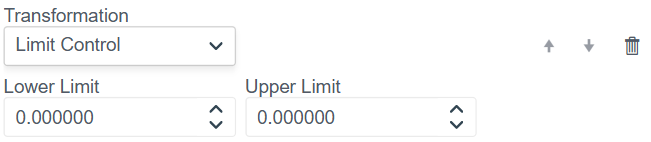
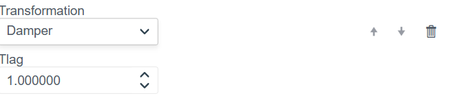
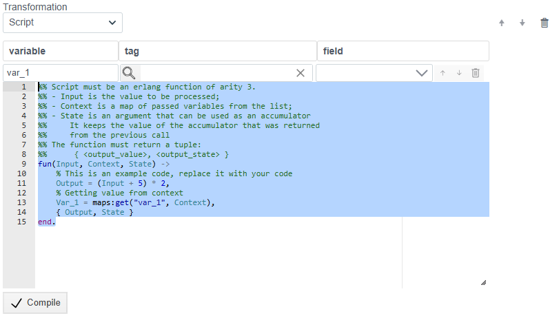
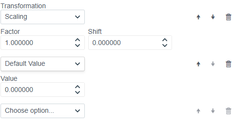

# Transformation feature setup

> See also: [PLC Connections overview](./general_en.md)

This document describes the preprocessing (transformation) features for bindings. The module lets you modify, limit, or mathematically process incoming values before they are sent to the system.

## 1. Overview of available methods

In the **Transformation** block, the **"Choose option..."** dropdown lists all available processing methods.

Available methods:
1. **Scaling**
2. **Default Value**
3. **Limit Control**
4. **Integration**
5. **Derivative**
6. **Damper**
7. **Script**

Below is a detailed description of each method.

---

## 2. Scaling

Performs a linear transformation using the formula:
$$Y = (X \times \text{Factor}) + \text{Shift}$$

**Parameters:**
* **Factor:** Multiply factor.
* **Shift:** Offset value.

---

## 3. Default Value

Sets a fixed value. Useful for initialization or for replacing a value with a constant.

**Parameters:**
* **Value:** Numeric value to pass forward.

---

## 4. Limit Control

Clamps the input value to a specified range. If the value is out of range, it is set to the nearest limit.

**Parameters:**
* **Lower Limit:** Lower bound.
* **Upper Limit:** Upper bound.

---

## 5. Integration

Integrates the incoming signal over time (accumulates the sum).

*Parameters are set automatically.*

---

## 6. Derivative

Calculates the derivative of the incoming signal, i.e. the rate of change per unit time.

*Parameters are set automatically.*

---

## 7. Damper

A smoothing filter that reduces sudden jumps and makes changes more gradual.

**Parameters:**
* **Tlag:** Time constant (inertia). Higher values mean stronger smoothing and slower response.

---

## 8. Script

Lets you implement custom logic using **Erlang**.

**Capabilities:**
* **Variable / Tag / Field:** Access context variables.
* **Code Editor:**
    * The function receives arguments: `Input` (input value), `Context` (variable context), `State` (accumulator state).
    * The function must return a tuple: `{Output, State}`.

---

## 9. Using multiple transformations

The system supports chains of transformations, where multiple methods are applied to a single binding.

### How it works

1. **Execution order:**
   Functions run strictly **top to bottom**. The output of one function becomes the input of the next.
   *Example:* Scaling runs first, then its result is passed to Default Value.

2. **Adding a function:**
   Click the **"Choose option..."** dropdown at the bottom of the list. Select a method and it will be appended to the chain.

3. **Controls:**
   Each function has control buttons on the right:
   * **Up arrow:** Move the function up (executes earlier).
   * **Down arrow:** Move the function down (executes later).
   * **Trash:** Remove the transformation from the chain.