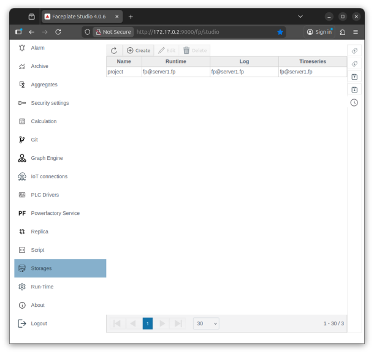
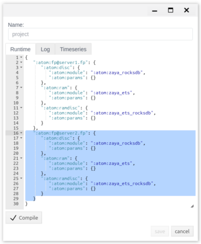
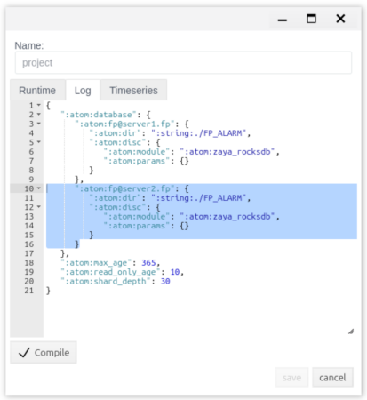
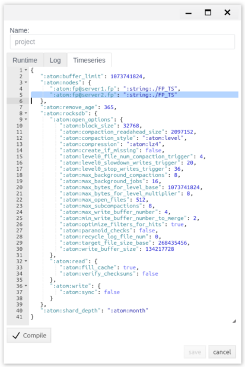
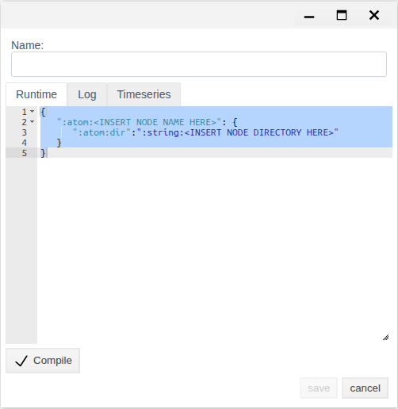
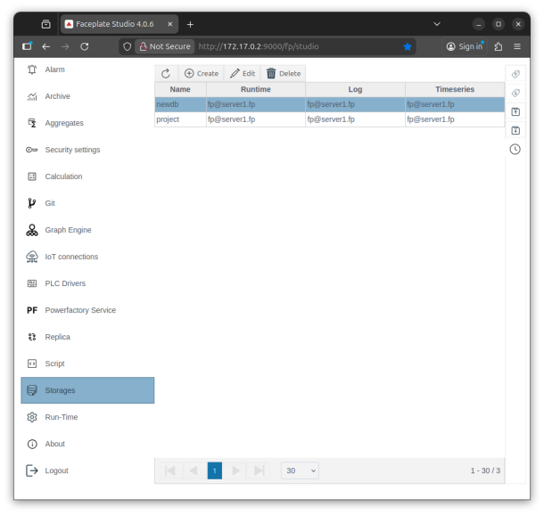
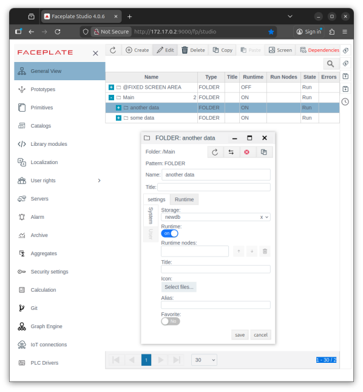
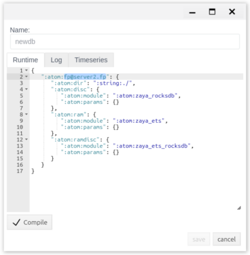
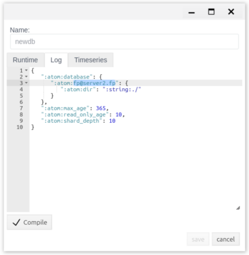
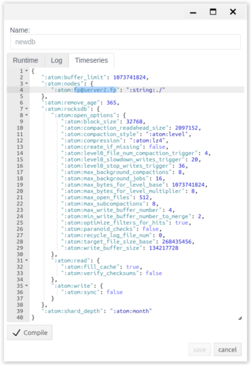

# Storages: which servers hold the project data

This document is for the integration engineer who decides where FACEPLATE project data is stored: so that the system keeps working when a server fails, so that a large project is spread across disks and servers, or so that data is moved to another server without stopping the system.

# Contents

- [Glossary](#glossary)
- [Introduction](#introduction)
- [Main part](#main-part)
    - [Preparing the servers](#preparing-the-servers)
    - [The Storages editor](#the-storages-editor)
    - [Redundancy: a database copy on a second server](#redundancy-a-database-copy-on-a-second-server)
    - [A separate database for a folder](#a-separate-database-for-a-folder)
    - [Moving a database to another server](#moving-a-database-to-another-server)
    - [Checking in the log](#checking-in-the-log)
- [Conclusion](#conclusion)

# Glossary

| Term | Meaning |
|---|---|
| Database | Where FACEPLATE stores project data. On first start, the `project` database is created, and everything in the project is stored in it. Other databases can be created in the **Storages** editor |
| Database parts | Each database has three parts, one per editor tab: **Runtime** — project objects and their current values; **Log** — the message and alarm log; **Timeseries** — value archives |
| Database copy | An instance of a database on a specific server. If a database has copies on two servers, FACEPLATE keeps them identical and, when one server fails, works with the other |
| Node | A FACEPLATE server named like `fp@<host>`. Cluster nodes are shown on the **Servers** panel, see [Cluster nodes](../../administration/nodes/nodes.md) |
| Cluster | Several nodes combined into one system, see [Resource Redundancy in Faceplate](../../administration/redundancy/redundancy.md#faceplate-service-redundancy) |
| Separate database for a folder | A database attached to a project folder with the **Storage** property: everything created in that folder is stored in this database instead of `project`. Also called a shard |
| Segment | A part of the message or archive database covering a time period. The segment name contains dates, for example `project___2026_01_20__2026_02_18` |

# Introduction

By default, the whole project is one `project` database on one server. All objects, messages, and archives are on that server's disk. If the server stops, Studio and Runtime are unavailable until it is started again.

The **Storages** editor changes where the data lives without stopping the system. It solves three tasks:

| Task | What you do | What you get |
|---|---|---|
| Redundancy | Add a copy of the database on a second server | A server can be lost: Studio and Runtime keep working on the other server, and the operator's Runtime switches by itself (see [Cluster nodes](../../administration/nodes/nodes.md#node-address-for-runtime)). No data is lost: the copies are identical |
| Separate database for a folder | Create a new database and attach it to a project folder | The folder's data is stored separately: on another disk or server. A large project is no longer one database, and the load is shared between disks and servers |
| Moving | Add a copy of the database on a new server and remove the old one | The data moves to another server while the system is running. For example, archives move to a dedicated archive server (see [Historian Server](../historian/historian_server.md)) |

Redundancy here means data redundancy. Redundancy of communication channels with equipment is described separately, in [Resource Redundancy in Faceplate](../../administration/redundancy/redundancy.md#plc-connection-redundancy).

The running example uses two servers, `fp@server1.fp` and `fp@server2.fp`. In the example, the `project` database gets a copy on `server2`, then the `newdb` database is created for the `another data` folder, and finally `newdb` is moved to `server2`. Your server names, paths, and parameter values may differ: the settings copy the values that are already set on your first server.

You will need access to Studio (`http://<server>:9000/fp/studio`) with an account that has permission to modify the project. Redundancy and moving require a cluster of at least two servers.

# Main part

## Preparing the servers

Redundancy and moving work between servers of one cluster. Before configuring storages, prepare the servers:

* a stable link between the servers — at least 100 Mbit/s;
* open access between the servers to port 4369 and to the FACEPLATE inter-node port. By default the inter-node port is chosen anew at every start; to open it on a firewall, fix it in `vm.args` with two lines with the same value, for example:
    * `-kernel inet_dist_listen_min 9100`
    * `-kernel inet_dist_listen_max 9100`
* open access from workstations to ports 9000 (HTTP) and 9443 (HTTPS), and to the ECOMET interface — 8000, see [Launch](../../general/project_structure/FACEPLATE-start.md#launch);
* each server has its own name in `faceplate/releases/<version>/vm.args` (the `-name` parameter, see [Resource Redundancy in Faceplate](../../administration/redundancy/redundancy.md#virtual-machine-settings-vmargs)) and a common `-setcookie`;
* the servers find each other by name: `/etc/hosts` on each server lists the addresses of all cluster servers.

In the example, `vm.args` of the first server has `-name fp@server1.fp`, the second has `-name fp@server2.fp`, and `/etc/hosts` on both servers contains:

```
192.168.1.11   server1.fp
192.168.1.22   server2.fp
```

The cluster is assembled like this: the first server is started with the usual command, the second with the `ATTACH_TO` variable pointing to the first. The commands are in [Resource Redundancy in Faceplate](../../administration/redundancy/redundancy.md#starting-and-assembling-the-cluster). In the example:

```bash
# server1
ulimit -n 200000
./faceplate/bin/faceplate console

# server2, after server1 has started
ulimit -n 200000
env ATTACH_TO=fp@server1.fp ./faceplate/bin/faceplate console
```

A server is ready when the console shows `---FACEPLATE STARTED---` and Studio opens. Both servers are shown on the **Servers** panel.

Right after attaching, the second server works with the `project` database stored on the first one. It has no copy of its own: if the first server stops, the second cannot work. The copy is added in the **Storages** editor, see [Redundancy](#redundancy-a-database-copy-on-a-second-server).

## The Storages editor

Open **Storages** in the Studio menu on the left. The list shows the project databases and the servers that hold each part of a database.



| Column | Meaning |
|---|---|
| **Name** | Database name |
| **Runtime** | Servers with a copy of project objects and current values |
| **Log** | Servers with a copy of the message log |
| **Timeseries** | Servers with a copy of archives |

Buttons above the list:

| Button | Purpose |
|---|---|
| **Create** | Create a new database, see [A separate database for a folder](#a-separate-database-for-a-folder) |
| **Edit** | Open the selected database for changes |

Double-clicking a row opens the database for viewing only: the **save** button in that window is inactive.

The database window:

| Element | Purpose |
|---|---|
| **Name** | Database name. Set at creation and not changed afterwards. Latin letters and digits, no spaces or special characters |
| Tabs **Runtime**, **Log**, **Timeseries** | Settings of the three database parts in JSON |
| **Compile** | Check the tab text. `OK` or an error appears next to it |
| **save** | Save the database. Changes apply immediately; data copying runs in the background |

The order is always the same: edit the tab → **Compile** → `OK` → **save**. A new database can be saved only when all three tabs are filled in.

Each tab lists the servers that hold this part of the database. A server is written as the key `":atom:fp@<host>"`:

| Tab | Where the server list is | What is written for a server |
|---|---|---|
| **Runtime** | Top-level keys | Directory (`:atom:dir`) and storage modules (`:atom:disc`, `:atom:ram`, `:atom:ramdisc`) |
| **Log** | Inside `":atom:database"` | Directory and storage module. The other keys (`read_only_age`, `max_age`, `shard_depth`) are described in [Alarms](../../alarms/alarm/alarm.md#9-storage-and-automatic-processing) |
| **Timeseries** | Inside `":atom:nodes"` | Directory. The other keys define archive storage and do not change when a server is added or removed |

The directory (`":atom:dir"`) is relative to the database directory `faceplate/DB`: `":string:./"` is `faceplate/DB` itself, `":string:./FP_ALARM"` is `faceplate/DB/FP_ALARM`.

To add a server, copy the block of an already configured server and change the name in the copy. The values inside the block come from your installation; they are not invented anew. To remove a server, delete its block.

## Redundancy: a database copy on a second server

A copy of the database on a second server gives:

* **operation on failure.** If the first server stops, Studio and Runtime continue on the second. The operator's Runtime switches by itself if the nodes have addresses set (see [Cluster nodes](../../administration/nodes/nodes.md#node-address-for-runtime));
* **data safety.** The copies are identical; changes go to both at once;
* **load sharing.** Both servers serve requests to the database.

The copy is added part by part, on each tab separately. The screenshots show the `project` database from the example:

1. **Storages** → database row → **Edit**.
2. **Runtime** tab: copy the first server's block and change the server name in the copy to the second server's name. **Compile** → `OK` → **save**.

    

3. **Edit** again, **Log** tab: the same inside `":atom:database"`. **Compile** → `OK` → **save**.

    

4. **Edit** again, **Timeseries** tab: the same inside `":atom:nodes"`. **Compile** → `OK` → **save**.

    

After each **save**, the second server receives a copy of that part of the database. The amount of copying depends on the accumulated data: project objects copy quickly, messages and archives copy segment by segment, which may take time. How to follow the copying, see [Checking in the log](#checking-in-the-log).

The result is visible in the list: the database's **Runtime**, **Log**, and **Timeseries** columns show both servers. Database files appear in `faceplate/DB` on the second server.

In the example, `":atom:fp@server2.fp"` blocks with the same values as `":atom:fp@server1.fp"` are added to the `project` database. After that, `server2` keeps working when `server1` is stopped.

Any other database gets a copy the same way — for example, a separate database for a folder.

## A separate database for a folder

By default, all project objects are stored in one `project` database. In a project with millions of objects and a dense data flow, one database becomes a bottleneck. A separate database for a folder splits the project: logically it is still one project, but physically the folder's content is stored in its own database — on a separate disk or server. It works like mounting a disk to a directory in Linux: everything written to the directory physically lives on the mounted disk.

Creating a database:

1. **Storages** → **Create**. A window opens with a template on each tab.

    

2. **Name** — the database name.
3. On each tab, replace `<INSERT NODE NAME HERE>` with the server name and `<INSERT NODE DIRECTORY HERE>` with a directory, for example `./`. **Compile** → `OK` on each tab.
4. **save**.

The database appears in the list.



Database directories appear in the server's `faceplate/DB`: `<name>` (objects), `<name>___<dates>` (message segment), `<name>_ts_database` (archives).

Attaching the database to a folder:

1. **General View** → create a folder or select an existing one → **Edit**.
2. **Settings** tab → **Storage** → select the database. The list contains all project databases.
3. **save**.



Everything created in this folder from now on is stored in the selected database. Working with objects in Studio and Runtime does not change.

In the example, the `newdb` database is created on `server1` with the `./` directory. The `another data` folder is attached to `newdb`; the `some data` folder has no separate database, so its objects are stored in `project`.

## Moving a database to another server

Moving is needed when data must live on another server: the new server is more powerful, the old one is running out of disk, or archives are moved to a dedicated server. The system does not stop during the move.

Moving is two operations from the previous sections in a row. The screenshots show the `newdb` database from the example, with only `server2` left on every tab:

1. Add a copy of the database on the new server, as in [Redundancy](#redundancy-a-database-copy-on-a-second-server), on all three tabs. Wait until copying finishes (see [Checking in the log](#checking-in-the-log)).
2. **Edit** → on the **Runtime** tab, delete the old server's block and keep only the new one. **Compile** → `OK` → **save**.

    

3. The same on the **Log** tab inside `":atom:database"`.

    

4. The same on the **Timeseries** tab inside `":atom:nodes"`.

    

After each **save**, the old server closes its copy of that part of the database. The database's columns in the list show only the new server. The content of folders attached to the database still opens in Studio and Runtime on any cluster server. The database files remain on the old server's disk.

In the example, `newdb` is moved from `server1` to `server2`: first the `":atom:fp@server2.fp"` blocks are added, then the `":atom:fp@server1.fp"` blocks are deleted.

## Checking in the log

Copying and closing of databases are recorded in each server's `console.log` (the log path is set in `fp.logger.config`, see [Resource Redundancy in Faceplate](../../administration/redundancy/redundancy.md#logging-configuration-fploggerconfig)). For messages and archives, the lines repeat for each segment.

| Action | Server | Log lines |
|---|---|---|
| Copy added (**Runtime**, **Log**) | Server with the data | `copy: <database> to '<new server>'` — start;<br>`<database> db opened at '<new server>'` — copy ready |
| | New server | `copy: <database> from '<server with the data>'` — start;<br>`copy: <database> from '<server with the data>' finish copy` — copy ready |
| Copy added (**Timeseries**) | Server with the data | `<database>_ts_database node '<new server>' with path "<directory>" added to schema`, then `copy:` lines for the archive parts |
| Database created | Database server | `creating a new database <database>___<dates>`;<br>`DB pool Supervisor has been started <database>_ts_database` |
| Copy removed (**Runtime**, **Log**) | Old server | `<database> database close` — start;<br>`<database> copy removed from '<old server>'` — copy removed |
| | Other servers | `<database> db closed at '<old server>'`;<br>`<database> copy removed from '<old server>'` |
| Copy removed (**Timeseries**) | Old server | `<database>_ts_database node '<old server>' removed from schema`, then `copy removed` for the archive parts |

For messages, the lines contain the segment name instead of `<database>`, for example `project___2026_01_20__2026_02_18`.

# Conclusion

By default, the whole project is stored in one `project` database on one server. The **Storages** editor changes this without stopping the system. A database copy on a second server protects against server failure and data loss. A separate database for a folder moves part of the project to another disk or server. Moving means adding a copy on the new server and removing the old one. Every change is done the same way: copy or delete a server block on the **Runtime**, **Log**, and **Timeseries** tabs, **Compile** → `OK` → **save** on each, and check the result in the list and in the log.
