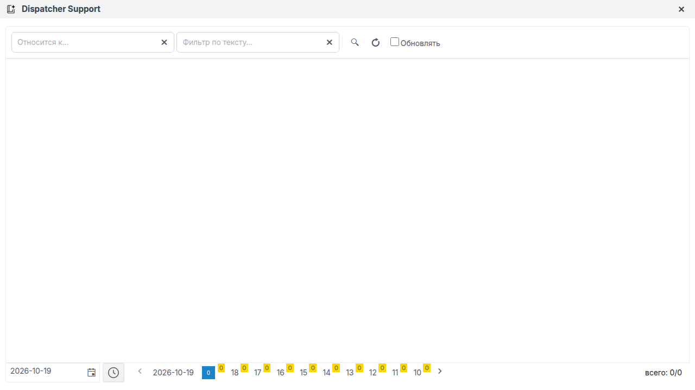

# Dispatcher Support in Faceplate: configuring the service and reviewing alarms

Working draft for Faceplate 4.0.7 integrators. This guide describes the advisor's purpose, service configuration, and verification using a training pump station.


## What the advisor does

The advisor helps you review alarm events. It obtains an explanation from a language model and links it to the source alarms. When document search is connected, you can also view relevant instructions alongside the explanation.

The integrator configures the processing service. The dispatcher opens advisor messages, reads the response, and checks the source events and retrieved documents. A comment added to a source alarm belongs to that alarm.

An advisor message, a source alarm, and a document are separate items. Reading a response does not replace checking the alarm state. The advisor window has no separate message acknowledgment function.

Installing the model and search services, populating the instruction library, and configuring alarms in general are separate tasks. This guide lists the prerequisites and a minimal training signal setup.

## How a recommendation is produced

The service performs the following sequence:

1. Selects alarm activation and clearing events for the next interval.
2. Passes the selected records to the grouping script.
3. Builds a prompt for each nonempty group.
4. Receives the language model's response.
5. If a secondary script is configured, sends an additional request to obtain a title and a document search query.
6. Saves a message with the response and source alarms.
7. Displays the message and available instructions in the advisor.

Events of types alarm, warning, and error are processed. An alarm that is already active does not necessarily produce another event in the next interval. A verification run requires a new state transition, such as a new threshold crossing.

Grouping determines which events are included in a single request. It can also accumulate data across cycles. If the script returns no groups, no request is sent to the model.

The secondary request is optional. Without it, the service uses the primary response and ignores document search. When a secondary request is used, the primary response remains the explanation; the additional response supplies the title and the query sent to the search service.

A document search failure does not prevent a message containing the explanation from being saved. Check the response and the retrieved instruction separately.

## Prerequisites

| Prerequisite | What to check |
|---|---|
| Project and folder | You can create and modify the service and read the required alarms. The folder is enabled for execution |
| Script execution | The service can execute Erlang expressions |
| Language model service | Its address is accessible from the Faceplate server; the model name and supported parameters are known |
| Model response format | The service accepts JSON and returns HTTP 200 with a JSON string field named response |
| Grouping script | Returns nonempty groups of the required events and includes the data needed for the primary prompt |
| Primary script | Builds the prompt text from a prepared group |
| Document search, for the second example | The address, supported region, and available instructions are known; a secondary script is ready |

Check the model address from the Faceplate server. A loopback address refers to the server making the request, rather than the computer running the browser. Compatibility with an arbitrary API is not automatic.

Use a separate training folder named **DSF_TRAINING** in an existing project. No database cleanup is required. Use the actual model and search services when checking the result; do not substitute mock responses.

### Training pump station

The objects in this table describe the preparation plan. They were not created on the inspected instance, and their presence has not been confirmed.

| Object | Role | Initial value | Threshold | Test value |
|---|---|---|---|---|
| Н-101 | First pump pressure, bar | 6.0 | Greater than 7.0 | 7.2 |
| Н-101_high | Pressure alarm for Н-101 | Alarm condition is false | No delay or inversion | Activates at 7.2 |
| Н-102 | Second pump pressure, bar; required for the second example | 6.0 | Greater than 6.5 | 6.8 |
| Н-102_high | Pressure alarm for Н-102 | Alarm condition is false | No delay or inversion | Activates at 6.8 |
| Pump station advisor | Service you create in the first example | Not yet created | — | A message for the training event |

Create a custom type named **DSFPressure** with a numeric **pressure** field of type float. Allow the field to be changed at runtime. Set its initial value to **6.0** and specify **bar** as the unit in the description.

Create an instance named Н-101 and configure a standard alarm on its pressure field: greater than 7.0, delay 0, no inversion, alarm enabled. For the second example, also add Н-102 with a threshold of 6.5. This is a preparation outline; the exact UI routes to the type and alarm editors have not been verified for this draft. Keep the Cyrillic letter Н in the example object names and JSON filter values.

Returning the pressure to 6.0 clears the high-pressure condition. The clearing event may also be processed, so a complete activation–clearing cycle does not necessarily produce exactly one message.

Only Н-101 and its alarm are required before the first example. The second example depends on the first and adds Н-102, documents, and search.

## Configuring alarm processing

The service settings are grouped under **Service Settings**, **Model Settings**, **Alarm Filter**, **Scripts Pipeline**, and **RAG Settings**. These labels and the type name **DSF Service** come from the form definition; their localization and placement in the running UI still require verification.


### Model connection and processing cycle

| Setting | Effect |
|---|---|
| LLM URI | Address to which the server sends model requests |
| Cycle (ms) | Event selection interval, in milliseconds |
| Prompt retries | Total number of request attempts; 3 means three attempts |
| Prompt timeout | Time to wait for the model response, in milliseconds |
| Model Settings | JSON request parameters: the model and its supported settings |

The time before a message appears includes the wait for event processing and the time taken by requests. A secondary request and document search add their own stages. The cycle value does not guarantee a response time.

For the training example, use the following **Model Settings** structure:

```json
{
  "model": "MODEL_NAME",
  "temperature": 0.1,
  "stream": false,
  "options": {
    "num_predict": 4096,
    "num_ctx": 16384
  }
}
```

Replace MODEL_NAME with the name of an available model. This is a parameter template, not a ready-to-use connection. Any additional keys must be supported by the service. The service script builds the prompt text; you do not need to set a fixed prompt separately in this JSON.

The example uses a response without streaming individual chunks: **stream=false**. The service must return the expected complete JSON response.

### Event filtering and message search

**Alarm Filter** restricts events before grouping and before requests are sent to the model. A blank value or an empty JSON object means that the service applies no additional filter.

Search in the advisor window restricts the view of messages already saved. It does not change the events the service previously sent to the model.

The second example filters by the training alarm's path:

```json
{
  "field": "point",
  "operator": "contains",
  "value": "Н-101"
}
```

The point field refers to the source alarm's location. In the training setup, its path ends in Н-101_high. Check the actual project path: the sensor name and the alarm path must not be assumed to match automatically.

When the additional filter is blank, the prepared grouping script must restrict processing to training events. A blank filter does not limit selection to the current folder.

### Processing scripts

The service uses Erlang. Depending on the editor, **Compile** checks JSON syntax or compiles the expression. A successful check does not confirm the input data, network connection, or model result.

The initial script templates in the form do not produce useful results without configuration.

| Editor | Input | Required return value |
|---|---|---|
| First editor in Scripts Pipeline | List of selected alarm records and an accumulator state; the state is none on the first call | A pair containing a list of groups and the new accumulator state |
| Prompt Primary Script | One prepared group | Primary prompt text as a binary string |
| Prompt Secondary Script | Full response from the primary request | Secondary prompt text as a binary string; this editor is optional |

A group uses the following keys. The key names matter in the expression you enter.

| Key | Contents |
|---|---|
| alarms | Nonempty list of references to existing source alarm records |
| category | Group category as a binary string |
| region | Region as a binary string; for search, it must match the document service |
| timestamp | Group time as an integer Unix timestamp in milliseconds |
| point, text | Additional data the grouping script must supply for the primary prompt in this guide |

In the training setup, the grouping script must accept only Н-101_high and Н-102_high at their actual paths, add point and text, and produce groups with the required region.

A ready-to-use grouping script for the environment has not been published or tested in this draft. Before running the first example, prepare one according to the contract above. The example is therefore not yet ready for fully independent reproduction.

The following expression is a sample input for **Prompt Primary Script**. It assumes that the group contains point and text:

```erlang
fun(Group) ->
    unicode:characters_to_binary([
        "Explain the pressure alarm at the pump station.\n",
        "List possible causes and the checks to perform in order.\n",
        "Location: ", maps:get(<<"point">>, Group), "\n",
        "Alarm: ", maps:get(<<"text">>, Group)
    ])
end.
```

For **Prompt Secondary Script** in the second example, use this expression:

```erlang
fun(Response) ->
    unicode:characters_to_binary([
        "Write a title of no more than 12 words for this response: ",
        Response
    ])
end.
```

Both expressions are sample user inputs. Their compilation in the editor, execution with actual data, and response quality have not yet been verified.

### Document search

Configure search under **RAG Settings**. **URI** specifies the service address, **Timeout** specifies the response timeout, and **Connect timeout** specifies the connection timeout.

The region comes from the prepared group. Naming the training folder does not create a region in the document service. DSF_TRAINING is only an example value; replace it if the service uses a different identifier.

Working search requires a secondary script, an accessible service address, a supported region, and documents. Entering a URI alone does not enable this stage without a secondary script.

## Get explanations for high pressure at Н-101

**Task:** create a service and link its explanation to a new high-pressure event at Н-101.

**Example status:** not reproduced. Prepared training signals, an actual model connection, and a working grouping script are required. You do not need the second example to complete this task.

| Initial data | Value |
|---|---|
| Folder | DSF_TRAINING |
| Н-101 pressure before the test | 6.0 bar |
| Alarm threshold | Greater than 7.0 bar |
| Test pressure | 7.2 bar |
| Cycle | 10000 ms |
| Attempts | 3 |
| Response timeout | 300000 ms |
| Additional filter | Blank |
| Secondary request and search | Not configured |

### Create and configure the service

1. Open the training folder in the project tree.
2. Create an object of type **DSF Service**.
3. Name it **Pump station advisor**.
4. Enter the actual model service address in **LLM URI**.
5. Enter **10000** in **Cycle (ms)**.
6. Enter **3** in **Prompt retries**.
7. Enter **300000** in **Prompt timeout**.
8. In **Model Settings**, enter the parameters of an available model using the template above.
9. Check the JSON using **Compile**.
10. Leave **Alarm Filter** blank.
11. Enter the prepared training event grouping script in the first **Scripts Pipeline** editor.
12. Check the grouping script using **Compile**.
13. Enter the primary prompt from “Processing scripts” in **Prompt Primary Script**.
14. Check the primary prompt using **Compile**.
15. Leave **Prompt Secondary Script** blank.
16. Leave the document search address blank.
17. Save the service settings.

Check that the service and its folder are enabled for execution. The exact route for creating and saving the form has not been confirmed on the instance used for this draft.

### Trigger an event and check the explanation

1. Open the runtime form of training object Н-101.
2. Check that pressure is **6.0**.
3. Enter **7.2** in the pressure field.
4. Check that source alarm **Н-101_high** activates.
5. Wait for the next processing cycle and the model response.
6. Open the Dispatcher Support window.
7. Refresh the message list.
8. Find the message for the new training alarm.
9. Open the message.
10. Open the linked source alarm.

**Expected check:** the source alarm refers to Н-101 and the condition of pressure exceeding 7.0 bar; the message contains a response and a link to that alarm. Read the short and full responses, then collapse and expand the available message sections.

Compare the source alarm time with the message time. In the proposed grouping setup, the message timestamp is assigned during processing; the two times do not have to match. The actual message count and delay have not been measured on the instance.

An instruction is not required in this example because the secondary request and search are not configured.

### Find the message and check diagnostics

Follow [Search, time selection, and list refresh](#search-time-selection-and-list-refresh) and [State and diagnostic log](#state-and-diagnostic-log) below using the message and service from this example. These procedures are part of the first scenario's verification, rather than separate examples.

After the check, return the pressure of Н-101 to **6.0**. Allow for a possible clearing event when reviewing subsequent results.

## Find instructions for pump station alarms

**Task:** restrict processing to Н-101 alarms and check instruction retrieval for a new event.

**Example status:** not reproduced. You need the completed first example, the second training signal, an actual search service, a supported region, and documents. No model response or retrieved instruction was obtained for this draft.

| Initial data | Value |
|---|---|
| Service | Pump station advisor from the first example |
| Initial pressure of Н-101 and Н-102 | 6.0 bar |
| Н-101 test | 7.2 bar with a threshold of 7.0 |
| Н-102 test | 6.8 bar with a threshold of 6.5 |
| Cycle after the change | 20000 ms |
| Filter | point contains Н-101 |
| Document | An actual instruction for the training pump station |
| Region | A value supported by the service |

### Change the settings

Changing settings restarts processing and resets the accumulator state. Run a new verification after making changes.

1. Open the training service settings.
2. Disable the service using **Disabled**.
3. Save the disabled state.
4. In **Alarm Filter**, enter the Н-101 JSON filter from “Event filtering and message search”.
5. Check the JSON using **Compile**.
6. Enter **20000** in **Cycle (ms)**.
7. In **Prompt Secondary Script**, enter the secondary prompt from “Processing scripts”.
8. Check the expression using **Compile**.
9. In the grouping script, set a region supported by the document service.
10. Check the modified grouping script using **Compile**.
11. Enter the actual search address in **RAG Settings → URI**.
12. Enter **10000** in **Timeout**.
13. Enter **20000** in **Connect timeout**.
14. Save the settings.
15. Clear **Disabled**.
16. Save the enabled state.

The search timeout values are in milliseconds. These values are configuration starting points, rather than verified service performance figures.

### Check filtering and the retrieved document

1. Check that both training objects have an initial pressure of **6.0**.
2. Change the pressure of Н-101 to **7.2**.
3. Change the pressure of Н-102 to **6.8**.
4. Check that both source alarms activate.
5. Wait for the next interval to be processed, the model responses, and document search.
6. Open the advisor.
7. Refresh the list.
8. Find the result for the new Н-101 alarm.
9. Open the message's source alarms.
10. Check that they include the new Н-101_high event and exclude the new Н-102_high event.
11. Open the message's instruction list.
12. Open the retrieved document.

**Expected check:** the retrieved document concerns the training pump station and can be read; its name, text, and relevance score are displayed. The service supplies the score; the user does not set it.

Check new events after changing the filter. Old Н-102 messages may remain in the list; their presence does not prove that the new filter is failing.

If the result contains an explanation but no instructions, check the model stage and search separately using the troubleshooting table.

### Add a comment and finish the training work

1. Open the source Н-101 alarm from the message.
2. Add the comment **Training check: the link between the response and the alarm has been verified**.
3. Check that the comment appears on that source alarm.
4. Return the pressure of both objects to **6.0**.

The comment does not confirm that recommendations have been carried out and does not acknowledge the advisor message.

To finish the second example, follow “Disable and delete the training service”. Adding a comment, deleting the service, and retaining old messages have not yet been checked on the instance.

## Managing the service and viewing messages

The following procedures are used in the scenarios above. The names and locations of general commands still require confirmation in the running UI.



### Search, time selection, and list refresh

Follow this procedure using the message from the first example. In the illustrated interface, **Filter by text...** appears as **Фильтр по тексту...**, **Related to...** as **Относится к...**, and **Auto-Update** as **Обновлять**.

1. Open the advisor message list.
2. Select the day on which the test event was created.
3. In **Filter by text...**, enter part of the message location, title, or category.
4. Apply the search.
5. Open the matching message.
6. Collapse one message section.
7. Expand that section.
8. Clear the text search field.
9. Apply the search again.
10. In **Related to...**, specify a fact or relationship matching the training event.
11. Apply the search.
12. Check the result's source alarm.
13. Clear this search field.
14. Apply the search again.
15. Restrict the time within the selected day.
16. Check that the test message falls within the selected time.
17. Reset the time selection.
18. Select a period that includes the test day.
19. Check page navigation if the messages span more than one page.
20. Refresh the list manually.
21. Enable **Auto-Update**.
22. Check that the next training message appears.
23. Restore the required operating refresh mode.

If there is not enough data for a second page, page navigation remains unverified. Do not fabricate results to populate the list.

According to the search logic, strings of one or two characters are checked for an exact match; strings of three or more characters are checked as substrings. Use a distinctive fragment of at least three characters for the training search.

The list supports automatic refresh every 5 seconds. Refresh reloads messages; a new model response requires the service to process an event. The period boundaries and display time zone have not been confirmed on the instance for this draft.

### State and diagnostic log

Follow this procedure using the training service from the first example.

1. Open the service state view.
2. Check **State** and **Error**.
3. If an error is present, read its full text in the tooltip.
4. Copy the error text using the available command.
5. Open **Diagnostics** and click **Start**, see [Diagnostics of Runtime objects](../diagnostics/diagnostics.md).
6. Generate a new training pressure event.
7. Read the processing and request records.
8. Copy the log records and click **Stop**.

Skip copying the error if there is no error; you do not need to deliberately break a working configuration for this check.

**RUN** confirms that a process is running. By itself, it does not confirm a response, retrieved instructions, or correct grouping.

### Disable and delete the training service

At the end of the second example, follow this procedure only for the training service you created.

1. Open **Pump station advisor**.
2. Select **Disabled**.
3. Save the state.
4. Check that service execution is disabled.
5. Note one previously saved training message.
6. Delete the training service using the available object management command.
7. Confirm deletion if prompted by the UI.
8. Refresh the project tree.
9. Check that the service is absent.
10. Open the previously saved message.
11. Generate a new Н-101 training event.
12. Check that the deleted service produces no new result for it.
13. Return the pressure to **6.0**.

According to the researched behavior, deleting the service does not delete saved messages. The actual delete command and this result still require UI verification. Do not delete other services, alarms, or documents as part of the training procedure.

## Service fields and states

The initial values below come from the inspected configuration templates. They do not mean that your project already has these values saved. The allowed numeric field ranges in the UI have not been confirmed for this draft.

| Field or group | Requirement | Initial value / units | Purpose |
|---|---|---|---|
| LLM URI | Required | Example: http://127.0.0.1:80/path | Replace with the actual address; the example is not a ready-to-use service |
| Cycle (ms) | Required | 10000 ms | Event selection interval |
| Prompt retries | Required | 3 attempts | Total number of attempts; the operating value must be positive |
| Prompt timeout | Required | 300000 ms | Response timeout; the model connection timeout is separately fixed at 10000 ms |
| Model Settings | Required | JSON object | Model and supported parameters; the template contains deepseek-r1:1.5b, temperature 0.1, stream false |
| options.num_predict / options.num_ctx | If supported by the service | 4096 / 16384 in the template | Model parameters inside JSON; do not treat them as universal across APIs |
| Alarm Filter | Optional | Blank or {} | No additional filter; compound conditions and comparisons are supported, for example contains |
| First Scripts Pipeline editor | Required | The initial template produces no useful groups | Grouping and accumulator state |
| Prompt Primary Script | Required | The initial template needs to be replaced | Primary prompt for a group |
| Prompt Secondary Script | Optional | No secondary stage without a working script | Additional prompt for the title and search |
| RAG Settings → URI | Optional | Example: http://127.0.0.1:3000 | Document search; a blank address does not define a connection |
| RAG Settings → Timeout | Optional | 10000 ms | Search response timeout |
| RAG Settings → Connect timeout | Optional | 20000 ms | Search connection timeout |
| Disabled | Inherited setting | Current project value | Disables execution |
| Memory limit (bytes) | Inherited setting | Units require clarification | Do not change it in these scenarios; the field's units have not been confirmed |

| State or result | Set by | How to use it |
|---|---|---|
| State: RUN / STOP | Runtime system | Check whether the process is running or stopped, then check the result separately |
| Error | Runtime system | Read the full text; the truncated line is not the complete error |
| PID / Node | Runtime system | Process and node information for diagnostics |
| Message time | Grouping script | Compare with the source event; identical timestamps are not guaranteed |
| Category / region | Grouping script | Message description and search scope |
| Short / full response | Model response and its presentation | Check the full response if the short version is incomplete |
| Source alarms | Processed group | Check the link between the explanation and the event |
| Instruction / score 1–5 | Search service | Read the retrieved text; the user cannot edit the score |

### Rules that affect verification

| Condition | Consequence |
|---|---|
| No events or no nonempty groups | There may be no new model request or message |
| The service or folder is disabled | Processing does not run |
| No secondary script | Document search is ignored |
| Search is unavailable | A message with an explanation may be saved without instructions |
| Settings change | Processing restarts and the accumulator state is reset |
| The service filter changes | Check new events; previous messages are not new results |
| Search is cleared in the window | The search must be applied again |

## If no recommendation appears

Check the stages in sequence: source event → filtering and grouping → model request → message → documents. The log messages in the table are taken from the behavior description and have not yet been confirmed in the instance's UI.

| Symptom or message | Where to check | Possible cause | Action | Recovery check |
|---|---|---|---|---|
| The list is empty | Advisor day, period, time, and search | Selection settings hide the result | Clear and reapply the search; select the required day | The test message is found |
| The list is empty with the correct time selected | Source alarm, Alarm Filter, grouping | No new transition occurred; the event was excluded; the group is empty | Check the 6.0→7.2 transition and selection conditions | The required event is included in a new group and message |
| Compile succeeds, but there is no result | Saved settings and a new event | Only syntax was checked | Save the form; check the data and execution | A response appears for the new alarm |
| STOP or Error | Service/folder disable settings and full error text | Execution is disabled or has not initialized | Enable the required objects or fix the cause of the error | The process runs and handles the test event |
| Script initialization error | Editors and number of input arguments | Script execution is unavailable, or the expression or contract is incorrect | Check that grouping takes two inputs and each prompt takes one; correct the expression | The saved configuration starts |
| no_attempts_left | Request log, model address, and model service | Attempts exhausted; network, HTTP status, or response format problem | Check access from the server and JSON with a string response field | A new request receives a response and the message is saved |
| failed to execute pipeline group | Group data and scripts in diagnostics | The group does not match the prompt requirements, or the expression failed | Check that alarms is nonempty and verify required keys and point/text | A new group is processed successfully |
| RAG is ignored, no secondary script | Prompt Secondary Script | The secondary script is missing | Configure a secondary request if search is required | A new result uses the search stage |
| RAG is not configured | RAG Settings → URI | The search address is not set | Configure the actual connection | Search runs for a new message |
| RAG is unavailable or error occurred | Search, network, region, and service response | The search request failed | Correct service availability and parameters | The required document can be read in a new result |
| No sources | Secondary request, region, and document library | No suitable instructions or search response | Check the document and search scope separately from the model | A new message includes a relevant document |
| The short response is empty or incomplete | Full message response | Response text processing behavior | Open the full response and check the model's output format | The required text can be read |

**RUN** and the absence of a current error line are not enough to establish success. An individual group's error may appear only in the log of the **Diagnostics** window, see [Diagnostics of Runtime objects](../diagnostics/diagnostics.md).

After correcting a problem, use a new test event. A previously saved response does not confirm that the modified configuration has run.

## Limitations

- The service scripts use Erlang; JavaScript support has not been established for these editors.
- A compatible model service with the expected JSON response format is required. An arbitrary API does not connect automatically.
- The initial editor templates are not a complete application configuration.
- Document search depends on the secondary request, region, service, and available instruction library.
- The advisor window has no separate functions for exporting, acknowledging or deleting a message, editing a response, uploading documents, or changing a relevance score.
- Clearing a previously saved secondary script through the form and the effect of doing so have not been checked for this draft. Do not treat it as a verified way to return to operation without search.
- The actual UI routes, service creation and saving, example compilation, response retrieval, instruction retrieval, comments, deletion, and retention of old messages have not been confirmed on the instance.
- Reproducing the first example independently still requires a working grouping script for the environment; the second also requires actual documents and a search connection.

The next verification of this working draft should confirm the training signals and grouping script, then run both scenarios through the UI using actual services. Until then, the expected results do not constitute a test report.
