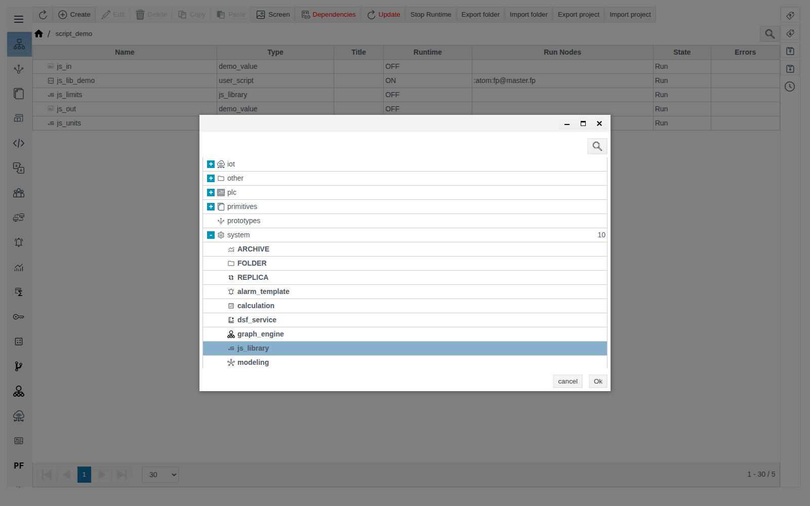
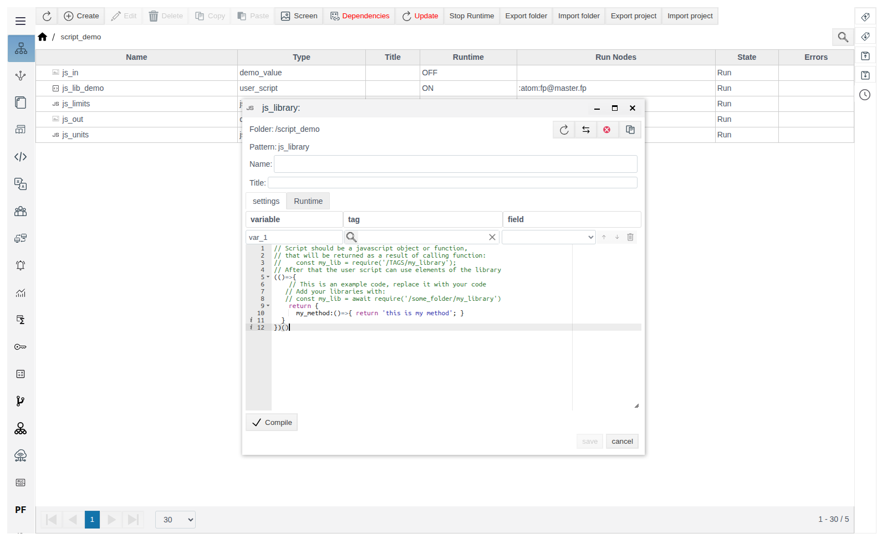
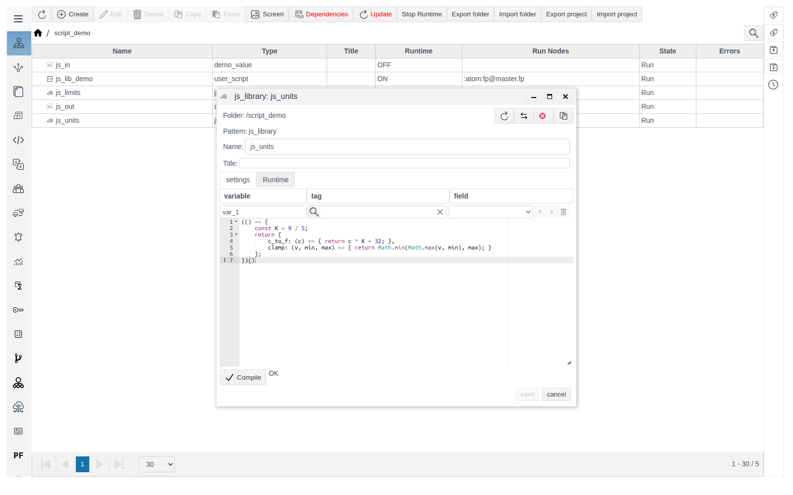
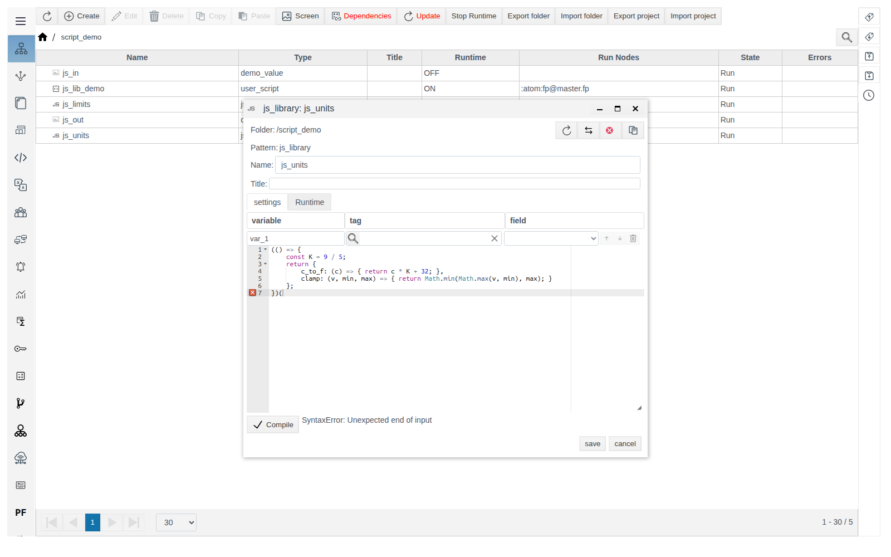
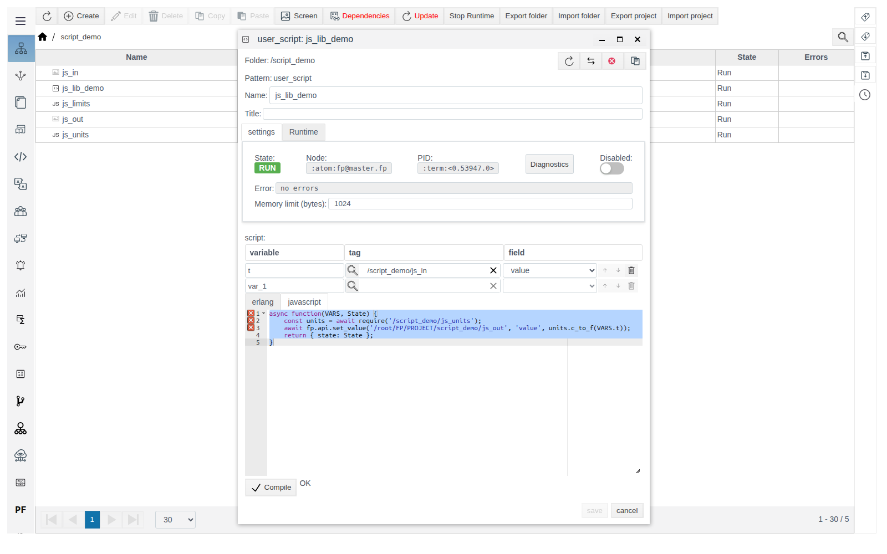
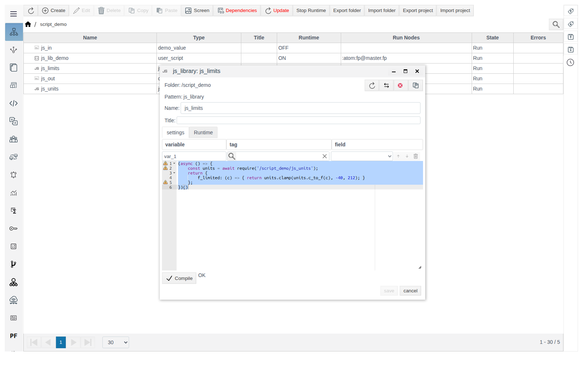
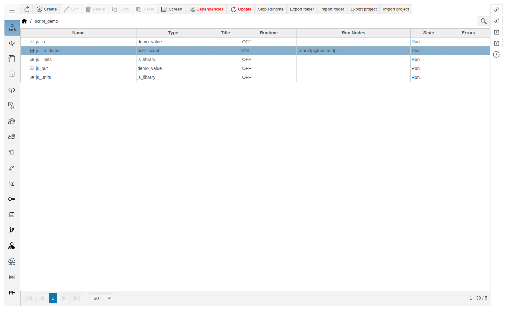
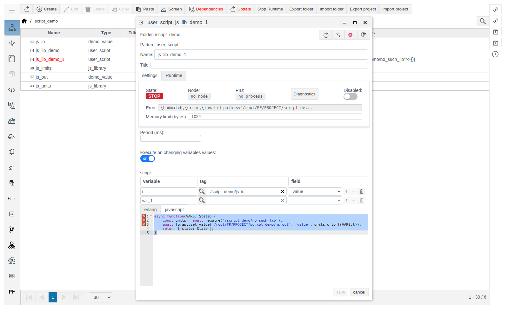

# JS Libraries

This document is for integration engineers who move shared JavaScript code into a separate project object and include it from user scripts.

# Contents

- [Glossary](#glossary)
- [Introduction](#introduction)
- [Main part](#main-part)
    - [Creating a library](#creating-a-library)
    - [Library code](#library-code)
    - [Compile and save](#compile-and-save)
    - [Including a library in a script](#including-a-library-in-a-script)
    - [A library that uses another library](#a-library-that-uses-another-library)
    - [Changing a library](#changing-a-library)
    - [Wrong path](#wrong-path)
- [Conclusion](#conclusion)

# Glossary

| Term | Meaning |
|---|---|
| JS library | A project object of type `js_library`. It holds JavaScript code whose result a script gets by calling `require` |
| `require` | A function available in JavaScript code. Given an object path, it returns the result of the JS library's code |

# Introduction

A JS library is shared JavaScript code for the whole project: functions, constants, lookup tables needed in more than one script. The code is written once in a `js_library` object, and scripts get it with `await require('/folder/name')`.

A library is an ordinary object in a project folder in **General View**. A library does not run on its own; a script runs its code when it calls `require`.

Running example, folder `script_demo`:

| Object | Type | Purpose |
|---|---|---|
| `js_units` | `js_library` | Functions `c_to_f` (Celsius to Fahrenheit) and `clamp` (clamp to a range) |
| `js_limits` | `js_library` | Function `f_limited`, which uses `js_units` |
| `js_in`, `js_out` | primitive with a `float` field `value` | Example input and output |
| `js_lib_demo` | `user_script` | Reads `js_in`, writes the result of `c_to_f` to `js_out` |

Creating a user script is covered in [User Scripts](../user_script/user_script.md), primitives in [Primitives](../primitives/Primitives.md).

You need access to Studio (`http://<server>:9000/fp/studio`) with an account allowed to modify the project.

# Main part

## Creating a library

In **General View**, enter the folder with a double click, click **Create**, expand the **system** group and select **js_library**.



A form with template code opens. The **variable / tag / field** table above the editor is not used in a library: there is no `VARS` variable in library code. The **Runtime** tab is empty.



Fill in **Name**, replace the template with your code, click **Compile**, wait for `OK` and save.

## Library code

Library code is a single JavaScript expression. Its value is what `require` returns. As in the template, it is a function that is called immediately and returns an object with functions:

```javascript
(() => {
    const K = 9 / 5;
    return {
        c_to_f: (c) => { return c * K + 32; },
        clamp: (v, min, max) => { return Math.min(Math.max(v, min), max); }
    };
})()
```

The first `return` returns the library object, the `return` inside each function returns its result. Constant `K` is visible only inside the library; the script gets `c_to_f` and `clamp`.



## Compile and save

**Compile** checks the syntax. `OK` or an error appears next to the button, for example `SyntaxError: Unexpected end of input` for an unclosed bracket.



The order is always the same: **Compile** → `OK` → **save**.

## Including a library in a script

A library is included with `await require('/folder/name')`. The path starts at the project root, as in **General View**.

Script `js_lib_demo` on the **javascript** tab, variable `t` is `/script_demo/js_in`, field `value`; **Execute on changing variables values** is on:

```javascript
async function(VARS, State) {
    const units = await require('/script_demo/js_units');
    await fp.api.set_value('/root/FP/PROJECT/script_demo/js_out', 'value', units.c_to_f(VARS.t));
    return { state: State };
}
```

`fp.api.set_value(path, field, value)` writes a value to an object field. The path here is the full one, with the `/root/FP/PROJECT` prefix.



With `js_in` = `25` the script writes `77` to `js_out`.

## A library that uses another library

`require` is available inside a library too. Declare a library function that calls it as `async`. Library `js_limits`:

```javascript
(async () => {
    const units = await require('/script_demo/js_units');
    return {
        f_limited: (c) => { return units.clamp(units.c_to_f(c), -40, 212); }
    };
})()
```

A script includes it the same way: `const limits = await require('/script_demo/js_limits');`. With `js_in` = `150`, `limits.f_limited(VARS.t)` returns `212`, with `js_in` = `-100` it returns `-40`.



In **General View** libraries carry the **JS** icon, and their **Runtime** column shows `OFF`.



## Changing a library

A running script loads the library on the first `require` call and keeps working with that version. A new library version reaches the script after the script restarts. Restart every script that uses the library:

- turn **Disabled** on, save, turn **Disabled** off, save;
- or change the script code, click **Compile** and save.

Example: `+ 1000` is added to the result of `c_to_f` in `js_units`. Before `js_lib_demo` restarts, with `js_in` = `30` it writes `86`; after the restart, with `js_in` = `31`, it writes `1087.8`.

## Wrong path

If there is no object at the `require` path, the script stops: **State** is `STOP`, and **Error** and the **Errors** column show `{badmatch,{error,{invalid_path,<<"/root/FP/PROJECT/script_demo/no_such_lib">>}}}`. No values are written.



# Conclusion

Workflow:

1. In a project folder, create a **system** → **js_library** object.
2. Write an expression that returns an object with functions. If the library includes other libraries, make the function `async`.
3. Click **Compile**, wait for `OK`, save and close the form.
4. In a script, include the library: `const lib = await require('/folder/name');`.
5. After changing a library, restart the scripts that use it.
