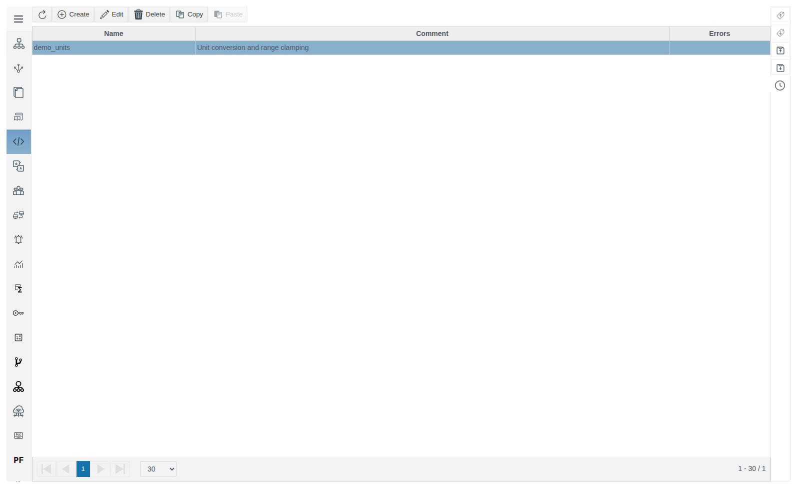
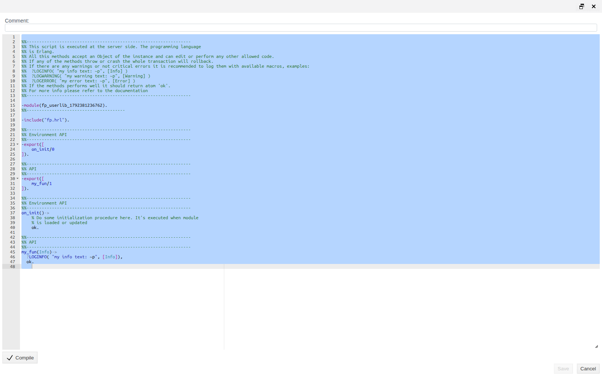
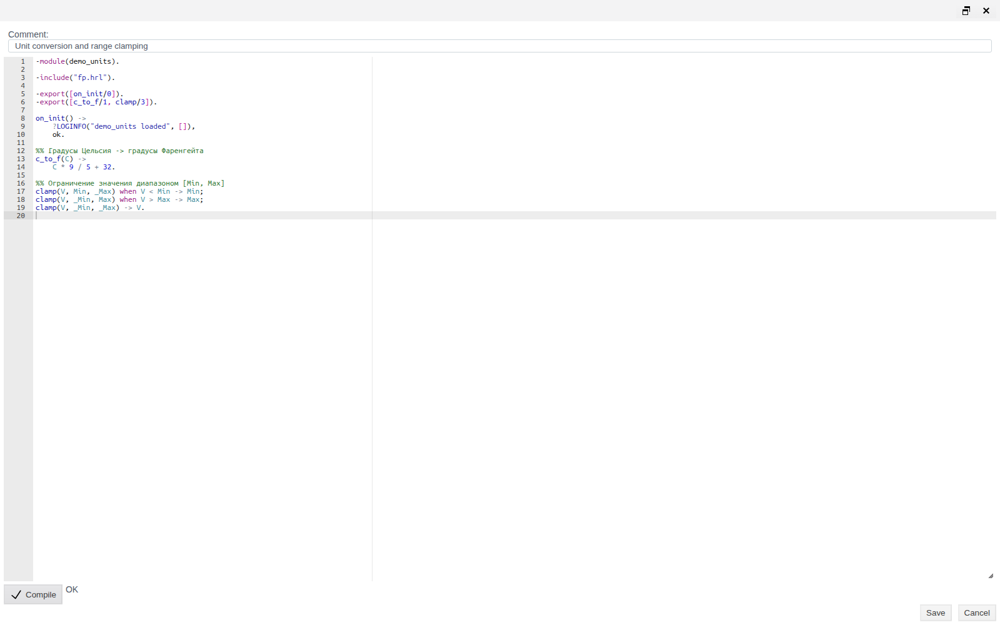
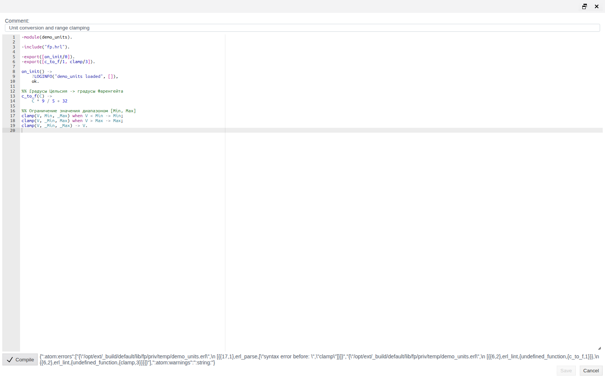
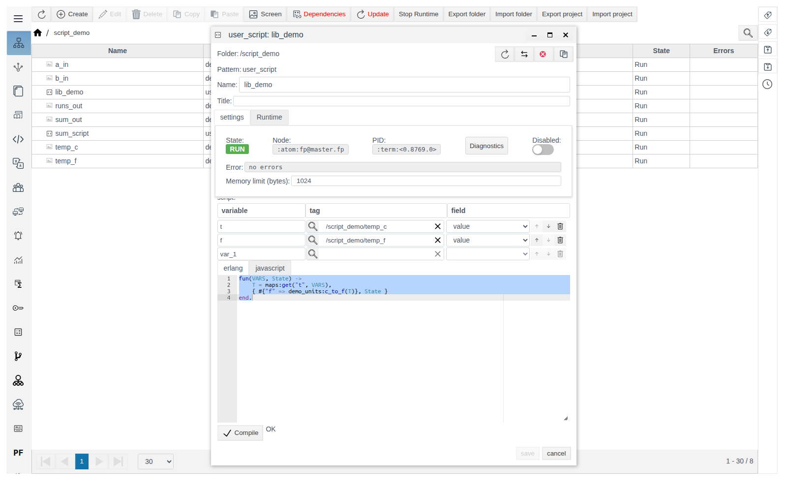
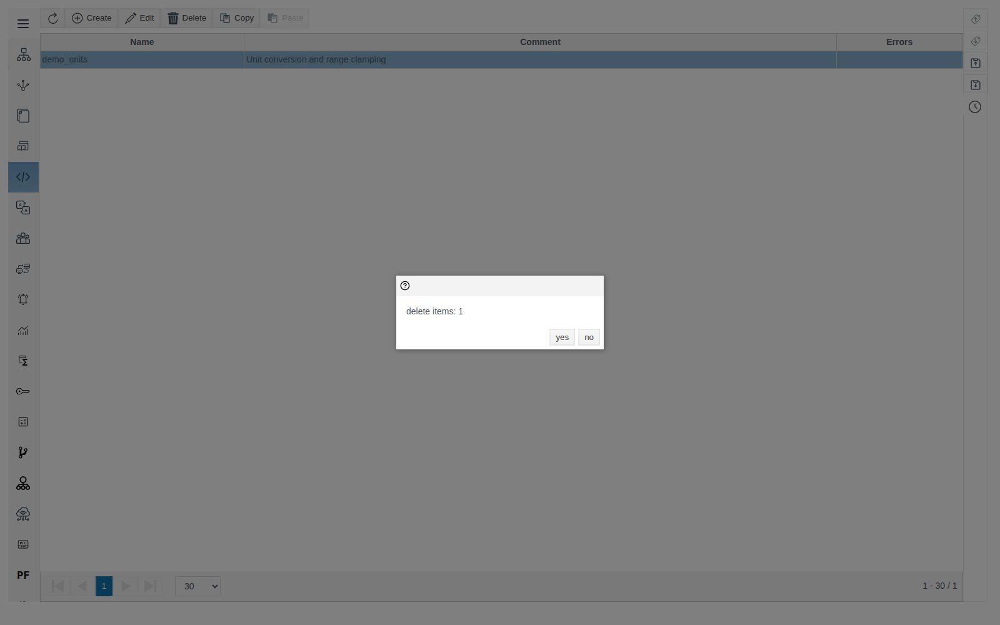

# Library Modules

This document is for integration engineers who move shared Erlang code into a separate module and call it from the project's user scripts. Verified on FACEPLATE Studio 4.0.7.

# Glossary

| Term | Meaning |
|---|---|
| Library module | An Erlang module stored in the project and loaded onto the FACEPLATE server. Its exported functions are available to project code as `module:function(...)` |
| **Library modules** section | A Studio main menu item: the list of the project's library modules and their editor |

# Introduction

A library module is shared Erlang code for the whole project: any functions needed in more than one place. The code is written once, and user scripts call it by module name.

You compile the module yourself: click **Compile**, wait for `OK`, then **Save**. A module cannot be saved without a successful **Compile**. After saving, the server loads the module on its own, and a change takes effect without restarting scripts.

Running example: module `demo_units` with functions `c_to_f/1` (Celsius to Fahrenheit) and `clamp/3` (clamp a value to a range). User script `lib_demo` reads a temperature from object `temp_c` and writes the result of `demo_units:c_to_f/1` to object `temp_f`. Creating a user script is covered in [User Scripts](../user_script/user_script_en.md).

You need access to Studio (`http://<server>:9000/fp/studio`) with an account allowed to modify the project.

# Main part

## The Library modules section

Open **Library modules** in the Studio main menu.



| Column | Meaning |
|---|---|
| **Name** | Module name from the `-module(...)` line. Set on save, not editable by hand |
| **Comment** | Free-form module description |
| **Errors** | Error text if the server failed to load the module. Empty means the module is loaded |

Buttons above the table: **Create**, **Edit** (or double-click a row), **Delete**, **Copy**, **Paste**.

## Creating a module

Click **Create**. The editor opens with a module template: a name like `fp_userlib_<number>`, `fp.hrl` included, functions `on_init/0` and `my_fun/1`.



Replace the template with your code, fill in **Comment**, click **Compile**, wait for `OK`, and save. Example:

```erlang
-module(demo_units).

-include("fp.hrl").

-export([on_init/0]).
-export([c_to_f/1, clamp/3]).

on_init() ->
    ?LOGINFO("demo_units loaded", []),
    ok.

%% Celsius -> Fahrenheit
c_to_f(C) ->
    C * 9 / 5 + 32.

%% Clamp a value to [Min, Max]
clamp(V, Min, _Max) when V < Min -> Min;
clamp(V, _Min, Max) when V > Max -> Max;
clamp(V, _Min, _Max) -> V.
```



| Element | Rule |
|---|---|
| `-module(name).` | Required. Sets the **Name** in the list and the name used in calls. Allowed: lowercase Latin letters, digits, `_` |
| `-export([...])` | Only exported functions can be called from other objects |
| `on_init/0` | Optional. Called after every load of the module: after saving and on server start. An error inside `on_init/0` does not prevent the module from loading |
| `-include("fp.hrl").` | The FACEPLATE header file with the logging macros `?LOGINFO`, `?LOGWARNING`, `?LOGERROR`. Needed only if the code uses them |

> **Important.** A module name is shared by the whole server. Two objects with the same `-module(...)` load the same module, and the code loaded last stays in effect. Give modules unique names with a project prefix and do not reuse Erlang or FACEPLATE module names.

After saving, the form stays open and **Save** becomes unavailable again. Close the form with **Cancel**.

## Compile and save

**Compile** checks the code on the server. Next to the button it shows `OK` or the raw compiler error, for example for a missing period at the end of a function:

`{":atom:errors":["{\"/opt/ext/_build/default/lib/fp/priv/temp/demo_units.erl\",\n [{{17,1},erl_parse,[\"syntax error before: \",\"clamp\"]}]}", ...`

Look for the `{line,column}` pair and the description: `{17,1}` and `syntax error before: clamp` mean an error before line 17. `undefined_function` messages for exported functions in the same output follow from the syntax error and are not a separate problem.



> **Important.** The order is always the same: **Compile** → `OK` → **Save**. When the form opens and after every save, **Save** stays unavailable until **Compile** returns `OK`.

## Calling from a user script

Call a module function by its full name `module:function(arguments)`. Script `lib_demo` with variables `t` (`/script_demo/temp_c`, field `value`) and `f` (`/script_demo/temp_f`, field `value`):

```erlang
fun(VARS, State) ->
    T = maps:get("t", VARS),
    { #{"f" => demo_units:c_to_f(T)}, State }
end.
```



With `temp_c` = `25`, the script writes `77` to `temp_f`.

## Changing a module

Open the module, edit the code, click **Compile**, and save. The server loads the new version within a few seconds, and subsequent calls from scripts use it. Scripts do not need to be restarted or re-saved.

If you change the `-module(...)` line, the **Name** in the list changes after saving. Fix scripts that call the module by its old name.

## Copying

Select a module, click **Copy**, then **Paste**, and confirm the paste with **OK**. The copy appears in the list with a name like `demo_units_1`, but its code is unchanged, with the same `-module(demo_units)` line.

> **Important.** Open the copy right away, change the name in `-module(...)`, click **Compile**, and save. Until the name is changed, the original and the copy declare the same module.

## Deleting

Select one or more modules (Ctrl+click), click **Delete**, and confirm with **yes**. The confirmation shows only the number of modules (`delete items: 1`).



> **Important.** Deleting the object does not unload the module from the server: calls from scripts keep running the old code until the server restarts. Before deleting, find and fix every script that calls the module.

# Conclusion

Workflow:

1. In **Library modules**, click **Create**.
2. Set a unique name in `-module(...)`, export the functions you need, add `on_init/0` if required.
3. Click **Compile**, wait for `OK`, save, and close the form.
4. Check that the **Errors** column is empty.
5. Call the functions from user scripts as `module:function(...)`.
6. After copying, rename the module in the copy. Before deleting, remove calls to the module from scripts.
