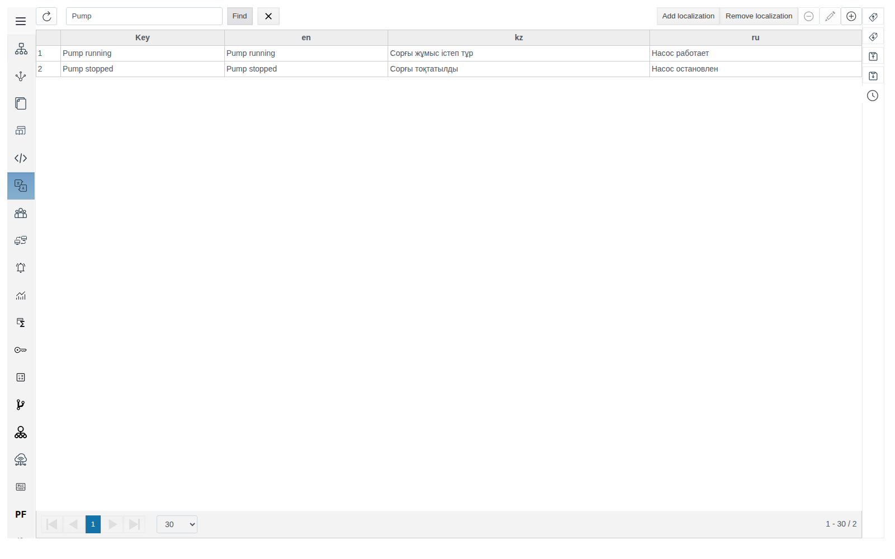
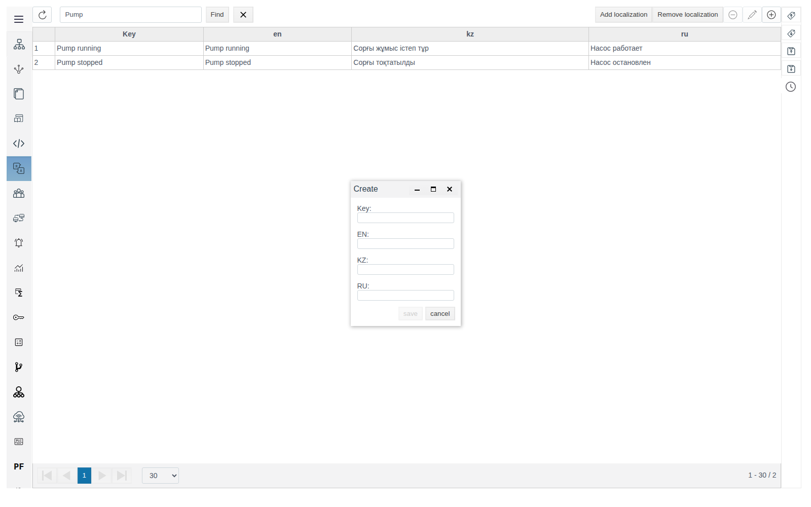
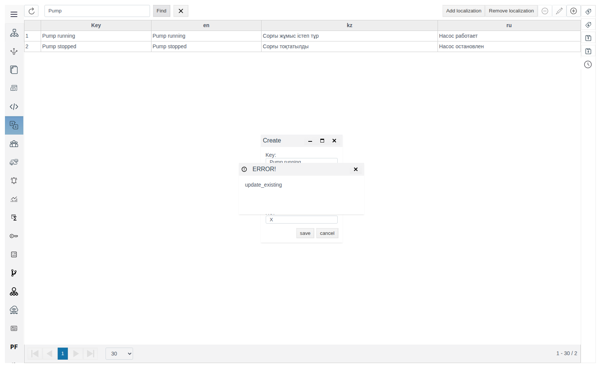
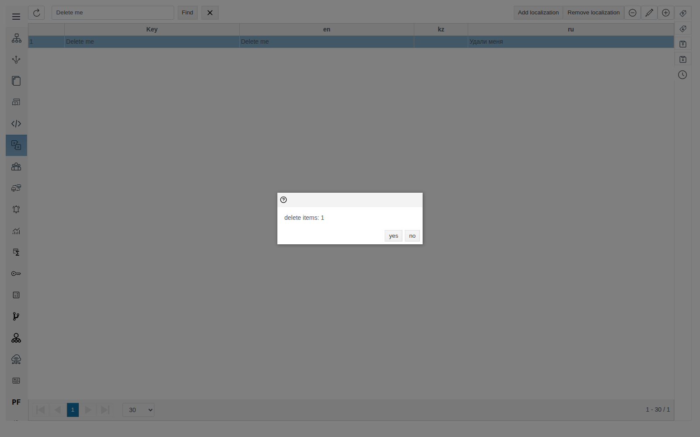
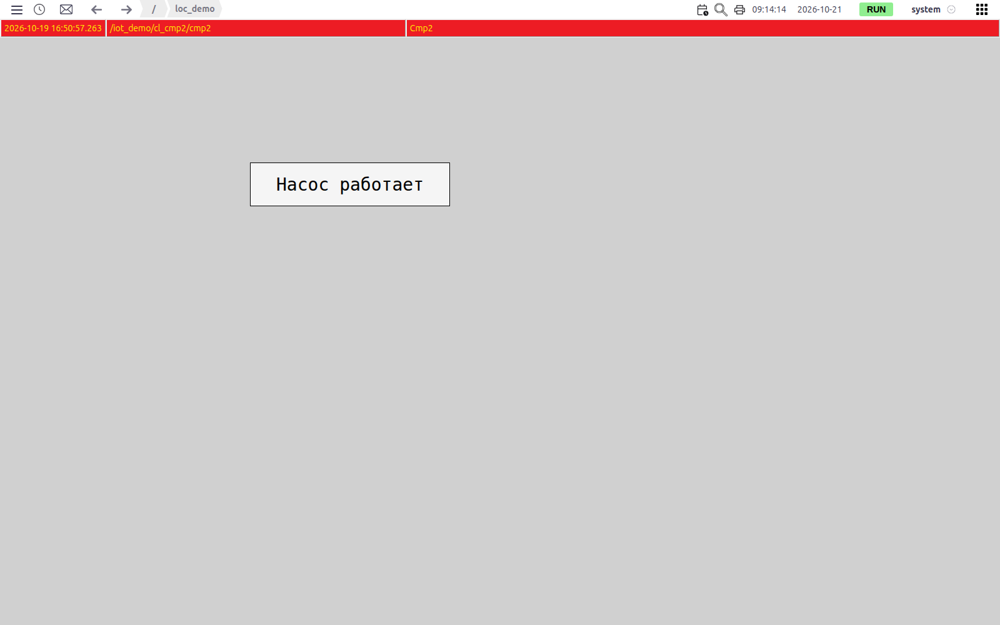
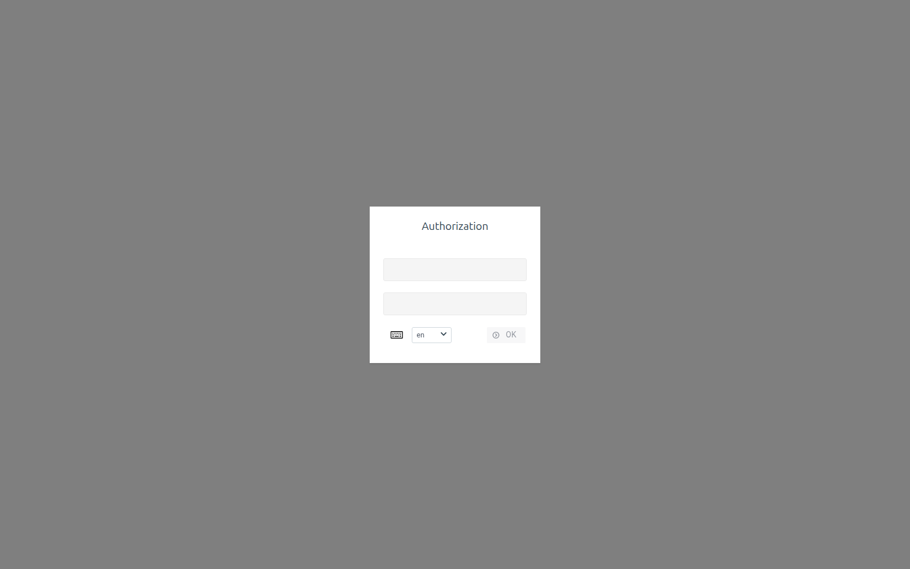
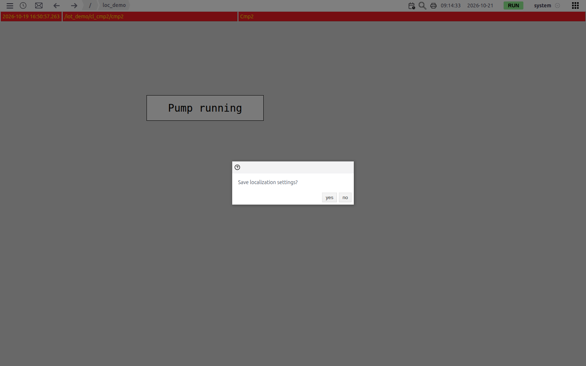
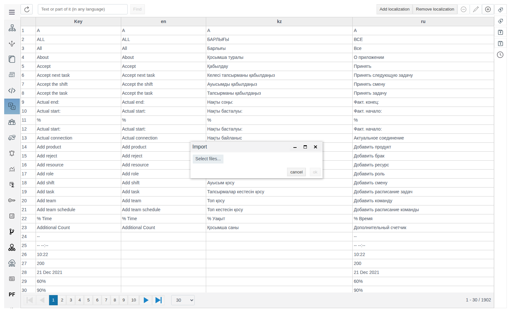

# Localization

A document for the integration engineer who sets up translations of the FACEPLATE interface and of project screen texts.

# Contents

- [Glossary](#glossary)
- [Introduction](#introduction)
- [Main part](#main-part)
    - [Dictionary](#dictionary)
    - [Keys and translations](#keys-and-translations)
    - [Text on a screen](#text-on-a-screen)
    - [Choosing the language](#choosing-the-language)
    - [Exchange via Excel](#exchange-via-excel)
- [Conclusion](#conclusion)

# Glossary

| Term | Meaning |
|---|---|
| Dictionary | The table of the **Localization** section: a row is a key, a column is a language |
| Key | The source text used to look up a translation. It matches a Studio or Runtime interface caption or the text entered in a screen element property |
| Localization | A dictionary language: a column with a language code (`ru`, `en`, `kz`). |

# Introduction

Localization shows the Studio and Runtime interface in the language chosen at login: menus, buttons, titles, messages. The same dictionary translates screen texts in Runtime: the engineer writes a key text on the screen and enters its translations in the dictionary, and the operator sees the translation into the session language.

The dictionary is shared by the project and the FACEPLATE interface: it already holds about 1900 keys with Studio and Runtime captions in Russian, English and Kazakh. Keys for screens go into the same table.

The running example is a pump state label: key `Pump running`, translations `Pump running` (en), `Сорғы жұмыс істеп тұр` (kz), `Насос работает` (ru).

You will need access to Studio (`http://<server>:9000/fp/studio`) with an account that is allowed to change the project.

# Main part

## Dictionary

Open **Localization** in the Studio main menu. The first column is **Key**, the others are one per language. The search box (**Text or part of it (in any language)**, **Find** button) searches the key and all translations; the query must be at least three characters long. The cross button resets the search.

The icon buttons in the top right corner of the table work with keys: **Delete a key**, **Edit the key**, **Создать ключ и переводы** (create a key and translations; the tooltip of this button is not translated in the English UI). The names are shown in the tooltips.

## Keys and translations

Click **Создать ключ и переводы**. In the **Create** form fill in **Key** and the language fields (**EN**, **KZ**, **RU**) and click **save**.

A key is unique. If the key already exists in the dictionary, saving ends with an `ERROR!` saying `update_existing`, and the existing entry is not changed. To change a translation, find the key, select the row and click **Edit the key**.

To change the displayed text, edit the translation into the required language. The key must match the text of a caption or element property: if the key is renamed, the text with the old value is shown without translation.

To delete, select the row, click **Delete a key** and confirm `delete items: 1` with **yes**.

## Text on a screen

Runtime translates the text that is set as the value of an element property. Example: the **text** property in the **text** group of the **Rectangle** element of the **Primitives** palette. The value must match the key character for character.

Save the screen and open it in Runtime. With language `ru` the rectangle shows `Насос работает`.

How the text behaves in different places:

| Where | What is shown |
|---|---|
| Runtime | The translation into the session language; if there is no translation into this language, the key itself |
| The graphic editor and the **Режим предварительного просмотра** (preview mode) window in Studio | The key without translation |
| The **value** of an **Input-output field** | The entered text without translation: it is the field value, not a label |

The dictionary is loaded at login. To see changes in an open Studio or Runtime, refresh the page (F5 or Ctrl+R) and log in again: interface captions and screen texts are shown with the new translations.

## Choosing the language

The language is chosen in the login form (**Authorization**) in the drop-down list next to the **OK** button, the same in Studio and Runtime. The list has three languages: `ru`, `en`, `kz`. The whole session interface and screen texts are shown in this language.

The language is remembered in the browser and in the user account. If the chosen language differs from the account language, the question `Save localization settings?` appears after login:

- **yes** — the chosen language becomes the account language; the question does not appear at the next logins;
- **no** — the current session stays in the chosen language, and the login form next time offers the account language.

## Exchange via Excel

Excel is convenient for handing the dictionary to a translator and loading the result.

**Export.** On the right panel of the **Localization** section click **Export .xlsx**. The browser saves the file `localization.xlsx`: sheet `localization`, columns `key` and `loc_<language code>` for each language.

| key | loc_en | loc_kz | loc_ru |
|---|---|---|---|
| Pump running | Pump running | Сорғы жұмыс істеп тұр | Насос работает |
| Pump stopped | Pump stopped | Сорғы тоқтатылды | Насос остановлен |

**Import.** Click **Import .xlsx**, choose the file in the **Import** window (**Select files...**) and click **ok**. The message `Импорт выполнен успешно` (import completed successfully) appears; it is not translated in the English UI. Rows are matched by `key`: existing keys are updated, new ones are added. Keys missing from the file are not changed, so the file needs only new and changed rows.

# Conclusion

Order of translating a screen:

1. Set key texts on the screen, for example in the **text** property of a rectangle.
2. In **Localization** create keys with translations or load them via **Import .xlsx**.
3. Log in to Runtime with the required language and check the screen; answer **yes** to `Save localization settings?` if the language should stay with the account.
4. After editing the dictionary, refresh the page (F5) and log in again to load the new translations.
