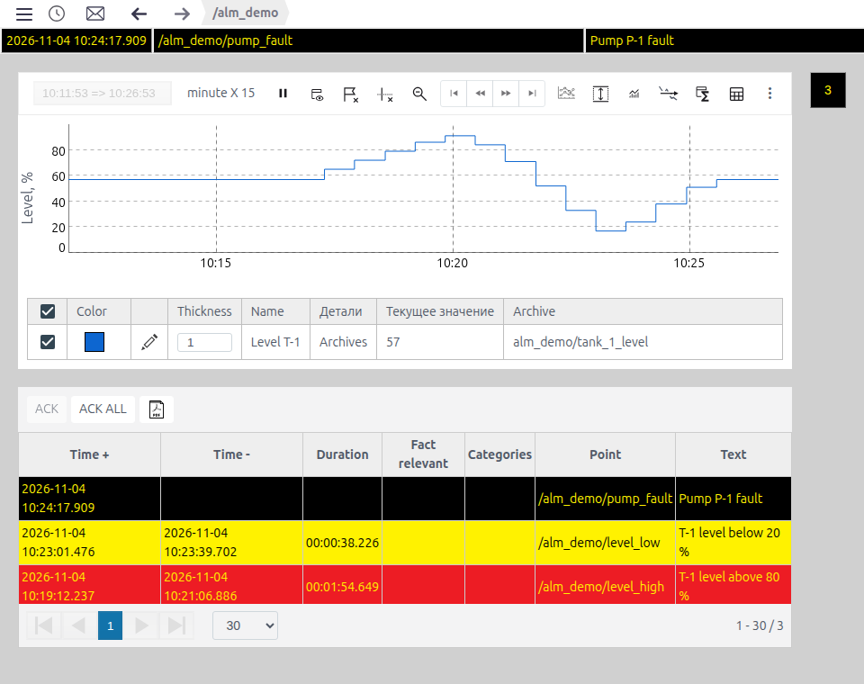
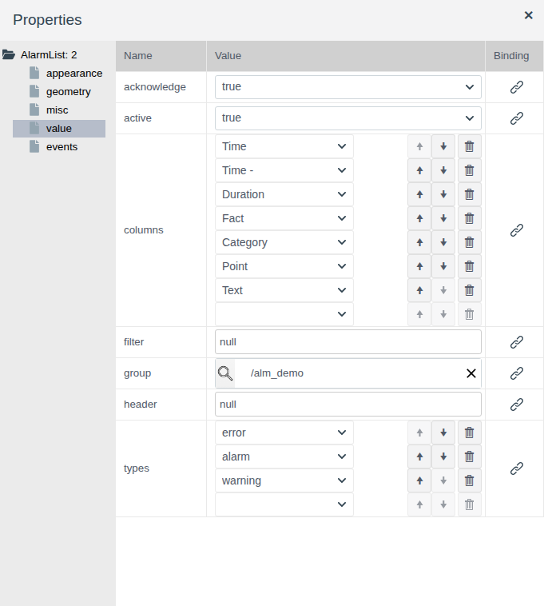
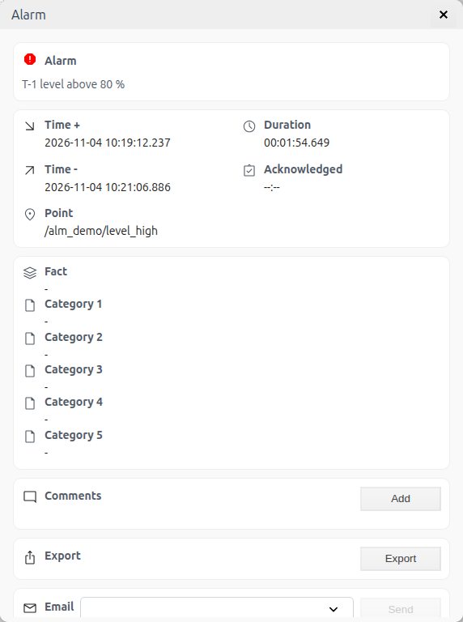
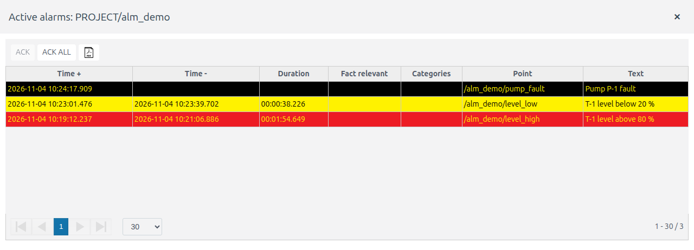
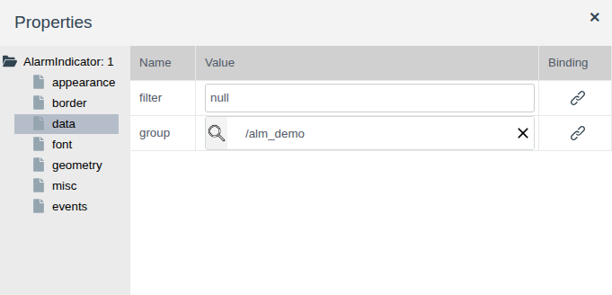
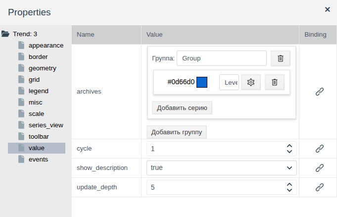
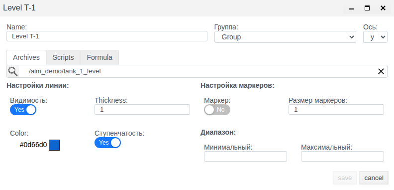
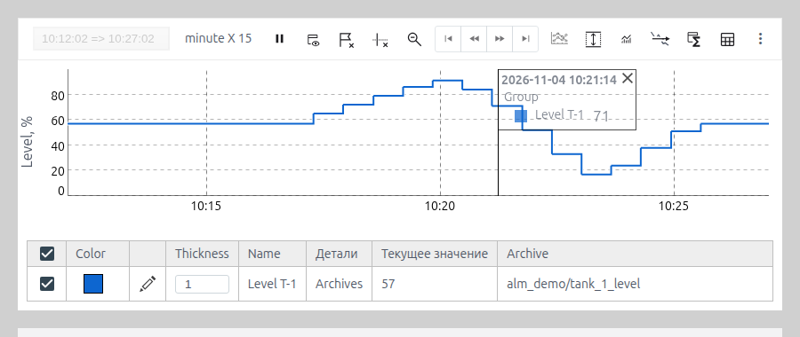

# Alarms and trends on a screen

A document for the integration engineer who needs to show the operator, on a screen, the alarms of their equipment and a chart of a value over the last minutes or hours.

# Contents

- [Glossary](#glossary)
- [Introduction](#introduction)
- [Main part](#main-part)
    - [Elements on the palette](#elements-on-the-palette)
    - [Alarm list: what gets into the list](#alarm-list-what-gets-into-the-list)
    - [Alarm list: columns and Runtime view](#alarm-list-columns-and-runtime-view)
    - [Alarm list: operator actions](#alarm-list-operator-actions)
    - [Alarm indicator](#alarm-indicator)
    - [Trend: series](#trend-series)
    - [Trend: series from a script or formula](#trend-series-from-a-script-or-formula)
    - [Trend: time window, scales and refresh](#trend-time-window-scales-and-refresh)
    - [Trend: appearance and legend](#trend-appearance-and-legend)
    - [Trend: toolbar](#trend-toolbar)
- [Conclusion](#conclusion)

# Glossary

| Term | Meaning |
|---|---|
| Message template | A project object of type `alarm_template`: it watches a tag field and creates a message when its condition is met. Creating a template is described in [Messages and alarms in Faceplate, section "Configuring a message"](../alarm/alarm_en.md#2-configuring-a-message) |
| Message | A log record created by a template: time on, time off, text, type. An alarm is a message about a violation |
| Message type | `error`, `alarm`, `warning`, `info`, `dsf` — set in the template. The type defines the row color in the list and the indicator color |
| Active message | The template condition is still met: time off is empty |
| Acknowledgement | The operator's confirmation that they have seen the message. It does not clear the active state: an acknowledged message stays active while the condition is met |
| Group | A project folder or a single template whose messages the element shows |
| Archive | A project object of type `ARCHIVE` that records the history of a tag field. Creating an archive is described in [Archives: configuring sources and recording data](../data_storage/archives/archives_en.md) |
| Series | One trend line: an archive, script or formula, with its own color and axis |
| Slice | A vertical line on a trend labelled with the time and the series values at that moment |
| Legend | A box on the trend chart: the time of the point under the mouse pointer and the names and values of the series at that point |
| Level line | A horizontal line on a trend at a given value |

The terms "Tag" and "Binding" are in [Buttons and value input](controls.md#glossary); "Screen", "Palette", "Element" are in [Screen editor](editor.md#glossary).

# Introduction

The operator sees project alarms in the alarm strip above the screen and in the message log. That is not enough when a screen shows one unit: the operator needs the alarms of exactly that unit's equipment next to its screen, and a chart of the parameter that shows how the value approached the limit. Three elements are placed on the screen for this:

- **Alarm list** — a table of the messages of the selected folder with acknowledgement;
- **Alarm indicator** — a square with the number of messages whose color shows the most severe type; a click opens a window with the list;
- **Trends** — a chart of archive values with a toolbar for browsing history.

The document describes the properties of these elements and their Runtime view. Work in the editor (adding, selecting, properties, saving) is described in [Screen editor](editor.md).

The running example is the `screen` of the `alm_demo` folder. The folder contains the object `tank_1` of the custom primitive `demo_alm` with fields `level` (float, tank level, %) and `fault` (integer, pump fault), the archive `tank_1_level` of the `level` field and three message templates:

| Template | Condition | Type | Text |
|---|---|---|---|
| `level_high` | `level` > 80 | `alarm` | T-1 level above 80 % |
| `level_low` | `level` < 20 | `warning` | T-1 level below 20 % |
| `pump_fault` | `fault` ≠ 0 | `error` | Pump P-1 fault |

In the example the level rose above 80 %, fell below 20 %, then the pump fault came on. The trend shows the level over the last 15 minutes, the list shows three messages, the indicator shows 3 on a black background: there is an unacknowledged `error` fault.



You need access to Studio (`http://<server>:9000/fp/studio`) with an account that may modify the project. The result is checked in Runtime (`http://<server>:9000/fp/runtime`); the project Runtime must be running.

# Main part

## Elements on the palette

All three elements are on the **Controls** palette:

| Icon tooltip | Property tree root | Purpose |
|---|---|---|
| Alarm list | `AlarmList` | Table of the group's messages with acknowledgement buttons |
| Alarm indicator | `AlarmIndicator` | Counter of the group's messages, colored by the most severe type |
| Trends | `Trend` | Chart of archive values |

The **appearance**, **geometry**, **misc** and **events** groups are the same as for the other screen elements (see [Graphic elements, section "Common properties"](graphics.md#common-properties)).

In the editor the elements show a placeholder: the list shows filler rows, the trend shows a dummy curve. Messages and archive data appear only in Runtime.

## Alarm list: what gets into the list

The **value** group defines which messages to show.



| Property | Purpose |
|---|---|
| `group` | Folder or message template selected with the magnifier. The list shows the messages of the templates in this folder or of one template. Empty — messages of the whole project. In the example `/alm_demo` |
| `acknowledge` | `true` — show unacknowledged messages |
| `active` | `true` — show active messages |
| `types` | Message types. A new element has `error`, `alarm`, `warning`; `info` can be added in the empty bottom row, the bin removes a type. If all rows are removed, there is no type restriction: the list also shows service messages — Dispatcher advisor summaries (`dsf`) and user logins (`oper`; they are not bound to a folder and are visible only with an empty `group`). Service message rows are white |
| `filter` | Additional selection condition in the **JSON** window |

`acknowledge` and `active` work together:

| `acknowledge` | `active` | What the list shows |
|---|---|---|
| `true` | `false` | Unacknowledged messages: both active and already cleared. This is the default for a new element |
| `false` | `true` | Active messages: both acknowledged and not |
| `true` | `true` | Messages that are active or unacknowledged. A message leaves the list when it is both cleared and acknowledged |
| `false` | `false` | All messages of the group, including cleared and acknowledged ones |

For a unit screen `true` / `true` is the usual choice: the operator sees everything that still needs attention, and an acknowledged but not resolved alarm does not disappear. The example uses this setting.

`filter` narrows the selection by message fields. The default value is `null` — no condition. A click on the value field opens the **JSON** window with the `{}` placeholder; replace it with a condition array `[field, operator, value]`, for example only the messages of one template:

```
["point", "=", "/<folder>/<template>"]
```

The `point` field is the template path shown in the **Point** column. After entering it click **Compile**, then **OK**.

## Alarm list: columns and Runtime view

The `columns` property is the ordered list of columns. Each row is a drop-down list, the arrows change the order, the bin removes a column, the empty bottom row adds a new one.

| Column in `columns` | Header in Runtime | Content |
|---|---|---|
| Time | Time + | Time on |
| Time - | Time - | Time off. Empty while the message is active |
| Duration | Duration | How long the message was active |
| Fact | Fact relevant | The related event if messages are linked in the template |
| Category | Categories | Categories 1–5 of the template separated by `/` |
| Point | Point | Path of the message template |
| Text | Text | Message text |

In Runtime the rows are sorted by time on, newest first. The row color depends on the message type (types from `types`):

| Type | Row background | Text |
|---|---|---|
| `error` | Black | Yellow |
| `alarm` | Red | Yellow |
| `warning` | Yellow | Black |
| `info` | Light blue | Black |

The list updates itself: a new message appears at the top without reloading the screen, a cleared one gets its time off and duration. Below the table are the page switcher and the number of rows per page (30 by default); on the right — the row range and the total number of messages.

In the example the list is 860 × 290 pixels with all seven columns; at this width date and time wrap to a second line.

## Alarm list: operator actions

Above the table there are three buttons:

| Button | Action |
|---|---|
| **ACK** | Acknowledges the selected rows. Disabled while nothing is selected. A row is selected with a click, several rows with Ctrl+click |
| **ACK ALL** | Acknowledges all rows of the current page of the list |
| PDF icon | Sends the list records to print as a table on an A4 landscape sheet. In the browser print window choose a printer or saving to PDF |

After acknowledgement a row stays or leaves depending on `acknowledge` and `active`. In the example (`true` / `true`) the acknowledged alarm `level_high` is already cleared, so it leaves the list, while the acknowledged fault `pump_fault` stays while it is active.

A double click on a row opens the message card: text, time on and time off, duration, acknowledgement, point, fact and categories. Below are the **Add** (comment) and **Export** buttons and the **Email** row. Working with the card is described in [Messages and alarms in Faceplate, section "Operator actions"](../alarm/alarm_en.md#3-operator-actions).

**Email** forwards the message by mail. The drop-down list contains users with the `operators` role; the mail goes to the address in the **Email** field of their account (Studio → **User rights** → **Users**). Select one or more recipients and click **Send**; after sending, a "Message sent" notification appears. The mail contains the message text, type, point, time on, fact and categories. Sending requires the SMTP parameters to be filled in and the email notifications switch to be on in Studio → **Alarm** → **Settings** → general settings (see [Messages and alarms in Faceplate, section "Email notifications"](../alarm/alarm_en.md#7-email-notifications)). In the example the `level_high` message was sent to the `mail_test` user and received.



## Alarm indicator

The indicator is a square with the number of the group's messages. It takes little space, so it is placed in a corner of a screen or on a button that leads to the unit, while the list goes only on the unit's own screen.

The indicator counts only messages of types `error`, `alarm` and `warning` that are active or unacknowledged; it ignores messages of all other types. From the counted messages it chooses its look:

| State of the group's messages | Indicator |
|---|---|
| Neither active nor unacknowledged | Hidden |
| Some are unacknowledged | Blinks, color of the most severe unacknowledged type |
| All acknowledged, some active | Steady, color of the most severe type |

Colors: `error` — yellow number on black, `alarm` — yellow on red, `warning` — black on yellow. The number is how many messages are counted; above 99 it shows `99+`.

In the example the indicator is 40 × 40 pixels in the top-right corner of the screen. After all three messages are acknowledged it stops blinking and shows 1 on black: the pump fault is still active. After it clears, the indicator hides.

A click on the indicator opens the window "Active alarms: PROJECT/<folder>" with a list of the same messages and the same **ACK**, **ACK ALL** and PDF buttons.



The **data** group defines what to count; the **font** and **border** groups set the look of the number and frame.



| Group | Property | Purpose |
|---|---|---|
| **data** | `group` | Folder or template whose messages the indicator counts. If one template is selected, the indicator watches only it |
| | `filter` | Additional condition in the **JSON** window, as for the list. For example `["type", "=", "alarm"]` — count only `alarm` messages |
| **font** | `font_family`, `font_size`, `bold`, `italic` | Font of the number |
| **border** | `border_width`, `border_color`, `border_style`, `border_radius` | Border; `border_radius` rounds the corners, with a radius of half the side the indicator is round |

The background and number colors are set by the message type; there are no separate properties for them.

## Trend: series

What the trend draws is set by the `archives` property in the **value** group. Its value is a set of series groups. Each group has the **Группа** field with its name and series rows: color, name, settings button (gear) and bin. **Добавить серию** adds a row to the group, **Добавить группу** adds a new group.



The gear opens the series window:



| Field | Purpose |
|---|---|
| **Name** | Series caption in the description table, legend and slices |
| **Группа** | Which series group the series belongs to. The group name is shown above the series in the legend and slice |
| **Ось** | `y` — left axis, `y2` — right axis. Use `y2` for a parameter with a different range, for example pressure next to level |
| **Archives** | Archive whose values the series draws. Selected with the magnifier |
| **Видимость** | **No** — when the screen opens the series is hidden and its check box in the description table is cleared. The operator shows the series by selecting the check box. Useful for auxiliary series that are not always needed |
| **Thickness**, **Color** | Line thickness and color |
| **Ступенчатость** | **Yes** — the value holds until the next archive record, the line is stepped. **No** — points are joined with sloped segments |
| **Маркер**, **Размер маркеров** | **Yes** — a dot at each archive record; dot size in pixels |

Click **save** in the series window, then save the screen.

Below the chart in Runtime there is the series description table: visibility check box, color, thickness, name, source type (**Детали**), current value and archive. Clearing the check box hides the line.

In the example there is one group "Group" and one series "Level T-1" on the archive `/alm_demo/tank_1_level`, axis `y`, blue, everything else by default.

## Trend: series from a script or formula

Besides an archive, a series can show a value calculated from several archives: a sum of flows, a temperature difference, a conversion to other units. The series window has the **Scripts** and **Formula** tabs for this.

Both tabs start with the **variablearchive** variable list: each row holds a variable name and an archive selected with the magnifier. A new row appears after the last one is filled in.

The **Scripts** tab holds a JavaScript function. It receives variable values in `VARS` and returns a number or `null`:

```javascript
function(VARS) {
   const result = VARS.<variable> * 2;
   if (typeof result !== 'number') return null;
   return result;
}
```

After entering it click **Compile**, then **save**.

The **Formula** tab holds a spreadsheet-style expression: variable names, arithmetic and functions, for example `ROUND`:

```
ROUND(<variable> / 10, 0) * 10
```

In the description table such a series shows the script type or the formula text in **Детали** and the variable names in **Archive**. Checked on a level archive with the value 65.46: the script `VARS.lv * 2` gave 130.91, the formula `ROUND(lv / 10, 0) * 10` gave 70.

## Trend: time window, scales and refresh

The trend shows the last stretch of time, which moves along with the current time.

| Group | Property | Purpose |
|---|---|---|
| **scale** | `time_step` | Unit of the window length: `second`, `minute`, `hour` |
| | `time_factor` | Window length in these units. `minute` and 15 — the last 15 minutes |
| | `range_min`, `range_max` | Limits of the left axis. Empty — fitted to the data |
| | `y2_range_min`, `y2_range_max` | Limits of the right axis |
| **value** | `cycle` | Chart refresh period in seconds. A new archive value appears on the chart within `cycle` seconds |
| | `show_description` | `false` — the series description table below the chart is hidden, the chart takes the full height |
| | `update_depth` | How far back the archive is re-read on each refresh, in seconds. Integer from 1, default 5 |

The window length is shown in Runtime on a toolbar button, for example "minute X 15". In the example `time_step` = `minute`, `time_factor` = 15, `range_min` = 0, `range_max` = 100, `cycle` = 1.

If the axis limits are empty, the axis fits the visible values: with an almost constant level, small fluctuations stretch over the full height. For a parameter with a known range set the limits explicitly so that the operator compares the line position with the thresholds.

When the screen opens, the trend loads the whole window; on each refresh it re-reads the last `update_depth` seconds of the archive. Values that reach the archive late — with a timestamp earlier than the moment of writing, for example from an archive script that returns `ts` (see [Archives: configuring sources and recording data, section "Script sources"](../data_storage/archives/archives_en.md#script-sources)) — are picked up by the trend if the delay is less than `update_depth`. For such an archive set `update_depth` greater than the write delay.

## Trend: appearance and legend

| Group | Property | Purpose |
|---|---|---|
| **series_view** | `ylabel`, `y2label` | Captions of the left and right axes. In the example `ylabel` = "Level, %" |
| | `ylabel_width` | Font size of the axis caption, from 12 to 32 |
| | `fill_graph` | `true` — the area under the line is filled with the series color |
| | `fill_opacity` | Fill opacity, from 0 to 1 |
| **grid** | `grid` | `false` — no grid |
| | `grid_x`, `grid_y` | Horizontal and vertical grid step in pixels |
| **legend** | `legend` | When to show the legend — series captions with values: `always` — always, in the top-left corner of the chart; `follow` — next to the mouse pointer; `never` — not shown |
| | `legend_font_family`, `legend_font_size`, `legend_text_color`, `legend_background_color` | Legend font, text and background colors |
| | `legend_max_numbers_after_point` | Decimal places of the values in the legend and in the **Текущее значение** column |
| | `max_hairlines` | How many slices can be placed at once |
| **misc** | `background_color` | Element background |
| **border** | `border_width`, `border_color`, `border_style`, `border_radius` | Element border |

The operator places a slice with a right click on the chart: a vertical line with the date, time and series values at that moment. A slice can be dragged with the mouse, × closes it. When there are already `max_hairlines` slices, a new slice replaces the oldest one. A double click on the chart adds a level line at the value under the pointer; it appears in the description table as "Линия уровня 1".



## Trend: toolbar

Above the chart there is a toolbar. The flags of the **toolbar** group define which buttons it shows. This way the integrator leaves the operator only the tools they need, for example removes export and analytics from a shift screen.

| Property | Value | Toolbar |
|---|---|---|
| `toolbar_visible` | `show` | The toolbar is visible. This is the default for a new element |
| | `hide` | No toolbar, the chart takes its place |
| | `roll up` | The toolbar is collapsed; the triangle in the top-left corner expands and collapses it |

Buttons go from left to right. The tooltip is the text that appears when you point at a button. If the element is narrow, the last buttons move to the **⋮** menu at the right edge of the toolbar.

| Flag | Button tooltip | Purpose |
|---|---|---|
| `set_period` | — | The "start => end" field of the window. While paused, an arbitrary period is entered here |
| `set_interval` | Period | Window length, the button reads like "minute X 15" |
| | Start-Stop | Pause: the chart stops moving. Pressing it again returns to the current time |
| | Go begin, Step back, Step forward, Go to end | Shift the window by its length. Available only while paused |
| `set_show_description` | Show/hide description | Shows or hides the series description table |
| `annotations` | Удалить аннотации и срезы | Removes slices and marks from the chart |
| `crosshair` | Удалить трассировку и выноски | Removes tracing lines and callouts |
| `reset_zoom` | Reset zoom | Returns the scale after zooming into a part with the mouse |
| `compare_period`, `set_interval` | Сравнение периода | Overlays another period on the current one. Available only while paused |
| `set_scale` or `select_range` | Scale settings | Axis limits while browsing |
| `select_archives` | Редактор групп | Series and groups while browsing |
| `add_level_lines` | Линии уровня | List of level lines |
| `analytics` | Аналитика | Series statistics for the period |
| `analytics_export` or `export` | Экспорт аналитики | Export of the statistics |
| `data_export` or `export` | Save as .csv | Export of the series values for the window to .csv or .xlsx |
| `appearance` | Settings | Chart appearance while browsing |
| `hairline_grid` | Slice Table | Values of the placed slice as a table |
| `export` | Print | Prints the chart |
| — | Export trends to a file, Import trends from a file | Saving and loading the trend composition as a .tnd file. Always visible |
| — | Maximize | The trend in a separate full-screen window. Always visible |

Where the "Flag" column names two properties, either of them set to `true` shows the button; to remove the button, turn both off. All flags are on for a new element.

# Conclusion

How to choose an element:

| What to show | Element |
|---|---|
| Unit alarms with acknowledgement right on its screen | Alarm list, `group` — the unit folder |
| That the unit has alarms, on an overview screen or a navigation button | Alarm indicator, `group` — the unit folder |
| How a parameter changed when an alarm came | Trend with a series on the archive of that parameter |
| A calculated value from several parameters | Trend with a series from a script or formula |

Working with the list and indicator:

1. Create message templates in the unit folder.
2. Add an **Alarm list**, select the folder in `group`, set `acknowledge`, `active`, and if needed `types`, `filter` and `columns`.
3. Add an **Alarm indicator** with the same folder in `group`.
4. Save the screen and check the messages, acknowledgement and indicator in Runtime.

Working with the trend:

1. Create an archive of the field to show.
2. Add **Trends**, in `archives` open the series window with the gear, set the name and select the archive.
3. Set the window length (`time_step`, `time_factor`), axis limits and captions.
4. Leave the needed buttons on the toolbar with the **toolbar** group flags.
5. Save the screen and check the chart in Runtime.
