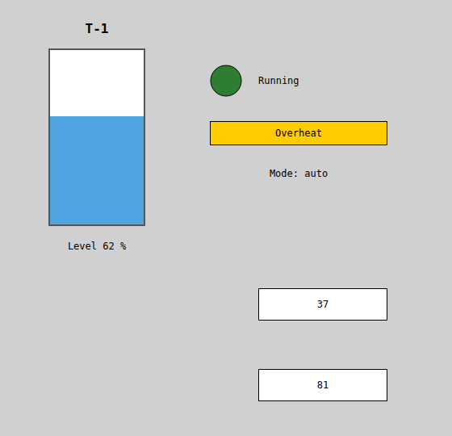
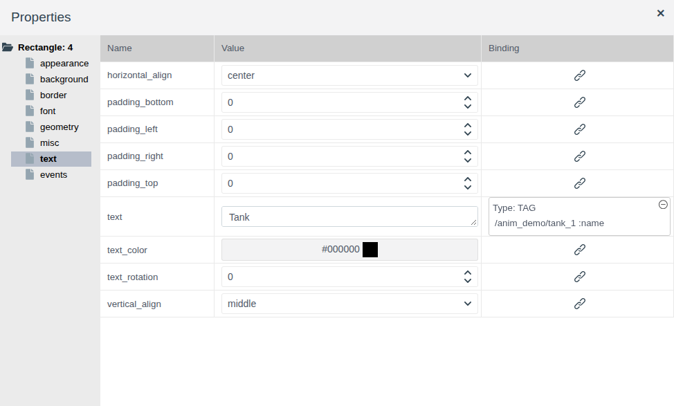
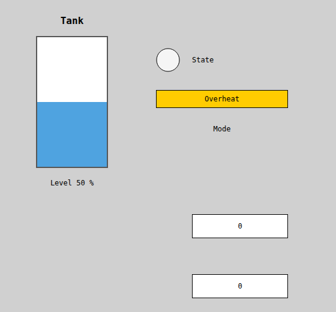
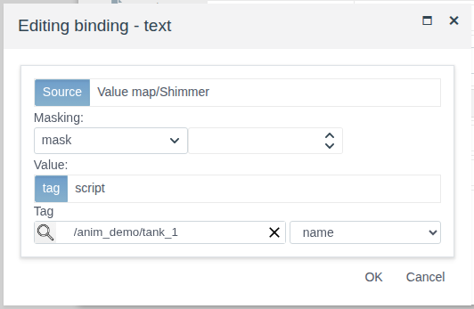
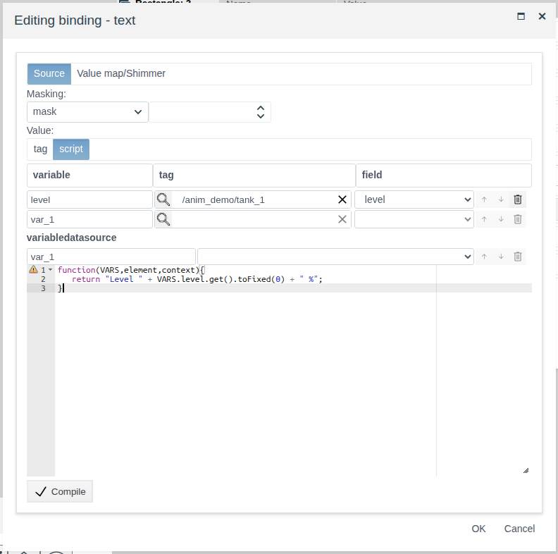
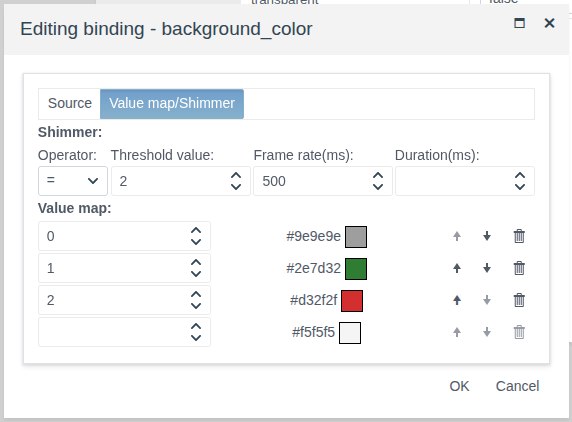
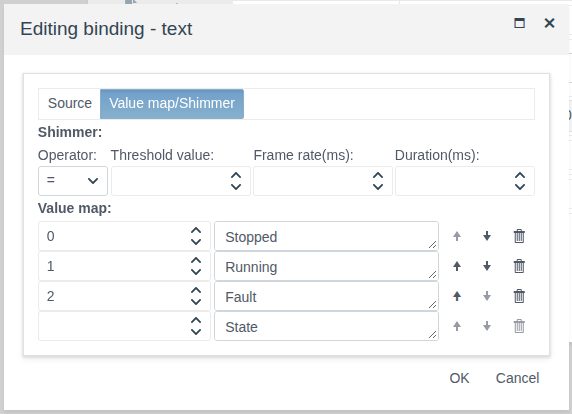
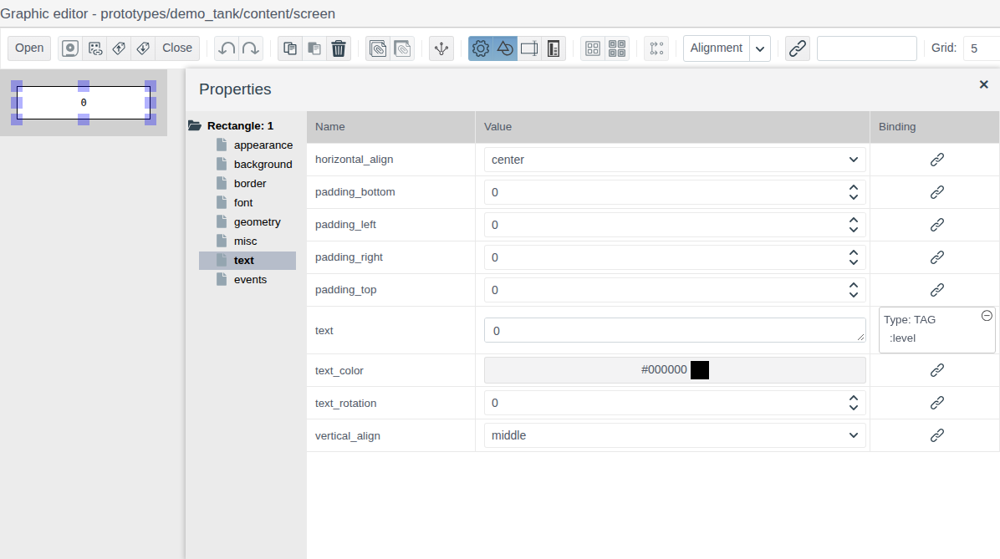

# Bindings and animation

A document for the integration engineer who brings a screen to life: elements must show tag values, change color and text with the equipment state, blink on a fault, move and resize with the measured value.

# Contents

- [Glossary](#glossary)
- [Introduction](#introduction)
- [Main part](#main-part)
    - [The Binding column](#the-binding-column)
    - [Binding window](#binding-window)
    - [Binding to a tag](#binding-to-a-tag)
    - [Script binding](#script-binding)
    - [Masking](#masking)
    - [Value map](#value-map)
    - [Shimmer](#shimmer)
    - [Movement and size](#movement-and-size)
    - [Binding on a prototype screen](#binding-on-a-prototype-screen)
- [Conclusion](#conclusion)

# Glossary

| Term | Meaning |
|---|---|
| Binding | A link between an element property and project data. In Runtime the property gets the value of a tag field or the result of a script and changes with it |
| Variable | The name under which a tag field is available in a binding script: `VARS.<name>.get()` |
| Threshold | A number in a value map row or in the shimmer settings that the field value is compared with |

The terms "Tag" and "Binding" as applied to input fields are explained in [Buttons and value input](controls.md#glossary), "Screen", "Palette" and "Element" in [Screen editor](editor.md#glossary).

# Introduction

Bindings are set for the properties of screen elements: background color, text, visibility, position, size. With them a lamp takes the color of the pump state, a label shows the mode, a warning appears when a fault bit is set, and the level in a tank rises and falls with the measurement. There are no separate animation elements: everything is done with bindings.

This document describes the binding window and all its modes: tag value, script, bit masking, value map, shimmer. Binding the geometry (movement and size) and binding on a prototype screen are shown separately. Working in the editor (adding elements, the properties panel, saving) is covered in [Screen editor](editor.md), the elements themselves in [Graphic elements](graphics.md). The opposite direction — writing to tags on an operator action — is set with events, see [Scripts and events](events.md).

The running example is the `screen` of the `anim_demo` folder. The folder holds the object `tank_1` of a custom primitive `demo_anim`:

| Field | Type | Meaning |
|---|---|---|
| `level` | float | Level in the tank, % |
| `state` | integer | Pump state: 0 — stopped, 1 — running, 2 — fault |
| `flags` | integer | Status word: bits 0–1 — mode (0 manual, 1 auto, 2 remote), bit 2 — overheat |
| `name` | string | Tag number of the tank |

On the example screen: the tank name, the tank with a fill by level and a level label, the pump lamp and state label, an "Overheat" plate and a mode label. Below are two instances of the prototype `demo_tank`, each showing its own level.



You need access to Studio (`http://<server>:9000/fp/studio`) with an account that may change the project. The result is checked in Runtime (`http://<server>:9000/fp/runtime`).

# Main part

## The Binding column

In the **Properties** panel, to the right of the property value, is the **Binding** column. The chain-link button opens the binding window for the property. After **OK** the cell shows a description of the binding instead of the button:

- `Type: TAG` and the field path: `/<folder>/<object> :<field>`. In the example it is `/anim_demo/tank_1 :name`;
- `Type: SCRIPT` and a line per script variable.

Clicking the description opens the binding for editing. The ⊖ icon in the corner of the cell deletes the binding after confirmation **yes**.



In the editor an element shows the value from the **Value** column, in Runtime the value from the binding. In the example the tank on the canvas is half full and the labels show the placeholders "State" and "Mode"; in Runtime the `tank_1` data take their place. A change of the tag field is immediately visible on an open screen. If no value is received (the field has no value yet, the script ended with an error), the element in Runtime is grey and shows the value from the editor.



Bindings are saved with the screen: save the screen after setting them up.

## Binding window

The window has two tabs.

| Tab | Field | Purpose |
|---|---|---|
| **Source** | **Masking** | Extracting bits from an integer: the "mask" or "bit" mode and a number. An empty number means no masking. See [Masking](#masking) |
| | **Value** | Where the value comes from: **tag** — an object field, **script** — the result of a script. See [Binding to a tag](#binding-to-a-tag), [Script binding](#script-binding) |
| **Value map/Shimmer** | **Shimmer** | The condition under which the property blinks. See [Shimmer](#shimmer) |
| | **Value map** | Thresholds and the property values for them. See [Value map](#value-map) |

The value is processed in tab order: masking, then shimmer and value map.

## Binding to a tag

The property gets the field value as is.

1. Select the element, open the property group and click the button in the **Binding** column.
2. On the **Source** tab keep **Value** = **tag**.
3. Click the magnifier, pick the object and click **OK**. Pick the field in the list on the right.
4. Click **OK**.

In the example the `text` of the label above the tank is bound to `tank_1.name`: in the editor the label reads "Tank", in Runtime "T-1".



The field must give a value the property understands:

| Property | Tag field |
|---|---|
| `text`, `title` | Any: a string is shown as is, a number as a number |
| `background_color`, `border_color`, `text_color`, `gradient_color` | `string` with a color code, for example `#00aa00` |
| `visible`, `bold`, `italic`, `transparent` | `bool` |
| `left`, `top`, `width`, `height`, `font_size`, `border_width`, `border_radius`, `text_rotation`, `z_index` | `integer`, `float` within the range allowed for the property |
| `border_style`, `gradient` | `string` with one of the values of the property's list, for example `dashed`, `horizontal` |
| `texture` | `string` with the path to an image of the [image library](images.md), for example `/IMAGES/textures/red_brick.jpg` |

A [value map](#value-map) turns a number into a color or a state text, [masking](#masking) turns bits into "yes/no", and a [script](#script-binding) does any other conversion.

## Script binding

The property gets the result of a JavaScript function. This way a value is recalculated (level into pixels), formatted (a number into a string with units) or built from several fields.

1. On the **Source** tab choose **Value** = **script**.
2. Define the variables in the **variable** / **tag** / **field** table: the variable name, the object (magnifier) and the field. The empty bottom row adds a variable.
3. Write the function in the editor below and click **Compile**. **OK** appears next to the button.
4. Click **OK** of the window.

The function receives the variables in `VARS`. The field value is `VARS.<name>.get()`. Whatever the function returns with `return` becomes the property value. The script runs when the screen opens and on every change of any of the variables' fields.

In the example the label under the tank shows the level with units. The variable `level` is the field `tank_1.level`:

```javascript
function(VARS,element,context){
   return "Level " + VARS.level.get().toFixed(0) + " %";
}
```



There may be several variables: each table row is its own variable, and the script gets all of them through `VARS`. In the example `return VARS.tname.get() + ": " + VARS.level.get();` for the fields `name` and `level` gives "T-1: 62". For the `text` property to show a word, return a string.

A script can also calculate a value from the records of a data source — the **variabledatasource** section of the window (see [Data sources on a screen, section "A source in a script"](datasources.md#a-source-in-a-script)).

## Masking

Masking extracts bits from an integer field — a controller status word. It is set on the **Source** tab: the mode in the **Masking** list and the number to the right.

| Mode | Number | Result |
|---|---|---|
| bit | Bit number, from 0 | 1 if the bit is set, otherwise 0 |
| mask | A mask, for example 3 (bits 0 and 1) | The field value bitwise ANDed with the mask: for a field value of 5 and mask 3 — 1 |

The "bit" mode suits "yes/no" properties (`visible`, `bold`, `transparent`). The result of the "mask" mode is a number; a value map turns it into a color or a text.

In the example, the "Overheat" plate: `visible` is bound to `tank_1.flags`, "bit", 2. With `flags` = 5 (bit 2 set) the plate is visible, with `flags` = 2 it is hidden.


In the example the mode label: `text` is bound to `tank_1.flags`, "mask", 3, and the value map turns 0, 1, 2 into "Mode: manual", "Mode: auto", "Mode: remote". The overheat bit does not affect the mode: with `flags` = 5 the label reads "Mode: auto".


## Value map

A map turns a number into a property value, for example into a color or a text. It is set on the **Value map/Shimmer** tab in the **Value map** section: each row is a threshold (an integer) and a property value. The value field is the same as in the properties panel: for a color the color selection window opens, for a text it is an input field.

The bottom row without a threshold is a blank: enter a threshold and the row is added to the map, and a new blank appears below.

The field value gets the row with the largest threshold that is not greater than the value. Values below the first threshold get the first row. For the map 3 → green, 8 → red: 3…7 — green, 8 and above — red, 0 — green.

A map works with numeric fields (`integer`, `float`) and with the result of masking.

In the example, the pump lamp: `background_color` is bound to `tank_1.state`, map 0 → grey, 1 → green, 2 → red.



In the example the state label: `text` is bound to the same field, map 0 → "Stopped", 1 → "Running", 2 → "Fault".



## Shimmer

Shimmer draws the operator's attention: while the condition holds, the property alternates between the value from the binding and the value from the editor. It is set on the **Value map/Shimmer** tab in the **Shimmer** section:

| Field | Purpose |
|---|---|
| **Operator** | Comparison of the field value with the threshold: `=`, `>`, `>=`, `<`, `<=` |
| **Threshold value** | The threshold, an integer |
| **Frame rate(ms)** | Time in milliseconds after which the values replace each other |
| **Duration(ms)** | How many milliseconds the shimmer lasts after the value changes. Empty — while the condition holds |

Shimmer is on when the threshold and the frame rate are set.

In the example the lamp has the operator `=`, threshold 2, frame rate 500: on a fault (`state` = 2) the lamp blinks red (the color from the map) and light grey (`background_color` in the editor). When `state` changes, the shimmer stops and the lamp takes the color from the map.

With a duration, shimmer signals a new event: it starts when the value changes and stops after the given time. If the screen is opened when the condition already holds, there is no shimmer.

Without a value map, shimmer works with the field value itself: for example, `border_width` alternates between the tag value and the width from the editor.

## Movement and size

The position and size of an element are properties like color: `left`, `top`, `width`, `height` of the **geometry** group. Binding them moves and resizes the element; `text_rotation` rotates the text of a rectangle.

In the example the tank fill is a blue rectangle inside a frame 216 pixels high (frame `top` 60, bottom at 278). The fill height is proportional to the level, and the top edge goes down so that the bottom stays on the tank bottom. Both bindings are scripts with the variable `level`:

| Property | Script |
|---|---|
| `height` | `return VARS.level.get() * 2.16;` |
| `top` | `return 278 - VARS.level.get() * 2.16;` |

In the example, with `level` = 62 the fill is 134 pixels high, with 20 — 43, with 90 — 194.

Movement is done the same way: `left` or `top` calculated by a script from the position of a valve, a trolley, a level.

## Binding on a prototype screen

A prototype screen is one for all instances, so a binding on it points not to an object but to a prototype field. Each instance placed on a project screen shows its own values.

1. Open the prototype screen (see [Screen editor, section "Prototype screens"](editor.md#prototype-screens)).
2. Open the binding window and click the magnifier. The selection window holds one object — the prototype itself. Pick it, click **OK** and pick a prototype field.
3. Click **OK**. The **Binding** column shows `Type: TAG` and the field without a path, for example `:level`.



The field list holds the prototype fields (see [Prototypes, section "Fields"](../project_objects/prototypes/prototypes.md#fields)).

In the example the prototype `demo_tank` has the field `level`, and its `screen` has a rectangle whose `text` is bound to `:level`. The `anim_demo` screen holds the instances `tank_p1` and `tank_p2`: in Runtime the first shows 37, the second 81 (see [the screenshot in the Introduction](#introduction)).

# Conclusion

| Task | How |
|---|---|
| Show a field value | Binding to a tag |
| Recalculate, format, build from several fields | Script binding |
| Color or label by state | Value map |
| Show or hide by a bit of a status word | "bit" masking on `visible` |
| Decode a group of bits (mode) | "mask" masking + value map |
| Draw attention to a fault | Shimmer |
| Move an element, change its size | Binding `left`, `top`, `width`, `height` |
| One screen for all instances | Binding to a field on a prototype screen |

Workflow:

1. Prepare the tag fields: numbers for states and levels, strings for texts and color codes.
2. Draw the elements and set in the editor the values the operator sees while there is no data and in the second phase of shimmer.
3. Bind the properties: tag, masking if needed, value map, shimmer or script.
4. Save the screen and check it in Runtime by changing the field values in the object form in Studio.
