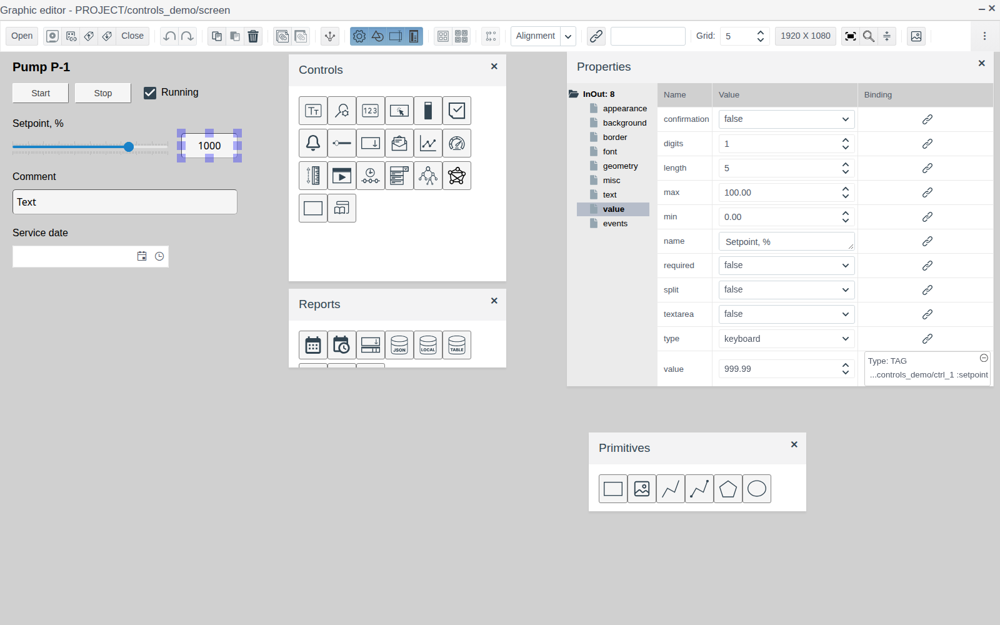
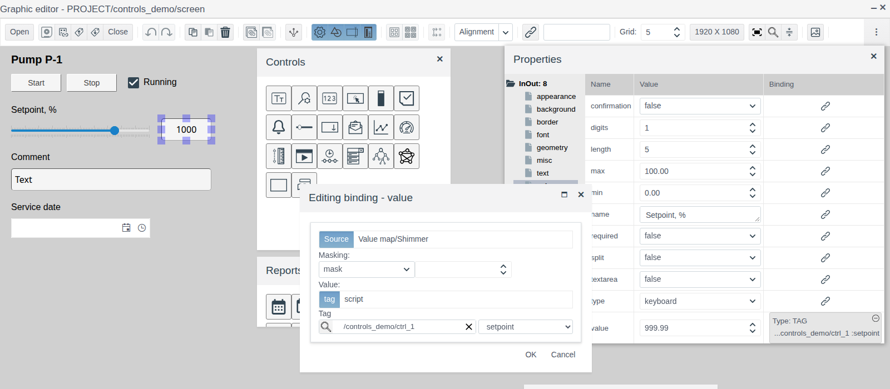
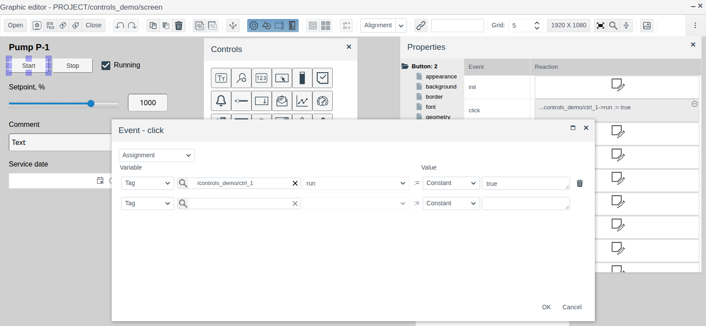
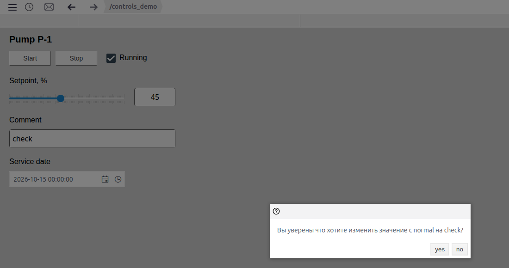
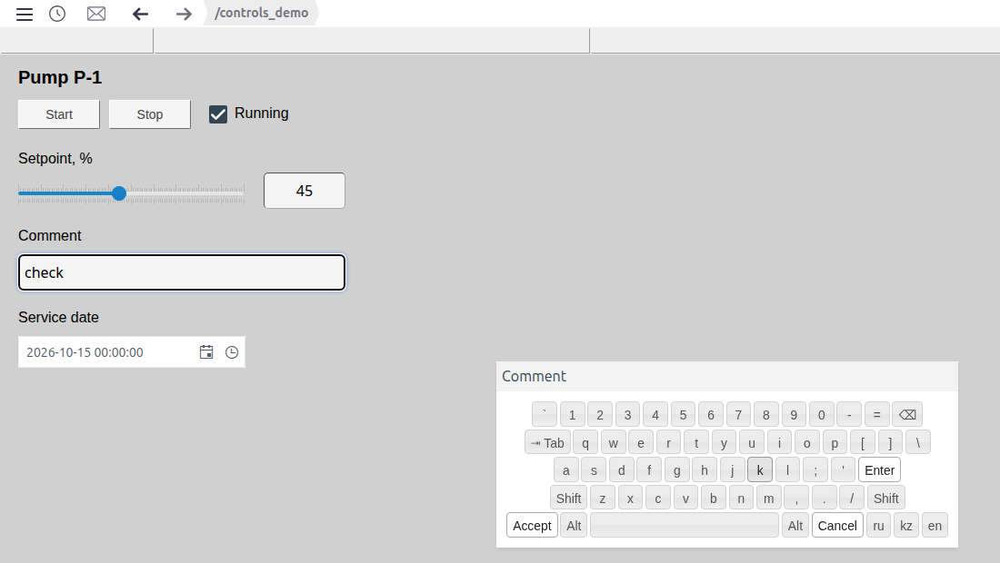
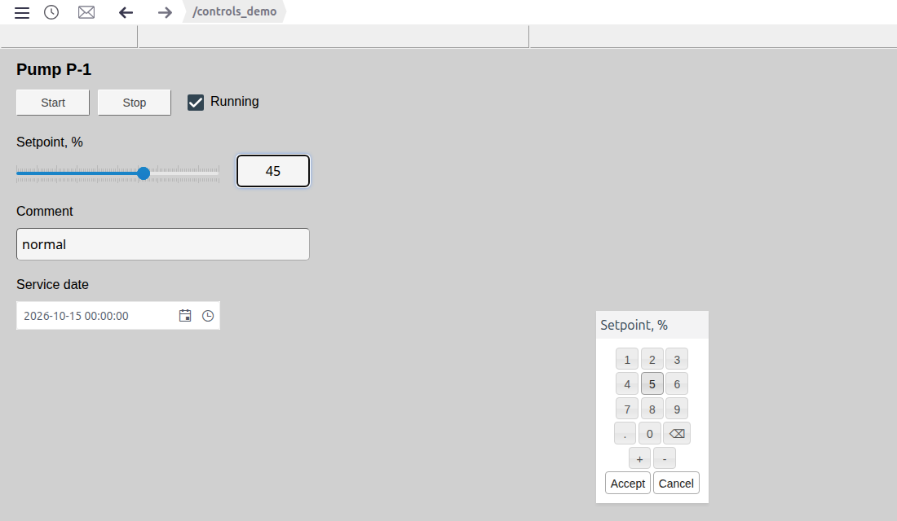
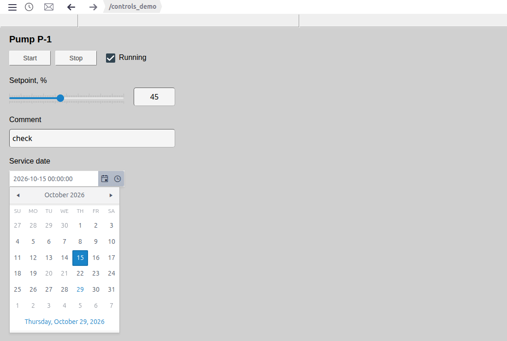
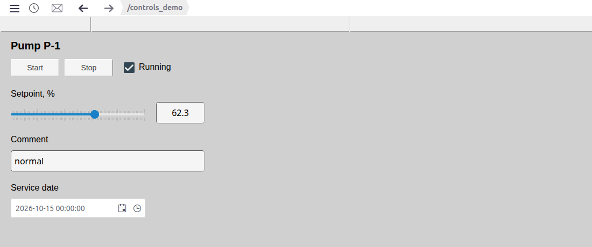

# Buttons and value input

A document for the integration engineer who builds operator controls on a screen: command buttons, checkboxes, sliders, fields for setpoints, text and dates.

# Contents

- [Glossary](#glossary)
- [Introduction](#introduction)
- [Main part](#main-part)
    - [Elements on the palettes](#elements-on-the-palettes)
    - [Linking an element to a tag](#linking-an-element-to-a-tag)
    - [Common properties](#common-properties)
    - [Button](#button)
    - [Checkbox](#checkbox)
    - [Slider](#slider)
    - [Number input field](#number-input-field)
    - [Text input field](#text-input-field)
    - [On-screen keyboard](#on-screen-keyboard)
    - [Date and date-time](#date-and-date-time)
- [Conclusion](#conclusion)

# Glossary

| Term | Meaning |
|---|---|
| Tag | A project object whose field a screen element shows or changes. In the example, the instance `ctrl_1` |
| Binding | A link between an element property and a tag field. Set with the button in the **Binding** column of the **Properties** panel |
| Assignment | A reaction to an element event without a script: write a constant, another field value or an element property into a tag field |
| On-screen keyboard | A window with keys for entering a value with the mouse or by touch, without a physical keyboard |

The terms "Screen", "Element", "Palette" are explained in [Screen editor](editor.md).

# Introduction

Input elements turn a screen from a picture into a control panel: in Runtime the operator starts and stops equipment, changes setpoints, writes comments, sets dates. Each element shows the current value of a tag field and writes what the operator entered into that field.

This document describes the input elements, their properties and their behaviour in Runtime. Working in the editor (adding, selecting, properties, saving) is covered in [Screen editor](editor.md); shapes and labels are covered in [Graphic elements](graphics.md).

The running example is the `screen` of the `controls_demo` folder: a pump control panel. The data is in the object `ctrl_1` of a custom primitive `demo_ctrl` with the fields `run` (bool), `setpoint` (float), `note` (string) and `service_dt` (string). The screen has the **Start** and **Stop** buttons, the "Running" checkbox, a slider and a setpoint field, a comment field and a service date field.



You need access to Studio (`http://<server>:9000/fp/studio`) with an account that may change the project. The result is checked in Runtime (`http://<server>:9000/fp/runtime`).

# Main part

## Elements on the palettes

Elements are added by dragging an icon from a palette onto the canvas. The element name is shown in the icon tooltip, the type in the root of the property tree.

| Palette | Icon tooltip | Property tree root | Purpose |
|---|---|---|---|
| **Controls** | Button | `Button` | A command on click: start, stop, acknowledge, reset |
| **Controls** | Checbox | `Checkbox` | Switching a logical flag on and off |
| **Controls** | Slider | `Slider` | Smooth change of a number within a range |
| **Controls** | Input-output field (icon `123`) | `InOut` | Showing and entering a number |
| **Controls** | Input-output field (icon `Tт`) | `InOutText` | Showing and entering text |
| **Reports** | Date | `DatePicker` | Picking a date |
| **Reports** | Date - Time | `DateTimePicker` | Picking a date and time |

## Linking an element to a tag

The checkbox, slider, input fields and date fields keep their value in the `value` property of the **value** group. To make an element show a tag field and write the operator's input into it:

1. Select the element, open the **value** group and click the button in the **Binding** column of the `value` row.
2. In the binding window, on the **Source** tab, keep the **tag** mode.
3. Click the magnifier, pick the object (`ctrl_1` in the example) and click **OK**. Pick the field in the list on the right.
4. Click **OK**. The **Binding** column shows `Type: TAG` and the field path.



Clicking a filled binding opens it for editing.

The field type must suit the element:

| Element | Tag field type |
|---|---|
| Checkbox | `bool` |
| Slider, number input field | `integer`, `float` |
| Text input field | `string` |
| Date, date-time | `string`: the date is written in ISO 8601 UTC, for example `2026-10-14T19:00:00.000Z` |

Several elements can be bound to one field: in the example the slider and the setpoint field both show `setpoint`, and a change in one is immediately visible in the other.

## Common properties

| Group | Property | Purpose |
|---|---|---|
| **misc** | `enabled` | `false` — the element accepts no input. A button's text takes the `disabled_color` colour |
| **value** | `name` | For input fields: title of the on-screen keyboard window |
| | `required` | For input fields: `true` — an empty value is not accepted, the operator sees a message |

The **appearance**, **geometry**, **misc** (`z_index`, `title`, `cursor`), **border** and **font** groups are the same as for graphic elements (see [Graphic elements, section "Common properties"](graphics.md#common-properties)).

## Button

A button with a caption. By itself it writes nothing: the action is set in the **events** group, usually on the `click` event.

To make a button write a value into a tag without a script:

1. Select the button, open the **events** group and click the **Reaction** cell in the `click` row.
2. In the "Event - click" window keep **Assignment**.
3. In the **Variable** column: **Tag**, magnifier → object → **OK**, the field on the right. In the example `ctrl_1`, field `run`.
4. In the **Value** column: **Constant** and the value. `true` for **Start**, `false` for **Stop**.
5. Click **OK**.



When a row is filled, an empty row appears below it for the next assignment. The bin deletes a row. Instead of a constant, the **Value** column can take a field of another tag (**Tag**) or a property of the button itself (**Property**).

| Group | Property | Purpose |
|---|---|---|
| **text** | `text` | Button caption. Enter starts a new line |
| | `text_color`, `disabled_color` | Caption colour of an available and an unavailable (`enabled` = `false`) button |
| | `horizontal_align`, `vertical_align`, `padding_*` | Caption alignment and padding, as for a rectangle |
| **background** | `background_color`, `transparent` | Background, transparent background |
| **border** | `border_width`, `border_color`, `border_radius` | Border |

An unavailable button shows its caption in `disabled_color` and does not react to clicks.

## Checkbox

A box with a tick for a `bool` field. In the example the "Running" checkbox is bound to `ctrl_1.run`: it is ticked after **Start** and cleared after **Stop**. Clicking the checkbox in Runtime toggles the field.

The checkbox caption is a separate rectangle without background and border (see [Graphic elements, section "Rectangle", paragraph "Label"](graphics.md#rectangle)).

## Slider

A scale with a handle. The operator drags the handle or clicks the scale, and the value is written into the tag field.

| Property (**value** group) | Purpose |
|---|---|
| `min`, `max` | Scale limits |
| `small_step` | Handle step and small scale ticks |
| `large_step` | Large scale ticks with labels |

The `orientation` property of the **appearance** group: `horizontal` or `vertical`. In the example a 0…100 slider with step 1 and ticks every 10 is bound to `ctrl_1.setpoint`.

## Number input field

The `InOut` field shows a number and accepts input. The input method is set by the `type` property of the **value** group:

| `type` | How the operator enters a value |
|---|---|
| empty | No input, the field only shows the value |
| `direct` | Click the field, type on the keyboard; Enter or moving elsewhere writes the value. Only digits, a point and a sign are accepted |
| `keyboard` | On hover a keyboard button appears to the right of the field. It opens the numeric on-screen keyboard |

Other properties of the **value** group:

| Property | Purpose |
|---|---|
| `digits` | Number of decimal places shown. The entered value is written without rounding |
| `length` | How many characters the number takes when shown |
| `split` | `true` — digit groups are separated by a space |
| `min`, `max` | Allowed range. A value outside it is not written, the operator sees a message naming the limit |
| `confirmation` | `true` — the operator confirms the change before it is written (see [Text input field](#text-input-field)) |

If the input is not accepted (out of range, empty with `required`, not a number), the field returns to the previous value.

In the example the setpoint field has `digits` = 1, `min` = 0, `max` = 100, `type` = `keyboard`, `name` = "Setpoint, %", and `value` is bound to `ctrl_1.setpoint`.

Appearance: the **text** (`align`, `padding`, `text_color`), **font**, **background** and **border** groups (`border_radius` rounds the corners).

## Text input field

The `InOutText` field does the same for strings. `type` is empty, `direct` or `keyboard`; they work as for the number field. Properties of the **value** group:

| Property | Purpose |
|---|---|
| `length` | Maximum text length. Longer text is not written, the operator sees a message with the limit |
| `textarea` | `true` — multi-line field |
| `confirmation` | `true` — before writing, a window asks to confirm the change from the old to the new value, with **yes** and **no**. **no** returns the previous value |

In the example the comment field has `type` = `keyboard`, `length` = 40, `confirmation` = `true`, and `value` is bound to `ctrl_1.note`.



While the tag field has no value, input and date fields are shown grey in Runtime.

## On-screen keyboard

Used on panels without a physical keyboard. It is turned on by `type` = `keyboard` on a number or text field. In Runtime hover over the field: a keyboard button appears on the right. The keyboard window takes its title from the `name` property.

The text field gets a full keyboard with the **ru**, **kz**, **en** layouts. **Accept** writes the value, **Cancel** closes the window without writing.



The number field gets a numeric keyboard: digits, point, `+`, `-`, delete a character. **Accept** writes the value with the `min`/`max` check, **Cancel** closes the window without writing.



## Date and date-time

The **Date** and **Date - Time** elements of the **Reports** palette are fields with a calendar. **Date** picks a date (shown as `yyyy-MM-dd`), **Date - Time** a date and time (shown as `yyyy-MM-dd HH:mm:ss`): the calendar button opens a month, the clock button a list of times. The date and time can also be typed into the field.

| Property (**value** group) | Purpose |
|---|---|
| `value` | The value; to write it into a tag, bind it to a `string` field |
| `interval` | **Date - Time** only: step of the time list in minutes, 30 by default |
| `config` | Settings in JSON. `disableDates` is a list of dates that cannot be picked |

`config` is edited in the JSON window: enter the text, click **Compile**, after `ok` click **OK**. In the example the service date field has:

```json
{
  disableDates: ["2026-10-20", "2026-10-21"]
}
```

These days are grey in the calendar and cannot be picked.



# Conclusion

Working order for input elements:

1. Prepare a tag with fields of suitable types: `bool` for a checkbox, `integer`/`float` for a slider and numbers, `string` for text and dates.
2. Drag the elements from the **Controls** and **Reports** palettes and label them with rectangles without background.
3. Bind the `value` of each element to a tag field. Give buttons an **Assignment** on the `click` event.
4. For numbers set `min`, `max`, `digits`; for text `length`; for important values `confirmation`.
5. On touch panels set `type` = `keyboard` and `name`, the keyboard window title.
6. Save the screen and check the input in Runtime.


