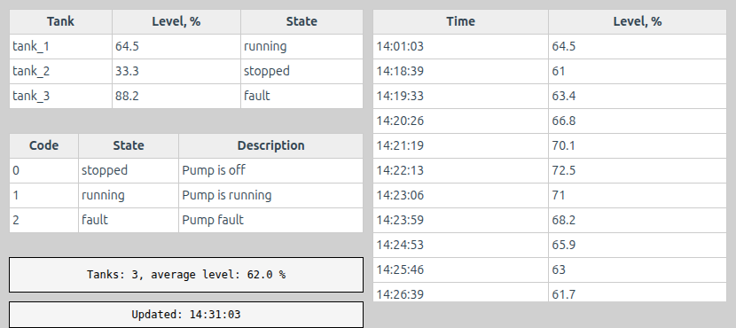
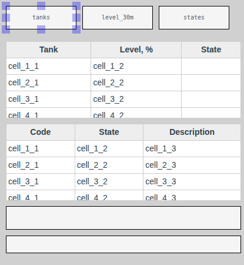
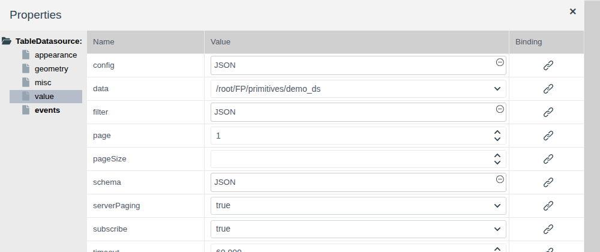
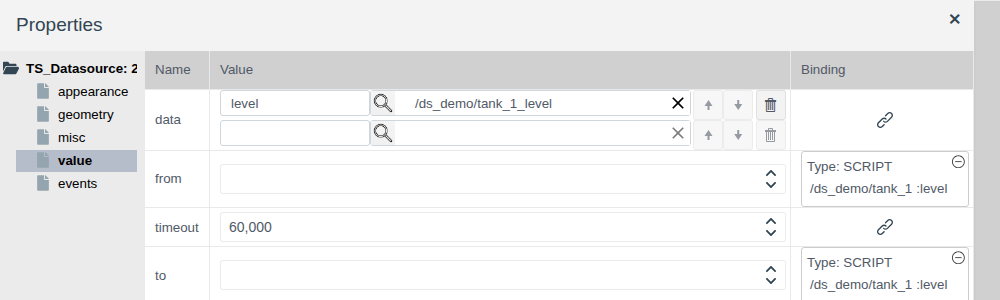
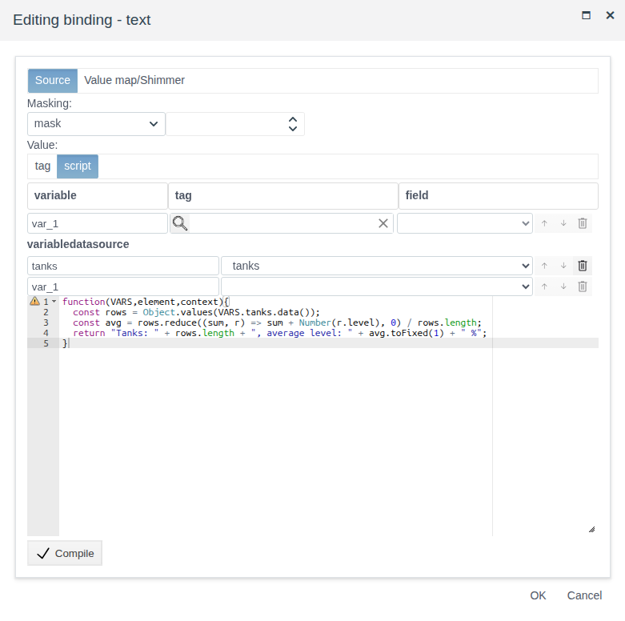

# Data sources on a screen

A document for the integration engineer who needs to show a set of records on a screen rather than a single value: a summary of a group of objects, the history of a quantity over a period, a reference table, a total calculated over several objects.

# Contents

- [Glossary](#glossary)
- [Introduction](#introduction)
- [Main part](#main-part)
    - [Sources on the palette](#sources-on-the-palette)
    - [Common to all sources](#common-to-all-sources)
    - [Local Datasource: records on the screen](#local-datasource-records-on-the-screen)
    - [Table Datasource: project objects](#table-datasource-project-objects)
    - [Time-series datasource: history from archives](#time-series-datasource-history-from-archives)
    - [Which elements read a source](#which-elements-read-a-source)
    - [A source in a script](#a-source-in-a-script)
    - [The change event](#the-change-event)
- [Conclusion](#conclusion)

# Glossary

| Term | Meaning |
|---|---|
| Data source | A screen element that holds a set of records for other elements and scripts. In the editor it looks like a rectangle with its name; in Runtime it is invisible |
| Record | One row of the set: a project object, a reference row or a history point. The fields of a record are set by the source's `schema` |
| Archive alias | The name under which the values of an archive appear in the records of **Time-series datasource**. It is set next to the archive in the `data` property |
| Source variable | A row of the **variabledatasource** section of a script window: the name under which the source is available to the script in `VARS` |

The terms "Tag" and "Binding" are explained in [Buttons and value input](controls.md#glossary), "Screen", "Palette" and "Element" in [Screen editor](editor.md#glossary), "Table" and "Archive" in [Tables and timeline](tables.md#glossary), "Event" in [Scripts and events](events.md#glossary).

# Introduction

A binding connects an element property with one field of one tag. That is not enough for a table or a chart: they need a set of records — all pumps of a folder, history points for half an hour, reference rows. Such a set is held by a data source. An element picks the source by name, and one source can feed several elements and scripts at once.

The document describes the three sources of the **Reports** palette: where each one takes its records from, how to configure it, which elements read it, how to reach the records from a script and how to react to their changes. Working in the editor (adding, selecting, properties, saving) is described in [Screen editor](editor.md), table columns and headers in [Tables and timeline](tables.md#table-columns-and-headers).

The running example is the `screen` of folder `ds_view`. The data is in folder `ds_demo`: objects `tank_1`…`tank_3` of a custom primitive `demo_ds` with fields `level` (float, level) and `state` (integer, state), and archive `tank_1_level`, which records `tank_1.level`. The screen has:

- a table of tanks from **Table Datasource** `tanks`;
- the level history of `tank_1` for the last 30 minutes from **Time-series datasource** `level_30m`;
- a reference of state codes from **Local Datasource** `states`;
- a line with the average level that a script calculates from the records of `tanks`;
- the time of the last update of `tanks`, set by the `change` event.



You need access to Studio (`http://<server>:9000/fp/studio`) under an account allowed to change the project. The result is checked in Runtime (`http://<server>:9000/fp/runtime`).

# Main part

## Sources on the palette

| Icon tooltip | Root of the property tree | Where records come from | When records change |
|---|---|---|---|
| Local Datasource | `LocalDatasource` | Defined on the screen in the `data` property or received from a string tag field | When `data` changes |
| Table Datasource | `TableDatasource` | Project objects of one type selected by a condition | When object fields change, if the subscription is on |
| Time-series datasource | `TS_Datasource` | History of one or several archives for the period `from`…`to` | When `from` or `to` changes |

How to choose:

| Task | Source |
|---|---|
| A reference, a list of modes, code descriptions — data that does not change during operation | Local Datasource with records in `data` |
| A table produced by an external system or a script and written to a tag field | Local Datasource with `data` bound to the field |
| Current field values of many objects of one type | Table Datasource |
| Values of quantities over a past period | Time-series datasource |

## Common to all sources



A source is added from the **Reports** palette like any element. Workflow:

1. Add the source and give it a name: group **misc**, property `name`. Elements and scripts find the source by this name. In the example `tanks`, `level_30m`, `states`.
2. Configure the properties of the **value** group — each source has its own, they are described below.
3. Add the element that reads the source and select the source in its `datasource` property. The source must be on the screen before this element.
4. Save the screen and check the records in Runtime: in the editor tables and charts show a sample.

The position and size of a source on the screen do not matter: it is invisible in Runtime. It is convenient to put the sources in a corner of the screen.

The `schema`, `data` and `filter` properties are edited in the **JSON** window: click the value field, enter the text, press **Compile**, then **OK**.

The fields of a record are described by `schema`: the field name and its type. The sample from a new Local Datasource:

```
{
   "column1": {type: fp.item.types.primitives.String},
   "column2": {type: fp.item.types.primitives.Integer},
   "column3": {type: fp.item.types.primitives.Bool}
}
```

Local Datasource and Table Datasource can output records page by page:

| Property | Purpose |
|---|---|
| `pageSize` | How many records to give at a time. Empty — all records |
| `page` | Page number starting from 1 |

For example, with `pageSize` = 2 and `page` = 2 a table shows the third and fourth records.

## Local Datasource: records on the screen

**Local Datasource** holds records in the `data` property of the **value** group — an array of objects, one per record. In the example source `states` explains the pump state codes:

```
schema:
{
  "code": {type: fp.item.types.primitives.Integer},
  "state": {type: fp.item.types.primitives.String},
  "note": {type: fp.item.types.primitives.String}
}

data:
[
  {"code": 0, "state": "stopped", "note": "Pump is off"},
  {"code": 1, "state": "running", "note": "Pump is running"},
  {"code": 2, "state": "fault", "note": "Pump fault"}
]
```

To receive records from outside, bind `data` to a tag field of type `string` (the **Binding** column, see [Bindings and animation, section "Binding to a tag"](bindings.md#binding-to-a-tag)). The field must hold the same kind of array in JSON format. Every time the field changes, the source replaces its records and the table on the screen is redrawn. This is how tables assembled by a user script or an external system are shown: shift staff, a task list, analysis results.

Records can also be replaced from an event script: `context.find_by_name("<source name>").set({data: '<JSON array>'})` (see [Scripts and events, section "What a script can use"](events.md#what-a-script-can-use)).

## Table Datasource: project objects

**Table Datasource** finds project objects of one type and gives their fields. A new object that meets the condition gets into the records without editing the screen.



| Property | Purpose |
|---|---|
| `data` | Type of objects. Custom primitives are at the end of the list: `/root/FP/primitives/<name>` |
| `filter` | Selection condition, for example objects of one folder |
| `schema` | Object fields that get into the records. The service field `.name` is the object name |
| `subscribe` | `true` — records are updated when object fields change. `false` — fields are read once when the screen opens |
| `pageSize`, `page` | Page-by-page output (see [Common to all sources](#common-to-all-sources)) |
| `serverPaging` | `true` — the server sends only the required page. `false` — the browser receives all objects and splits them into pages itself. It does not change what the operator sees; `true` saves traffic when there are many objects |

Selecting the objects of one folder:

```
[".folder", "=", "$oid('/root/FP/PROJECT/<folder>')"]
```

In the example `data` = `/root/FP/primitives/demo_ds`, the selection is by folder `ds_demo`, `subscribe` = `true`, and `schema` is:

```
{
  ".name": {type: fp.item.types.primitives.String},
  "level": {type: fp.item.types.primitives.String},
  "state": {type: fp.item.types.primitives.Integer}
}
```

Describe a `float` field as `String`: the value is output as is, while `Integer` rounds it to an integer. More about the condition and field types — in [Tables and timeline, section "Table: row source"](tables.md#table-row-source).

With `subscribe` = `true` the operator sees a new value at once: in the example, after 45 was written to `tank_2.level`, the `tank_2` row of the table and the average level below it changed without reloading the screen.

## Time-series datasource: history from archives

**Time-series datasource** reads values for a period from archives and gives them as records: one record per moment when at least one archive recorded a new value. Unlike the timeline, which shows only colored states (see [Tables and timeline, section "Timeline: archive"](tables.md#timeline-archive)), the source gives the numbers themselves — they can be shown in a table or processed by a script.

Prepare an archive of the field (see [Archives, section "Archiving pressure from a tag"](../data_storage/archives/archives.md#archiving-pressure-from-a-tag)). In the example it is `ds_demo/tank_1_level` on field `tank_1.level`.



| Property | Purpose |
|---|---|
| `data` | List of archives. In a row: the alias on the left, the archive on the right, picked with the magnifier. The empty bottom row adds an archive, the arrows change the order, the bin deletes |
| `from` | Start of the period |
| `to` | End of the period |

`from` and `to` are moments in milliseconds since January 1, 1970 (UTC), as returned by `Date.now()` in JavaScript. While either of them is empty, the source gives no records.

The records of the source contain the field `ts` — the moment in the same milliseconds — and one field per alias with the archive value. The first record falls on the start of the period and holds the value the archive had at that moment.

The period "last N minutes" is set by a script binding on `from` and `to` (see [Bindings and animation, section "Script binding"](bindings.md#script-binding)). In the example both properties have one variable — field `tank_1.level`; the `from` script:

```javascript
function(VARS,element,context){
  return Date.now() - 30 * 60 * 1000;
}
```

and the `to` script:

```javascript
function(VARS,element,context){
  return Date.now();
}
```

The scripts run when the screen opens, so the table shows the 30 minutes before opening. The source re-reads the archive every time `from` or `to` changes: both from a binding and from an event script, for example a "Last hour" button with `context.find_by_name("level_30m").set({from: Date.now() - 3600000, to: Date.now()})`.

To make a table show the time instead of a number of milliseconds, convert `ts` with a function in the table column. In the example:

```
header:  ["Time", "Level, %"]
columns: [{fields: ["ts"], handler: ({ts}) => new Date(ts).toLocaleTimeString()}, "level"]
```

## Which elements read a source

An element reads a source through its `datasource` property (group **value**). The drop-down list contains the names of all sources of the screen.

| Element | Palette | Sources | What it does with the records |
|---|---|---|---|
| **Grid** | **Reports** | Local Datasource, Table Datasource, Time-series datasource | A row per record, columns from `columns` (see [Tables and timeline](tables.md#table-columns-and-headers)) |
| **Bar Chart** | **Reports** | Local Datasource with fields `name` and `data` | Bar series (see [Dial and linear gauges, section "Bar chart"](gauges.md#bar-chart)) |
| Any property of any element | — | All three | The value a binding script calculated from the records (see [A source in a script](#a-source-in-a-script)) |

## A source in a script

A binding script and an event script receive the records of a source through the **variabledatasource** section of their window. This is how a total that cannot be expressed by a table column is calculated over a set of records: the number of objects, an average, the number in fault.



1. Open the binding window of the property and select **Value** = **script** (for an event — type **Scripts**).
2. In the **variabledatasource** section enter the variable name on the left and select the source in the list on the right. The empty bottom row adds a variable.
3. Write the function, press **Compile**, then **OK**.

In a script, `VARS.<name>.data()` returns the records of the source. Iterate over them with `Object.values(...)`: you get an array of records with the fields from `schema`. In the example the line under the table of tanks calculates the average level from source `tanks`:

```javascript
function(VARS,element,context){
  const rows = Object.values(VARS.tanks.data());
  const avg = rows.reduce((sum, r) => sum + Number(r.level), 0) / rows.length;
  return "Tanks: " + rows.length + ", average level: " + avg.toFixed(1) + " %";
}
```

The binding is recalculated every time the records of the source change. In the example `level` is described in `schema` as `String`, so it is wrapped in `Number(...)` before adding.

## The change event

Sources have the `change` event in the **events** group. It occurs when the source has received its records on screen opening, and then every time they change: a new field value with `subscribe` = `true`, a new `data` value, new `from` and `to`. Assign to `change` a script that must run together with the data update: mark the time, highlight an element, recalculate something that does not fit into a binding. The event window and the script arguments are described in [Scripts and events, section "Event script"](events.md#event-script).

In the example source `tanks` puts the time of the last update into the rectangle with `name` = `updated`:

```javascript
function(VARS,element,context){
   context.find_by_name("updated").set({text: "Updated: " + new Date().toLocaleTimeString()});
}
```

After a write to `tank_2.level` the time in the "Updated" line changed together with the table row.

# Conclusion

| What to show | Source | Element |
|---|---|---|
| Reference data defined on the screen | Local Datasource | Grid, Bar Chart |
| A table prepared by a script or an external system | Local Datasource, `data` bound to a string field | Grid |
| Current values of many objects of one type | Table Datasource, `subscribe` = `true` | Grid |
| Archive values for a period | Time-series datasource, `from` and `to` by a script binding | Grid |
| A total over a set of records | Any | Script binding with a source variable |

Workflow:

1. Add a source from the **Reports** palette and set `name`.
2. Configure the **value** group: records and `schema` for Local Datasource; type, condition, `schema` and subscription for Table Datasource; archives and period for Time-series datasource.
3. Add the element after the source and select the source in `datasource` or in the **variabledatasource** section of a script.
4. For actions on data update, assign a script to the source's `change` event.
5. Save the screen and check the records in Runtime.
