# Screen editor

A document for the integration engineer who draws the project's screens (mimic diagrams) in the Studio graphic editor.

# Contents

- [Glossary](#glossary)
- [Introduction](#introduction)
- [Main part](#main-part)
    - [Folder screens](#folder-screens)
    - [What the screens are for](#what-the-screens-are-for)
    - [A screen inside a screen: Folder Screen](#a-screen-inside-a-screen-folder-screen)
    - [Prototype screens](#prototype-screens)
    - [The User tab: the settings screen](#the-user-tab-the-settings-screen)
    - [Editor window](#editor-window)
    - [Canvas](#canvas)
    - [Adding elements](#adding-elements)
    - [Selection](#selection)
    - [Moving and resizing](#moving-and-resizing)
    - [Properties panel](#properties-panel)
    - [Copy, paste, delete](#copy-paste-delete)
    - [Undo and redo](#undo-and-redo)
    - [Alignment](#alignment)
    - [Grouping](#grouping)
    - [Saving and closing](#saving-and-closing)
    - [Exporting and importing a screen](#exporting-and-importing-a-screen)
    - [Concurrent editing](#concurrent-editing)
    - [The screen in Runtime](#the-screen-in-runtime)
- [Conclusion](#conclusion)

# Glossary

| Term | Meaning |
|---|---|
| Screen | A mimic diagram stored in a project folder or in prototype content. A folder has 17 screen slots: `screen`, `view1`…`view15` and `settings` |
| Instance | A project object created from a prototype (see ["Prototypes"](../prototypes/prototypes.md)) |
| Graphic editor | The Studio window in which a screen is drawn |
| Element | An object on a screen: a shape, a control, a data source, etc. |
| Palette | An editor panel with element icons: **Primitives**, **Controls**, **Reports** |
| Group | Several elements joined into one: they are selected, moved and aligned together |

# Introduction

A screen is the operator's view in Runtime. It is drawn in the Studio graphic editor: elements are placed on the canvas, their position, size and appearance are set, and the screen is saved. A screen belongs to a project folder; a folder has 17 screen slots, each with its own purpose.

This document covers folder screens and their purpose, as well as working in the editor itself: the editor window, the canvas, selection, properties, alignment, grouping, saving and showing the screen in Runtime. The elements are described in [Graphic elements](graphics.md) and [Buttons and value input](controls.md).

The running example is the folder `mnemo_demo`: the main screen `screen` made of two rectangles and an ellipse, the additional screen `view2` "Насос" (Pump) embedded into `screen`, and the prototype `demo_pump` with the instance `pump_1`.

You will need access to Studio (`http://<server>:9000/fp/studio`) with an account that is allowed to change the project.

# Main part

## Folder screens

Open the folder in the project tree with a double click and press **Screen**. The "<folder>: Views" window opens with the rows `screen`, `view1`…`view15` and `settings` (the last rows appear after scrolling). Each row has the screen name and three buttons:

| Button | Action |
|---|---|
| Pencil with a plus / pencil | Create the screen (empty row) or open it in the editor |
| Screen with a magnifier | Open the screen in preview mode: view only, no editing |
| Bin | Delete the screen. After confirming, press **save** in the "Views" window |

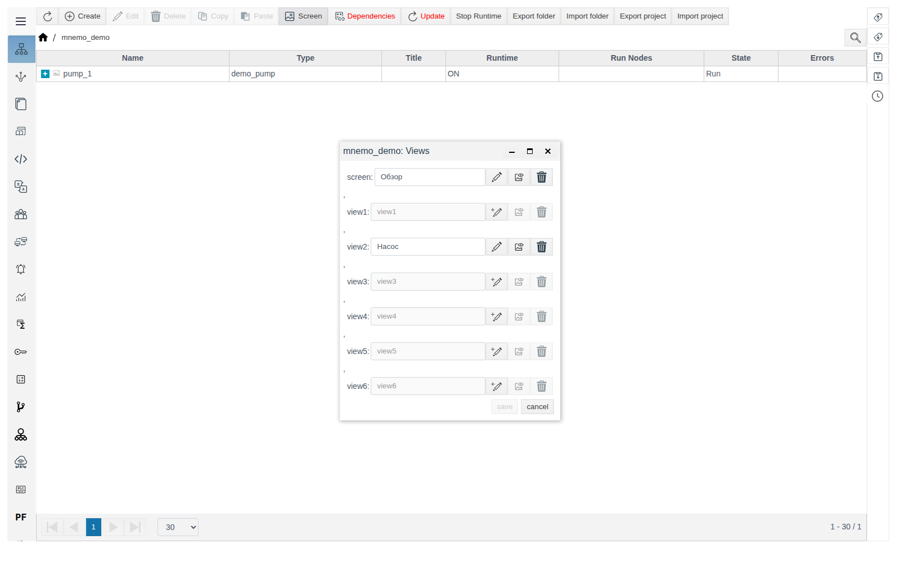

Each row is a separate screen with its own content: elements drawn in `screen` do not appear in `view1`, and vice versa.

Until a screen is saved its row is grey, and preview and delete are unavailable. After the first save the name field becomes editable: enter a meaningful name (`Обзор` in the example) and press **save**. The name is shown in the "Views" window and in the editor title; the slot name (`screen`, `view1`…) does not change.

## What the screens are for

| Screen | Where it is shown |
|---|---|
| `screen` | The main screen of the folder. Opens in Runtime when the operator selects the folder in the **Screens** menu (see [The screen in Runtime](#the-screen-in-runtime) below) |
| `view1`…`view15` | Additional folder screens. They are not in the Runtime menu: they are shown inside other screens with the **Folder Screen** element |
| `settings` | The **User** tab of the folder properties form in Studio |

Prototype content has the same 17 slots. Its screens are placed on project screens with the "Prototype" element, and the prototype's `settings` is shown in the form of every instance.

Any saved screen, `settings` included, can be chosen in **Folder Screen** and in the prototype insert window: both list the screens by name.

## A screen inside a screen: Folder Screen

The **Folder Screen** element (**Controls** palette) shows a screen of any folder inside another screen. This way the same picture (a unit, an assembly, a legend) is drawn once and shown on several screens.

1. Draw and save the screen to embed, for example `view2` of the folder `mnemo_demo`, and give it a name in the "Views" window (`Насос` in the example).
2. Open the screen you embed into and drag **Folder Screen** onto the canvas. Until a screen is chosen, the element reads "Screen folder is undefined" and "View is undefined".
3. In the **Properties** panel open the **settings** group. In the `folder_list` property press the magnifier and choose the folder in the project tree (**OK**), then choose the screen in the **View** list. The list shows the saved screens of that folder by name; the screen you are editing is not in it.
4. Set the position and size of the element in the **geometry** group and save.

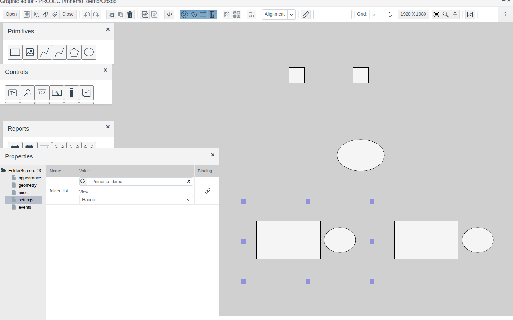

The embedded screen is stretched or shrunk as a whole to the size of the element. To show it one to one, give the embedded screen the size of the element: in its properties `Screen: 0` → **geometry** → `width` and `height` (400 × 250 for both `view2` and the element in the example).

## Prototype screens

A prototype has the same 17 screens: **Prototypes** → select the prototype → **Content** → **Screen** at the content root. Working with them in the editor is the same as with folder screens.

To place a prototype screen on a project screen you need an instance of that prototype in the project (`pump_1` in the folder `mnemo_demo` in the example).

1. Press the **Prototypes** button on the editor toolbar. The "Select Prototype view" window opens with the list of prototypes; expand a prototype and select a screen — its view appears on the right.
2. Press **Select**, select the instance in the project tree and press **OK**.
3. Click on the canvas where the element should be.

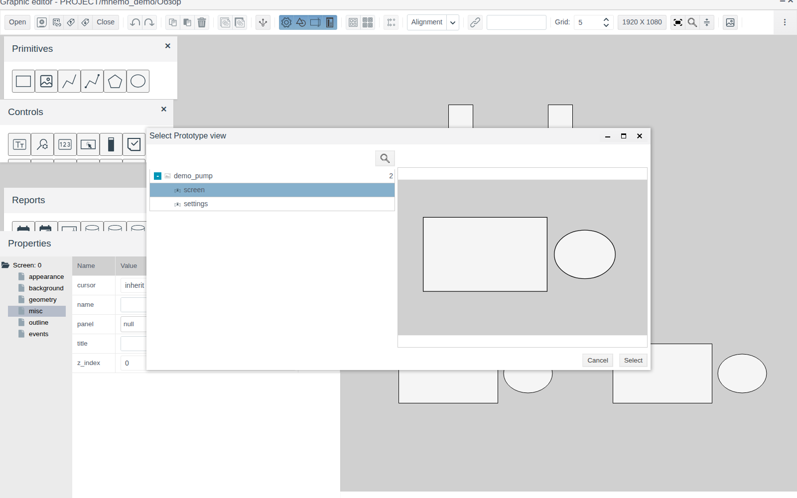

A `Prototype` element the size of the prototype screen appears on the screen. Its **settings** group has `instance` — the instance, and `prototype` and `view` — the prototype and the screen, read-only.

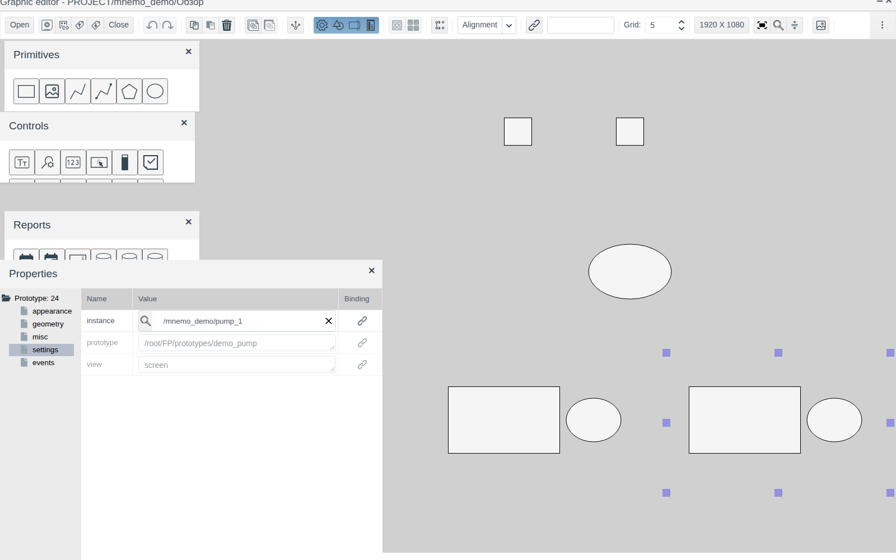

A prototype screen is drawn once; every instance gets its own Prototype element with that instance in `instance`.

## The User tab: the settings screen

The folder properties form (folder → **Edit**) has two vertical tabs: **System** — the folder fields, **User** — the `settings` screen of this folder. Until `settings` is saved, the **User** tab is inactive.

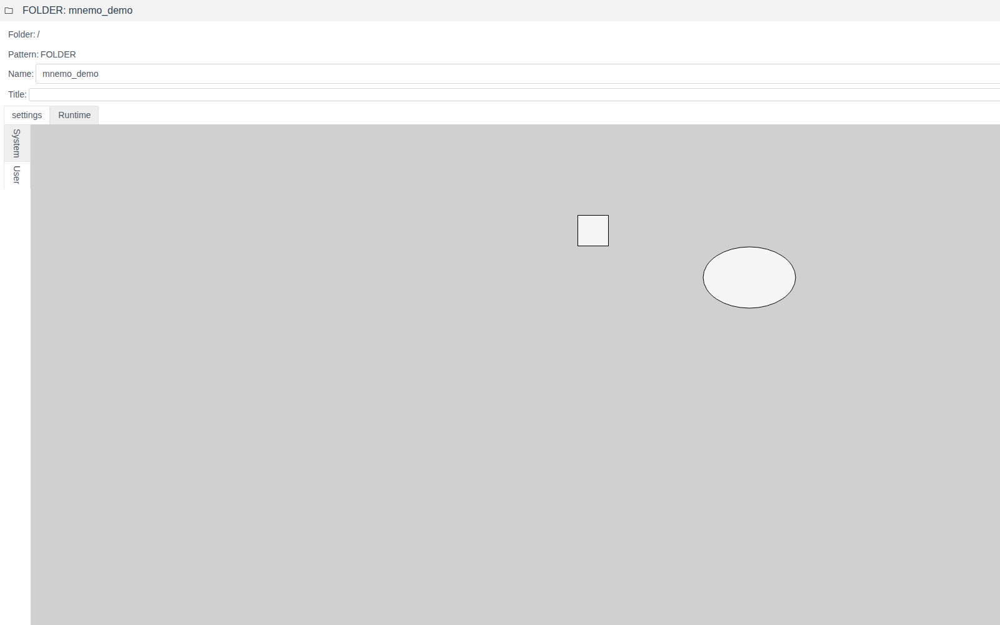

The `settings` screen of a prototype is shown on the **User** tab of the form of each of its instances.

## Editor window

The editor opens full screen. The title reads "Graphic editor - PROJECT/<folder>/<screen name>", with minimize and close buttons on the right.

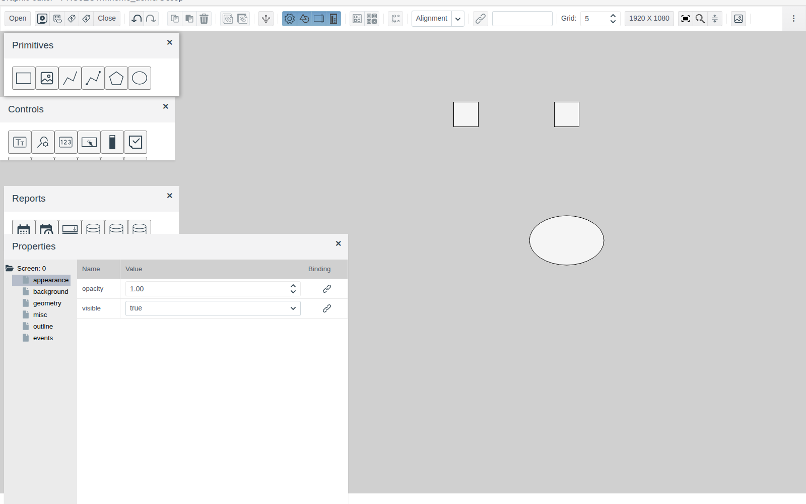

Below the title is the toolbar. Buttons without a caption show their purpose in a tooltip. Each button is described in the section where it is used.

Four panels lie on top of the canvas. Drag them by the title, close them with the cross and open them again with the toolbar buttons:

| Panel | Button | Content |
|---|---|---|
| **Primitives** | **Drawing** | Shapes: rectangle, image, polyline, connector polyline, polygon, ellipse |
| **Controls** | **Control elements** | Input fields, buttons, lists, indicators, trends, video and other elements |
| **Reports** | **Report items** | Date pickers, data sources, grid, bar chart |
| **Properties** | **Properties** | Properties of the selected element |

Panel positions and visibility are remembered per user and restored the next time the editor opens.

## Canvas

The canvas is the grey area of the screen. The size of a new screen is set by the screen-size button on the toolbar (**1920 X 1080** by default). It opens the "Set client screen size" window with the **Width (px)** and **Height (px)** fields, from 400 to 30000. The value is common to the project and applies to screens created after the change. The size of an existing screen is changed in its properties, see [Properties panel](#properties-panel).

**Zoom.** Ctrl + mouse wheel zooms the canvas in and out. The **Zoom** button (magnifier) opens a panel with the current zoom in percent, **−** and **+** buttons and a reset button (back to 100 %).

**Grid.** The **Grid** field sets the step in pixels (1 to 100, 5 by default). Coordinates snap to the grid when dragging and resizing; the arrow keys move an element by one grid step.

## Adding elements

Drag an icon from a palette onto the canvas. The element appears where you release it, becomes selected, and the **Properties** panel shows its properties. The element name is shown in the icon tooltip.

Every element gets a number that is unique within the screen. The number is shown at the root of the properties tree: `Rectangle: 1`, `Ellipse: 3`.

## Selection

| Action | Result |
|---|---|
| Click an element | Selects the element and deselects the others |
| Ctrl + click | Adds the element to the selection |
| Frame: press on an empty spot of the canvas and drag | Selects the elements that lie entirely inside the frame. Elements the frame only touches are not selected |
| Ctrl + A | Selects all elements of the screen |
| Click an empty spot | Clears the selection |

A selected element is outlined with handles. When several elements are selected, the root of the properties tree is `Selection:`; it shows the common property groups and the **subitems** node with the list of selected elements. A value entered in the properties table applies to all selected elements.

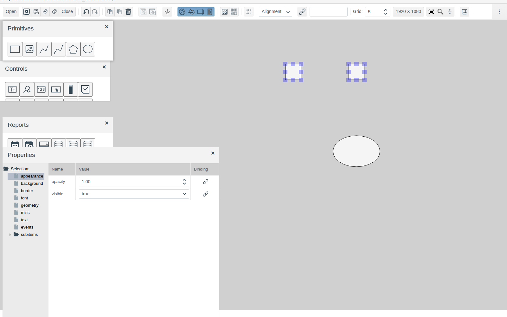

## Moving and resizing

- **Dragging** moves the selected elements; coordinates snap to the grid.
- **Arrow keys** move the selected elements by one grid step.
- **Handles** at the corners and sides of the selection change the size; the size also snaps to the grid.
- **Exact** position and size are set in the **geometry** group of the **Properties** panel: `left`, `top`, `width`, `height` in pixels from the top-left corner of the screen.

## Properties panel

The left side of the **Properties** panel is the tree of property groups of the selected element, the right side is the table of the chosen group with the **Name**, **Value** and **Binding** columns. The set of groups depends on the element, for example a rectangle has **appearance**, **background**, **border**, **font**, **geometry**, **misc**, **text**, **events**.

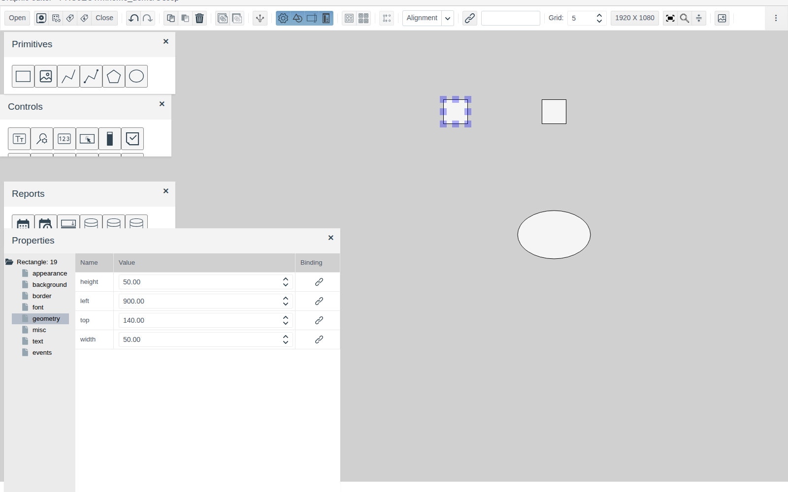

When you click an empty spot of the canvas, the panel shows the properties of the screen itself, `Screen: 0`. The screen has its own groups: **appearance**, **background**, **geometry**, **misc**, **outline**, **events**. **geometry** sets the screen size (`width`, `height`).

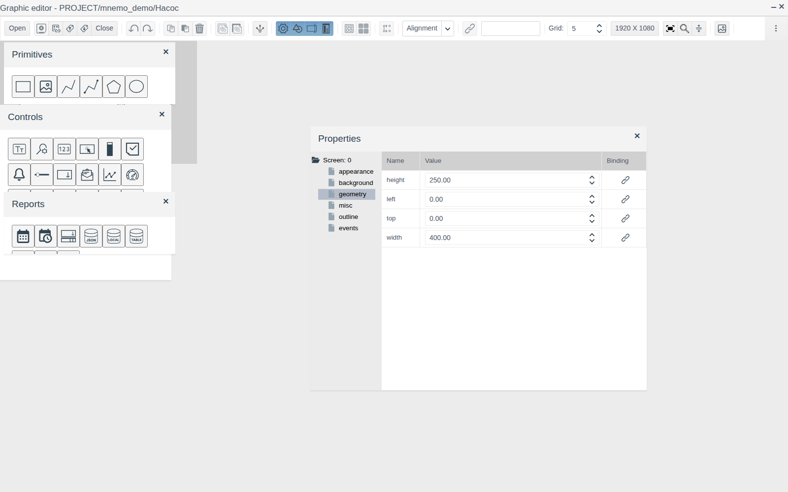

A value is changed right in the cell: a number by typing or with the arrows, an option from the list. The change is visible on the canvas at once. The button in the **Binding** column links the property to project data, and the **events** group sets the reaction to events; an example of both is in [Buttons and value input](controls.md), sections [Linking an element to a tag](controls.md#linking-an-element-to-a-tag) and [Button](controls.md#button).

## Copy, paste, delete

| Action | Keys | Button |
|---|---|---|
| Copy the selection | Ctrl + C | **Copy** |
| Paste | Ctrl + V | **Paste** |
| Delete the selection | Delete | **Delete** |

The copy appears 10 px to the right and below the original and becomes selected. Pasting again gives one more copy with the next offset.

**Copying the look.** Select a sample and press **Copy properties**, then select one or more elements and press **Paste properties**. Appearance properties are transferred — background and text colours, border, font; position, size and opacity do not change.

## Undo and redo

Ctrl + Z (the **Undo** button) undoes the last action, Ctrl + Shift + Z (the **Redo** button) repeats the undone one. Every action is one step: adding, moving, an arrow-key shift, a property change, deleting, aligning, grouping.

## Alignment

Select two or more elements and choose a mode in the **Alignment** list on the toolbar.

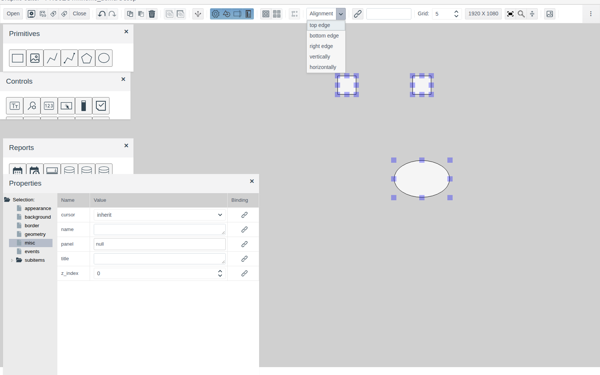

| Mode | What it does |
|---|---|
| **top edge** | Top edges — to the topmost element |
| **bottom edge** | Bottom edges — to the bottommost element |
| **right edge** | Right edges — to the rightmost element |
| **vertically** | Centres on one vertical line, at the leftmost centre |
| **horizontally** | Centres on one horizontal line, at the topmost centre |

An alignment is undone with a single Ctrl + Z.

## Grouping

Select elements and press **Group**. The group gets its own number (`Group: 6`) and the properties **appearance**, **background**, **border**, **geometry**, **misc**, **events**; the **subitems** node holds its elements. A click on any element of the group selects the whole group, dragging moves it as a whole.

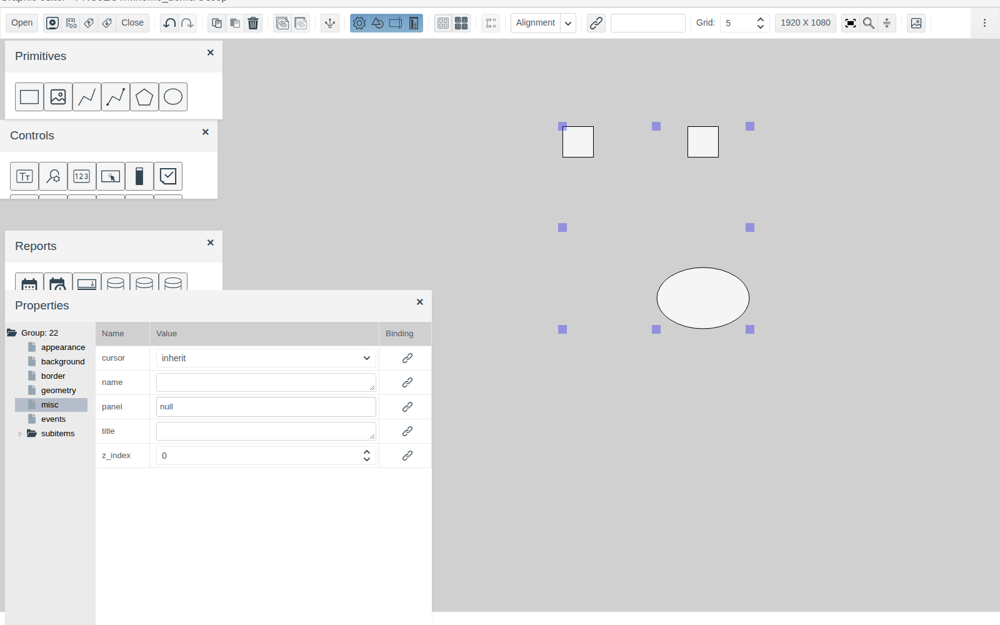

**Ungroup** returns the elements to the screen one by one. The button is active when a group is selected.

## Saving and closing

Save the screen with Ctrl + S or the **Save** button. After saving the button stays inactive until the next change.

The **Проверить зависимости** button checks that the project objects referenced by the screen elements exist. If there are no broken references, a message says so.

**Closing.** **Close** on the toolbar closes the screen, the cross in the title closes the whole editor. If there are unsaved changes, the editor asks whether to save them: **yes** saves and closes, **no** asks to confirm closing without saving.

**Autosave.** Once a minute the editor stores a copy of the changed screen for the current user. If work was interrupted without saving (tab closed, session lost), the next time the screen is opened the editor offers to restore the unsaved copy. **yes** opens the copy, **no** opens the last saved version. Save a restored copy as usual.

## Exporting and importing a screen

**Export to file** saves the current screen to a `.scn` file. The file name is built from the screen path: `PROJECT_mnemo_demo_screen.scn`.

**Import from file** opens the "File select" window. Choose a `.scn` file with **Select files...** and press **OK**: the content of the open screen is replaced with the content of the file. Save the screen to keep the result.

## Concurrent editing

Only one session edits a screen at a time. If the screen is already open in the editor, another user (or the same user in another browser) gets the "Confirm" window: "The view is currently being edited by: <user>. Only review mode is available. Do you want to open?". **Yes** opens the screen in preview mode.

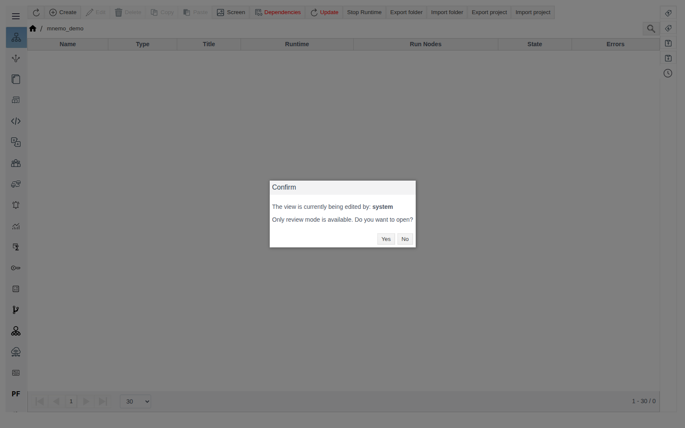

The screen is released when it is closed in the editor or when the browser tab in which it is open is closed.

## The screen in Runtime

In Runtime (`http://<server>:9000/fp/runtime`) open the menu, then **Screens**. The list shows the project folders that have a saved `screen`. A click on a folder opens that screen; the folder path is shown in the top bar. Embedded screens (Folder Screen) and Prototype elements are visible inside it: in the picture, the bottom row shows `view2` "Насос" on the left and the `demo_pump` prototype screen on the right.

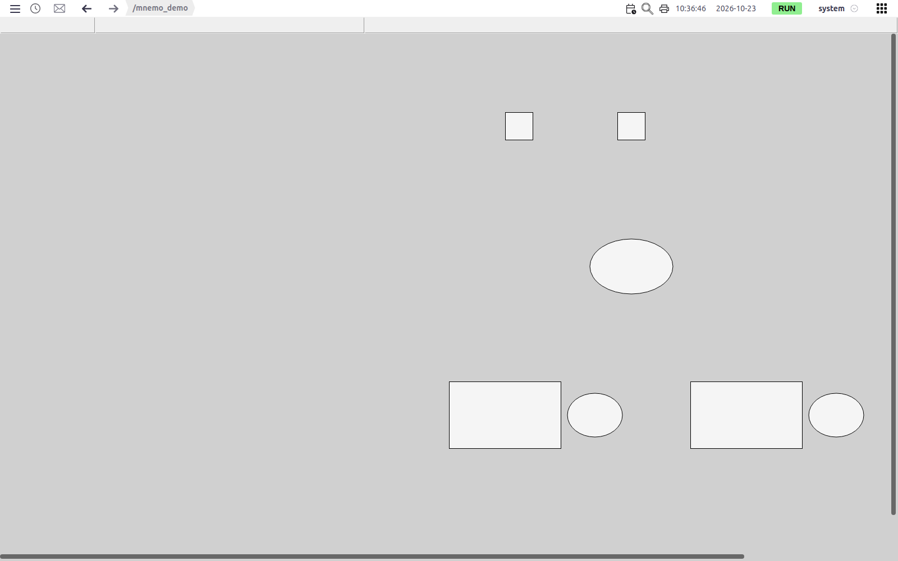

To view a screen without leaving Studio, use the preview button in the "Views" window.

# Conclusion

Working with a screen:

1. Enter the folder with a double click, press **Screen** and create a screen: `screen` — the Runtime view, `view1`…`view15` — fragments to embed with **Folder Screen**, `settings` — the **User** tab of the folder form.
2. Drag elements from the palettes onto the canvas.
3. Arrange them: by dragging and with the arrow keys snapped to the grid, exactly — in the **geometry** group; align and group them.
4. Set the appearance in the **Properties** panel; carry the same look over with **Copy properties** / **Paste properties**.
5. Save (Ctrl + S) and, if you like, give the screen a name in the "Views" window.
6. Draw repeated fragments once: in a folder `viewN` (embedded with **Folder Screen**) or in a prototype screen (one Prototype element per instance).
7. Check the result with the preview button in the "Views" window or in Runtime → **Screens**.
