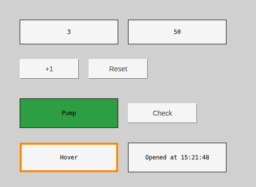
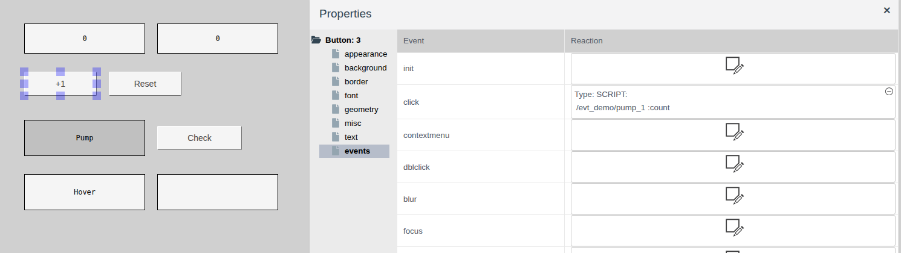
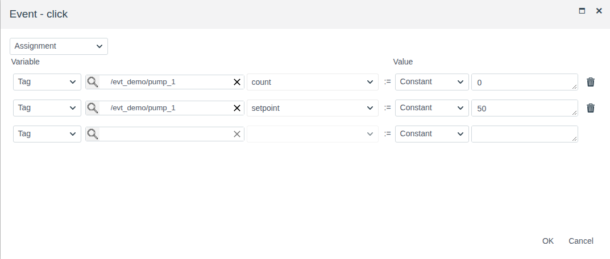
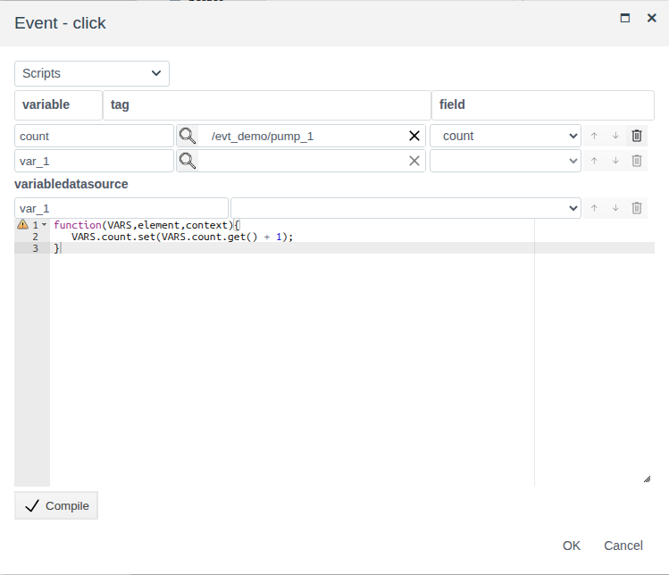
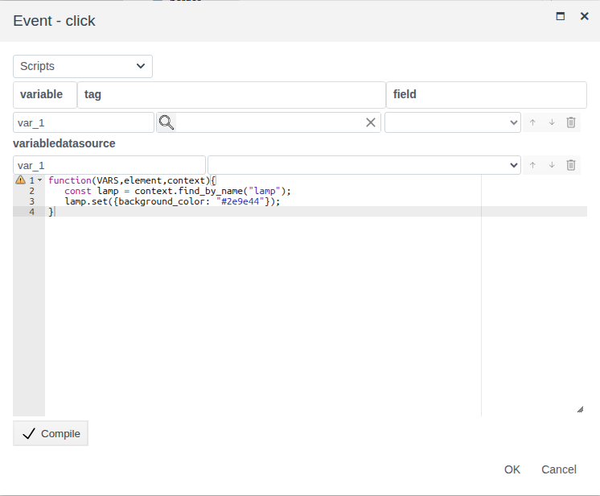

# Scripts and events

A document for the integration engineer who sets up how a screen reacts to the operator: a button writes values to tags, a click changes the look of another element, hovering highlights an element, the screen runs a script when it opens.

# Contents

- [Glossary](#glossary)
- [Introduction](#introduction)
- [Main part](#main-part)
    - [The events group](#the-events-group)
    - [Events](#events)
    - [Event window](#event-window)
    - [Assignment](#assignment)
    - [Event script](#event-script)
    - [What a script can use](#what-a-script-can-use)
    - [Event and binding](#event-and-binding)
- [Conclusion](#conclusion)

# Glossary

| Term | Meaning |
|---|---|
| Event | An operator action or a change on the screen an element can react to: a click, hovering, a key press, the screen opening |
| Reaction | What runs on the event: an assignment or a script. Set in the **Reaction** column of the **events** group |
| Assignment | A reaction without a script: write a constant or the value of another field into a tag field |
| Element name | The `name` property of the **misc** group. A script finds the element on the screen by it |

The terms "Tag" and "Binding" are explained in [Buttons and value input](controls.md#glossary), "Variable" in [Bindings and animation](bindings.md#glossary), "Screen", "Element" and "Palette" in [Screen editor](editor.md#glossary).

# Introduction

A binding (see [Bindings and animation](bindings.md)) brings data onto the screen: an element property follows a tag field. An event works the other way: an operator action starts a reaction, which writes values to tags or changes element properties. The reaction is either an assignment that needs no programming or a JavaScript script.

The document describes the list of events, the event window, the assignment, the event script and what a script can use. Work in the editor (adding elements, the properties panel, saving) is described in [Screen editor](editor.md), the button and input fields in [Buttons and value input](controls.md).

The running example is the `screen` of the `evt_demo` folder. The folder holds the object `pump_1` of a custom primitive `demo_evt`:

| Field | Type | Meaning |
|---|---|---|
| `count` | integer | Press counter |
| `setpoint` | float | Setpoint |

On the screen:

| Element | Event | Reaction |
|---|---|---|
| Two rectangles at the top | — | Show `count` and `setpoint` (`text` binding) |
| "+1" button | `click` | Script: increase `count` by 1 |
| "Reset" button | `click` | Assignment: `count` := 0, `setpoint` := 50 |
| "Pump" rectangle, `name` = `lamp` | — | — |
| "Check" button | `click` | Script: paint "Pump" green |
| "Hover" rectangle | `mouseenter`, `mouseleave` | Script: orange border while hovered, normal border when the pointer leaves |
| Bottom right rectangle | `init` | Script: show the time the screen was opened |



You need access to Studio (`http://<server>:9000/fp/studio`) under an account allowed to change the project. The result is checked in Runtime (`http://<server>:9000/fp/runtime`).

# Main part

## The events group

Every screen element and the screen itself (click an empty spot of the canvas, the panel shows `Screen: 0`) have an **events** group in the **Properties** panel. It holds a table: the **Event** column is the event name, the **Reaction** column is the configured reaction.

An empty **Reaction** cell is a button that opens the "Event - <name>" window. After **OK** the cell shows the reaction description:

- `Type: SCRIPT:` and a line per script variable: `/<folder>/<object> :<field>`;
- for an assignment, a line per assignment: `/<folder>/<object>-><field> := <value>`.

In the example the "+1" button cell shows `/evt_demo/pump_1 :count`, the "Reset" button cell `/evt_demo/pump_1->count := 0` and `/evt_demo/pump_1->setpoint := 50`.

Clicking the description opens the reaction for editing. The ⊖ icon in the cell corner deletes the reaction after confirmation → **yes**.



Reactions work in Runtime only: in the editor a click selects the element. Reactions are saved with the screen: save the screen after setting them up.

## Events

The list of events is the same for all elements. Input elements — input fields, the checkbox, the slider, the lists, object selection and catalog selection — also have the `input` event.

| Event | When it fires |
|---|---|
| `init` | The screen has loaded in Runtime (see [Returning to a screen](screens.md#returning-to-a-screen)). Good for the initial look |
| `click` | Left click |
| `dblclick` | Double click. Two `click` events fire before it |
| `contextmenu` | Right click |
| `mousedown`, `mouseup` | The mouse button is pressed, released over the element |
| `mouseenter`, `mouseleave` | The pointer entered the element, left it |
| `focus`, `focusin` | The element got the focus: a click in an input field, moving with Tab |
| `blur`, `focusout` | The element lost the focus |
| `keydown` | A key is pressed while the element has the focus |
| `keypress` | A key that types a character, or Enter, is pressed |
| `input` | The element value changed: it came from the tag when the screen opened or when the field changed, or the operator entered it |

Focus and keys go to the elements the operator works with from the keyboard: the button and an input field with `type` = `direct`. Mouse events, `init` and `input` suit any element that has them.

The order of events on a click in an input field: `mousedown`, `focusin`, `focus`, `mouseup`, `click`.

## Event window

The list at the top of the window selects the reaction type:

| Type | What it does |
|---|---|
| **Assignment** | Writes values to tag fields. See [Assignment](#assignment) |
| **Scripts** | Runs a JavaScript function. See [Event script](#event-script) |

**OK** is available when the reaction is filled in. **Cancel** closes the window without changes.

## Assignment

An assignment is a table of "**Variable** := **Value**" rows. Each row writes one value into one field.

| Column | What to choose |
|---|---|
| **Variable** | **Tag**, magnifier → object → **OK**, then on the right the field the value is written to |
| **Value** | **Constant** and a value, or **Tag**, an object and a field whose value is written |

The constant is entered the way the field needs: a number in a numeric box, `true`/`false` from a list, a string as text. Once a row is filled in, an empty row appears below it for the next assignment. The bin deletes a row. On the event the rows run in order from top to bottom.

In the example the "Reset" button writes two fields of `pump_1` on `click`: `count` := 0, `setpoint` := 50.



An assignment suits "Start", "Stop", "Reset", "Set setpoint 50" buttons: the values are known in advance. The "Start" and "Stop" buttons example is in the [Button](controls.md#button) section of Buttons and value input. If the value has to be calculated, use a script.

## Event script

A script is a JavaScript function that runs on the event. The window is arranged like the script binding window (see [Script binding](bindings.md#script-binding)):

1. Choose the **Scripts** type.
2. Define the variables in the **variable** / **tag** / **field** table: the variable name, the object (magnifier) and the field. The empty bottom row adds a variable. A script that only changes screen elements needs no variables.
3. Write the function body in the editor and click **Compile**.
4. Click **OK**.

The difference from a binding: the function returns nothing. It performs actions — writes tag fields, changes element properties. Before the script runs, the values of all variables are read again, so the script sees the current field values at the moment of the event.

In the example the "+1" button increases the counter. The variable `count` is the field `pump_1.count`:

```javascript
function(VARS,element,context){
   VARS.count.set(VARS.count.get() + 1);
}
```



## What a script can use

The function receives three arguments.

| Argument | What it gives |
|---|---|
| `VARS` | The variables from the window table. `VARS.<name>.get()` is the field value, `VARS.<name>.set(value)` writes to the tag field |
| `element` | The element the event happened on. `element.get("<property>")` is the property value, `element.set({<property>: value, …})` changes one or several properties |
| `context` | The screen open in Runtime. `context.find_by_name("<name>")` is the screen element with this `name` value; it has the same `get` and `set` |

Property names are the same as in the **Properties** panel: `text`, `background_color`, `border_width`, `visible` and others. Properties changed by a script stay until the screen loads again: when you return to it, the elements are as the script left them, after a new load they are as in the editor (see [Returning to a screen](screens.md#returning-to-a-screen)).

Changing the element itself — highlight on hover. In the example the "Hover" rectangle, the `mouseenter` event:

```javascript
function(VARS,element,context){
   element.set({border_color: "#ff8800", border_width: 4});
}
```

The `mouseleave` event restores the border: `element.set({border_color: "#000000", border_width: 1});`.

Changing another element — by its name: give the element a `name` and find it with `context.find_by_name`. In the example the "Pump" rectangle has `name` = `lamp` (the **misc** group). The "Check" button, the `click` event:

```javascript
function(VARS,element,context){
   const lamp = context.find_by_name("lamp");
   lamp.set({background_color: "#2e9e44"});
}
```



Setting the look when the screen opens — the `init` event. In the example the bottom right rectangle shows the opening time:

```javascript
function(VARS,element,context){
   element.set({text: "Opened at " + new Date().toLocaleTimeString()});
}
```

## Event and binding

| | Binding | Event |
|---|---|---|
| Direction | Data → element property | Operator action → writing to tags, changing properties |
| When it runs | When the screen opens and on every field change | On the event |
| Where it is set | The **Binding** column of a property | The **Reaction** column of the **events** group |
| Without programming | Tag, masking, value map, shimmer | Assignment |
| Script | Returns the property value with `return` | Performs actions, returns nothing |

For the operator to change what a binding shows, the event writes the tag field and the binding brings the new value onto the screen. This is how "+1" and "Reset" work in the example.

# Conclusion

| Task | How to do it |
|---|---|
| Write a value known in advance to a tag with a button | Assignment on `click` with a constant |
| Copy the value of one field into another | Assignment: **Value** = **Tag** |
| Write a calculated value | Script: `VARS.<name>.set(…)` |
| Change the look of an element on hover | Script on `mouseenter` and `mouseleave` with `element.set` |
| Change another element | `name` on the element and `context.find_by_name` in the script |
| Do something when the screen opens | The `init` event |
| React to a change of an input field value | The `input` event |

Workflow:

1. Decide what the reaction does: writes values known in advance (assignment), or calculates them and changes elements (script).
2. Give `name` to the elements a script changes.
3. Select the element, in the **events** group click the **Reaction** cell of the needed event and set up the reaction.
4. Save the screen and check it in Runtime. Written values are visible in the object form in Studio.
