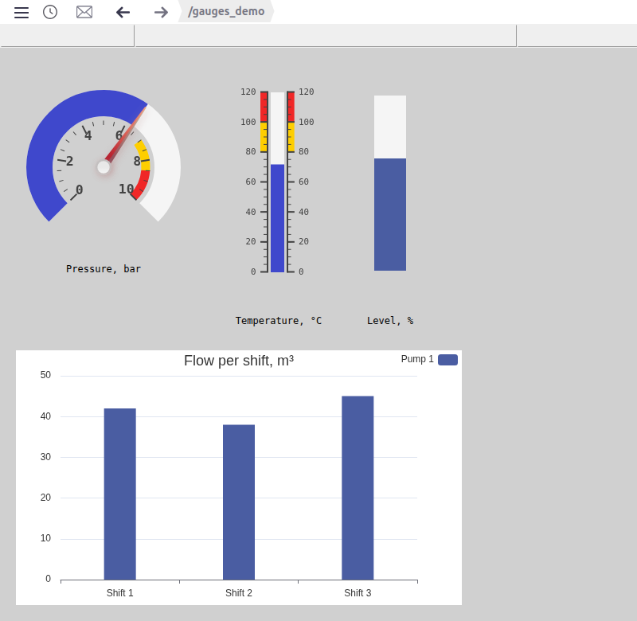
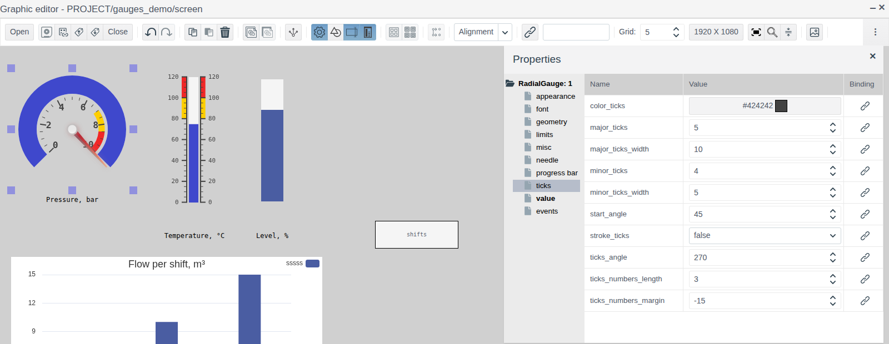
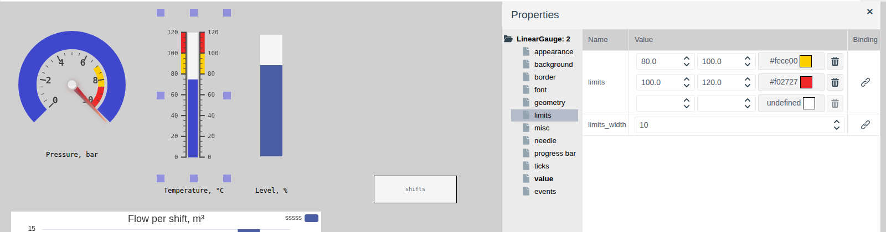
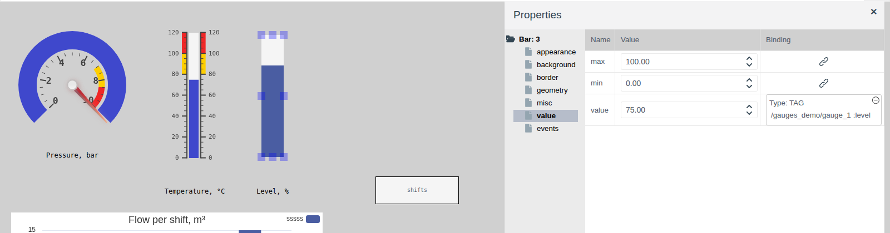
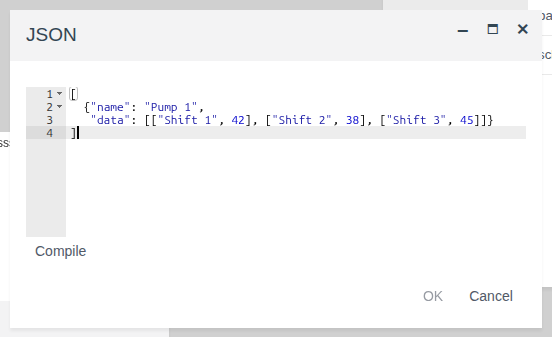
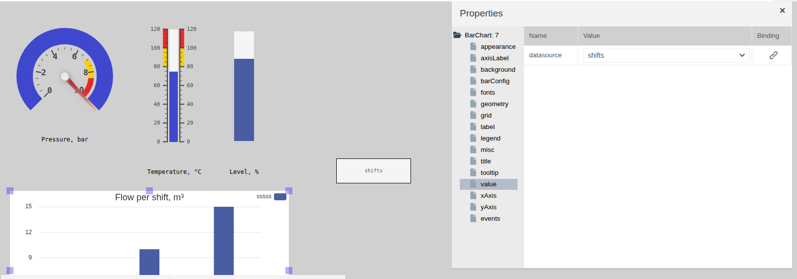

# Dial and linear gauges

A document for the integration engineer who shows measured values to the operator on a screen: pressure on a dial, temperature on a linear scale, level as a bar and summary figures as a bar chart.

# Contents

- [Glossary](#glossary)
- [Introduction](#introduction)
- [Main part](#main-part)
    - [Elements on the palettes](#elements-on-the-palettes)
    - [Scale and value](#scale-and-value)
    - [Radial gauge](#radial-gauge)
    - [Linear gauge](#linear-gauge)
    - [Color zones](#color-zones)
    - [Bar](#bar)
    - [Bar chart](#bar-chart)
- [Conclusion](#conclusion)

# Glossary

| Term | Meaning |
|---|---|
| Gauge | A screen element that shows a number from a tag field on a scale: as an arc, a bar or a needle. The operator does not change the value |
| Color zone | A part of a gauge scale painted in its own color: a warning or alarm range |
| Data source | A screen element, invisible in Runtime, that holds a data set for other elements. Here it is **Local Datasource** from the **Reports** palette |
| Series | A set of chart bars with a common name, one bar per category |

The terms "Tag" and "Binding" are explained in [Buttons and value input](controls.md#glossary), "Screen", "Palette" and "Element" in [Screen editor](editor.md#glossary).

# Introduction

Gauges show the current value of a tag field on a scale and update together with it. The scale, ticks and color zones let the operator see whether the value is normal without reading the digits.

This document describes three gauges (radial, linear and bar) and the bar chart: their properties, binding to a tag and how they look in Runtime. Working in the editor (adding, selecting, properties, saving) is covered in [Screen editor](editor.md); binding a property to a tag field is covered in [Buttons and value input, section "Linking an element to a tag"](controls.md#linking-an-element-to-a-tag); the captions are rectangles from [Graphic elements](graphics.md#rectangle).

The running example is the `screen` of the `gauges_demo` folder. The data is in the object `gauge_1` of a custom primitive `demo_gauge` with the fields `pressure`, `temp` and `level` (all float). The screen shows pressure 0–10 bar on a radial gauge, temperature 0–120 °C on a linear gauge, level 0–100 % as a bar, and a chart of flow per shift.



You need access to Studio (`http://<server>:9000/fp/studio`) with an account that may change the project. The result is checked in Runtime (`http://<server>:9000/fp/runtime`).

# Main part

## Elements on the palettes

The element name is shown in the palette icon tooltip, the type in the root of the property tree.

| Palette | Icon tooltip | Property tree root | What it shows |
|---|---|---|---|
| **Controls** | RadialGauge | `RadialGauge` | A number on a circular scale: as an arc and a needle |
| **Controls** | LinearGauge | `LinearGauge` | A number on a straight scale with ticks, like a thermometer |
| **Controls** | Bar | `Bar` | A number as a bar without a scale: the filled share from `min` to `max` |
| **Reports** | Bar Chart | `BarChart` | A set of numbers as bars by category, taken from a data source |

The **appearance**, **geometry** and **misc** groups are the same as for the other screen elements (see [Graphic elements, section "Common properties"](graphics.md#common-properties)).

## Scale and value

In all three gauges the value and the scale range are set in the **value** group:

| Property (**value** group) | Purpose |
|---|---|
| `min` | Start of the scale |
| `max` | End of the scale |
| `value` | The value shown. Bind it to a tag field of type `integer` or `float` |

The binding is set with the button in the **Binding** column of the `value` row (see [Buttons and value input, section "Linking an element to a tag"](controls.md#linking-an-element-to-a-tag)). In the editor the gauge shows the number from the **Value** column, in Runtime the value of the tag field.

The ticks and labels of the radial and linear gauge scales are set in the **ticks** group:

| Property (**ticks** group) | Purpose |
|---|---|
| `major_ticks` | Into how many equal parts the scale is divided. Major ticks with labels stand at the part boundaries. In the example the scale is 0–10 bar and `major_ticks` = 5: labels 0, 2, 4, 6, 8, 10 |
| `minor_ticks` | The number of minor ticks between neighbouring major ticks |
| `major_ticks_width`, `minor_ticks_width` | Length of major and minor ticks |
| `color_ticks` | Color of ticks and labels |
| `stroke_ticks` | `true` — a scale line is drawn along the ticks |
| `ticks_numbers_length` | The maximum number of digits in a label. With 3, the label 33.333 is shown as 33.3 |
| `ticks_numbers_margin` | Offset of the labels from the ticks |

The label font is set in the **font** group: `font_numbers` (family), `font_numbers_size` (size), `font_numbers_weight` (`normal` or `bold`).

Gauges have no caption or unit property. Put the name of the value next to the gauge as a rectangle with text, as in the example.

## Radial gauge

The **RadialGauge** element: a scale arc with ticks. The value is shown by a colored arc from the start of the scale and, if enabled, by a needle.



The arc shape is set by properties of the **ticks** group:

| Property (**ticks** group) | Purpose |
|---|---|
| `ticks_angle` | Length of the scale arc in degrees, from 30 to 360. 180 is a half circle |
| `start_angle` | Where the scale starts: an angle in degrees from the bottom point of the circle, clockwise. With `ticks_angle` = 180 and `start_angle` = 90 the scale is the upper half circle |

In the example `ticks_angle` = 270 and `start_angle` = 45: an arc with a gap at the bottom, 0 on the left, 10 on the right.

The value arc is set in the **progress bar** group:

| Property (**progress bar** group) | Purpose |
|---|---|
| `bar_progress` | `true` — the arc is filled from the start of the scale to the value |
| `bar_width` | Arc thickness |
| `bar_color` | Color of the filled part |
| `bar_color_background` | Color of the unfilled part |
| `bar_color_stroke` | Color of the arc outline |
| `bar_shadow` | Size of the arc shadow, 0 — no shadow |

The needle is set in the **needle** group:

| Property (**needle** group) | Purpose |
|---|---|
| `needle` | `true` — the needle is shown |
| `needle_type` | Needle shape: `arrow` — pointed, `line` — a line |
| `needle_start`, `needle_end` | Where the needle starts and ends, in percent of the radius from the centre |
| `needle_width` | Needle thickness |
| `needle_color` | Needle color |
| `needle_circle_size`, `needle_circle_color` | Size and color of the circle in the centre |

In the example `min` = 0, `max` = 10, `value` is bound to `gauge_1.pressure`, `needle` = `true`.

## Linear gauge

The **LinearGauge** element: a bar with a scale, like a thermometer. A new element is 120 × 300 pixels with a vertical scale.

Ticks and labels can be on one or both sides of the bar:

| Property (**ticks** group) | Purpose |
|---|---|
| `tick_side` | Which side the ticks are on: `left`, `right`, `both` |
| `number_side` | Which side the labels are on: `left`, `right`, `both` |
| `ticks_padding` | Distance of the ticks from the bar |

The bar is set in the **progress bar** group. In addition to the radial gauge properties it has:

| Property (**progress bar** group) | Purpose |
|---|---|
| `bar_length` | Bar length in percent of the element length, from 0 to 100 |
| `bar_begin_circle` | A bulb at the start of the bar, like a thermometer: size in percent of the bar width. 0 — no bulb |

The needle is enabled the same way, with the `needle` property of the **needle** group. The `needle_side` property sets the needle side: `left`, `right`, `both`.

Unlike the radial gauge, the linear gauge has a border and a background:

| Group | Property | Purpose |
|---|---|---|
| **border** | `border_width`, `border_color` | Border width and color |
| | `border_style` | Border line style. Until a style is chosen, there is no border |
| | `border_radius` | Rounding of the border and background corners |
| **background** | `transparent` | `true` — the background is transparent. This is the default for a new element |
| | `background_color` | Background color when `transparent` = `false` |
| | `texture` | Background picture from the image library; the `textures` folder opens by default. Covers the background color |

In the example `min` = 0, `max` = 120, `major_ticks` = 6, `value` is bound to `gauge_1.temp`.

## Color zones

On the radial and linear gauges parts of the scale can be painted in their own color: for example, yellow for the warning range and red for the alarm range. Zones are set in the **limits** group.



Each `limits` row is one zone: start, end and color. Start and end are given in scale units, not in percent. Typing into the empty bottom row adds a zone, the bin deletes it. The color is chosen by clicking the color field (see [Graphic elements, section "Choosing a color"](graphics.md#choosing-a-color)). The `limits_width` property sets the thickness of the zone strip.

A new gauge is created with two zones: 60–80 yellow and 80–100 red. If your scale is different, adjust them to your range.

In the example:

| Gauge | Yellow zone | Red zone |
|---|---|---|
| Pressure, 0–10 bar | 7–8.5 | 8.5–10 |
| Temperature, 0–120 °C | 80–100 | 100–120 |

Zones are a fixed marking on the scale. The needle or the end of the arc (the bar, on the linear gauge) shows which zone the value is in, but their color does not change with the zone.

## Bar

The **Bar** element: a rectangle filled by the share from `min` to `max`. There is no scale and no labels. Suitable for tank level, load, valve opening percentage.

| Group | Property | Purpose |
|---|---|---|
| **appearance** | `orientation` | `vertical` — fills from bottom to top, `horizontal` — from left to right |
| | `bar_color` | Color of the filled part |
| **background** | `background_color` | Color of the unfilled part |
| | `transparent` | `true` — the unfilled part is transparent |
| **border** | `border_width`, `border_color`, `border_style` | Border. Until `border_style` is chosen, there is no border |

A value below `min` is shown as an empty bar, above `max` as a full one.



In the example the bar is 40 × 220 pixels, `min` = 0, `max` = 100, `value` is bound to `gauge_1.level`. In the editor the bar is 75 % filled, the number from the **Value** column. In Runtime, at a level of 64 %, 64 % of the height is filled (see [the screenshot in the Introduction](#introduction)).

## Bar chart

The **Bar Chart** element from the **Reports** palette draws bars by category: flow per shift, output per unit, downtime per cause. The chart takes its data not from a tag but from a **Local Datasource** data source on the same screen.

### Data source

The data source is the **Local Datasource** element from the **Reports** palette. In the editor the data source is a rectangle with its name, in Runtime it is not visible.

| Group | Property | Purpose |
|---|---|---|
| **misc** | `name` | The data source name. The chart finds the data source by it. In the example `shifts` |
| **value** | `schema` | Description of the data set fields |
| | `data` | The data set |

`schema` and `data` are edited in the **JSON** window: click the value field, enter the text, press **Compile**, then **OK**.

For the chart, set `schema`:

```
{
  "name": {type: fp.item.types.primitives.String},
  "data": {type: fp.item.types.primitives.Any}
}
```

`data` holds an array of series. A series has two fields: `name` — the series name, `data` — a list of "category, value" pairs:

```
[
  {"name": "Pump 1",
   "data": [["Shift 1", 42], ["Shift 2", 38], ["Shift 3", 45]]}
]
```



Categories become the labels under the bars, values the bar heights. With several series, the bars of the series stand side by side in each category.

### Chart properties

When the data source is on the screen, drag **Bar Chart**, select it and in the **value** group choose the data source name in `datasource`.



| Group | Property | Purpose |
|---|---|---|
| **value** | `datasource` | The data source, from the list of data sources on the screen |
| **title** | `title` | The title above the chart |
| | `align` | Title position: `left`, `center`, `right` |
| | `titleColor`, `titleFamily`, `titleSize`, `titleWeight` | Title font: color, family, size, weight (`normal` or `bold`) |
| **background** | `background_color` | Chart background |
| **grid** | `gridTop`, `gridLeft`, `gridBottom`, `gridRight` | Margins of the bar area from the element edges, for example `10%` |
| | `isGridBackground` | `true` — the bar area is filled with the `gridBackground` color |
| | `gridBackground` | Color of the bar area |
| **barConfig** | `barColor` | Bar color. One for all series |
| | `barWidth` | Bar width in pixels |
| **xAxis** | `xAxisName` | Caption of the category axis |
| | `xAxisNameLocation` | Caption position: `start` — at the axis start, `center` — in the middle, `end` — at the axis end |
| **yAxis** | `yAxisName` | Caption of the value axis, for example the units |
| | `yAxisNameLocation` | Caption position: `start`, `center`, `end`. With `end` the caption is above the axis |
| **axisLabel** | `xLabelRotate`, `yLabelRotate` | Rotation of the category and value labels in degrees, from −90 to 90 |
| | `xLabelMargin`, `yLabelMargin` | Distance of the category and value labels from the axis |
| **fonts** | `labelColor`, `labelFamily`, `labelSize`, `labelWeight` | Font of the category and value labels |
| | `globalColor`, `globalFamily`, `globalSize`, `globalWeight` | Font of the axis captions `xAxisName` and `yAxisName` |
| **legend** | `isLegend` | `true` — the series names are shown |
| | `legendAlign` | Legend position: `left`, `center`, `right` |
| | `legendOrient` | `horizontal` — names in a row, `vertical` — in a column |
| | `legendOrder` | `left` — the color mark is left of the name, `right` — right of it |
| | `legendColor`, `legendFamily`, `legendSize`, `legendWeight` | Legend font |
| **tooltip** | `isTooltip` | `true` — hovering over a bar shows a tooltip |
| | `tooltipTrigger` | `item` — a tooltip for one bar: series, category and value. `axis` — the values of all series in the category |

The font family is chosen from the list: `serif`, `sans-serif`, `monospace`, `cursive`, `fantasy`, `system-ui`.

Example of a value axis caption: `yAxisName` = `m³`, `yAxisNameLocation` = `end`, `gridTop` = `20%`. The caption is shown above the axis.

The title and the legend are at the top of the chart. Give them different positions in `align` and `legendAlign`, otherwise they overlap.

In the editor the chart shows a sample with the categories `ttt`, `aaaa`, `wwww`. The data source data is visible only in Runtime.

In the example the chart is 560 × 320 pixels, `datasource` = `shifts`, `title` = "Flow per shift, m³", `barColor` = `#4a5da2`, `barWidth` = 40.

# Conclusion

How to choose an element:

| What to show | Element |
|---|---|
| Pressure, speed, load — a value the operator knows from a dial instrument | RadialGauge |
| Temperature, level on a scale with ticks | LinearGauge |
| Level or percentage, compactly, without a scale | Bar |
| A comparison of several numbers by category | Bar Chart |

Order of work:

1. Prepare a tag with fields of type `integer` or `float`.
2. Drag a gauge from the **Controls** palette, set `min` and `max`, the ticks in the **ticks** group and the color zones in the **limits** group.
3. Bind `value` to a tag field.
4. Caption the gauge with a rectangle holding the name of the value and the units.
5. For the chart, add **Local Datasource** with a name, `schema` and `data` first, then **Bar Chart**, and choose the data source in `datasource`.
6. Save the screen and check the readings in Runtime.
