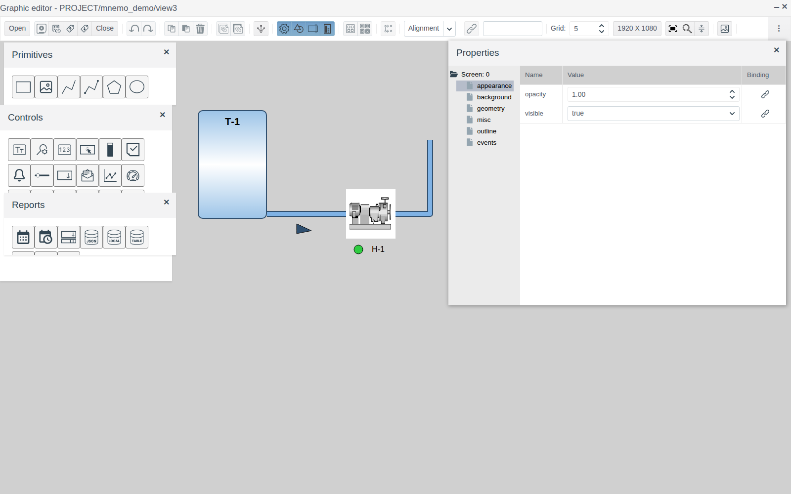
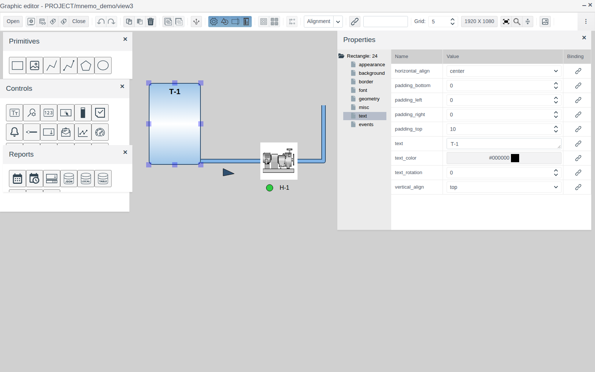
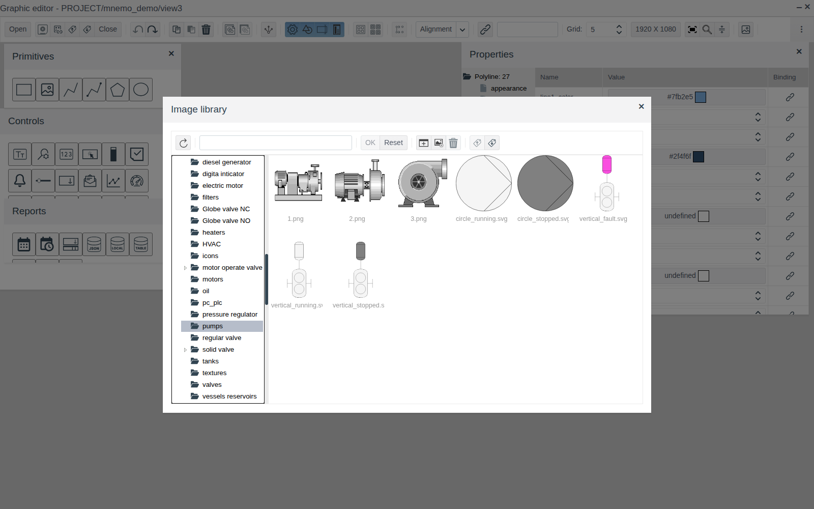
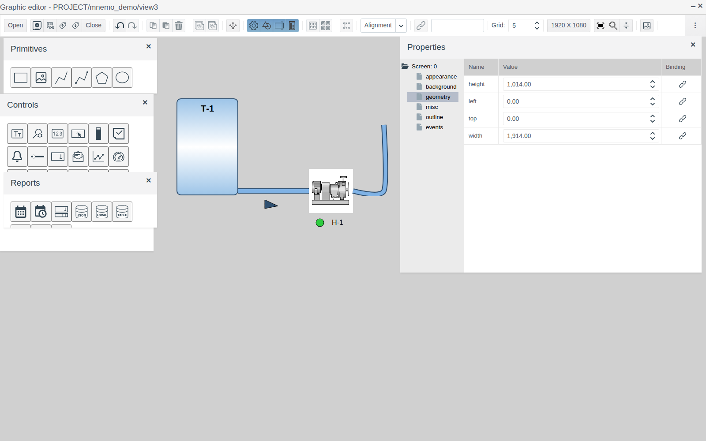
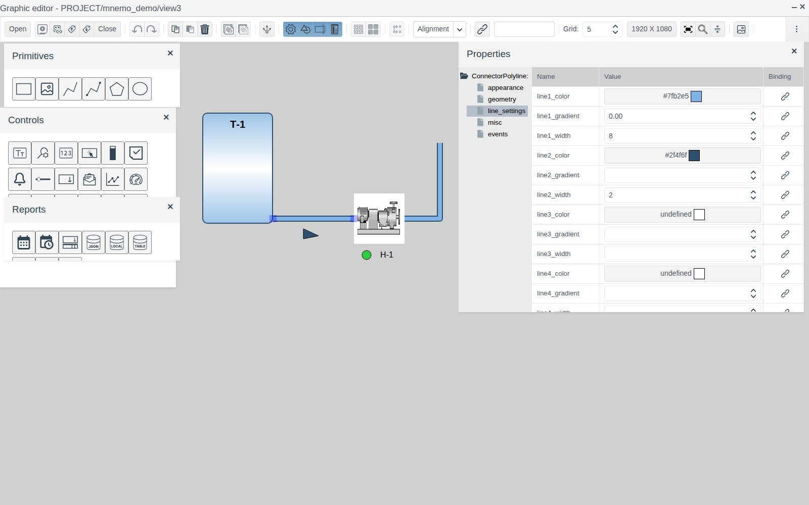
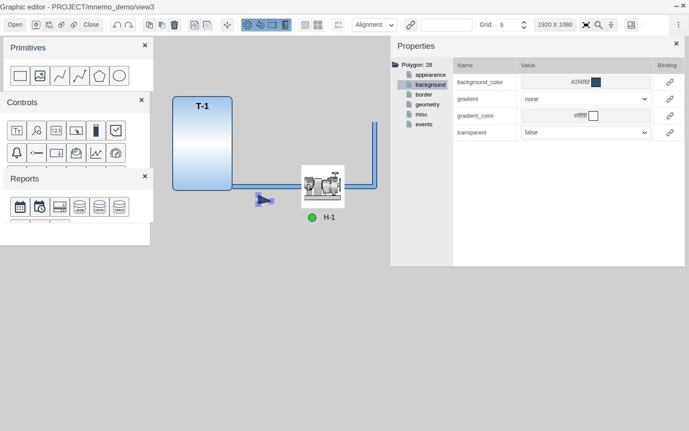
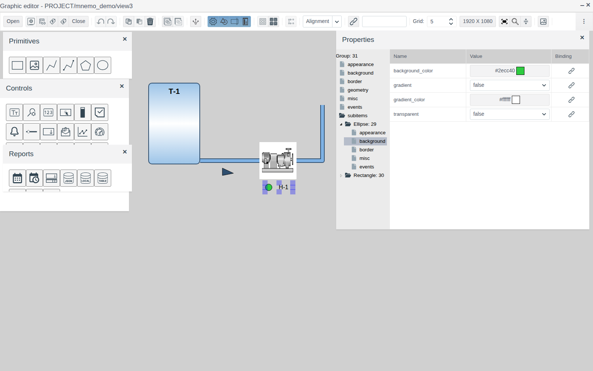
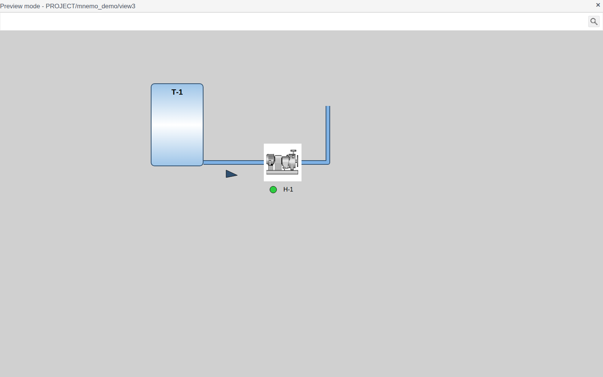

# Graphic elements

A document for the integration engineer who draws the static part of a screen: equipment, pipelines, labels, pointers.

# Contents

- [Glossary](#glossary)
- [Introduction](#introduction)
- [Main part](#main-part)
    - [The Primitives palette](#the-primitives-palette)
    - [Common properties](#common-properties)
    - [Choosing a color](#choosing-a-color)
    - [Rectangle](#rectangle)
    - [Image](#image)
    - [Polyline](#polyline)
    - [Connector polyline](#connector-polyline)
    - [Polygon](#polygon)
    - [Ellipse](#ellipse)
    - [Group](#group)
- [Conclusion](#conclusion)

# Glossary

| Term | Meaning |
|---|---|
| Point | A vertex of a polyline, connector polyline or polygon. The list of points is stored in the `path` property |
| Handle | A square on a selected element. On a rectangle, image, ellipse and group the handles sit at the corners and sides of the frame; on lines and polygons, at the points |
| Image library | The project's picture store, shared by all screens. It opens from an element's properties and with the **Image library** button on the editor toolbar |

The terms "Screen", "Element", "Palette" and "Group" are defined in ["Screen editor"](editor.md).

# Introduction

Graphic elements are the shapes that make up the picture of a process plant: vessels and units, pipelines, flow-direction arrows, labels, status lamps. They are on the **Primitives** palette of the graphic editor.

This document describes each element of the palette: what it is for, what properties it has and how to draw it. Working in the editor itself — adding, selecting, moving, aligning, grouping, saving — is covered in ["Screen editor"](editor.md). Binding properties to project data, animation and scripts are covered in other documents of this section.

The running example is the screen `view3` of the folder `mnemo_demo`: the tank `Т-1` (a rectangle), the pump picture (an image), under it a status lamp (an ellipse) and the label "Н-1" (a rectangle with no background and no border), a pipeline from the tank to the pump with a flow-direction arrow, and a branch going up from the pump.

You will need access to Studio (`http://<server>:9000/fp/studio`) with an account that is allowed to change the project.

# Main part

## The Primitives palette

The **Drawing** button on the editor toolbar opens the palette. An element is added by dragging its icon onto the canvas. The element name is shown in the icon tooltip.

| Icon (left to right) | Element | Root of the property tree | Purpose |
|---|---|---|---|
| Rectangle | **Rectangle** | `Rectangle` | Units, vessels, cabinets, frames, captions and labels |
| Picture | **Image** | `Image` | A ready-made picture of equipment from the image library |
| Line segment | **Polyline** | `Polyline` | Pipelines, cables, busbars, leader lines |
| Polyline with points | **Connector polyline** | `ConnectorPolyline` | A line whose ends are attached to elements and follow them |
| Pentagon | **Polygon** | `Polygon` | Free-form shapes: arrows, valves, triangles |
| Oval | **Ellipse** | `Ellipse` | Status lamps, round units, motors |

## Common properties

Every graphic element has these groups:

| Group | Property | Purpose |
|---|---|---|
| **appearance** | `visible` | `true` — the element is shown, `false` — hidden |
| | `opacity` | Opacity from 0 (invisible) to 1 (opaque) |
| **geometry** | `left`, `top` | Position of the top-left corner in pixels from the top-left corner of the screen |
| | `width`, `height` | Width and height in pixels |
| **misc** | `z_index` | Stacking order: an element with a greater value is drawn over elements with smaller values |
| | `title` | Tooltip: appears in Runtime when the operator hovers the mouse over the element |
| | `cursor` | Mouse pointer shape over the element in Runtime: `inherit`, `default`, `crosshair`, `pointer`, `text`, `help` |

The **events** group and the buttons in the **Binding** column connect an element to data and scripts; an example is in [Buttons and value input](controls.md), sections [Linking an element to a tag](controls.md#linking-an-element-to-a-tag) and [Button](controls.md#button).

## Choosing a color

Color properties (`background_color`, `border_color`, `text_color`, `line1_color`, etc.) show the color code and a swatch. A click on the cell opens the "Color select" window: preset colors on the left, the `#rrggbb` code field and the shade picker on the right, the **Transparent** check box. Pick a color and press **OK**.

## Rectangle

The most versatile element: a shape with a background, a border and text inside. In the example it is the tank `Т-1` with rounded corners, a gradient fill and a caption at the top, and also the label "Н-1" under the pump picture.

| Group | Property | Purpose |
|---|---|---|
| **background** | `background_color` | Background color |
| | `gradient` | Gradient fill. Empty — solid color. `horizontal` — horizontal bands: `background_color` at the top and bottom edges, `gradient_color` in the middle. `vertical` — the same from left to right |
| | `gradient_color` | The second gradient color |
| | `texture` | A fill picture from the image library. When set, it replaces the color and the gradient |
| | `transparent` | `true` — transparent background, only the border and text are visible |
| **border** | `border_width` | Border width in pixels, 0 — no border |
| | `border_color` | Border color |
| | `border_style` | Border line style: `solid`, `dashed`, `dotted`, `double`, etc. |
| | `border_radius` | Corner radius in pixels |
| **text** | `text` | Text inside the rectangle. Enter starts a new line |
| | `text_color` | Text color |
| | `horizontal_align` | Horizontal alignment: `left`, `center`, `right` |
| | `vertical_align` | Vertical alignment: `top`, `middle`, `bottom` |
| | `padding_left`, `padding_right`, `padding_top`, `padding_bottom` | Text indents from the edges in pixels |
| | `text_rotation` | Text rotation from −90 to 90 degrees |
| **font** | `font_family` | Font: `serif`, `sans-serif`, `monospace`, `cursive`, `fantasy`, `system-ui` |
| | `font_size` | Font size in pixels |
| | `bold`, `italic` | Bold, italic |

**Label.** To get text without a shape, set the rectangle's `transparent` to `true` and `border_width` to 0. This is how the label "Н-1" under the pump picture is made in the example.

## Image

Shows a picture from the image library: a pump, a gate valve, a motor, etc.

1. Drag **Image** onto the canvas. The "Image library" window opens at once.
2. Select a folder on the left and a picture on the right, press **OK**.

The picture is scaled to the element size (150 × 150 by default). To change it, use the `image` property of the **misc** group: a click on the cell opens the library again.

The **border** group is the same as for a rectangle: `border_width`, `border_color`, `border_style`, `border_radius`. In the example the pump has `border_width` = 0.

## Polyline

A line made of several points. Suits pipelines, cables, leader lines.

A new polyline is a segment of two points. A selected polyline has a handle at each point:

| Action | Result |
|---|---|
| Drag a handle | The point moves |
| Shift + click a handle | A new point is added after this one, shifted 30 px right and down |
| Ctrl + click a handle | The point is deleted |
| Drag the line | The whole polyline moves |

Exact point coordinates are set in the `path` property of the **geometry** group: each row is a point (`left`, `top` in pixels from the top-left corner of the screen). To add a point at the end, fill in both fields of the empty bottom row and press Enter or Tab. The arrows in a row move the point one place up or down, the bin deletes it. The polyline's `left`, `top`, `width`, `height` are calculated from the points.

Line appearance is in the **line_settings** group:

| Property | Purpose |
|---|---|
| `line1_width`, `line1_color` | Width and color of the main line |
| `line2_width`…`line5_width`, `line2_color`…`line5_color` | Additional line layers. Each layer is drawn under the previous one and sticks out of it on both sides by its own width. An empty width or color means no layer |
| `line1_gradient`…`line5_gradient` | A light stripe along the layer axis that gives the line volume: from 0 (none) to 0.5 (widest) |
| `line_type` | Line type: `solid`, `dashed`, `dotted` |
| `round_corner` | `true` — rounded bends |
| `round_end` | `true` — rounded ends |
| `tension` | Smoothing: 1 — straight segments between points, smaller values — a smooth curve through the points |

**Pipeline.** In the example the pipe has two layers: a light-blue `line1_width` = 8 and a dark-blue `line2_width` = 2. The result is a pipe with an outline. For right-angle bends, turn on `round_corner`.

## Connector polyline

A polyline whose ends are attached to the edges of other elements. When an element is moved or resized, the line end follows it.

1. Place the elements to be connected — in the example, the tank `Т-1` and the pump.
2. Drag **Connector polyline** onto the canvas.
3. Drag the start handle onto the first element: the handle snaps to the nearest side of the element.
4. Drag the end handle onto the second element in the same way.

An end attaches to a rectangle, an image or an ellipse; it does not attach to lines and polygons. To detach an end, drag its handle to an empty spot on the canvas: from then on it does not follow the element.

Intermediate points, the `path` property and the **line_settings** group are the same as for a polyline. The connection is saved with the screen.

## Polygon

A closed shape made of points, with a fill and an outline. A new polygon is a triangle. Points are added, deleted and moved the same way as for a polyline: with handles (Shift + click, Ctrl + click) or in the `path` property.

In the example the polygon is a flow-direction arrow under the pipe: a 30 × 20 triangle with a dark fill.

| Group | Property | Purpose |
|---|---|---|
| **background** | `background_color`, `transparent` | Fill color, transparent fill |
| | `gradient` | `none` — solid fill; `horizontal`, `vertical` — a gradient with `gradient_color` in the middle |
| | `gradient_color` | The second gradient color |
| **border** | `border_width`, `border_color`, `border_style` | Outline width, color and line type (`solid`, `dashed`, `dotted`) |
| **appearance** | `tension` | Outline smoothing, as for a polyline |
| | `round_corner` | `true` — rounded vertices |

## Ellipse

An ellipse inscribed in the `width` × `height` frame; with equal sides, a circle. In the example it is the pump's green status lamp, 20 × 20.

| Group | Property | Purpose |
|---|---|---|
| **background** | `background_color`, `transparent` | Fill color, transparent fill |
| | `gradient` | `true` — a radial gradient: `gradient_color` in the center, `background_color` at the edge |
| | `gradient_color` | The center color |
| **border** | `border_width`, `border_color`, `border_style` | Outline: width, color, line type (`solid`, `dashed`, `dotted`) |

## Group

A group joins several elements into one. Creating and ungrouping a group is described in ["Screen editor", section "Grouping"](editor.md#grouping). In the example the lamp and the label "Н-1" are grouped.

The group's own properties:

| Group | Property | Purpose |
|---|---|---|
| **background** | `background_color` | Background under the group's elements |
| **border** | `border_width`, `border_color`, `border_style`, `border_radius` | A border around the group |
| **geometry** | `left`, `top` | Group position; the elements move with it |

The group size is the frame around its elements.

**Properties of elements inside a group.** Expand the **subitems** node in the group's property tree, then the node of the element, and select a property group. Changes apply to that element without ungrouping. The position and size of an element inside a group are not set here: to change them, ungroup, edit and group again.

# Conclusion

How to work with graphic elements:

1. Draw the equipment: rectangles for units and vessels, images from the library for standard equipment, ellipses for lamps and round units.
2. Make labels with rectangles that have a transparent background and no border.
3. Draw the pipelines: a connector polyline between units, a polyline for branches and free lines. The `line2`…`line5` layers give a pipe volume.
4. Add arrows and other shapes with a polygon.
5. Group the elements of one unit; edit the appearance of elements inside a group through **subitems**.
6. Save the screen and check it with the preview button in the "Views" window.

