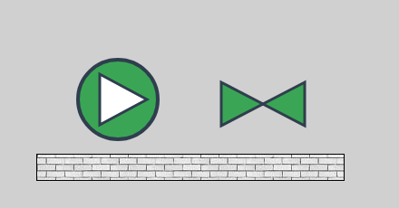
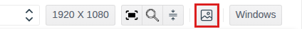
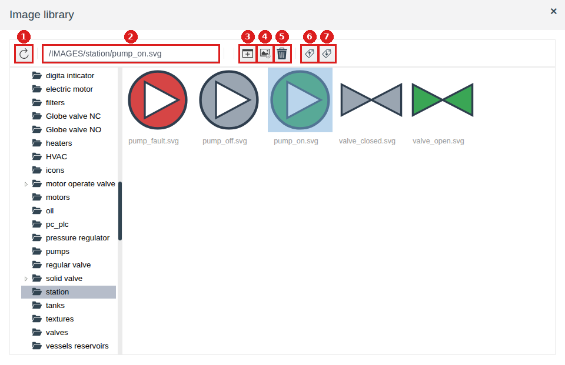
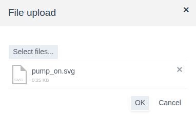
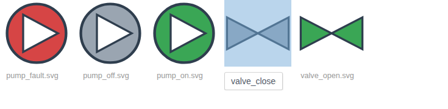
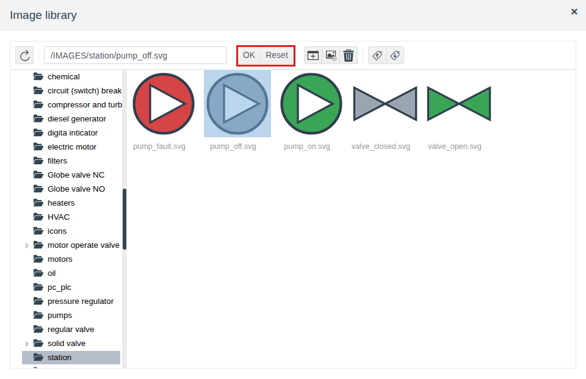
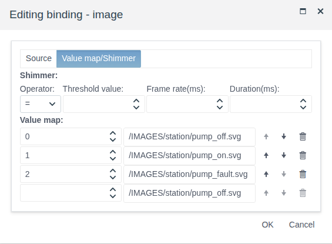

# Image library

A document for the integration engineer who draws screens and keeps equipment pictures, icons and textures for them.

# Contents

- [Glossary](#glossary)
- [Introduction](#introduction)
- [Main part](#main-part)
    - [Where the library opens](#where-the-library-opens)
    - [Library window](#library-window)
    - [Folders](#folders)
    - [Uploading pictures](#uploading-pictures)
    - [Renaming and deleting](#renaming-and-deleting)
    - [Choosing a picture for an element](#choosing-a-picture-for-an-element)
    - [Picture by state](#picture-by-state)
    - [Moving to another project](#moving-to-another-project)
- [Conclusion](#conclusion)

# Glossary

| Term | Meaning |
|---|---|
| Image library | The project's picture store, shared by all screens. Pictures are arranged in folders; the root folder is `IMAGES` |
| Picture path | A string like `/IMAGES/<folder>/<file>`. The `image` and `texture` properties keep it, and the element finds the picture by it |
| `.iex` file | An export file of selected library pictures and folders. It is loaded back with the **Import** button of the library window |

The terms "Screen", "Element", "Palette" are in the [Screen editor](editor.md#glossary) document.

# Introduction

A picture is not embedded into a screen as a file. It is uploaded to the project library, and the element keeps only its path. Therefore:

- any number of screens use one picture, and the project stores it once;
- a picture can be replaced in one place, and all screens with this path show the new one;
- pictures move to another project together with it or as a separate file.

Three properties show library pictures:

| Property | Elements | What it shows |
|---|---|---|
| `image` (**misc** group) | **Image** (see [Graphic elements, the Image section](graphics.md#image)) | The whole picture, stretched to the element size |
| `texture` (**background** group) | [**Rectangle**](graphics.md#rectangle), [**LinearGauge**](gauges.md#linear-gauge), [**Timeline**](tables.md#timeline-axis-border-and-background) | A background fill with a repeated picture instead of a color |

The shipped library already contains folders with typical equipment: pumps, valves, motors, tanks, textures. Your own pictures are added next to them.

The running example is the library folder `station` with five SVG pictures: a pump running, stopped and in fault, a valve open and closed. On the screen of the project folder `img_demo` the pump changes its picture by the `state` field of the `pump_1` object, an open valve stands next to it, and a base with the `grey_brick.jpg` texture is under them.

You need access to Studio (`http://<server>:9000/fp/studio`) with an account that may change the project. The result is checked in Runtime (`http://<server>:9000/fp/runtime`).

# Main part

## Where the library opens

The library opens only from the screen editor. What you can do in it depends on where you opened it:

| From | What you can do | **OK** and **Reset** buttons |
|---|---|---|
| The **Image library** button on the editor toolbar | Upload, rename, delete pictures, create folders, export and import | No |
| The **Value** cell of the `image` or `texture` property in the **Properties** panel | The same, plus choose a picture for the element | Yes |
| The value field in the value map of an `image` or `texture` binding | The same, plus choose a picture for the map row | Yes |
| Dragging **Image** from the palette onto the canvas | The same, plus choose a picture for the new element | Yes |

The **Image library** button is the picture icon in the right part of the toolbar. If the toolbar does not fit into the browser window, the button moves to the **⋮** menu at the end of the toolbar.

Changes in the library are saved at once, without saving the screen, and are visible in all screens of the project.

## Library window

On the left is the folder tree, on the right is the content of the open folder: subfolders first, then pictures. A double click on a folder on the right opens it.

| No. | Button | What it does |
|---|---|---|
| 1 | Refresh | Reloads the tree and the folder. Needed if another user changed pictures while the window is open |
| 2 | Path field | Shows the path of the selected picture. Type a path and press Enter — its folder opens and the picture is selected |
| 3 | **Create folder** | Creates a folder inside the open one |
| 4 | **Upload image** | Uploads a picture from a file into the open folder |
| 5 | **Delete** | Deletes the selected pictures and folders |
| 6 | **Export** | Saves the selected pictures and folders to an `.iex` file |
| 7 | **Import** | Loads pictures from an `.iex` file |

A click on a picture selects it, Ctrl + click adds more pictures to the selection. The **Delete** and **Export** buttons work with the selection.

## Folders

Folders keep your pictures apart from the shipped ones and make them easy to move: exporting a folder takes all of it.

1. In the tree open the folder that will hold the new one, for example `IMAGES`.
2. Press **Create folder**. The `New folder` folder appears (the next ones are `New folder_0`, `New folder_1`, etc.).
3. Click its name under the icon, type your own and press Enter.

In the example the `station` folder is created in the `IMAGES` root.

Folders nest to any depth. The picture path follows the nesting: `/IMAGES/station/pumps/pump_on.svg`.

## Uploading pictures

1. Open the folder you upload the picture to.
2. Press **Upload image**. In the "File upload" window press **Select files...** and choose the file.
3. Press **OK**. The picture appears in the folder and is selected at once.

One file is uploaded at a time. The picture name in the library is the file name with its extension, for example `pump_on.svg`. Cyrillic letters and spaces in the name are allowed.

Names inside one folder are unique. If the folder already has a picture or a folder with this name, the upload is not done and an **ERROR!** window with the text `{not_unique,<<"<name>">>}` appears. Rename the file or upload it to another folder.

The picture is shown by the browser, so any format the browser can display will do. SVG, PNG, JPG, GIF, BMP, WEBP and ICO have been checked: pictures of these formats are shown the same way in the editor and in Runtime. Formats that browsers do not display (for example, TIFF) are uploaded but are not visible on the screen.

**Which format to choose.** The element stretches the picture to its size. SVG scales without loss of quality, so SVG is more convenient for equipment drawn at different sizes on different screens. Raster formats (PNG, JPG) suit photos and textures; upload them at the size they will have on the screen, otherwise the picture becomes blurry when enlarged.

**Replacing a picture.** To replace a picture without touching the screens, delete the old one and upload a new one with the same name, including the extension, to the same folder. The path does not change, and screens with this path show the new picture the next time they are opened. A new picture in another format has another name and another path (for example, `pump_on.svg` instead of `pump_on.png`): choose it again in the properties of every element and in the value maps of bindings where the old one was used (see [Renaming and deleting](#renaming-and-deleting)).

## Renaming and deleting

**Renaming.** Click the name of a picture or folder under the icon, type a new one and press Enter. The extension is part of the name: keep it when renaming a picture. A name already taken in the folder is not accepted: the same **ERROR!** window appears and the name stays as it was.

**Deleting.** Select pictures and folders, press **Delete** and confirm the "Delete items? (N)" question, where N is the number of selected items. A folder is deleted with all its content.

There is no separate command to move a picture to another folder: upload it to the new folder and delete it from the old one.

A screen keeps the picture path, not the picture itself. After a picture is renamed, deleted or moved, and after a folder is renamed, elements with the old path are left without a picture. So first decide where the picture will lie and what it will be called, and only then place it on screens. If the path has changed anyway, choose the picture again in the properties of every element that used it.

## Choosing a picture for an element

1. Select the element and click the **Value** cell of the `image` property (**misc** group) or `texture` (**background** group). For a new **Image** the window opens by itself when it is dragged from the palette.
2. Choose a folder in the tree and a picture on the right. Its path appears in the path field.
3. Press **OK**.

The window opens on the element's current picture. If no picture is chosen yet, the default folder opens: `active elements` for `image`, `textures` for `texture`.

| Button | Result |
|---|---|
| **OK** | The property gets the path of the selected picture |
| **Reset** | The property is cleared. For `texture` it means the background is filled with the `background_color` color again |
| The cross in the title | The window closes, the property does not change |

After the choice the property cell shows the path, for example `/IMAGES/station/pump_off.svg`. Save the screen: the path is written into the screen on saving, like the other properties.

## Picture by state

A common task is to show the state of equipment with a picture: a running pump is green, a stopped one is grey, a faulty one is red. For this the `image` property is bound to the state field, and a value map is set where every field value has a picture from the library. Binding and the value map are described in detail in the [Bindings and animation document, the Value map section](bindings.md#value-map).

1. Upload the pictures of all states to one library folder. In the example these are `pump_off.svg`, `pump_on.svg`, `pump_fault.svg` in the `station` folder.
2. Add an **Image** to the screen and choose the default state picture. In the example it is `pump_off.svg`.
3. Click the icon in the **Binding** column of the `image` property and on the **Source** tab choose the tag and the field. In the example it is `pump_1`, the `state` field (0 — stopped, 1 — running, 2 — fault).
4. On the **Value map/Shimmer** tab fill in the map rows: a threshold and a picture. A click on the picture field opens the library; the choice is confirmed with **OK**.
5. Press **OK** in the binding window and save the screen.

In the example at `state` = 1 the operator sees a green pump (see the picture in the [Introduction](#introduction)), at 0 a grey one, at 2 a red one.

A texture is changed the same way: bind `texture` and choose textures in the value map.

## Moving to another project

Pictures are moved with an `.iex` file.

1. Select pictures or folders (Ctrl + click for several) and press **Export**. The browser saves the `fp_image_export.iex` file.
2. In the other project open the library, press **Import**, choose the file in the "Import images" window and press **OK**. The "Images imported successfully" message appears.

Import places the pictures at the same paths as at export, no matter which folder is open in the window. Missing folders are created. A picture with the same path is replaced by the picture from the file. The other library pictures do not change. So it is convenient to keep your pictures in your own folder: exporting and importing it does not affect the shipped pictures.

A `.scn` screen file (the **Export to file** button of the editor, see [Screen editor, the Exporting and importing a screen section](editor.md#exporting-and-importing-a-screen)) keeps only picture paths. Move a screen together with the `.iex` of its pictures; shipped pictures need not be moved, every project has them.

If the whole project is moved, the library does not need a separate export: it is included in the project export.

# Conclusion

| Task | How to do it |
|---|---|
| Open the library to manage pictures | The **Image library** button on the editor toolbar (or in the **⋮** menu) |
| Add your own pictures | Create a folder, upload files with the **Upload image** button |
| Show a picture on a screen | The **Image** element, the `image` property |
| Fill a background with a picture | The `texture` property of a rectangle, LinearGauge or Timeline |
| Change the picture by state | An `image` binding to the state field with a value map |
| Replace a picture in all screens | Delete the old one and upload a new one with the same name and extension to the same folder |
| Move pictures to another project | **Export** in the library window → **Import** in the other project |

Order of work:

1. Create your own folder for the project pictures in `IMAGES`, if needed with subfolders by equipment type.
2. Upload the pictures; SVG is preferable for equipment. Give them their final names right away.
3. Place the pictures on screens through `image` and `texture`, state pictures through a binding with a value map.
4. Save the screens and check them in Runtime.
5. To move to another project, export your folder to `.iex`.
