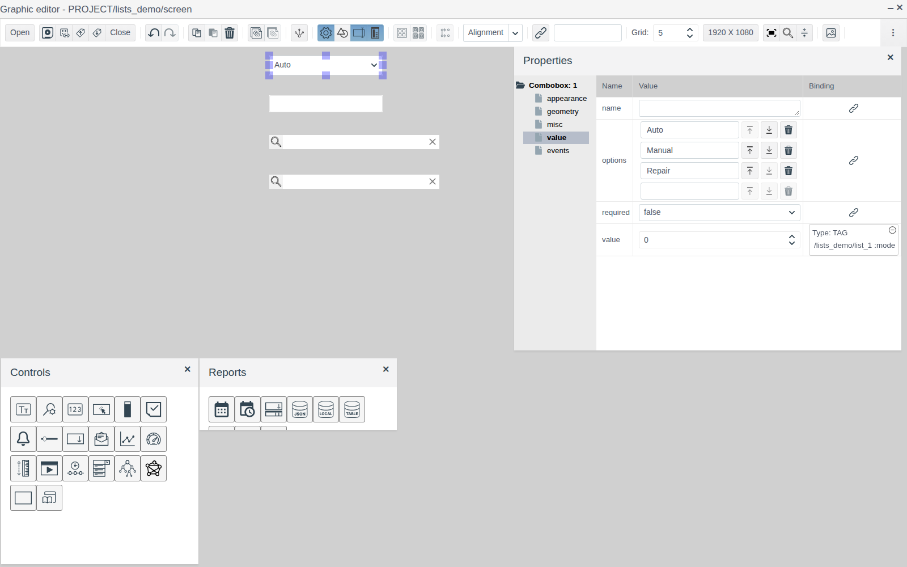
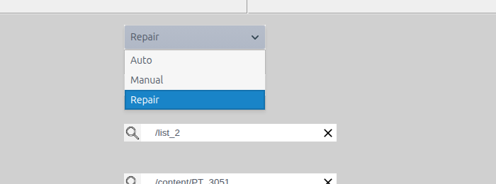
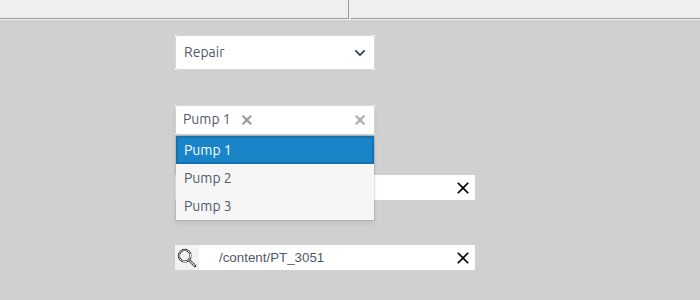
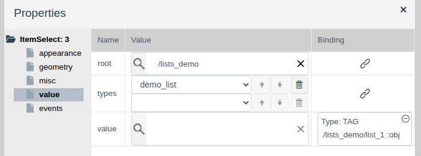
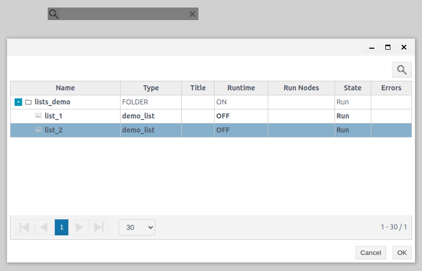
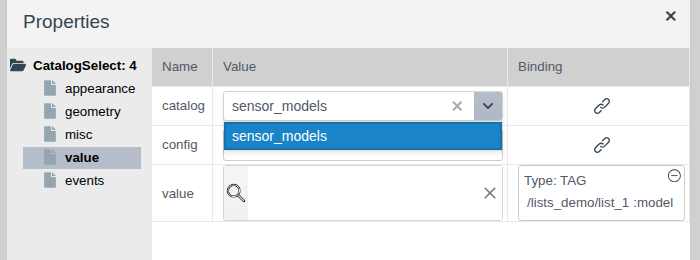
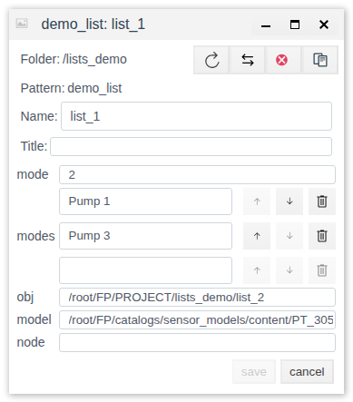
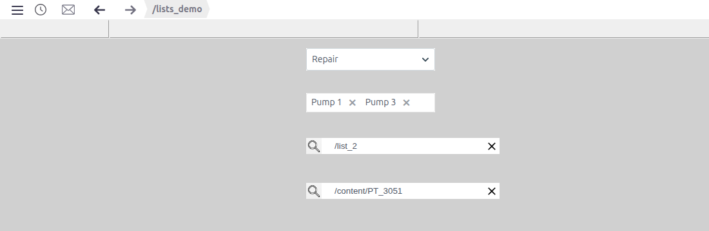

# Selection from lists

A document for the integration engineer who lets the operator pick from a ready-made list on a screen: an operating mode, a set of units, a project object or a catalog record.

# Contents

- [Glossary](#glossary)
- [Introduction](#introduction)
- [Main part](#main-part)
    - [Elements on the palettes](#elements-on-the-palettes)
    - [Dropdown list](#dropdown-list)
    - [Multiple selection](#multiple-selection)
    - [Selecting a project object](#selecting-a-project-object)
    - [Selecting a catalog record](#selecting-a-catalog-record)
- [Conclusion](#conclusion)

# Glossary

| Term | Meaning |
|---|---|
| Full path | The address of an object in the Faceplate database. Project objects are under `/root/FP/PROJECT`, catalog records under `/root/FP/catalogs/<catalog>/content`. Example: `/root/FP/PROJECT/lists_demo/list_2` |
| Catalog record | A row of a catalog from the **Catalogs** section (see [Catalogs](../catalogs/catalogs.md)) |

The terms "Tag" and "Binding" are explained in [Buttons and value input](controls.md#glossary), "Screen", "Palette" and "Element" in [Screen editor](editor.md#glossary).

# Introduction

Selection elements spare the operator from typing: the operator picks a value from a list and the element writes the choice into a tag field. The list comes from different places: lines in the element properties, project objects or catalog records.

This document describes four selection elements, their properties, how they write the value to a tag and how they behave in Runtime. Working in the editor (adding, selecting, properties, saving) is covered in [Screen editor](editor.md); binding a property to a tag field is covered in [Buttons and value input, section "Linking an element to a tag"](controls.md#linking-an-element-to-a-tag).

The running example is the `screen` of the `lists_demo` folder. The data is in the object `list_1` of a custom primitive `demo_list` with the fields `mode` (integer), `modes` (list, subtype string), `obj` (string) and `model` (string). Next to it is a second object of the same type, `list_2`. The catalog `sensor_models` with sensor models is created as described in [Catalogs](../catalogs/catalogs.md).

The screen, top to bottom: the operating mode ("Auto", "Manual", "Repair"), the pumps in operation ("Pump 1", "Pump 2", "Pump 3"), selection of a `demo_list` object and selection of a sensor model from the catalog.

You need access to Studio (`http://<server>:9000/fp/studio`) with an account that may change the project. The result is checked in Runtime (`http://<server>:9000/fp/runtime`).

# Main part

## Elements on the palettes

The element name is shown in the palette icon tooltip, the type in the root of the property tree.

| Palette | Icon tooltip | Property tree root | What the operator picks | What is written to the tag | Tag field type |
|---|---|---|---|---|---|
| **Controls** | Dropdown list | `Combobox` | One item from a list | The item number, from 0 | `integer` |
| **Reports** | multiselect | `MultiSelect` | Several items from a list | The texts of the selected items | `list` with subtype `string` |
| **Controls** | Itemselect | `ItemSelect` | A project object | The full path of the object | `string` |
| **Controls** | CatalogSelect | `CatalogSelect` | A catalog record | The full path of the record | `string` |

In all four elements the value is stored in the `value` property of the **value** group. To get the operator's choice into a tag, bind `value` to a tag field (see [Buttons and value input, section "Linking an element to a tag"](controls.md#linking-an-element-to-a-tag)). The binding works both ways: the element shows the current field value. While the field has no value, the dropdown list and the magnifier fields are grey in Runtime.

The **appearance**, **geometry**, **misc** and **events** groups are the same as for the other screen elements (see [Graphic elements, section "Common properties"](graphics.md#common-properties)).

## Dropdown list

A field with an arrow. A click opens the item list, the selected item is shown in the field.

| Property (**value** group) | Purpose |
|---|---|
| `options` | The list items, one per line. Typing into the empty bottom line adds an item, the arrows change the order, the bin deletes |
| `value` | The number of the selected item: the first item is `0`, the second `1`, and so on |

The tag receives the item number, not its text. The order of items therefore matters: if you swap items, the existing field value will show a different item.

In the example `options` = "Auto", "Manual", "Repair", and `value` is bound to `list_1.mode`. Picking "Repair" writes `2` to `mode`.

## Multiple selection

The **multiselect** element from the **Reports** palette. A click on the field opens the list, the selected item becomes a chip in the field. The cross on a chip removes the item from the selection.

| Property (**value** group) | Purpose |
|---|---|
| `options` | The list items, edited the same way as in the dropdown list |
| `value` | The selected items |

The tag receives a list of the texts of the selected items, so the tag field must be of type `list` with subtype `string`. An empty selection is written as an empty list.

Chips that do not fit in the width wrap to the next line below the element border. Give the element enough height and width for the largest selection.

In the example `options` = "Pump 1", "Pump 2", "Pump 3", and `value` is bound to `list_1.modes`.

## Selecting a project object

The **Itemselect** element is a field with a magnifier. The operator picks a project object of the given types inside the given folder.

| Property (**value** group) | Purpose |
|---|---|
| `root` | The folder in which the operator picks an object. Set with the magnifier: select the folder in the project tree window and click **OK** |
| `types` | The object types that can be picked. After a type is chosen, an empty line for the next one appears below; the arrows change the order, the bin deletes |
| `value` | The selected object |

In Runtime the magnifier opens a window with the tree of the `root` folder. Objects of matching types are shown in bold. Select an object and click **OK**. The element field shows the object path relative to `root`; the tag receives the full path. The cross in the field clears the selection, and an empty value is written to the tag.

In the example `root` = `/lists_demo`, `types` = `demo_list`, and `value` is bound to `list_1.obj`. After `list_2` is picked, the field shows `/list_2` and `obj` holds `/root/FP/PROJECT/lists_demo/list_2`.

## Selecting a catalog record

The **CatalogSelect** element is a field with a magnifier for picking a catalog record.

| Property (**value** group) | Purpose |
|---|---|
| `catalog` | A catalog from the **Catalogs** section, chosen from a list |
| `value` | The selected record |
| `config` | Leave the default value `{}` |

In Runtime the magnifier opens a window titled with the path to the catalog records. The table has the `.name` column and the catalog fields. Select a record and click **save**; **cancel** closes the window without a choice. The element field shows `/content/<record name>`; the tag receives the full path of the record.

In the example `catalog` = `sensor_models`, and `value` is bound to `list_1.model`. After `PT_3051` is picked, `model` holds `/root/FP/catalogs/sensor_models/content/PT_3051`.

The fields of `list_1` after a choice in all four elements:

# Conclusion

Which element to use:

| What the operator picks | Element |
|---|---|
| One item from a short fixed list | Dropdown list |
| Several items from a fixed list | multiselect |
| A project object: a unit, a line, a plant | Itemselect |
| A reference record: a model, a type, a code | CatalogSelect |

Workflow:

1. Prepare a tag with fields of the right types: `integer` for the dropdown list, `list` with subtype `string` for multiple selection, `string` for object and catalog record selection.
2. Drag the elements from the **Controls** and **Reports** palettes.
3. Define the list: `options` for the lists, `root` and `types` for object selection, `catalog` for record selection.
4. Bind the `value` of each element to a tag field.
5. Save the screen and check the selection in Runtime.

