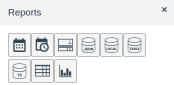
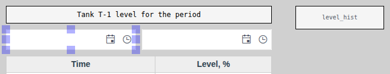
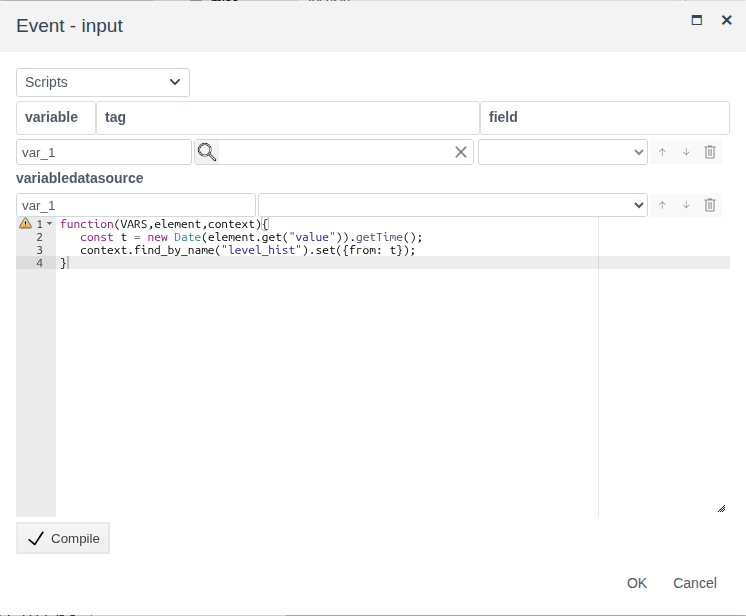
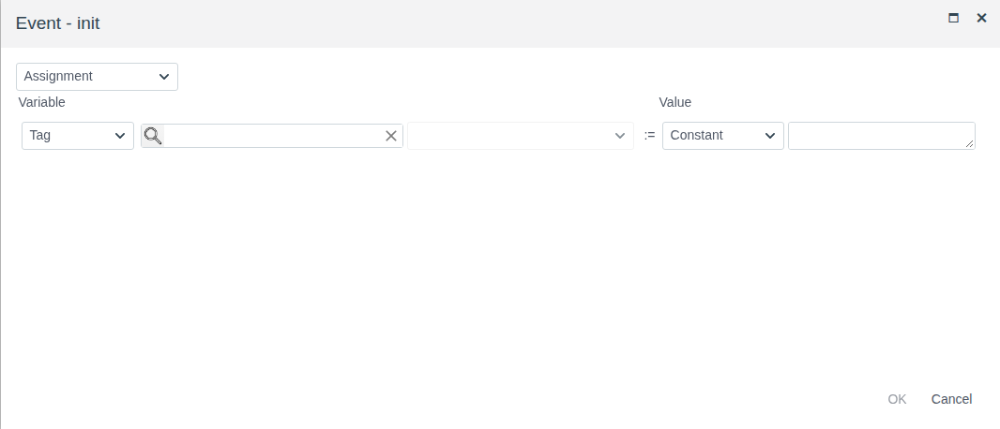
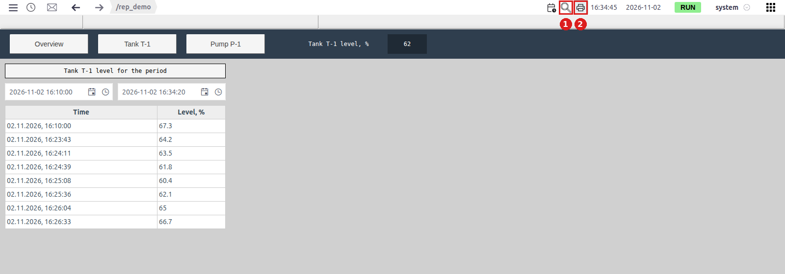
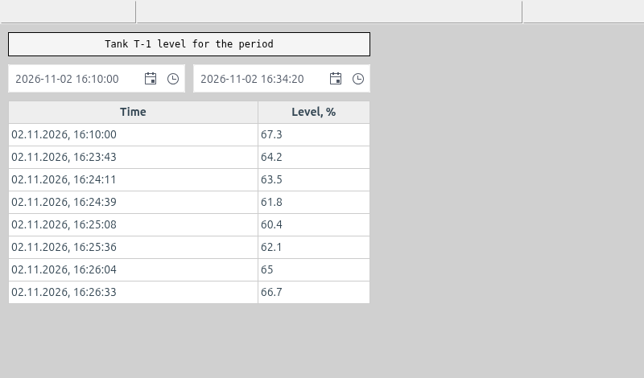
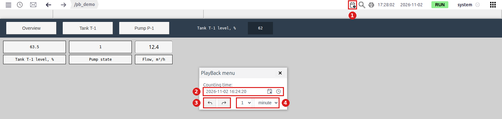

# Reports and screen printing

A document for an integration engineer who needs to give the operator a table of values for a period the operator chooses, and a way to print it or save it to PDF right from Runtime.

# Contents

- [Glossary](#glossary)
- [Introduction](#introduction)
- [Main part](#main-part)
    - [The Reports palette](#the-reports-palette)
    - [Report screen: period, source, table](#report-screen-period-source-table)
    - [Default period: the init event](#default-period-the-init-event)
    - [The report in Runtime](#the-report-in-runtime)
    - [Screen printing](#screen-printing)
    - [Past state of the screen: archive playback](#past-state-of-the-screen-archive-playback)
- [Conclusion](#conclusion)

# Glossary

| Term | Meaning |
|---|---|
| Report screen | A screen on which the operator sets the period and a table shows the archive values for that period. There is no separate object type: it is an ordinary screen built from elements of the **Reports** palette |
| Alarm strip | The row under the Runtime top bar, above the screen. Active alarms appear in it |
| Work area | The part of the Runtime window under the alarm strip where the screen is shown. It can be zoomed and scrolled |
| Archive playback | A Runtime mode in which the screen shows archive values for a chosen past moment. Turned on with the calendar-with-clock icon on the top bar, controlled in the "PlayBack menu" window |
| Screen printing | The printer button on the Runtime top bar and the Ctrl + P shortcut. Hands the browser a picture of the alarm strip and of the visible part of the work area |

The terms "Screen", "Palette" and "Element" are explained in [Screen editor](editor.md#glossary), "Event" in [Scripts and events](events.md#glossary), "Data source" and "Record" in [Data sources on a screen](datasources.md#glossary), "Archive" in [Tables and timeline](tables.md#glossary).

# Introduction

An operational screen shows current values. To review a shift, hand over a log or answer "what happened to the level overnight", you need a report: values for a period the operator chooses, on paper or in PDF. In FACEPLATE a report is built on an ordinary screen from elements of the **Reports** palette and printed with a Runtime button.

The document describes what the **Reports** palette holds, how to connect the period fields to an archive and a table, how to set a default period, what the operator sees and what ends up on the sheet when printing. Element properties are described in their own documents; here only what a report needs:

- date fields — [Buttons and value input, section "Date and date-time"](controls.md#date-and-date-time);
- sources — [Data sources on a screen](datasources.md);
- table — [Tables and timeline, section "Table: columns and headers"](tables.md#table-columns-and-headers);
- event scripts — [Scripts and events, section "Event script"](events.md#event-script).

The running example is the `screen` of the `rep_demo` folder: the history of a tank level for a period the operator sets with two fields. The data come from the `tank_1_level` archive of the `ds_demo` folder (its creation is described in [Data sources on a screen](datasources.md#time-series-datasource-history-from-archives)).

You need access to Studio (`http://<server>:9000/fp/studio`) under an account allowed to change the project, and an archive that records the history of the quantity you need. The result is checked in Runtime (`http://<server>:9000/fp/runtime`).

# Main part

## The Reports palette

The **Reports** palette is opened in the screen editor with the **Report items** button on the toolbar (see [Screen editor, section "Editor window"](editor.md#editor-window)). It holds elements for working with record sets and periods:



| Icon (tooltip) | Purpose | Described in |
|---|---|---|
| Date | Date picker field | [Buttons and value input](controls.md#date-and-date-time) |
| Date - Time | Date and time picker field | [Buttons and value input](controls.md#date-and-date-time) |
| multiselect | Picking several list items | [Selection from lists](lists.md) |
| Local Datasource | Source: records set on the screen | [Data sources on a screen](datasources.md#local-datasource-records-on-the-screen) |
| Table Datasource | Source: project objects of one type | [Data sources on a screen](datasources.md#table-datasource-project-objects) |
| Time-series datasource | Source: archive history for a period | [Data sources on a screen](datasources.md#time-series-datasource-history-from-archives) |
| Grid | Table of source records | [Tables and timeline](tables.md#table-columns-and-headers) |
| Bar Chart | Bar chart of source records | [Dial and linear gauges](gauges.md#bar-chart) |

A report for a period needs three of them: **Date - Time** (start and end of the period), **Time-series datasource** (archive history) and **Grid** (the table).

## Report screen: period, source, table

In **Time-series datasource** the period is set by the `from` and `to` properties: a moment in milliseconds. The source rereads the archive every time `from` or `to` changes. A **Date - Time** field keeps the chosen moment in `value`. The field and the source are connected by a script on the field's `input` event: it occurs when the operator has picked a date in the calendar, a time in the list or typed a value into the field. The script converts the chosen moment to milliseconds and writes it to the source.

Why this is better than binding `from`/`to` to a tag: the period lives only on the operator's screen. Two operators can look at the report for different periods at the same time, and nothing changes in the project.



Steps:

1. Add a **Time-series datasource**, set the name in **misc** → `name`, in **value** → `data` pick the archive and set the alias (see [Data sources on a screen](datasources.md#time-series-datasource-history-from-archives)). Leave `from` and `to` empty: the scripts fill them. In the example — `level_hist`, archive `tank_1_level`, alias `level`.
2. Add two **Date - Time** fields. In the **value** group → `name` set the names of the start and end fields. In the example — `from_dt` and `to_dt`.
3. Add a **Grid** after the source and pick the source in **value** → `datasource`. Set the headers (`header`) and columns (`columns`) as for any history table: the record time is the `ts` field, the value is the archive alias. In the example:

    ```
    ["Time", "Level, %"]
    ```

    ```
    [{fields: ["ts"], handler: ({ts}) => new Date(ts).toLocaleString()}, "level"]
    ```

4. Select the start field, **events** group → `input` → **Scripts**, enter the script, **Compile** → **OK**:

    ```javascript
    function(VARS,element,context){
       const t = new Date(element.get("value")).getTime();
       context.find_by_name("<source>").set({from: t});
    }
    ```

5. The same for the end field, with `{to: t}` in the last line.
6. Save the screen.

In the example `<source>` is `level_hist`.



In the editor the table is filled with sample cells; archive records appear only in Runtime.

## Default period: the init event

While `from` or `to` is empty, the source returns no records and the table is empty when the screen opens. For the operator to see a report for a typical period right away, set the period with a script on the screen's `init` event: it runs when the screen opens in Runtime.

Click an empty spot of the canvas (the screen gets selected), **events** group → `init` → **Scripts**:

```javascript
function(VARS,element,context){
   const to = Date.now();
   const from = to - 24 * 60 * 60 * 1000;
   context.find_by_name("<start field>").set({value: from});
   context.find_by_name("<end field>").set({value: to});
   context.find_by_name("<source>").set({from: from, to: to});
}
```

The script puts the last 24 hours into the fields and passes the same period to the source. For another period change the number in the `from` line: 8 hours is `8 * 60 * 60 * 1000`. In the example the fields are `from_dt` and `to_dt`, the source is `level_hist`.



## The report in Runtime

The operator opens the screen from the **Screens** menu (see [Screens and navigation](screens.md#how-the-operator-finds-screens)). In the example, on opening the fields show the last 24 hours and the table shows all level values for that time.

To change the period, the operator clicks the calendar icon in the field and picks a day, the clock icon and picks a time from the list (the list step is the `interval` property), or types the date into the field. After the choice the table rereads the archive for the new period. The first row of the table is the archive value at the start of the period, then every change of the quantity.



The table does not extend itself while the operator looks at the report: new values appear after the next period choice.

## Screen printing

Printing is available on any Runtime screen, not only on a report screen. It is started in two ways:

- the printer icon on the Runtime top bar, on the right, between the magnifier and the clock (**2** in the figure above);
- Ctrl + P while Runtime is open.

Runtime makes a picture and opens the browser print dialog. In it you pick a printer or saving to PDF.

The sheet gets what the operator sees in the work area, and the alarm strip above it:

| Part of the Runtime window | On the sheet |
|---|---|
| Alarm strip | Yes |
| Visible part of the screen | Yes |
| Part of the screen beyond the window edge | No |
| Table rows beyond its scroll | No |
| Top bar (menu, path, clock, user) | No |
| Fixed screen (see [Screens and navigation](screens.md#fixed-screen)) | No |



In the example the picture has no top bar and no fixed screen with navigation buttons, which are visible in the Runtime figure above; at the top is the empty alarm strip.

Hence two rules for a report screen:

1. **The whole screen in the window.** If the screen is larger than the window, the operator reduces the zoom before printing: the magnifier icon on the top bar (**1** in the figure above) opens a panel with the current zoom in percent and the **−**, **+** and **Reset** buttons. The **−** button halves the zoom. Ctrl + mouse wheel also changes the zoom; the wheel without Ctrl scrolls the screen. **Reset** returns 100 %.
2. **All table rows visible.** The height of the **Grid** is chosen by the number of rows the report gives for a typical period. If there are clearly more rows, shorten the default period in `init` or give the table the full height of the screen.

## Past state of the screen: archive playback

A report table shows one quantity for a period. Investigating an event often needs something else: the whole screen at one past moment — what the levels and states were when a protection tripped. For this Runtime has the archive playback mode. It needs no separate screen: it works on any open screen.

The calendar-with-clock icon on the top bar, to the left of the magnifier (**1** in the figure), opens the "PlayBack menu" window over the current screen:

| No. | Window element | Purpose |
|---|---|---|
| 2 | **Counting time** | The moment for which the screen shows values. Type the date and time into the field and press Enter |
| 3 | "Back" and "forward" buttons | Move the moment one step earlier or later |
| 4 | Step | A number (1, 5, 10, 15, 30, 60) and a unit: `second`, `minute`, `hour` |



What the screen shows:

- while no moment is set — current values, as usual;
- an element bound to a field that has an archive — the archive value at the set moment;
- an element bound to a field without an archive — the current value;
- values from the screen are not written to the project in this mode.

In the example (the `pb_demo` screen) the level `tank_1.level` is recorded by an archive, the pump state is not. At 16:24:20 the level shows 63.5 — the archive value, the state shows the current value. The "forward" button with a step of 1 `minute` moves the screen to 16:25:20, and the level changes to 60.4. Closing the window with the cross returns the screen to current values.

So only what an archive records is played back: a field you need to see in the past must have an archive (see [Archives: configuring sources and recording data](../data_storage/archives/archives_en.md)).

Printing in this mode gives the screen at the set moment. The "PlayBack menu" window does not get onto the sheet, so the moment is not shown on the printout: if you need it, label the sheet.

| | Report table | Archive playback |
|---|---|---|
| What is on the sheet | One quantity, all changes for the period | The whole screen at one moment |
| What the integrator prepares | A separate screen: period fields, source, table | Nothing but archives of the needed fields |
| How the operator picks the time | Period start and end in screen fields | Moment and step in the "PlayBack menu" window |

# Conclusion

| Task | What to use |
|---|---|
| Archive values for a period the operator picks | Two **Date - Time** fields, a script on the `input` of each field → `from`/`to` of a **Time-series datasource**, **Grid** |
| A report right on opening | A script on the screen's `init` event sets the fields and the source period |
| A summary of project objects or a reference table on the same sheet | **Table Datasource** or **Local Datasource** and one more **Grid** (see [Data sources on a screen](datasources.md)) |
| The whole screen at a past moment | The calendar-with-clock icon → "PlayBack menu"; the needed fields have archives |
| A paper copy or PDF | The printer icon on the Runtime top bar or Ctrl + P → the browser print dialog |

Steps:

1. Add a **Time-series datasource**, pick the archive, set the name.
2. Add two named **Date - Time** fields and a **Grid** with the source, headers and columns.
3. On the `input` of each field, assign a script that writes `from` or `to` of the source.
4. On the screen's `init`, assign the default period script.
5. Size the screen and the table so the report fits the Runtime window entirely. Save the screen.
6. In Runtime pick a period, check the table and print the screen.
