# Runtime desktop: features and configuration example

Documentation version: Faceplate v4.0.7.

## Purpose and layout

The Runtime desktop brings together project screens, navigation, messages, status information, and display tools. Operators select a screen and use its controls. Integrators prepare its content and settings in Studio.

Open `/fp/runtime` on your Faceplate installation and sign in. Preparing screens also requires access to Studio and the graphics editor.

- **Process graphic (screen)**: saved graphical content belonging to a project folder. This guide uses **screen** below.
- **Working area**: the area displaying the currently selected screen.
- **Fixed area**: separate content above the working area that remains when switching screens.
- **Screen context**: connections between screen elements, data, and client events.

### What screens are used for

A screen represents a process unit or technological object visually: equipment, connections, labels, current values, and status indicators. Operators can see where a measurement belongs and which equipment it describes. For example, a tank's fill level and numeric reading show the available volume, while temperature, pressure, and operating state help explain the unit's condition.

A project can provide an overview and detailed views. The overview helps operators notice a change and select the relevant object; a detailed screen shows that unit's exact parameters. Operators open a view, check its state and data freshness, and move to details, messages, or trends. Where the project provides controls, they perform an authorized action using the configured elements and check its result. Available elements depend on the project and user permissions.

### Connection to the graphics editor

Integrators draw the layout and connect elements to data in the graphics editor; see [Graphics editor: creating screens](../editor.md#folder-screens). The configuration section below explains how to open a primary screen from Studio.

After saving, the authored layout opens as a screen in Runtime. Static labels and drawings remain as saved; values and properties bound to tags change as data arrives. Operators do not need to redraw or save the screen to see a new measurement.

The prepared content becomes the operator's working screen. Elements **inside the screen** belong to the project; navigation and surrounding tools belong to the Runtime desktop.

### Desktop areas

The top bar contains navigation, the current path, tools, and user information. Below it are the message line, the fixed area when configured, and the main working area. Additional functions open in their own windows.

Screenshots show the Russian interface. Russian labels and example text are retained where they identify the exact controls or values used during verification.

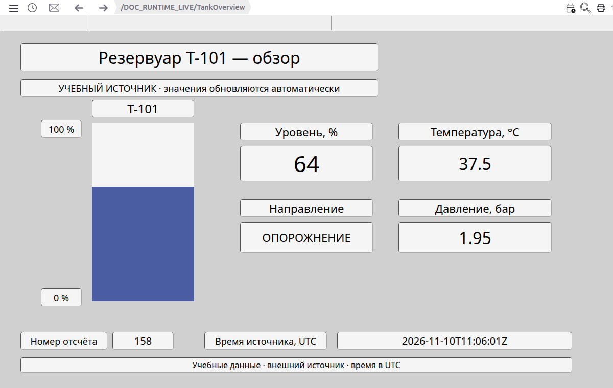

Figure 1. Training tank overview: the filled scale matches the 64% level, alongside direction, temperature, and pressure. The sample number and source time appear below. The working examples later in this guide show how readings change.

The following section explains how operators select screens and use the tools around the working area.

## Features and controls

### Top bar: left to right

The walkthrough follows the controls' positions: navigation and the path on the left, tools and session information on the right. Each command is pictured together with its result.

Figure 2. «Меню» (Menu), «История» (History), «Активные сообщения» (Active messages), Back, Forward, and the current screen path.

Figure 3. Playback, zoom, print, time, date, STOP, username, and Favorites. The optional PowerFactory command is absent from this installation.

The pictures use training screens titled «Обзор участка» (Area overview) and «Параметры участка» (Area parameters), plus a training message. Names and paths in your project will differ.

#### Menu

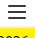

Click the three horizontal lines at the left to open the sidebar and screen tree. Clicking again closes the sidebar. Operators use this menu to select screens and access additional functions.

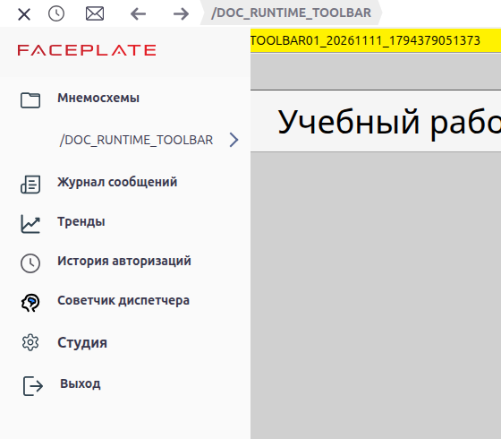

Figure 4. The sidebar is open, with the tree already visible below «Мнемосхемы» (Screens).

#### History

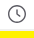

The clock beside Menu opens **«История» (History)** with cards for previously selected screens. Click a card to open its screen.

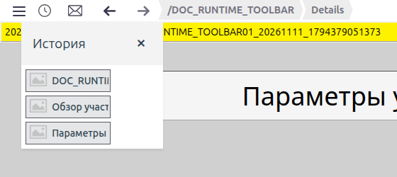

Figure 5. Three visited screens appear in History.

Navigation history holds up to 100 records and belongs to the user. The window removes duplicate paths; deleted objects or those no longer available as screens may be absent. Cards are not guaranteed to be in chronological order.

#### Active messages

The next icon, an envelope, opens **«Активные сообщения» (Active messages)** with a list of errors, alarms, and warnings.

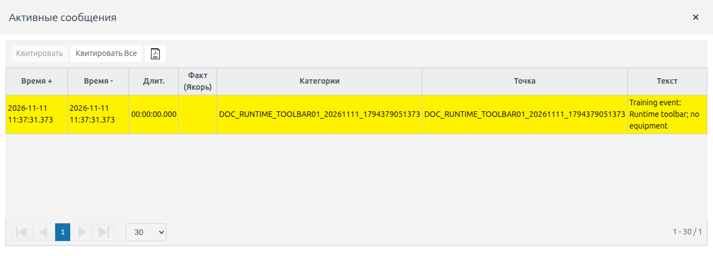

Figure 6. One training warning is listed; «Время+» and «Время−» show when the event occurred and cleared.

During initial loading, the envelope may be unavailable until the message list is received; availability alone does not indicate an alarm count. The last-message line below the bar has a separate action: clicking it acknowledges the latest message. Selection and acknowledgment are explained under “Message state and acknowledgment”.

#### Back and Forward

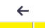

The left arrow returns to the previous navigation position within Runtime. In this example, after Details was selected, Back returned to Overview: both the path and the working-area title changed.

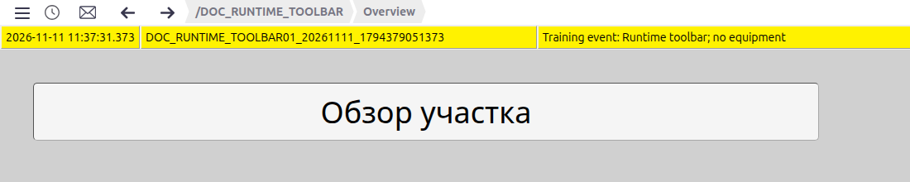

Figure 7. Back opened Overview with the title «Обзор участка» (Area overview).

The right arrow follows the next navigation position after going back. In the same example, it reopened Details.

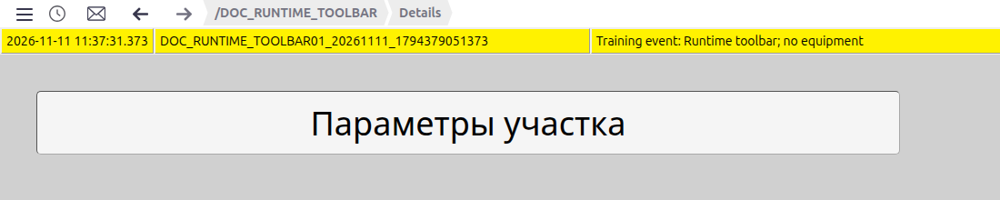

Figure 8. Forward opened Details with the title «Параметры участка» (Area parameters).

These are Runtime's own navigation controls. At a history boundary, the corresponding arrow is unavailable. Selecting a different screen after going back replaces the previous forward branch.

#### Current screen path

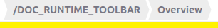

To the right of the arrows, the path uses folder names. Its segments support navigation: click a parent folder name to open that folder's screen, provided it has been prepared and is accessible. The example selects the parent screen «Учебный рабочий стол» (Training desktop).

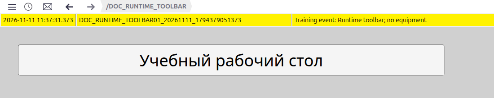

Figure 9. Selecting the parent removed the final Overview segment; the working area now displays the parent folder's content.

A card alias and the title inside a drawing can differ from the folder name. Check both path and content when verifying a transition.

#### Playback

The calendar-and-clock icon opens **«Меню проигрывания» (Playback menu)** for the current screen. It provides **«Время отсчета» (Reference time)** and a time-navigation step. Entry requires an open screen in normal current-data mode.

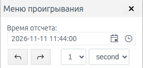

Figure 10. The time-selection menu is open with a 1-second step. No playback time has been selected here.

This window changes viewing from current data to a selected time. Archived and non-archived fields, control restrictions, and the return to current data are explained under “Archived and model data”.

#### PowerFactory study (when available)

With modeling available and a screen open in normal mode, the PowerFactory command appears **after Playback and before Zoom**. It opens a model study. This command is absent from the illustrated installation; its presence depends on the installation.

#### Zoom and panning

The magnifier opens the zoom panel with the current percentage, **−**, **+**, and **«Сброс» (Reset)**. Clicking the magnifier again closes it.

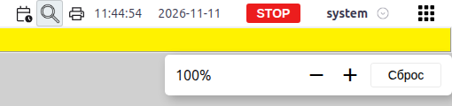

Figure 11. At 100%, the panel offers zoom out, zoom in, and Reset.

**+** doubles the zoom; **−** halves it. **Reset** restores 100% and the working area's initial position. The range is 1% to 25600%. Drag with the middle mouse button to pan a large drawing; the ordinary wheel moves the content, while Ctrl+wheel zooms around the pointer. Movement is limited by the content boundaries.

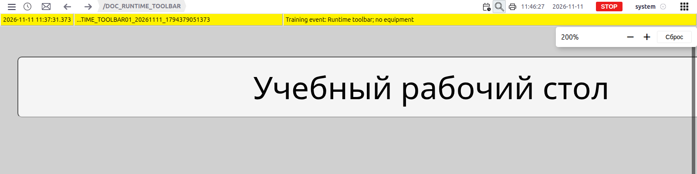

Figure 12. At 200%, the title is twice as large. The content was also panned with the middle mouse button to keep the title visible in this picture.

Runtime zoom changes the working area and is separate from browser zoom. Standard navigation to another screen resets it; zoom is not saved as a permanent screen setting.

#### Print

The printer prepares an image of the current working area and message line, then invokes browser printing. Ctrl+P or Cmd+P uses the same mechanism. The top bar, sidebar, and fixed area are excluded.

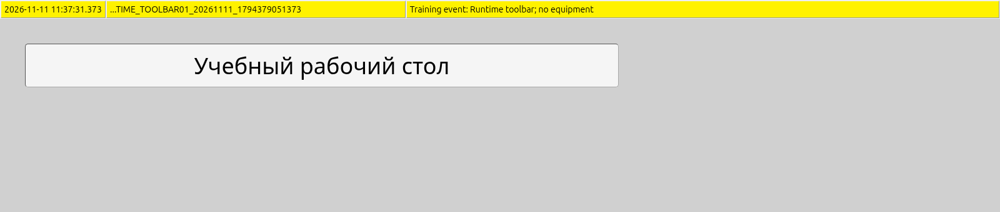

Figure 13. Part of the actual image prepared by Faceplate: the message line and screen. This illustrates preparation output, rather than a printer-selection dialog.

The dialog appearance, printer selection, and PDF saving depend on the browser and operating system. Check the included areas, scale, and readability before confirming printing.

#### Time, date, and RUN/STOP

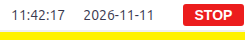

Time, date, and project execution state follow the printer. Clicking these labels does not open a window or switch project execution.

Runtime requests server time every second and displays it **in the browser's time zone**. Workstations in different time zones can therefore display the same server timestamp differently. A failed request can leave the last received time on screen.

**RUN** means project execution is enabled; **STOP** means it is disabled. This is not a connection-quality or data-freshness assessment. A connection failure can also leave the previous state label on screen. Check the source and arrival time of individual values separately.

#### Username and password change

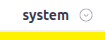

The current username and chevron come next. In this example, **system** is the account name. Clicking the group opens **«Изменение пароля - system» (Change password - system)**.

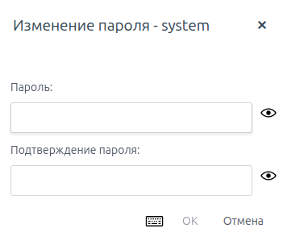

Figure 14. An empty form with «Пароль» (Password) and «Подтверждение пароля» (Confirm password). «Отмена» (Cancel) closes it; a password changes only when the completed form is confirmed.

#### Favorites

The rightmost button, a square grid, opens **«Избранное» (Favorites)**. Select a card to open its screen.

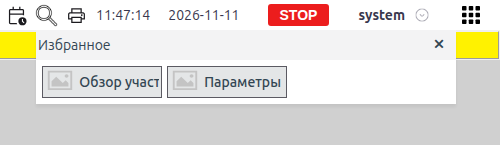

Figure 15. Two cards from the training project. Selecting «Обзор участка» opens Overview, as in the Back result pictured above.

This is a project list configured by the integrator; users see the screens they can access. There is no personal command for adding the current screen to favorites. Long card labels can be clipped; check the opened screen by its path and content. Captions and icons are covered below with folder settings.

### Sidebar: top to bottom

The top bar provides quick navigation and viewing tools. Other commands are collected in the sidebar: open **Menu** and follow the entries from top to bottom. Selecting a screen closes the sidebar and tree.

#### Screens

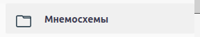

The first entry toggles the tree. Because Menu already shows it, clicking **«Мнемосхемы» (Screens)** next can hide it; another click restores the list.

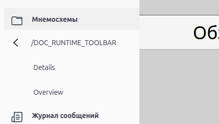

Figure 16. The tree is expanded to Overview and Details. Clicking a name selects the screen; the separate «Перейти» (Go) arrow opens a child level. The left arrow returns to the tree's parent level.

Folders without their own screen may be combined into a path label. The list depends on saved primary screens and user access.

#### Message log

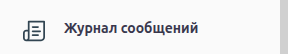

This entry opens **«Архив сообщений» (Message archive)**. Unlike the short unacknowledged-message list, the archive and filters help inspect an event's occurrence, clearance, and acknowledgment.

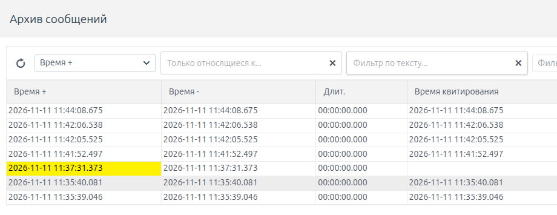

Figure 17. The beginning of the archive window, including filters and time columns. The yellow row is the training warning; other rows are sign-in events on the training installation.

Selection rules and actions are covered in the [messages and alarms guide](../../alarms/alarm/alarm.md).

#### Trends

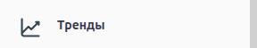

Clicking opens **«Выбор трендов» (Trend selection)**. This window selects data and groups for charts; the picture shows **«Группы» (Groups)**, **«Архивы» (Archives)**, and **«Файл» (File)** tabs. Its content depends on project settings and available archives.

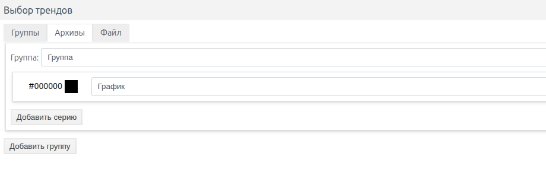

Figure 18. The training installation shows Groups with an empty draft. Opening the window alone does not create a working chart.

Series, groups, and display settings are explained in the [trends guide](../../data_storage/archives/trends.md).

#### Login history

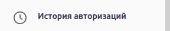

Opens the current user's last successful and last failed sign-in. The window explicitly reports a missing attempt. It is a brief account reference; a full audit is not displayed here.

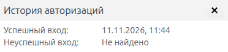

Figure 19. A successful sign-in was found; the failed sign-in shows «Не найдено» (Not found).

#### Dispatcher advisor

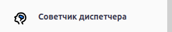

This entry appears when the module is installed and opens its window. The verified interface uses the title **Dispatcher Support**. Object selection, a text filter, and result refresh are available.

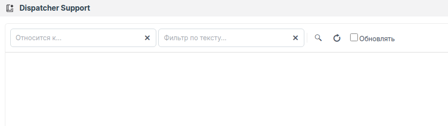

Figure 20. The window is open, with no results on the training installation. An empty list alone does not establish a fault.

Data preparation and service operation are described in the [dispatcher advisor guide](../../alarms/dsf/dsf.md).

#### Studio

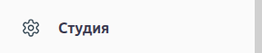

Opens Studio in a new browser tab. Administrative access is required; the new tab may require a separate sign-in. After signing in, integrators see project configuration and can open the graphics editor.

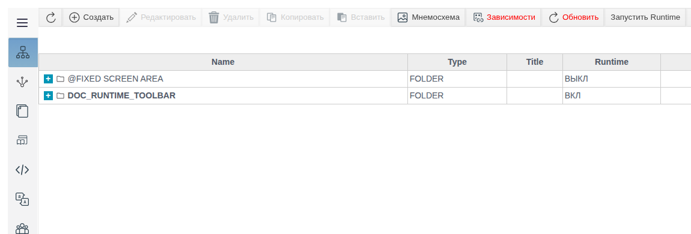

Figure 21. Training project configuration in Studio after signing in through a new tab.

Switch back to the Runtime tab to resume monitoring. Screen preparation is covered in the next section, “Configuring screens and the fixed area”.

#### Exit

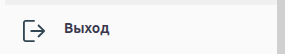

Clicking requests confirmation before ending the session. **yes** confirms sign-out; **no** cancels and keeps the user in Runtime.

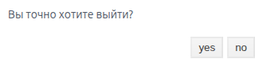

Figure 22. «Вы точно хотите выйти?» (Are you sure you want to exit?). This picture shows the request before confirmation; sign-out was canceled during verification.

#### Installation information

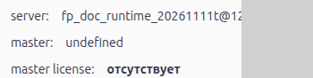

**server**, **master**, and **master license** appear below the commands. They describe the server, master node, and installation license. Clicking them does not open separate windows. Long server names can be clipped to the sidebar width; node and licensing configuration belong to administration.

#### Theme

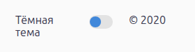

The theme switch is the last sidebar entry. **«Тёмная тема» (Dark theme)** offers dark styling; after switching, **«Светлая тема» (Light theme)** returns to light styling.

Changing the theme affects the shell; colors authored into the screen keep their own settings. In the example, the gray background stayed gray when switching to the dark theme.

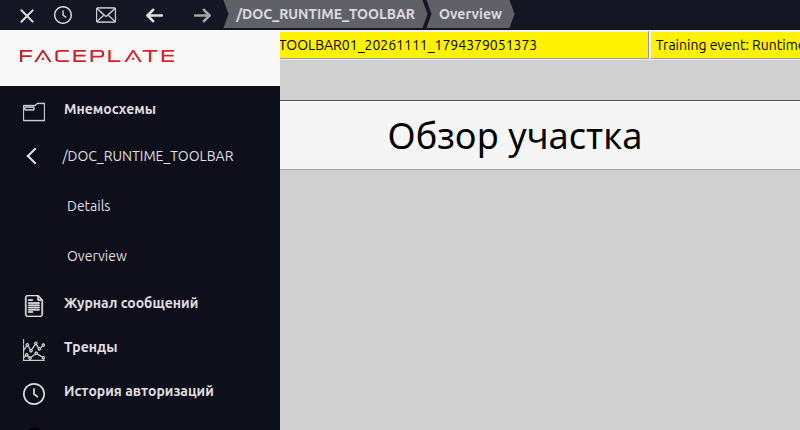

Figure 23. The desktop after enabling the dark theme; the authored screen background remains gray.

### Windows and printing

The commands above open different tool windows. Drag a floating window by its title and close it with × where these controls are provided. Resizing and maximizing depend on the window; pinned trends have a separate parameter mechanism described in the trends guide.

A tool window and a print image serve different purposes: the former is used during operation, while the latter captures the areas listed at the printer button. The screen content itself is prepared separately in Studio.

## Configuring screens and the fixed area

The commands above work with an already prepared project. The integrator first saves a primary screen, then sets its presentation in Runtime and prepares the fixed area if required.

### A folder's primary screen

Save a folder's primary screen for it to appear in the tree. In Studio, open the project folder → **«Мнемосхема» (Screen)** → primary **screen** row, then create or edit the layout in the graphics editor. Other folder representations do not replace the primary screen.

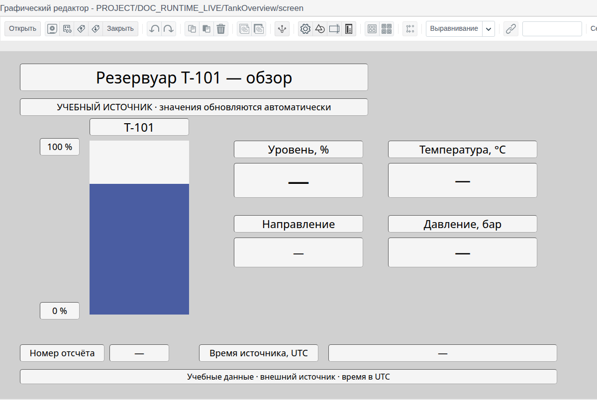

Figure 24. The training tank layout in the editor: the author prepares its positions, labels, and scale. This layout uses «—» placeholders for bound readings; Runtime replaces them with data, as in Figure 1. The disk icon immediately after Open is Save. Follow the graphics editor guide linked above for tool details.

### Folder and screen settings

After saving the drawing, configure its desktop presentation. Folder settings determine the History and Favorites captions and cards; layout properties determine the screen's dimensions and background. Text inside the drawing is added separately in the graphics editor.

| Setting | Where to set it | Purpose | Default or omission | Who changes it |
|---|---|---|---|---|
| Primary screen | «Мнемосхема», graphics editor | Working screen content | Without saved content, the folder does not become a regular screen entry | Integrator |
| Псевдоним (Alias) | Folder settings, Runtime | Caption in Favorites and History | Falls back to the folder name | Integrator |
| Избранное (Favorite) | Folder settings, Runtime | Include the screen in the project list | Excluded unless enabled | Integrator |
| Иконка (Icon) | Folder settings, Runtime | Card image | Standard placeholder when no file is supplied | Integrator |
| Dimensions | Screen properties, geometry | Saved content dimensions | Initial values depend on project settings; existing layouts are not automatically fitted | Screen author |
| Background | Screen properties, background | Working area color | Initial color #D0D0D0 | Screen author |
| Access | Project and object permissions | Viewing and permitted actions | Assigned project and object permissions apply | Administrator / integrator |
| Fixed area | Primary screen of the special project folder | Content above the working area | Hidden when there is no content | Integrator |

The icon form accepts SVG, PNG, JPG, and JPEG.

The folder form's **Runtime** switch concerns server execution. Enabling it is not required to display a static layout.

### Fixed area

The project contains a folder named **`@FIXED SCREEN AREA`**. Its primary screen supplies the fixed area's content and dimensions. It has its own context and sits above the changing working area. This folder is excluded from the regular tree and Favorites.

Prepare and save its content in that folder's graphics editor. After changing it, reopen the Runtime page: the fixed layout is read when the desktop initializes. The main changing screen uses a different update mechanism.

The fixed area consumes part of the browser window. Allow enough space for the main screen. Once layouts are prepared, consider how Runtime loads them and retains state during navigation.

## Data, context, and state retention

The saved layout determines appearance, while an open screen instance has its own context and local values. Switching screens, reselecting a screen, and reloading the page can therefore produce different results.

### What happens when you switch screens

When you switch from screen A to screen B, Runtime can keep A loaded in memory. Operators cannot see it, but its data updates and periodic actions configured by the author can continue.

Returning from B to A can show the already loaded A with its local state. Selecting the currently open A again recreates it: locally entered values that were not saved can reset.

Saving a new layout in the editor can also reload that screen in Runtime. Switching away is therefore not used to stop periodic actions authored for a screen; their completion is handled in the project configuration.

### What is retained

Some state lives in the open page's memory; the last selected screen and history belong to the account. The table shows the differences in normal mode.

| State | Switch to another screen | Reselect the current screen | Reload the page | Sign in again |
|---|---|---|---|---|
| Last open screen | Saves the user's selection | Saves the selection again | Loads after authentication if accessible | Loads if set and accessible |
| Navigation history | Adds an entry | Can repeat the path | Reads saved history | Reads saved history |
| Local state and context | Can remain in a hidden instance | Recreates the instance | Previous page memory is lost | No general snapshot restores it |
| Zoom and position | Standard navigation resets them | Standard navigation resets them | Initial values | Initial values |
| Theme | Retained in the open page | Retained in the open page | Not persisted by this mechanism | Selected again |
| Ordinary windows | Depends on the window | Depends on the window | No general restoration | No general restoration |

A page reload can require signing in again. If a user has no last selected screen, the working area can remain empty until a screen is chosen from the menu.

Tabs or workstations using the same login share the saved last screen and history. Each page still has its own local memory.

### Data freshness and access

State-retention rules explain the interface state; incoming measurements and permission to control require separate checks. Indicators are explained under “Time, date, and RUN/STOP”. For a particular reading, check its source, sample number, or arrival timestamp; the example below places these fields beside the measurements. A stopped source can leave its last values visible.

Viewing and control permissions differ: a visible button or field does not guarantee permission to write. If data is visible but a command fails, check write permissions and the control's purpose separately from the server connection.

## Additional functions

The desktop provides entry points to related Faceplate functions. The table brings together their purpose, availability conditions, limitations, and guides. The sections below explain message handling and archived and model data.

| Function | Purpose | Conditions | Main limitation | Guide |
|---|---|---|---|---|
| Active messages / Message log | View messages and their history | User access to messages | List selection differs from event state | [Messages and alarms](../../alarms/alarm/alarm.md) |
| Trends | View charts and groups | Available data and permissions | Separate windows, parameters, and pinning | [Trends](../../data_storage/archives/trends.md) |
| Playback | View data at a selected time | A screen is open in normal live-data mode | Fields without archives do not form a historical snapshot | [Playback](https://docs.google.com/document/d/1ho98hgPi2a4_MeGCRtHpS6MPb-_ciYo65QlzPFllfqU/edit) |
| PowerFactory study | Work with model data | Modeling available; a screen open in normal mode | Separate session and data source | Installed module's help |
| Dispatcher advisor | View advisor results | Module installed | Service configuration is described separately | [Dispatcher advisor](../../alarms/dsf/dsf.md) |
| Studio | Configure the project | Administrative access | Changes require appropriate permissions | Your Faceplate installation's Studio |

### Message state and acknowledgment

**«Активные сообщения» (Active messages)** opens unacknowledged messages by default, including messages whose conditions have already cleared. A row disappearing after acknowledgement does not prove that the alarm condition has cleared. See the [messages guide](../../alarms/alarm/alarm.md) for filters and handling.

### Archived and model data

Use playback to analyze values from a past period and PowerFactory to study a calculated model. Their entry points are shown on the top bar.

In **playback**, actual values are used until a time is selected. Afterwards, archived fields read from the archive while fields without archives may retain current or previously received values. The entire screen therefore does not necessarily represent a single historical snapshot. The standard write mechanism does not perform control changes in this mode; this restriction does not replace control over arbitrary user scripts. Closing playback returns to current data and reloads the screen. See the [playback guide](https://docs.google.com/document/d/1ho98hgPi2a4_MeGCRtHpS6MPb-_ciYo65QlzPFllfqU/edit) for the detailed procedure.

A model study uses a separate data mode; closing it returns to normal mode. Calculation-session parameters are described in the installed module's help. The following example uses normal display of data from a training source.

## Desktop configuration example

### Training project and data source

The following two views represent the same **training tank T-101**. The project has a **Tank1** tag containing level, temperature, pressure, direction, sample number, and source time. In the verified example, a training source changed these fields automatically about every 2 seconds; no equipment was connected. The paths below belong to that prepared training project. The screens display received values through ordinary bindings.

The project remained in STOP on this test installation while a separate training source updated the fields. New readings were therefore visible with STOP displayed. In a working project, data sources and process execution are configured separately from the screen drawing.

### Binding elements to a tag

Bind element properties to tag fields so incoming values change the drawing. Select the **«Бар» (Bar)** element in the graphics editor. Open binding creation in the **«Привязка» (Binding)** column for its **value** property. On **«Источник» (Source)**, select **«тег» (Tag)**, the object **`/DOC_RUNTIME_LIVE/Tank1`**, and the separate **level** field. Bind the text readings to the corresponding fields of the same tag in the same way. After **OK**, save and reopen the layout. These bindings require no user JavaScript.

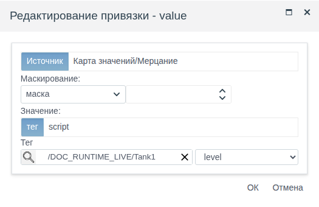

Figure 25. Select the tag and its level field separately. This binding makes the scale's value and fill follow source data. Numeric and text readings use the same method.

### Tank overview

After configuring bindings, open **TankOverview** through **«Меню» (Menu)** at **`/DOC_RUNTIME_LIVE/TankOverview`**. The scale on the left shows 0–100% fill; exact readings and direction appear on the right. Operators use this overview to assess the unit quickly before choosing a detailed view.

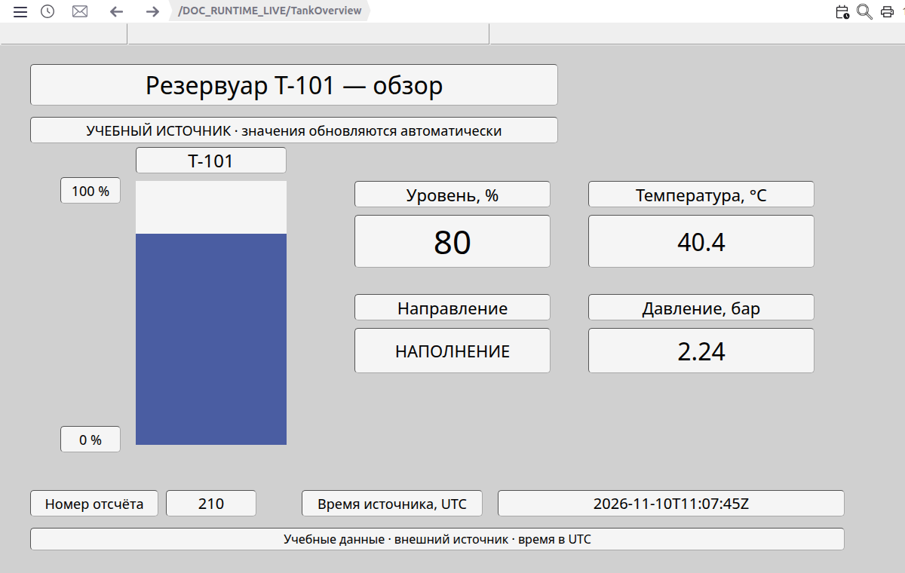

Figure 26. First overview frame: level 80%, temperature 40.4 °C, pressure 2.24 bar, «НАПОЛНЕНИЕ» (Filling), sample 210, source time 11:07:45 UTC.

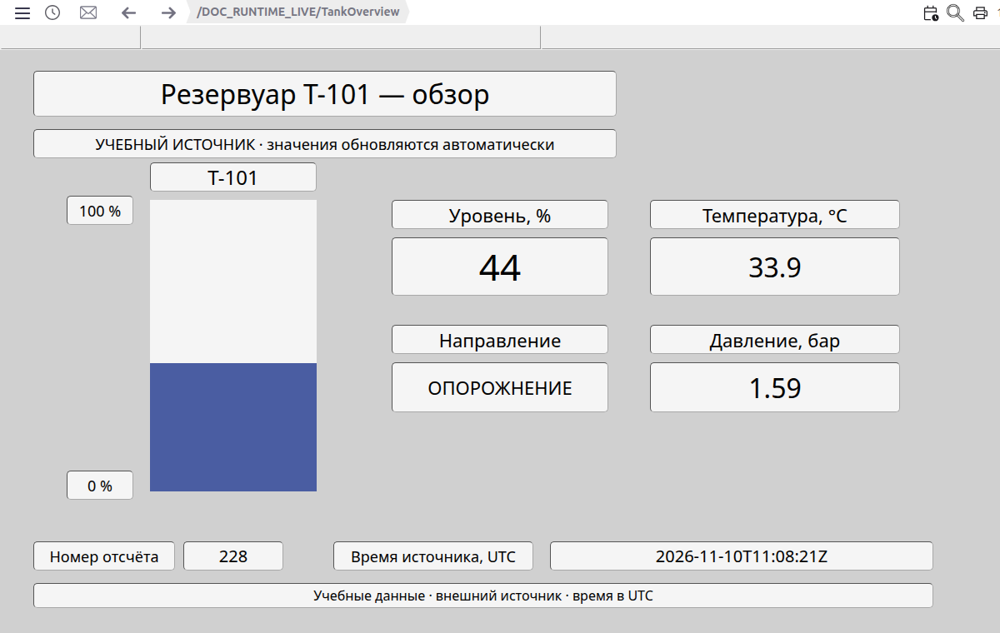

Figure 27. After 36 seconds, the same open screen shows 44%, 33.9 °C, 1.59 bar, and «ОПОРОЖНЕНИЕ» (Draining); sample 228, time 11:08:21 UTC. The blue fill height has also changed. The page was not reloaded and the screen was not reselected between these frames.

### Tank parameters

To read exact values, open **TankDetails** through **«Меню» (Menu)** at **`/DOC_RUNTIME_LIVE/TankDetails`**. This view shows the same Tank1 fields in separate rows with units. Operators use it to read exact values and check the data timestamp after assessing the overview.

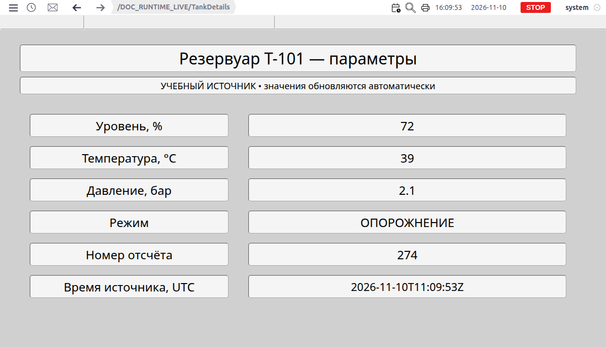

Figure 28. First parameter frame: 72%, 39 °C, 2.1 bar, «ОПОРОЖНЕНИЕ» (Draining); sample 274, source time 11:09:53 UTC.

Figure 29. After 20 seconds without reloading or reselecting the screen, the values are 52%, 35.4 °C, and 1.74 bar; sample 284, time 11:10:13 UTC. Row labels remain unchanged while bound readings update.

The overview and parameter frames were captured at different times although both views read Tank1; compare their source timestamps. If the expected data or screen update does not appear, use the troubleshooting reference below.

## Troubleshooting and limitations

Start with the observed symptom. Verification should establish the required result: the screen appears, new data arrives, or an authorized action succeeds.

| Symptom | Check | Action | Confirmation |
|---|---|---|---|
| Screen missing from the tree | Saved primary screen and folder access | Open its primary representation in Studio; check saving and permissions | The entry appears and opens the intended layout |
| Tree disappeared | Whether Screens was toggled again | Show the tree and wait for loading | Accessible entries reappear |
| Favorites or History empty | Favorite setting, permissions, visits, and saved screens | Check folder settings; open an accessible screen | The required card appears |
| Screen does not open | Path, access, and saved content | Select an existing screen from the tree; check it in the editor if needed | Content and path match the selected folder |
| Zoom or local values reset | Navigation, reselection, page reload, or layout update | Apply the state retention rules; set the required view again | The expected view is displayed |
| Fixed area did not update | Whether its layout was saved | Reopen Runtime and sign in if required | Saved fixed-area content appears |
| Viewing works, control denied | Write permissions and the control's purpose | Ask the administrator to check permissions | The authorized action works under the intended account |
| Data unchanged while RUN is shown | Connection, server time, source, and value freshness | Check the desktop and data source separately | New values arrive from the expected source |
| Additional function missing | Installed module, role, active screen, and mode | Check availability conditions | The entry is available when conditions are met |
| Message disappeared after acknowledgement | Unacknowledged selection and event state | Check the event in the log or appropriate message view | Acknowledgement and clearing are distinguished |
| Print differs from the whole desktop | Included areas and zoom | Inspect the prepared browser print result | The selected areas are readable and contain the required data |

If the cause remains unclear, record the screen path, observation time, action performed, and exact error text. These details help reproduce the issue when contacting support.
