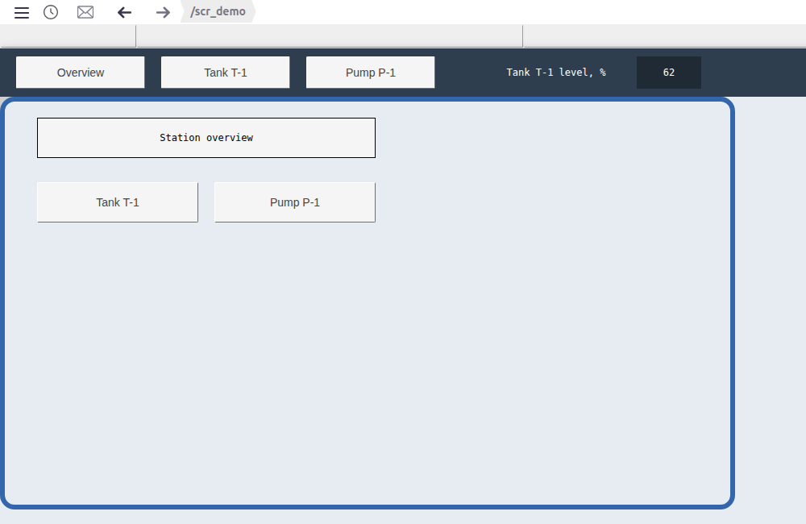
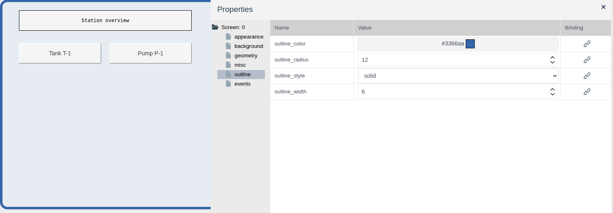
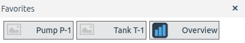
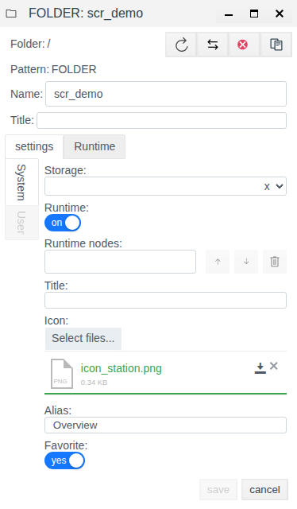
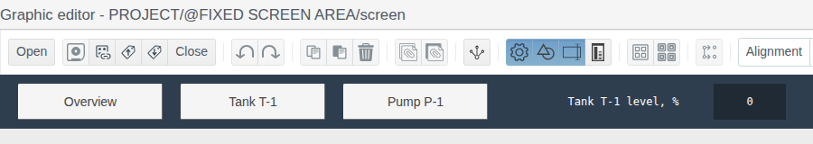
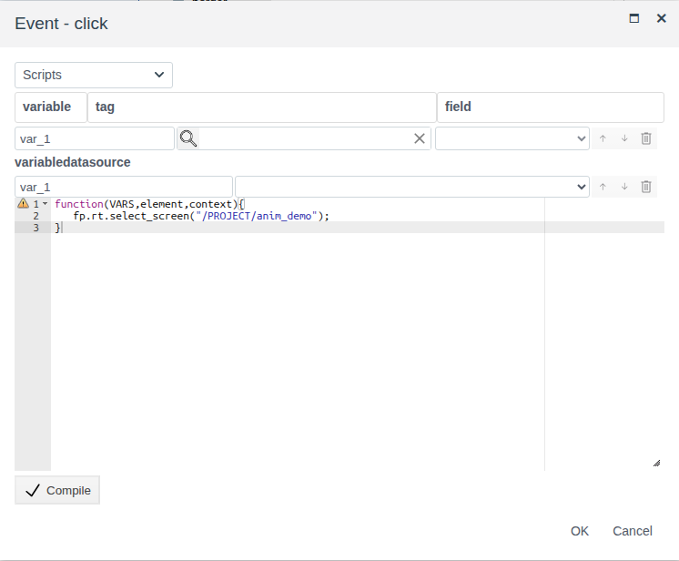

# Screens and navigation

A document for the integration engineer who builds the operator workplace from screens: which screens the operator opens in Runtime, how they move between them and which bar is visible above any screen.

# Contents

- [Glossary](#glossary)
- [Introduction](#introduction)
- [Main part](#main-part)
    - [Screen and folder](#screen-and-folder)
    - [Screen properties](#screen-properties)
    - [The folder in Runtime: alias, icon, favorites](#the-folder-in-runtime-alias-icon-favorites)
    - [Fixed screen](#fixed-screen)
    - [Going to another screen](#going-to-another-screen)
    - [Returning to a screen](#returning-to-a-screen)
- [Conclusion](#conclusion)

# Glossary

| Term | Meaning |
|---|---|
| Runtime screen | The `screen` of a folder opened in the Runtime work area. One folder, one Runtime screen |
| Work area | The part of the Runtime window that shows the screen the operator selected. Only this part changes on navigation |
| Fixed screen | The `screen` of the system folder `@FIXED SCREEN AREA`. Runtime shows it above the work area all the time, whatever screen is open |
| Alias | A folder field: a screen name the operator understands, used in the Favorites and History windows of Runtime |
| Favorites | A Runtime window listing the screens the integrator marked with the folder field **Favorite**. Opened with the button in the right corner of the top bar |
| History | A Runtime window listing the screens already opened under this account. Opened with the clock button in the top bar |

The terms "Screen", "Element" and "Palette" are explained in [Screen editor](editor.md#glossary), "Event" and "Reaction" in [Scripts and events](events.md#glossary).

# Introduction

Each project folder has 17 screens, but only one of them, `screen`, becomes a Runtime screen. The others are embedded into other screens (see [What the screens are for](editor.md#what-the-screens-are-for) in Screen editor). The document describes what else is needed to turn a set of screens into a workplace:

- how a screen looks in Runtime: size, background, frame;
- the name the operator sees the screen under and how to find it fast;
- a bar visible on all screens at once;
- navigation buttons between screens;
- what the operator sees when returning to a screen already opened.

The running example is three screens: the overview `scr_demo` (alias "Overview") and the screens of the `anim_demo` and `controls_demo` folders (aliases "Tank T-1", "Pump P-1"). Above them there is a fixed screen: a dark bar with the "Overview", "Tank T-1", "Pump P-1" buttons and the current tank level.



You need access to Studio (`http://<server>:9000/fp/studio`) under an account allowed to change the project. The result is checked in Runtime (`http://<server>:9000/fp/runtime`).

# Main part

## Screen and folder

A folder becomes a Runtime screen once its `screen` has been saved at least once. After that:

- the folder appears in the Runtime **Screens** menu. The menu item is the folder path from the project root, `/<folder>`;
- in the Studio project tree the folder name is bold, so you can see which folders already have a Runtime screen.

The `view1`…`view15` screens do not become Runtime screens and are not in the menu. The **Folder Screen** element shows them inside another screen (see [A screen inside a screen: Folder Screen](editor.md#a-screen-inside-a-screen-folder-screen)). Hence the layout rule: whatever the operator opens as a separate screen is the `screen` of a separate folder; whatever repeats on several screens is a `viewN` embedded into each of them.

A saved screen is updated at once for all operators who have this screen open in Runtime: the page does not reload, the operator sees the new version in place of the old one. Save the screen when the change is finished: intermediate versions also reach the workplaces.

## Screen properties

The properties of the screen itself define how it fits into the work area. To see them, click an empty spot of the canvas: the **Properties** panel shows `Screen: 0`.

| Group | Property | What it changes in Runtime |
|---|---|---|
| **geometry** | `width`, `height` | The screen size in pixels. The screen is drawn from the top left corner of the work area |
| **background** | `background_color` | The screen color. While the screen is open, the work area around it is filled with the same color, so a screen smaller than the window does not look like an "island" on a grey background |
| **outline** | `outline_width` | A frame around the screen, width in pixels. 0 means no frame |
| | `outline_color` | The frame color |
| | `outline_style` | The line style: `solid`, `dashed`, `dotted` and others |
| | `outline_radius` | The rounding of the frame corners |

A new screen is 1914 × 1014. If the screen should take part of the window, reduce `width` and `height`: in the example `scr_demo` is 900 × 500, background `#e6ecf2`, a 6 px `#3366aa` `solid` frame, rounding 12. In the picture in the introduction the work area to the right of and below the frame has the same color as the screen.



The **events** group of the screen is the same as for elements: `init` runs when the screen loads, `click` on a click on an empty spot of the screen (see [Scripts and events](events.md)).

## The folder in Runtime: alias, icon, favorites

### How the operator finds screens

Everything the operator uses to move between screens is in the Runtime top bar:


| No. | Button (tooltip) | What it does |
|---|---|---|
| 1 | **Menu** | Opens the side menu. The **Screens** item is the list of all screens of the project. The screens are named by folder paths, for example `/<folder>`: these are the names the integrator gave the folders in the project tree |
| 2 | **History** | The History window: screens already opened under this account. The list is stored on the server with the account, so it is the same in any browser where the operator has logged in under their name |
| 3, 4 | **Go back**, **Go forward** | Step back and forward through the opened screens, as in a browser |
| 5 | — | The path of the current screen |
| 6 | **Favorites** | The Favorites window: screens the integrator marked with the folder field **Favorite**. The list is the same for everyone; the operator opens screens from it but does not change it |

In the History and Favorites windows a screen is shown as a button with the folder icon and alias. A click on the button opens the screen in the work area, the cross closes the window.



In the example Favorites holds three screens; `scr_demo` has its own icon, the other two have no icon, and an empty picture is shown in its place.

### Folder fields

How a screen looks in these windows is set by three fields of the folder form (folder → **Edit**, the **settings** tab, **System**):

| Field | What it gives |
|---|---|
| **Favorite** | **yes** puts the screen into the Favorites window |
| **Alias** | The screen name in the Favorites and History windows instead of the folder name. Empty means the folder name is shown |
| **Icon** | A picture next to the name in these windows and in the Studio project tree. **Select files...** uploads a file |

After a change click **save**.



The alias is used only in the Favorites and History windows. In the **Screens** menu, in the path of the current screen and in a navigation script the screen is named by the folder path. The alias does not appear on screens either: the label of a navigation button is its own `text` property. In the example the `scr_demo` alias and the label of the fixed screen button are the same ("Overview"), but they are set separately: changing the alias does not change the label.

## Fixed screen

**Why.** Some information is needed by the operator all the time, whatever screen they are on: buttons to the main screens, the plant name, one or two key values. If you draw this on every screen, any change — a new button, another value — turns into a change of all screens. The fixed screen is drawn once, and Runtime itself shows it above whatever screen is open.

**What the operator sees.** In the example the fixed screen is a 60 px bar across the whole window width, right below the message line. The work area starts below the bar. The operator opens "Tank T-1" — the bar is in place; goes to "Pump P-1" — the same bar with the same buttons, only the work area changes. The "Tank T-1 level, %" value on the bar changes with the `tank_1.level` field on any screen, including the pump screen where there is no tank. The bar buttons go to their screens from anywhere.

**How it differs from a normal screen and from Folder Screen:**

| | Normal Runtime screen | Fixed screen |
|---|---|---|
| Where it is visible | In the work area, when the operator has selected it | Above the work area, always |
| How many in a project | One per folder | One |
| How the operator gets to it | Menu, Favorites, History, navigation buttons | No way needed: it shows itself, it is not in the menu |
| When operators see changes | Right after saving | After reloading the Runtime page |

Folder Screen also shows one screen on several screens, but it is placed into each screen by hand and is visible only where it is placed. The fixed screen is not placed anywhere. If a common fragment is needed on all screens, use the fixed screen; if on several, use Folder Screen.

**How to create it.** The fixed screen is the `screen` of the system folder `@FIXED SCREEN AREA`. The folder always exists at the root of the project tree. Until its screen is saved, there is no bar and the work area starts right below the message line.

1. In Studio open **General View**, enter the `@FIXED SCREEN AREA` folder with a double click and click **Screen**.
2. Create the `screen`. Select the screen itself and set `height` in the **geometry** group — the bar height, 60 in the example. Runtime gives the fixed screen exactly the height of its screen: with the default height of 1014 it takes the whole window, and normal screens are not visible.
3. Set `background_color`, `#2f3e4e` in the example. The whole bar across the window width is filled with this color.
4. Draw the elements. Bindings and events work as on a normal screen: in the example three buttons with a navigation script (see [Going to another screen](#going-to-another-screen)) and a rectangle whose `text` is bound to `anim_demo/tank_1`, field `level`.
5. Save the screen and reload the Runtime page to see the result.



## Going to another screen

The operator moves between screens on their own with the **Screens** menu, the Favorites and History windows and the back and forward buttons in the top bar. A navigation button on a screen is needed to put the transition where the operator is looking: from an overview to a detailed screen, from the fixed screen bar to any screen.

An assignment does not open a screen, so a navigation button is made with an event script (see [Event script](events.md#event-script)). Select the button, in the **events** group click the **Reaction** cell of the `click` event, choose **Scripts** and write:

```javascript
function(VARS,element,context){
   fp.rt.select_screen("/PROJECT/<folder>");
}
```

`fp.rt.select_screen` opens the screen of a folder in the work area. The argument is the folder path from the project root with the `/PROJECT` prefix, that is, the same path as in the **Screens** menu with `/PROJECT` in front. The script needs no variables.

In the example the "Tank T-1" button has `fp.rt.select_screen("/PROJECT/anim_demo");`.



For Runtime a transition by script is the same as a transition from the menu: the path in the top bar changes, the back button returns to the screen where the button was clicked, forward goes again to the screen opened by the button.

In the example the navigation script is on the "Tank T-1" and "Pump P-1" buttons of the `scr_demo` screen and on the three buttons of the fixed screen. The buttons on `scr_demo` are visible only on the overview, the bar buttons everywhere.

## Returning to a screen

Runtime keeps the screens opened during the session in memory. This defines what the operator sees when returning to a screen with the back button or from the **Screens** menu:

| What is on the screen | On return |
|---|---|
| Values from bindings | Current: if a tag field changed while the operator was on another screen, they see the new value at once |
| Properties changed by event scripts (`element.set`) | As the script left them |
| The `init` event | Does not run again |

An example from [Scripts and events](events.md#what-a-script-can-use): on the `evt_demo` screen the "Check" button paints the "Pump" rectangle green with a script. The operator clicks it, goes to another screen and comes back — the rectangle is green. Values from bindings are current: in a check on the `anim_demo` screen the level changed while the operator was away was shown new.

So set everything that must match the data with a binding: it always shows the current value. Use event scripts to change what relates to the operator's actions on this screen.

The screen loads anew — as saved in the editor, running `init` — if you choose a screen that is already open in the **Screens** menu, or reload the Runtime page.

# Conclusion

| Task | How to do it |
|---|---|
| Make a screen a Runtime screen | Save the `screen` of the folder |
| Fit the screen to the window, set background and frame | Properties of the screen itself: **geometry**, **background**, **outline** |
| Give the operator quick access to the main screens | The folder field **Favorite**, with **Alias** and **Icon** |
| Show buttons and values on all screens | The fixed screen: the `screen` of the `@FIXED SCREEN AREA` folder with a small `height` |
| Show a common fragment on several screens | A `viewN` of the folder and **Folder Screen** in each screen |
| Make a navigation button | A script on `click`: `fp.rt.select_screen("/PROJECT/<folder>")` |
| Keep the screen matching the data on return | Bindings, not event scripts |

Workflow:

1. Arrange the screens in folders: one folder, one `screen`. Move repeated fragments into `view1`…`view15`.
2. Set the size, background and frame of the screens.
3. Turn **Favorite** on for the main screens, give them an **Alias** and an **Icon**.
4. Draw the fixed screen: set its `height` first, then the common navigation buttons and key values.
5. Add navigation buttons to the overview screens.
6. Check in Runtime: transitions, back, Favorites, returning to a screen. Fixed screen changes — after reloading the page.
