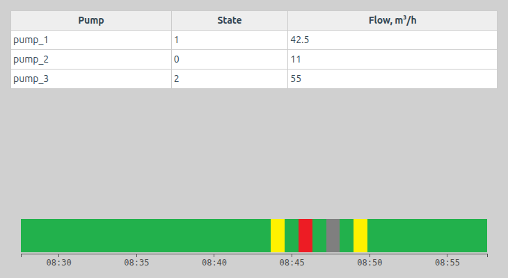
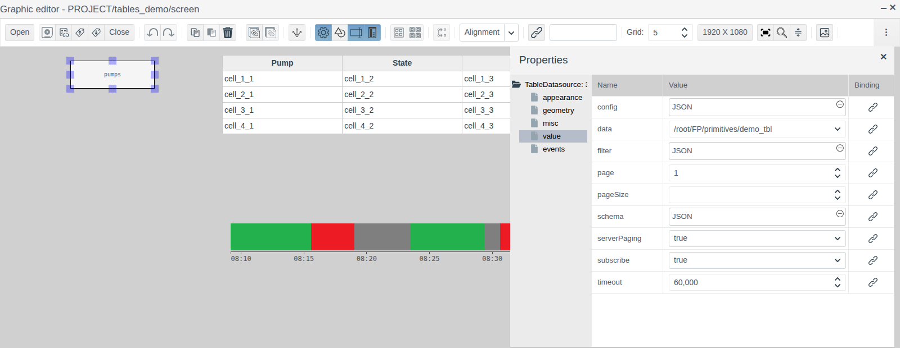
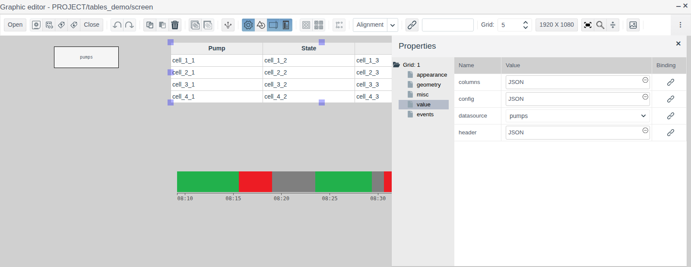
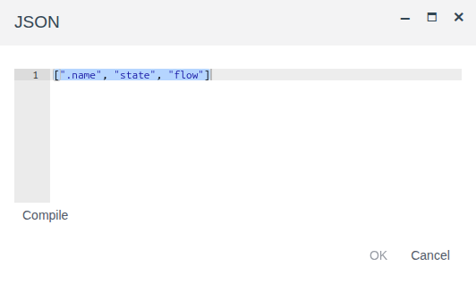
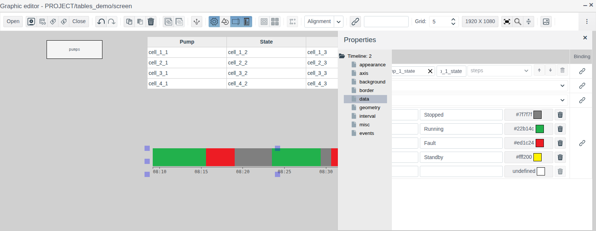
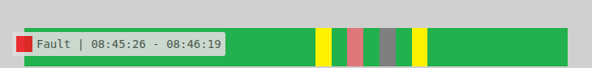

# Tables and timeline

A document for the integration engineer who needs to show the operator a summary of a group of objects on a screen (a table of pumps with their state and flow) and the state history of a unit over the last minutes or hours.

# Contents

- [Glossary](#glossary)
- [Introduction](#introduction)
- [Main part](#main-part)
    - [Elements on the palettes](#elements-on-the-palettes)
    - [Table: row source](#table-row-source)
    - [Table: columns and headers](#table-columns-and-headers)
    - [Table: colors](#table-colors)
    - [Timeline: archive](#timeline-archive)
    - [Timeline: states](#timeline-states)
    - [Timeline: interval](#timeline-interval)
    - [Timeline: axis, border and background](#timeline-axis-border-and-background)
- [Conclusion](#conclusion)

# Glossary

| Term | Meaning |
|---|---|
| Table | The **Grid** element: rows are records of a data source, columns are their fields |
| Data source | A screen element, invisible in Runtime, that holds a set of records for other elements. For a table it is **Table Datasource** (project objects) or **Local Datasource** (records defined on the screen) |
| Timeline | The **Timeline** element: a strip in which every period of time is painted in the color of the unit's state |
| Archive | A project object of type `ARCHIVE` that records the history of a tag field. Creating an archive is described in [Archives: configuring sources and recording data](../data_storage/archives/archives_en.md) |
| State | An integer in a tag field that stands for the unit's mode: 0 — stopped, 1 — running, etc. |

The terms "Tag", "Binding" and "Assignment" are explained in [Buttons and value input](controls.md#glossary), "Screen", "Palette" and "Element" in [Screen editor](editor.md#glossary).

# Introduction

A table shows many objects of one type at once: a row per object, a column per field. It finds the objects by type and folder itself, so a new pump in the folder needs no change to the screen. A timeline shows when a unit was running, stopped or faulted: from the colored strip the operator sees the downtime of a shift without opening trends.

This document describes both elements: their properties, data preparation and how they look in Runtime. Working in the editor (adding, selecting, properties, saving) is covered in [Screen editor](editor.md).

The running example is the `screen` of the `tables_demo` folder. The folder holds three objects `pump_1`…`pump_3` of a custom primitive `demo_tbl` with the fields `state` (integer, pump state) and `flow` (float, flow). The table shows all pumps of the folder, the timeline shows the state history of `pump_1` over the last 30 minutes from the archive `pump_1_state`.



You need access to Studio (`http://<server>:9000/fp/studio`) with an account that may change the project. The result is checked in Runtime (`http://<server>:9000/fp/runtime`).

# Main part

## Elements on the palettes

| Palette | Icon tooltip | Property tree root | Purpose |
|---|---|---|---|
| **Reports** | Grid | `Grid` | A table of data source records |
| **Reports** | Table Datasource | `TableDatasource` | Source: project objects of one type |
| **Reports** | Local Datasource | `LocalDatasource` | Source: records defined on the screen |
| **Controls** | Timeline | `Timeline` | A timeline of states from an archive |

The groups **appearance**, **geometry**, **misc** and **events** are the same as for the other screen elements (see [Graphic elements, section "Common properties"](graphics.md#common-properties)). An **Assignment** can be set on the `click` event of a table or a timeline, as for a button (see [Buttons and value input, section "Button"](controls.md#button)).

The properties `header`, `columns` of the table and `schema`, `data`, `filter` of the sources are edited in the **JSON** window: click the value field, enter the text, press **Compile**, then **OK**.

## Table: row source

A table is not bound to a tag: it takes its rows from a data source on the same screen. Add the source first, then the table.

### Project objects: Table Datasource

**Table Datasource** selects project objects of one type, for example all instances of a primitive in a folder. In the editor the source looks like a rectangle with its name; in Runtime it is not visible.



| Group | Property | Purpose |
|---|---|---|
| **misc** | `name` | Source name. The table finds the source by it. In the example `pumps` |
| **value** | `data` | Object type. Custom primitives are at the end of the list: `/root/FP/primitives/<name>`. In the example `/root/FP/primitives/demo_tbl` |
| | `filter` | Object selection condition |
| | `schema` | Object fields that go into the table |
| | `subscribe` | `true` — the table in Runtime updates when object fields change. `false` — values are read once when the screen opens |

Selecting the objects of one folder:

```
[".folder", "=", "$oid('/root/FP/PROJECT/<folder>')"]
```

The path starts with `/root/FP/PROJECT/`, followed by the folder path in the project tree. In the example it is `$oid('/root/FP/PROJECT/tables_demo')`.

In `schema`, list the fields and their types as in the sample of a new source. The service field `.name` is the object name. Describe a `float` field as `String`: the value is shown as is (`42.5`), while `Integer` rounds it to a whole number. In the example:

```
{
  ".name": {type: fp.item.types.primitives.String},
  "state": {type: fp.item.types.primitives.Integer},
  "flow": {type: fp.item.types.primitives.String}
}
```

### Records on the screen: Local Datasource

**Local Datasource** keeps records right on the screen: a reference table, a list of modes, data to check the table look. Properties of the **value** group:

| Property | Purpose |
|---|---|
| `schema` | Record fields and their types, as for Table Datasource |
| `data` | An array of records, for example `[{"column1": "r1", "column2": 10}, …]` |

### Selecting the source

Select the table and in the **value** group choose the source name in `datasource`. The list contains all sources of the screen.

In the editor the table shows a sample: four rows `cell_1_1`, `cell_1_2`… by the number of columns. Source records are visible only in Runtime.

A table also reads **Time-series datasource** — the history of archives for a period. All sources, their subscription, page-by-page output and the `change` event are described in [Data sources on a screen](datasources.md).

## Table: columns and headers

Columns are set by the `columns` property, headers by `header`. Both are arrays with one item per column, in the same order.



A `columns` item is of one of three kinds:

| Kind | Example | Cell content |
|---|---|---|
| Field name | `"flow"` | The field value |
| Fields and function | `{fields: ["flow"], handler: ({flow}) => flow + " m³/h"}` | The text returned by the function. The function receives an object with the fields from `fields` |
| Label element | `{view: fp.item.view.primitives.Label, options: {links: {text: "flow"}}}` | The field value as a label |

A `header` item is a string, a function without arguments that returns a string, or an element `{view: fp.item.view.primitives.Html, options: {html: "<div>Flow</div>"}}`.

A new table is created with a sample that shows all kinds: a convenient start for your own columns.

In the example:

```
header:  ["Pump", "State", "Flow, m³/h"]
columns: [".name", "state", "flow"]
```



A function is handy for turning a code into text. In the example the column `{fields: ["state"], handler: ({state}) => state === 1 ? "running" : "stopped"}` shows "running" for a pump with `state` = 1 and "stopped" for the others.

## Table: colors

| Property (group **appearance**) | Purpose |
|---|---|
| `grid_text_color` | Cell text color |
| `grid_header_text_color` | Header text color |

A color is chosen by clicking the field (see [Graphic elements, section "Choosing a color"](graphics.md#choosing-a-color)).

## Timeline: archive

**Timeline** shows the history of an integer field from an archive. Prepare:

1. A state field of type `integer` in the tag. In the example `pump_1.state`.
2. An `ARCHIVE` object with the **tag** source on that field (see [Archives, section "Archiving pressure from a tag"](../data_storage/archives/archives_en.md#archiving-pressure-from-a-tag)). In the example `tables_demo/pump_1_state`.

Drag **Timeline** from the **Controls** palette, open the **data** group, click the magnifier in the `archive` row, choose the archive and press **OK**.



In the editor the timeline shows a sample with random states. The archive history is visible in Runtime.

## Timeline: states

The `states` property of the **data** group is the states map: which value to paint in which color and how to label it. A map row is a value, a label and a color. Typing in the empty bottom row adds a state, the bin deletes one. The color is chosen with the button in the color field.

A new timeline is created with the map:

| Value | Label | Color |
|---|---|---|
| 0 | stop | grey |
| 1 | run | green |
| 2 | error | red |
| 3 | wait | yellow |

Replace the labels and colors with those used in the project. In the example the labels are "Stopped", "Running", "Fault", "Standby".

A value missing from the map and time for which the archive has no history are painted black.

In Runtime, hovering the mouse over a period shows a tooltip: the state label and the start and end time of the period.



## Timeline: interval

The timeline shows the last period of time, which moves along with the current time. The period length and the update rate are set by the **interval** group:

| Property | Purpose |
|---|---|
| `time_step` | Length unit: `second`, `minute`, `hour` |
| `time_factor` | Length in these units. `time_step` = `minute` and `time_factor` = 30 — the last 30 minutes |
| `update_cycle` | How often new periods are drawn in Runtime, in seconds |

A new field value appears on the timeline no later than the archive polling period plus `update_cycle`. In the example `time_step` = `minute`, `time_factor` = 30, `update_cycle` = 1.

## Timeline: axis, border and background

The time axis with labels is set by the **axis** group:

| Property | Purpose |
|---|---|
| `axis` | Axis position: `bottom` — below the strip, `top` — above it, `hide` — no axis |
| `axis_margin` | Gap between the strip and the axis |
| `ticks_count` | Approximate number of labels on the axis |
| `ticks_length`, `ticks_width` | Tick length and width |
| `ticks_color` | Color of ticks and labels |
| `ticks_font`, `ticks_font_size` | Label font and size |

Other styling:

| Group | Property | Purpose |
|---|---|---|
| **geometry** | `margin` | Gap between the strip and axis and the left and right edges of the element |
| **border** | `border_width`, `border_color`, `border_style`, `border_radius` | Border: width, color, line style, corner radius. There is no border until a line style is chosen |
| **background** | `transparent` | `true` — transparent background. This is the default for a new element |
| | `background_color` | Background color when `transparent` = `false`. Visible in the `margin` area |
| | `texture` | Background image from the [image library](images.md) |

In the example the timeline is 700 × 70 pixels, `axis` = `bottom`, other properties are default.

# Conclusion

Which element to choose:

| What to show | Element |
|---|---|
| Current field values of many objects of one type | Grid + Table Datasource |
| Reference data defined on the screen | Grid + Local Datasource |
| The mode history of a unit over the last period of time | Timeline + archive of the state field |

Working with a table:

1. Prepare objects of one type in a folder.
2. Add **Table Datasource**: `name`, `data`, `filter`, `schema`; for live values `subscribe` = `true`.
3. Add **Grid**, choose the source in `datasource`, set `header` and `columns`.
4. Save the screen and check the rows in Runtime.

Working with a timeline:

1. Create an archive of the integer state field.
2. Add **Timeline**, choose the archive in `archive`, set the labels and colors in `states`.
3. Set the period length in `time_step` and `time_factor`.
4. Save the screen and check the timeline in Runtime.
