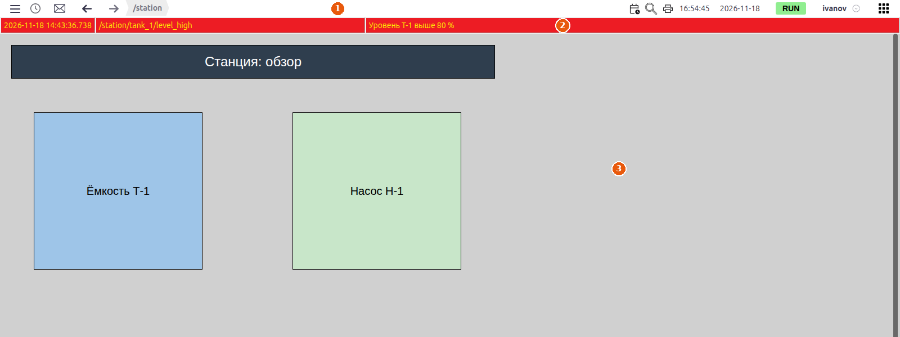
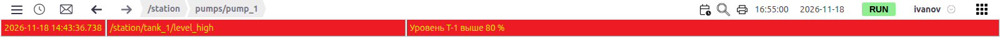
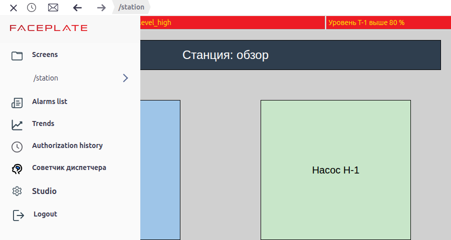
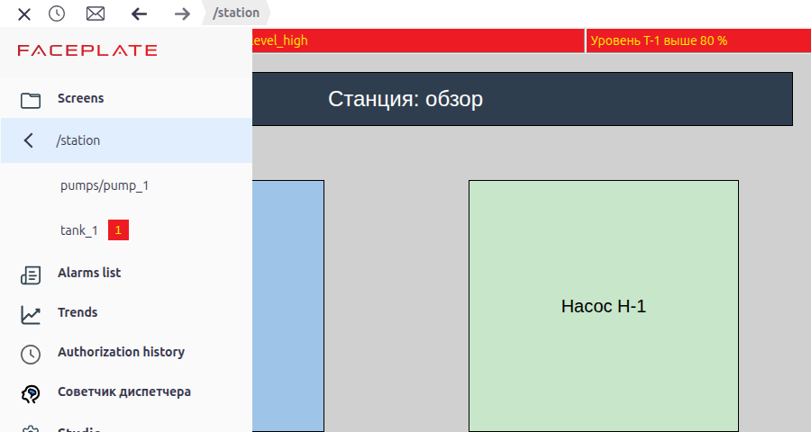
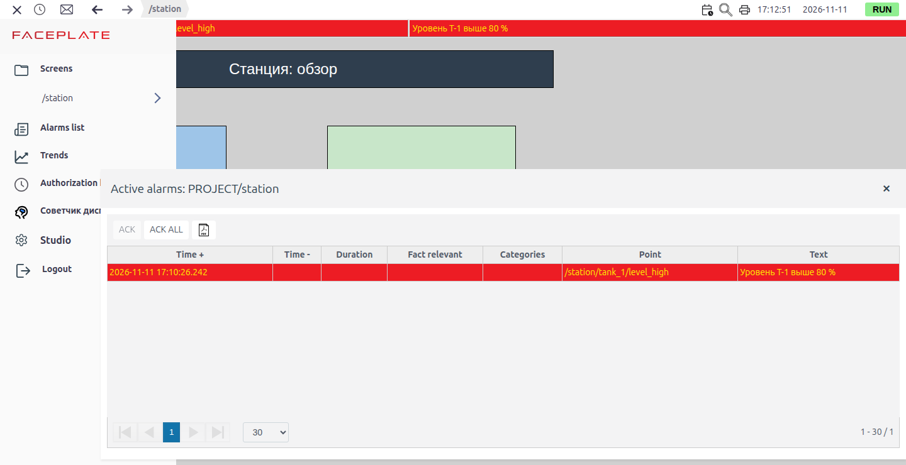
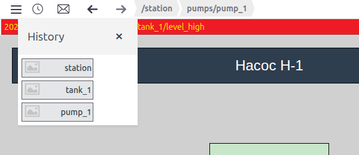
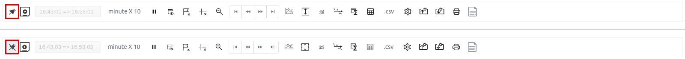

# Desktop and navigator

This document is for the integration engineer who prepares a project for the operator: what the Runtime window consists of, how the Studio folder tree becomes the screen navigator, what the operator sees in it, and how Runtime remembers where the operator has been.

# Contents

- [Glossary](#glossary)
- [Introduction](#introduction)
- [Main part](#main-part)
    - [The Runtime window](#the-runtime-window)
    - [Top bar](#top-bar)
    - [Side menu](#side-menu)
    - [Screen navigator](#screen-navigator)
    - [Alarm indicator in the navigator](#alarm-indicator-in-the-navigator)
    - [Path of the current screen](#path-of-the-current-screen)
    - [Back, forward and History](#back-forward-and-history)
    - [Last screen after sign-in](#last-screen-after-sign-in)
    - [What is kept on navigation and sign-in](#what-is-kept-on-navigation-and-sign-in)
    - [Windows over the screen](#windows-over-the-screen)
- [Conclusion](#conclusion)

# Glossary

| Term | Meaning |
|---|---|
| Screen | The `screen` scheme of a project folder opened in the Runtime work area. One folder, one screen |
| Work area | The part of the Runtime window below the top bar and the alarm strip where the selected screen is shown |
| Navigator | The list of project screens in the Runtime side menu, item **Screens**. It follows the Studio folder tree, but only folders that have a screen |
| Alarm strip | The line below the Runtime top bar: the latest unacknowledged message — time, alarm template path, text. Clicking the strip acknowledges this message |
| Navigation history | The sequence of screens the operator has opened. The back and forward buttons step through it. It belongs to the account, not to the browser |
| Pinned window | A trend window bound to a screen with **Pin to screen**. It opens together with the screen and closes when the operator leaves it |

The terms "Scheme" and "Element" are in [Screen editor](../mnemo/editor.md#glossary); "Alias", "Fixed screen", "Favorites" are in [Screens and navigation](../mnemo/screens.md#glossary).

# Introduction

The operator works in Runtime and moves between the screens the integrator drew in Studio. Which screens appear in the navigator, how they are named and nested is decided not by a separate setting but by the project folder structure: the navigator is built from it automatically. So plan the folder layout before drawing schemes.

The document covers:

- the parts of the Runtime window and what each menu button opens;
- how the Studio folder tree is shown in the navigator and which folders are not shown;
- the alarm indicator next to a screen in the navigator;
- the path of the current screen, the back and forward buttons, the History window;
- which screen the operator sees after signing in;
- trend windows that open together with a screen.

How to set a screen's size, alias and icon, mark it as a favorite, draw the fixed screen and navigation buttons is described in [Screens and navigation](../mnemo/screens.md).

The running example is the folder `station` with the screen «Станция: обзор» (station overview). Inside it are the folder `tank_1` with the tank screen, the object `tank` and the alarm template `level_high` (level above 80 %), and the folder `pumps` without a screen, which holds the folder `pump_1` with the pump screen.

You need access to Studio (`http://<server>:9000/fp/studio`) with an account allowed to change the project. Check the result in Runtime (`http://<server>:9000/fp/runtime`).

# Main part

## The Runtime window



| No. | Part | What it holds |
|---|---|---|
| 1 | Top bar | Menu and navigation buttons, path of the current screen, view modes, server time, project state, account |
| 2 | Alarm strip | The latest unacknowledged message of type `error`, `alarm` or `warning`: time, template path, text. The color follows the message type. Clicking the strip (tooltip "Acknowledge alarm") acknowledges the shown message without confirmation, and the strip moves on to the next unacknowledged one. When there are no unacknowledged messages the strip is empty, even if alarms are still active. The strip shows only messages the account can acknowledge: those raised in folders where it has the write right |
| 3 | Work area | The screen the operator selected. Only this part changes on navigation |

If the project has a fixed screen, Runtime shows it between the alarm strip and the work area (see [Fixed screen](../mnemo/screens.md#fixed-screen)).

## Top bar



From left to right:

| Button (tooltip) | What it does | Details |
|---|---|---|
| **Menu** | Opens and closes the side menu | [Side menu](#side-menu) |
| **History** | A window listing the screens opened under this account | [Back, forward and History](#back-forward-and-history) |
| **Active alarms** | A window of unacknowledged messages of types `error`, `alarm` and `warning`, both active and already cleared, with acknowledgment. An acknowledged message leaves the window even if the alarm is still active. The button is disabled while the alarm strip is empty | [Operator actions](../alarms/alarm/alarm.md#3-operator-actions) |
| **Go back**, **Go forward** | A step through the navigation history | [Back, forward and History](#back-forward-and-history) |
| Path | Path of the current screen; each part is a link to its screen | [Path of the current screen](#path-of-the-current-screen) |
| Calendar-with-clock icon | Archive playback on the current screen | [Past state of the screen](../mnemo/reports.md#past-state-of-the-screen-archive-playback) |
| Magnifier | Work area zoom | [Screen printing](../mnemo/reports.md#screen-printing) |
| Printer | Printing the work area and the alarm strip | [Screen printing](../mnemo/reports.md#screen-printing) |
| **Favorites** (rightmost) | A window of screens marked in Studio with the folder field **Favorite**. If there are none, the notification "Favorite screens are not defined" | [The folder in Runtime](../mnemo/screens.md#the-folder-in-runtime-alias-icon-favorites) |

Between the printer and **Favorites** are the server time and date, the project state indicator and the account name (see [Status bar](status.md#status-bar)).

## Side menu

The **Menu** button slides out a panel on the left. While the panel is open, the button shows a cross.



| Item | What it opens |
|---|---|
| **Screens** | The screen navigator below the item (see [Screen navigator](#screen-navigator)). When the menu opens, the navigator is already shown; a click on the item hides it, another click shows it again |
| **Alarms list** | The "Alarms log" window: all messages with filters and export (see [Archive and export](../alarms/alarm/alarm.md#5-archive-and-export)) |
| **Trends** | The "Trends selection" window: charts from archives, trend groups, settings files (see [Trends](../data_storage/archives/trends.md)) |
| **Authorization history** | A window with the dates of the last successful and the last failed sign-in under this account |
| **Советчик диспетчера** | The alarm advisor window. The item exists only if the advisor module is installed on the server (see [Dispatcher Support](../alarms/dsf/dsf.md)) |
| **Studio** | Studio in a new browser tab. Studio asks for the user name and password; the sign-in uses the account's own rights: an account without access to Studio gets the access-denied page |
| **Logout** | After the confirmation "Are you sure to exit?" — ends the session and shows the sign-in form |

At the bottom of the panel are the node and license details and the **Dark theme** switch. The dark theme changes the colour of the top bar and the side menu; the screen colours and the work area background are set on the screen and do not change. After a screen is selected in the navigator, the menu closes by itself.

## Screen navigator

### How the Studio tree becomes the navigator

The navigator follows the project folder tree and needs no separate configuration. A change in Studio shows up in Runtime without reloading the page — just open the menu again.

Rules:

| In Studio | In the navigator |
|---|---|
| A folder with a saved `screen` scheme | A navigator item. Clicking the name opens the screen |
| A folder without a `screen` scheme | No item of its own. Its name becomes part of the nested screen's name: `pumps/pump_1` |
| A screen inside a folder with a screen | A nested item: the parent gets an `>` arrow |
| Top-level screens | Name with a leading slash: `/station` |
| The root scheme of the project (`screen` of the `PROJECT` folder itself) | Item `/` |
| `@FIXED SCREEN AREA`, the prototypes folder | Not shown in the navigator |

In the example, Studio has three folders with a screen and one without:

```text
PROJECT
└── station          screen "Станция: обзор"
    ├── tank_1       tank screen
    └── pumps        no screen
        └── pump_1   pump screen
```

At the top level of the navigator there is one item `/station` with an arrow. Inside it are `pumps/pump_1` and `tank_1`: the folder `pumps` did not get an item of its own, its name became part of the pump screen name.



Names in the navigator are folder names from the project tree, not aliases. Name folders so that the operator understands them without explanation: the alias from the folder field is shown only in the Favorites and History windows.

### Using the navigator

- Clicking a name opens the screen in the work area and closes the menu.
- The `>` arrow to the right of a name goes to the level of nested screens. The screen itself does not open.
- The top line of a level is the parent screen with a `<` arrow: clicking it returns one level up.
- The navigator opens at the level of the current screen. In the picture above `tank_1` is open (path `/station › tank_1`), and the menu shows the contents of `/station` straight away.

The navigator is one of three places where the operator picks a screen. The other two are the Favorites and History windows: they show screens by folder alias and icon in one flat list. The navigator shows all project screens and their hierarchy, Favorites only those selected by the integrator, History those the operator has already visited.

## Alarm indicator in the navigator

Next to a screen name in the navigator there is an indicator: the number of messages raised in this folder and in all nested folders. The operator sees which screen to look at for the cause before opening any screen.

In the example the template `level_high` is in the folder `tank_1`. When the level exceeded 80 %, an indicator with 1 appeared both next to `tank_1` and at the top level next to `/station`, where the tank is nested: for `tank_1` see the image above, for `/station` the image below.

What the indicator shows:

| State | Look |
|---|---|
| There are unacknowledged messages | Blinks |
| All messages are acknowledged but still active | Steady |
| No active or unacknowledged messages | Hidden |

The number counts all messages of types `error`, `alarm` and `warning` that are active or unacknowledged. The color follows the most important type: `error` — black with a yellow number, `alarm` — red with yellow, `warning` — yellow with black. While there are unacknowledged messages, the color is chosen by them.

The indicator ignores messages of types `info` and `dsf`: they are not counted and do not light the indicator, even when active and unacknowledged. If such messages must be visible on the screen, give the template the type `warning` or higher; the operator finds `info` and `dsf` messages in the **Alarms list** window.

Clicking the indicator number opens the window "Active alarms: PROJECT/<folder>". It lists the same messages the indicator counts: from this folder and nested folders. The screen does not open, and the menu stays in place. The window has the buttons **ACK** (the selected message), **ACK ALL** and a PDF export, so the operator acknowledges the messages of an area without opening its screen (see [Operator actions](../alarms/alarm/alarm.md#3-operator-actions)).

The indicator and the message window are also shown to an account that has only the read right on the folder. Messages of a folder can be acknowledged by an account with the write right on it.



Where the number lights up depends only on the folder of the project tree that holds the alarm template: the number appears next to that folder and next to every folder above it. The indicator does not take into account which scheme shows the equipment. In the example the template `level_high` is in `station/tank_1`, so the number lights up next to `tank_1`: the operator opens that screen and immediately sees the tank T-1 the alarm refers to. If the template were in the folder of another screen, the number would light up next to that screen, and the operator would look for the tank in the wrong place.

So create the alarm template — an object of type `alarm_template` in the Studio project tree (see [A template and an individual message](../alarms/alarm/alarm.md#a-template-and-an-individual-message) and [Create an initial working configuration](../alarms/alarm/alarm.md#create-an-initial-working-configuration)) — in the folder of the screen that shows this equipment (`<screen folder>/<template>`), or in a folder nested in it.

## Path of the current screen

In the top bar, after the arrows, is the path of the open screen, split into parts the same way as in the navigator: `/station` › `pumps/pump_1`. Each part is a link: clicking `/station` opens the station overview. This way the operator goes one level up without opening the menu.

Navigating by a path part is added to the navigation history, like navigating from the navigator.

## Back, forward and History

Every navigation — from the navigator, Favorites, History, a path part, or a navigation button on a scheme — adds the screen to the navigation history. **Go back** and **Go forward** step through it like browser buttons. A button is disabled when there is nowhere to go. If you go back and open another screen, the forward steps from that point are lost. The navigation history keeps the last 100 screens: **Go back** goes back at most 99 steps.

The navigation history belongs to the account, not to the browser. After signing in again, including in another browser, **Go back** leads through the screens of the previous session.

The History window (the clock button) lists the screens from the navigation history: each screen once, with the folder's icon and alias. A click opens the screen and closes the window.



In the example the folders have no aliases, so the window shows the folder names `station`, `tank_1`, `pump_1`, and no icons are set.

## Last screen after sign-in

Runtime stores the last opened screen with the account and opens it after sign-in. An operator who closed the browser on the pump screen sees the pump screen again after signing in.

For an account that has never opened a screen, the work area is empty after sign-in: the operator picks a screen in the navigator or in Favorites. There is no separate start screen setting: after sign-in Runtime opens the screen where the operator ended the previous session. To help a new operator find the main screens, mark them as favorites.

## What is kept on navigation and sign-in

| | Moving to another screen | Selecting the open screen again in the navigator | Page reload (F5) | Sign-out and sign-in |
|---|---|---|---|---|
| Screen in the work area | The selected one | The same, loaded anew | The same | The same |
| Navigation history | Grows | Kept | Kept | Kept |
| Zoom | 100 % | 100 % | 100 % | 100 % |
| Dark theme | Stays on | Stays on | Turns off | Turns off |

After a page reload Runtime asks for the user name and password. What happens to a screen when you return to it is described in [«Screens and navigation», section «Returning to a screen»](../mnemo/screens.md#returning-to-a-screen).

## Windows over the screen

Runtime windows open over the work area and do not block it: the screen underneath keeps updating, and the navigator switches screens.

| Window | How to open | Size when opened |
|---|---|---|
| Active alarms | The **Active alarms** button (envelope) in the top bar | A window in the middle of the screen, the scheme around it stays visible |
| Alarms log | **Menu** → **Alarms list** | Full screen |
| Trends selection | **Menu** → **Trends** | Full screen |
| Trend window | The **OK** button in the Trends selection window | Full screen |

A full-screen window has two buttons without captions in the right corner of its title bar: ❐ (two overlapping squares) and × (close). The ❐ button switches the window to normal size: Alarms log moves to the lower right corner, Trends selection moves to the middle of the screen, and the scheme next to them is visible again. In normal size the title bar shows □ instead of ❐, which expands the window to full screen again. Trends selection and a trend window in normal size also have a «_» button, which minimizes the window to its title bar: the Trends selection title bar stays where the window was, a trend window moves as a small bar to the upper left corner of Runtime. The ❐ button on the minimized title bar brings the window back.

A trend window can be pinned to a screen (see [Pinning a chart to a process screen](../data_storage/archives/trends.md#pinning-a-chart-to-a-process-screen)). The **Pin to screen** button is the first on the left of the trend window toolbar, an icon button shaped like a pushpin; its caption appears only as a tooltip. Open the trend from **Menu** → **Trends** while on the required screen and click it. On a pinned window the button is highlighted and the icon is crossed out: it is now **Unpin**.



A pinned window:

| Event | What happens to the window |
|---|---|
| The operator leaves the screen | Closes |
| The operator closes the window with the cross | Closes, but the pin remains |
| The operator returns to the screen, refreshes the page (F5) or signs in again on it | Opens again with the same series, even if it was closed with the cross before |
| Another user opens this screen | Does not appear: the pin applies only to the account that made it |

Pinning replaces a built-in trend for the operator when the integrator did not put one on the scheme: the operator assembles the needed charts and binds them to the screen. A built-in trend (the **Trends** element on a scheme, see [Alarms and trends on a screen](../mnemo/alarms_trends.md)) is placed by the integrator for all users at once.

**Unpin** on the trend toolbar removes the pin.

# Conclusion

| Task | How to do it |
|---|---|
| Show a screen in the navigator | Save the folder's `screen` scheme |
| Make screens nested | Nest folders with screens inside each other |
| Group screens without an extra level | An intermediate folder without a screen: its name becomes part of the screen name |
| Give the operator clear names in the navigator | Clear folder names; aliases are shown only in Favorites and History |
| Show which screen has the alarm | Alarm templates of type `error`, `alarm` or `warning` in the folder of that screen or in a nested one |
| Help a new operator find the main screens | Mark them as favorites: there is no start screen, after sign-in the account's last screen opens |
| Give the operator own charts on a screen | Trend window → **Pin to screen** |

Workflow:

1. Lay out the project folders the way the operator should see the screens in the navigator. Make groups without their own screen folders without a `screen` scheme.
2. Save the `screen` schemes of the needed folders.
3. Put alarm templates of types `error`, `alarm` and `warning` in the folders of the screens where the operator handles those alarms.
4. Mark the main screens as favorites and give them aliases (see [Screens and navigation](../mnemo/screens.md)).
5. Sign in with the operator's account and check the navigator, the alarm indicator, the alarm strip and the back and forward buttons.
