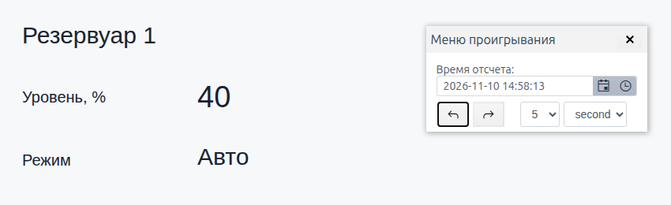

# Playback: Viewing Archived Data on a Process Screen

Faceplate v4.0.7

## Purpose and capabilities

Playback lets you view values on a process screen for a selected time in the past. Operators can examine plant conditions around an event and compare several moments using the familiar arrangement of indicators.

Viewing is manual: select a time or click an arrow to move one step backward or forward. There is no automatic time progression, play, pause, speed setting, or range repetition.

Key terms:

- **Selected time** — the moment for which history is requested. It may differ from the timestamp of the record found.
- **Archive point** — a stored value with a timestamp.
- **Time step** — the amount and unit of a single change to the selected time.
- **Current-value cache** — values read once when fields are accessed and retained for the duration of the mode. They do not update continuously.
- **Normal Runtime mode** — operation of the process screen with current data, restored when you close the playback window.

Entering playback reloads the process screen with a different data source. Fields with a matching archive receive historical values. Other readings may come from the current-value cache or the screen's own logic. The entire desktop cannot be treated as one historical snapshot.

Playback uses the current layout, bindings, and client scripts. It does not restore earlier versions of the process screen or project configuration. Viewing history does not itself stop server-side project execution or data collection.

## Which values the process screen displays

### First opening, archives, and the current-value cache

Immediately after opening, the window shows its opening time, while the process screen displays current reads, including fields that have archives. **You must actually change the selected time to switch to history.** A date displayed in the window does not by itself confirm an archive read.

| Condition | Value source | When it updates | How to interpret the reading |
|---|---|---|---|
| Window just opened; time not changed yet | A current read of the field | On first access, then retained | History has not been selected yet |
| Time changed; matching archive found | An archive point for the selected time | After a successful read when time changes | Historical value using the preceding-point rule |
| No archive; field already read | Current-value cache | Changing time does not refresh it | A retained current value, rather than history or a live update |
| No archive; field first needed later | A current read at that later moment | Once, then cached | It may have been read later than adjacent fields |
| Archive found; no matching point | The result indicating a missing archive point | When the selected time is read | There is no automatic fallback to the current value |
| Read failed | No new archive values received | After a successful subsequent read | A retained number does not confirm a successful request |

The current-value cache is not a simultaneous snapshot of every field: fields may first be read at different times. Changing time and navigating within the same mode do not refresh this cache.

If no matching archives are found at all, the window's time can change without updating the readings or showing a separate message about missing archives.

### How an archive point is selected

For each archive, playback takes the **last point at or before the selected time**. It does not find the nearest point in either direction, interpolate, or average values.

| Selected time | Point used | Result and qualification |
|---|---|---|
| Before the first record | No matching point | The archive exists but has no data yet for this moment |
| Exactly on a record | That record | An exact match is included |
| Between records | The preceding record | The value remains until the next point; no intermediate number is calculated |
| After the last record | The last record | The value remains even across a large time gap |
| Empty archive | No matching point | An archive object does not prove that history exists |

There is no limit on the age of the point found. The window shows the request time, which does not confirm a new record at that moment. Playback does not supply the timestamp or historical quality of the point alongside its value. A separate indicator of the source field's current quality does not automatically become historical.

### When a value is missing

A missing archive and a missing point in an existing archive produce different results: the former can use a retained current read; the latter does not substitute the current value for history. How a missing point appears depends on the screen element. Do not assume a universal dash, blank field, or zero; check the actual history records.

## Preparing the process screen and history

### Prerequisites

Before viewing, the following must be available:

- a prepared process screen in Desktop Runtime with bindings to the required objects and fields;
- normal Runtime mode when entering playback;
- a working connection, an authenticated session, and accessible history storage;
- matching archives with real records for the period of interest;
- read access to archives and to source objects for current reads.

Write access is not required to view history. Creating an archive today does not reconstruct values for earlier periods. For collection and source configuration, see [Archives: Configuring Sources and Recording Data](../data_storage/archives/archives.md).

### Field bindings and archive matching

Each screen element must refer to the correct source object and field. Automatic history lookup for that field requires a standard archive object with a direct source matching **both the object and the field**. Matching indicator and archive names is insufficient. Similar settings alone do not establish support for an arbitrary derived archive type.

The window's time step and the archive's collection period are independent. The standard archive period defaults to 1000 ms; the viewing step does not change data collection or create missing points. The system maintains internal links and storage information; they are not entered manually for playback.

| Case | How the history source is determined | What to check |
|---|---|---|
| Element bound to a source object's field | A direct archive of that exact object and field is sought | Element binding, direct archive source, and recorded points |
| Element bound to the archive's own value field | History is read from that archive | That the intended archive value is displayed and has been recorded |
| Archive stores a script result | The result is available through the archive's own value field | Binding to the archive; its input variables do not automatically acquire this history |
| Several archives match | Archives that are not disabled come first, then disabled ones; within each group, full paths are compared lexicographically | All accessible candidates, their disabled state, and full paths |
| Archive inaccessible during lookup | It may be absent from the matches | The current user's access, rather than only an administrator's |
| An already selected archive becomes inaccessible or is deleted | The group archive read fails | Every selected archive; there is no automatic fallback to another one |

For example, an archive of a flow calculation result does not become the history of every variable used by that calculation. Bind the indicator to the archive's value to display the stored result. Restoring the input variables requires their own matching archives.

### Multiple archives and access rights

The playback window has no manual archive selector. Automatic selection does not compare history depth, freshness, completeness, or recording frequency. A disabled archive can still provide previously collected data. Changes to access, paths, or disabled state can change the selection on a new lookup.

Check configuration under the same role that the operator will use. An archive visible to an administrator may be absent from an ordinary user's lookup. Access is checked again when selected archives are read. One archive's failure can prevent the entire group read from returning partial results; another candidate is not selected automatically.

## Using the playback window

### Opening and ending a viewing session

With a process screen active, click the calendar icon on Runtime's top toolbar, to the left of the zoom button. The **«Меню проигрывания»** window (Playback menu) opens. The entry button has no text label.

To end viewing, click **×** in this window's title bar. The original process screen reloads in normal Runtime mode. Check its current readings after leaving: closing the window changes the data source; it does not write the selected historical state to the project.

Entering and leaving playback recreate the process screen. Local state may reset, and initialization events may run again.

### Window parameters and actions

The labels below retain the wording observed in the Russian interface.

| Element | Values and default | Purpose and result | Conditions and limits |
|---|---|---|---|
| «Время отсчета» (Reference time) | Date and time; initially the window's opening time | Sets the selected time after a change is accepted | Time must change for the first historical read |
| Calendar and time list on the right of the field | Date and time selection; time list at 1-minute intervals | Help fill the field; seconds can be edited with the keyboard | This is not a list of archive points |
| Step amount | 1, 5, 10, 15, 30, 60; initially 1 | Numeric part of the time step | Changing the list alone does not move time |
| Step unit | second, minute, hour; initially second | Seconds, minutes, hours | Step equals amount × unit; it is neither speed nor recording period |
| Left arrow | One selected step | Moves time backward | Does not specifically jump to the preceding record |
| Right arrow | One selected step | Moves time forward | Cannot move beyond the window's opening time |
| × in the title bar | Close | Restores normal mode and the original process screen | Current data must be checked again |

Window in the prepared example: selected time 14:58:13, level 40%, step 5 seconds. Drag the window by its title bar if it covers indicators.

### Entering time and understanding the time zone

The field displays **year-month-day hours:minutes:seconds**, for example `2026-11-10 14:58:13`. You can choose a day in the calendar, select the field's contents, and type the date and time sequentially with the keyboard. Press Tab to finish. Check the time actually accepted and the resulting readings; incomplete or invalid input does not guarantee a clear error message.

The date is interpreted in the **browser's time zone**. The playback window has no separate time-zone setting. In another time zone, the same calendar numbers represent a different instant. Before comparing against logs and archives, establish which time zone their timestamps use.

The initial time and viewing limit depend on the browser's clock. The server clock in the status bar does not set the selected time. Differences between client and server clocks affect the comparison of moments.

### Steps and time limits

The initial step is **1 second**. To move by 5 seconds, select amount **5** and unit **second**, then click the required arrow. Other combinations, such as 15 minute or 60 hour, are also available.

The upper limit is fixed when the window opens and does not advance with the clock. If a forward step crosses it, time remains unchanged. This limit is unrelated to the end of the archive. The calendar also has no knowledge of the beginning or end of collected history: an available date does not confirm that data exists.

## Practical example of viewing history

### Starting data

The task is to view a tank's level history on a prepared process screen and compare two moments. Objects and history are prepared beforehand. The example uses the training branch `/root/FP/PROJECT/DOC_PLAYBACK`.

| Object or data | Prepared state |
|---|---|
| Overview process screen, «Резервуар 1» (Tank 1) | Two indicators: «Уровень, %» (Level, %) and «Режим» (Mode) |
| Tank1, field level | Numeric level; current value 80% |
| Tank1, field mode | Current «Авто» (Auto); this field has no archive |
| Tank1LevelArchive | Direct archive of Tank1.level; no other matching archive |
| Reference point, 10 November 2026, 14:58:08 | 40% |
| Reference point, 10 November 2026, 14:58:18 | 55% |
| Browser time zone | Asia/Almaty, UTC+05:00 |

There are no other records between these two points in the reference interval. The later current value of 80% does not change results for the selected past moments. In your own project, use known points from your archive; the example's dates do not create data automatically.

The readings have mixed origins: level comes from the archive, while «Авто» comes from the current-value cache. This example does not reconstruct the tank's historical operating mode. The process screen keeps its current layout.

### Selecting a time and comparing readings

1. In normal Runtime, open **«Меню» → «Мнемосхемы»** (Menu → Process screens) and select **/DOC_PLAYBACK/Overview**. Confirm «Резервуар 1», level **80**, and mode **«Авто»**.
2. Click the playback button with the calendar icon. On first opening, the level remains **80**: historical time has not been selected yet.
3. In **«Время отсчета»**, use the calendar to select **10 November 2026**. Select the field's contents, type `2026-11-10 14:58:13` sequentially with the keyboard, and press **Tab**. Confirm that the field accepted this exact time and the level became **40**. This is the value recorded at 14:58:08; the next point has not been reached yet.
4. Select step amount **5** and unit **second**. Changing the lists alone should not move time.
5. Click the **right** arrow once. Confirm time **14:58:18** and level **55**.
6. Click the **left** arrow once. Confirm the return to **14:58:13** and level **40**. The adjacent «Авто» remains a retained current value.

The 5-second step landed exactly on the next archive point. The level change confirms that a different moment of history was read.

### Returning to current data and verifying the result

Click **×** in the title bar of «Меню проигрывания». Confirm that the window closed, the original process screen is open, the level is **80** again, and the mode is **«Авто»**. The source object's values did not change during this example; on an operating plant, leaving playback displays its actual current readings.

Check the sequence:

| Action | Selected time or source | Level | Mode |
|---|---|---|---|
| Open window | Current reads; history not yet selected | 80% | «Авто» |
| Select time | 10 Nov 2026 14:58:13, UTC+05:00 | 40% | Cached «Авто» |
| One step forward | 10 Nov 2026 14:58:18, UTC+05:00 | 55% | Same cache |
| One step backward | 10 Nov 2026 14:58:13, UTC+05:00 | 40% | Same cache |
| Close window | Normal Runtime, current data | 80% | Current «Авто» |

If results differ, first check the accepted date, time zone, and actual archive points. An unchanged field without an archive does not by itself indicate a fault.

## Characteristics and limitations

### Writes, calculations, and scripts

Standard write operations through process-screen bindings are ignored in playback. A control may still look available; write success or error notifications may never arrive. An unchanged number on the screen does not confirm a command's outcome.

This limit does not cover all custom logic. Client scripts, events, and timers continue running. Direct access to the server, external sources, and custom command paths can bypass the process screen's normal data source. Playback is not a general interlock for equipment control.

A client calculation can use archived values when its inputs are read through the process screen's context — the links between its elements and data. However, current clocks, timers, direct requests, and external data do not automatically move into the past. Assess a calculation with mixed inputs according to the origin of each input.

### Recreation, navigation, and scope

Entering and leaving playback recreate the process screen and its context. Project logic must account for repeated initialization events, loss of locally entered values, and reset of unsaved state.

Navigation is not blocked while the window is open. New process screens may use the selected time and existing cache, but closing the window returns to the path from which playback was opened. Fixed desktop areas and previously created contexts may keep their own data sources. Do not extend conclusions about the active screen's historical state to every desktop panel. Navigation and return consistency in a complex project require separate verification.

### Connection loss and reconnection

When a connection is restored on the same page, the selected time, archive matches, and caches may remain. Reconnection alone does not guarantee a fresh read of history or current fields. An old reading after connection recovery may still be cached.

A lost request is not automatically repeated, and its wait for a response may remain unfinished. Successful authentication is needed even after transport is restored. A new time change after authentication can request known archives again, but it does not complete the old lost request.

The desktop can be recreated during connection recovery while the open playback window remains associated with the previous screen. Restored connectivity therefore does not guarantee that all window controls and the return action work correctly. A full page reload or a move to another server creates a new viewing session: the previous time and cache are not retained.

After a failure, verify the selected time, readings against known points, and the actual return to current data. There is no universal automatic recovery of the entire mode. General connection indicators are described in [Status Bar, Connection, and Reconnection](status.md).

## Troubleshooting

**Normal behavior:** current readings immediately after opening; an unchanged field without an archive; the same value between adjacent points and after the last point; a fixed upper limit; ignored standard writes. These signs do not by themselves establish a fault.

| Symptom | Possible cause | What to check | Verification signal |
|---|---|---|---|
| Window does not open | No active process screen, or a special data mode is already in use | Open a prepared screen in normal Runtime; end the previous mode | «Меню проигрывания» opens |
| Current numbers remain when the window opens | Historical time has not been selected | Actually change «Время отсчета» to a known past moment | The value matches the preceding archive point |
| Time changes, but an archived reading stays the same | The same preceding point is selected, or no archive was found | Compare actual points; check the direct source, object, field, and access rights | Crossing a point with a different value changes the reading |
| A field without an archive stays unchanged | Normal current-value cache | Determine whether the field needs its own archive; end viewing to see current data | The current value appears after leaving |
| An administrator sees history, but the operator does not use it | Access excludes the archive, or a different candidate is selected | Check reads under the operator's role, all matching archives, and their paths | The required field's history is accessible under the working role |
| Date selected, but no archive point | Empty archive or a time before the first record | Check history start and actual records; do not rely solely on the calendar | A time with a known preceding point yields the expected value |
| Number does not change after history ends | Normal use of the last point without an age limit | Compare the end of history with the selected time | The last record used is understood; a new number requires a different point |
| Date not accepted, or time looks unexpected | Incomplete input, invalid date, different time zone, or client clock | Choose the day in the calendar, type date and time with the keyboard, finish with Tab; check the zone and accepted text | The intended time is accepted and the result matches known history |
| Forward step does not move time | It crosses the limit fixed at opening | Compare the resulting step time with the window's opening time; check the unit | A step within the limit moves time by the selected amount |
| Read error, waiting, or an old number | Archive/storage inaccessible, archive deleted, or connection interrupted | Check connection, authentication, and every selected archive; verify a new time change after recovery | Values for a known time are successfully received and waiting ends |
| New time after an error, but old numbers | Time and old cache do not roll back automatically | Compare readings against known points after a successful request | Date and values agree again; a new date alone is insufficient |
| Standard write has no effect, but a script keeps running | Binding-based writes are ignored; scripts and direct access continue | Check how project logic reads data and sends commands | The source and possible effect of each action are established separately |
| Window or return behaves unexpectedly after reconnection | Cache retained, request lost, or desktop recreated | Verify completed authentication, selected time, a known value, and the outcome of leaving playback | Successful reading and normal current data after leaving are confirmed |

A missing archive, a missing record, and a read error require different checks. The appearance of an empty result and any messages depend on the situation and screen element; do not identify the cause from one number or the appearance of a field alone.

## Conclusion

Playback in Faceplate lets you manually view archived values on a familiar process screen and compare plant conditions at different moments. Reliable results require correct bindings, recorded history, read access, and a consistent browser time zone: the selected time uses the last archive point at or before that moment, while fields without archives retain current values read once. The tank level example demonstrates selecting a time, moving in steps, and returning to current data. Account for screen recreation, write limitations, continuing script execution, and connection recovery behavior; investigate unexpected readings by checking their data sources and actual archive points. End viewing by closing the window and checking current readings in normal Runtime.
