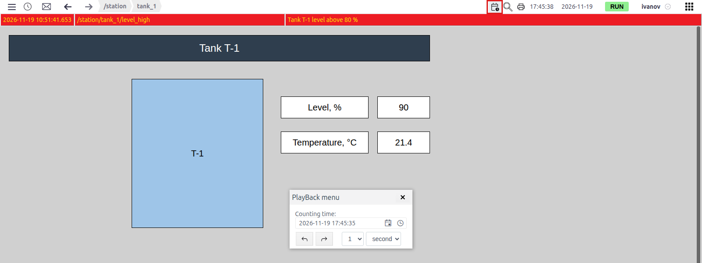
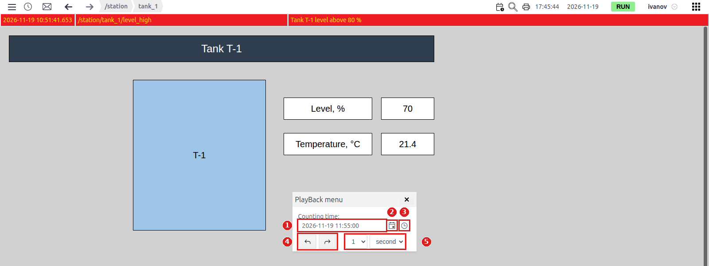

# Archive playback

This document explains how to view a screen in Runtime with the values of a past moment: open the playback mode, pick a moment, step through time, and tell past values on the screen from current ones.

# Contents

- [Glossary](#glossary)
- [Introduction](#introduction)
- [Main part](#main-part)
    - [Opening and closing the mode](#opening-and-closing-the-mode)
    - [The "PlayBack menu" window](#the-playback-menu-window)
    - [What the screen shows](#what-the-screen-shows)
    - [Another screen in playback mode](#another-screen-in-playback-mode)
    - [Control and printing in the mode](#control-and-printing-in-the-mode)
    - [Example: tank level at 11:55](#example-tank-level-at-1155)
- [Conclusion](#conclusion)

# Glossary

| Term | Meaning |
|---|---|
| Archive playback | A Runtime mode in which the screen shows archive values for a chosen past moment. Turned on with the calendar-with-clock icon on the top bar |
| Moment | The date and time in the **Counting time** field of the "PlayBack menu" window: the screen shows values for this moment |
| Step | How far the window's "back" and "forward" buttons move the moment: a number and a unit (`second`, `minute`, `hour`) |
| Archived field | An object field whose values a project archive records: the archive's source is this field. Only such fields have past values |

The terms "Screen", "Work area", "Navigator" are in [Desktop and navigator](desktop.md#glossary); "Fixed screen" is in [Screens and navigation](../mnemo/screens.md#glossary).

# Introduction

To investigate an event — a protection tripped, an alarm came, an operator takes over a shift — you need to know what the screen showed earlier: what the level was, when the deviation began. Playback mode shows the same screen with archive values for a chosen moment. No separate screen is needed: the mode works on any screen.

The document covers:

- how to open and close the mode;
- how to pick a moment and step through time;
- which values on the screen are past values and which are not;
- what happens when you go to another screen;
- what does not work in the mode and what printing gives.

The running example is the tank screen `station/tank_1`: the level is recorded by an archive, the temperature is not. The level archive has records 11:40 — 62 %, 11:50 — 70 %, 12:00 — 78 %. The level is now 90 %, the temperature 21.4 °C.

You need access to Runtime (`http://<server>:9000/fp/runtime`). Only fields recorded by an archive have past values (see [Archives: configuring sources and recording data](../data_storage/archives/archives.md)).

# Main part

## Opening and closing the mode

Open a screen and click the calendar-with-clock icon on the top bar, to the left of the magnifier. The "PlayBack menu" window opens over the screen.

Until a moment is picked, the screen shows current values, and the **Counting time** field holds the time the window was opened. The window can be dragged by its title so that it does not cover the values you need.

To leave the mode, click × in the window title. Runtime returns the screen from which the mode was opened, with current values. Reloading the page (F5) also turns the mode off; after it Runtime asks for the user name and password. Runtime switching to another cluster node (see [Cluster nodes](../administration/nodes/nodes.md#node-address-for-runtime)) also turns the mode off: Runtime opens the same screen with current values.

When the window opens and when the mode ends, the screen is loaded again.

## The "PlayBack menu" window

| No. | Element | Purpose |
|---|---|---|
| 1 | **Counting time** field | The moment as `yyyy-MM-dd HH:mm:ss`. Click a part (year, month, day, hours, minutes, seconds) and type it. A typed moment applies on Enter, Tab or a click outside the field |
| 2 | Calendar icon | Picks a day. The picked day applies at once, the time in the field stays. The calendar does not offer days after today |
| 3 | Clock icon | A list of times with a one-minute step. The picked time applies at once |
| 4 | "Back" and "forward" buttons | Move the moment one step earlier or later |
| 5 | Step | A number (1, 5, 10, 15, 30, 60) and a unit: `second`, `minute`, `hour`. When the window opens — 1 `second`. Changing the step does not move the moment |

The moment changes only manually — with the field, the calendar, the time list or the "back" and "forward" buttons; it does not move by itself. The calendar and the time list do not show when the archive made records: you can also pick a moment for which there are no records.

The time in the field, like the time on the top bar and the alarm strip, is shown in the time zone of the computer on which Runtime is open.

Playback shows values the archive has already recorded, so the moment is never later than the current time.

## What the screen shows

The screen is shown as it is now: if it was changed, past values are put into its current elements. Once a moment is picked, the screen holds both past and current values. The rule depends neither on the kind of element nor on the object type, but on where the element takes its data from:

| Element on the screen | What it shows |
|---|---|
| Bound to an archived field (a rectangle, a gauge, an input field and any other element bound to an object field) | The last value recorded by the archive no later than the chosen moment. Between records the value holds until the next record; after the last record — the last value |
| Bound to an archived field, the moment is earlier than the archive's first record | No value |
| Bound to an archived field, the archive was stopped (for example, while the server was stopped) | No value — from the last record before the stop to the first record after the start. The archive records a value when it changes, so the last record can be long before the stop |
| Bound to a field without an archive | The value the field had when it first appeared on the screen in the mode. It does not change until the window is closed: neither when the moment changes nor when the field changes in the project |
| Trend, table of values for a period | Its own period, as outside the mode: they do not move to the chosen moment |
| Alarm list, alarm indicator | Current messages, including those that occurred after the chosen moment |
| Table of current object values | Current values |
| Fixed screen above the work area | Current values |

The alarm strip below the top bar also shows current messages.

A field that an archive reads in a script is not an archived field: such an archive records the script result, not the field value. The script result for the chosen moment is shown by an element bound to the archive itself.

An archive records field values as numbers. So numeric and logical fields look in the mode the same as outside it, and a string field holding a number shows that number. A string field holding text has no value: the archive does not record text. If a string field held text instead of a number for a while, there is no value for the moments of that period either.

An archived field shows past values only if the account can read that archive. Otherwise the field behaves like a field without an archive.

Only the values of archived fields belong to the chosen moment; the other values on the screen do not.

## Another screen in playback mode

The "PlayBack menu" window stays open when you go to another screen — from the navigator, by a part of the path, or with the top bar "back" and "forward" buttons (see [Desktop and navigator](desktop.md#screen-navigator)). The new screen shows values for the same moment, and the window buttons move the moment on it too. This way you can view several parts of the plant at one moment.

The window's cross returns the screen from which the mode was opened, with current values.

## Control and printing in the mode

The mode is view-only: buttons and input fields on the screen look as usual but do not write values to the project. Equipment control works after the window is closed.

The mode changes only what this Runtime shows: the project keeps running, archives record current values, alarms occur as usual.

Printing in the mode (the printer icon on the top bar) gives the screen at the chosen moment. The "PlayBack menu" window does not get onto the sheet. Printing in detail — in [Reports and screen printing, Screen printing](../mnemo/reports.md#screen-printing).

## Example: tank level at 11:55

1. Open the `tank_1` screen (**Menu** → **Screens** → `/station` → `tank_1`). The level is 90 %, the temperature 21.4 °C.
2. Click the calendar-with-clock icon. The "PlayBack menu" window opens; the screen still shows the same 90 and 21.4 (the figure in [Opening and closing the mode](#opening-and-closing-the-mode)).
3. In the **Counting time** field type `2026-11-19 11:55:00` and press Enter. The level is 70: this is the 11:50 archive record, the next one is at 12:00. The temperature stays 21.4: it has no archive, this is its value when the window was opened (the figure in [The "PlayBack menu" window](#the-playback-menu-window)).
4. Choose the step **5** and `minute`, click "forward". The moment is 12:00:00, the level 78, the 12:00 record.

5. Click × in the window title. The screen shows current values again: 90 and 21.4.

# Conclusion

| Task | How to do it |
|---|---|
| See the screen at a past moment | Calendar-with-clock icon → moment in the **Counting time** field → Enter |
| Follow how a value changed | Choose a step and click "back" or "forward" |
| Tell which values are past values | Past values — only on archived fields; a field without an archive shows, until the window is closed, its value at the time it first appeared on the screen |
| View another screen at the same moment | Go to it without closing the window |
| Return to current values | × in the window title |
| Print the screen at a past moment | The printer icon in playback mode |
