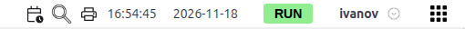
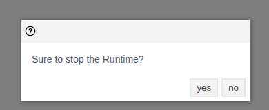
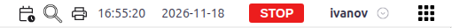
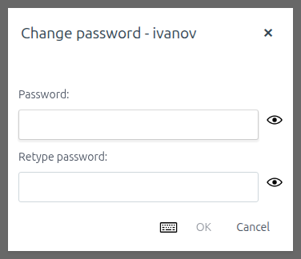
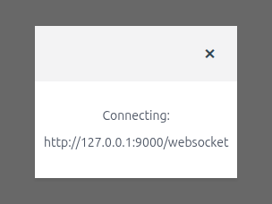

# Status bar and connection

A document for the integration engineer who hands over operator workstations: what the right part of the Runtime top bar shows, how the RUN/STOP project state is tied to the Studio buttons, and what the operator sees when the connection to the server is lost and restored.

# Contents

- [Glossary](#glossary)
- [Introduction](#introduction)
- [Main part](#main-part)
    - [Status bar](#status-bar)
    - [Project state: RUN and STOP](#project-state-run-and-stop)
    - [Account and password change](#account-and-password-change)
    - [Node in the Runtime menu](#node-in-the-runtime-menu)
    - [Connection loss](#connection-loss)
    - [Switching to another node](#switching-to-another-node)
    - [Studio on connection loss](#studio-on-connection-loss)
- [Conclusion](#conclusion)

# Glossary

| Term | Meaning |
|---|---|
| Status bar | The right part of the Runtime top bar: server time and date, project state indicator, account name |
| Project state | Whether project objects are running: scripts, calculations, connections, archives, alarm templates. `RUN` — running, `STOP` — stopped. Switched in Studio with **Start Runtime** and **Stop Runtime** |
| Node | One FACEPLATE server named `fp@<host>`, see [Cluster nodes](../administration/nodes/nodes.md) |
| Reconnection | Repeated attempts of Runtime to reach the server after the connection is lost. They run without operator action |

The other parts of the top bar and the menu are described in [Desktop and navigator](desktop.md#top-bar).

# Introduction

The operator looks at screens and does not see the server. The status bar is the only place where Runtime shows that the server and the project are fine: the clock is ticking and the indicator is green. If the clock has stopped or the indicator is red, the data on the screen is not updated, even if the screen looks as usual.

The document answers these questions:

- what each element of the status bar means;
- how to stop and start the project and how this shows in Runtime;
- how an operator changes their own password;
- what happens when the connection is lost on a single server and in a cluster, and what has to be configured for it.

You will need access to Studio (`http://<server>:9000/fp/studio`) with an account allowed to change the project. The result is checked in Runtime (`http://<server>:9000/fp/runtime`).

# Main part

## Status bar

| Element | What it shows |
|---|---|
| Time, date | Server time converted to the time zone of the operator's computer. Updated every second while the server is connected. Tooltips **Current time**, **Current date** |
| `RUN` / `STOP` | Project state: green `RUN` — project objects are running, red `STOP` — stopped. See [Project state](#project-state-run-and-stop) |
| Account name | Who is logged in. A click opens the password change window (tooltip **Change password**), see [Account and password change](#account-and-password-change) |

The clock takes its time from the server, not from the operator's computer. That is why it shows both a wrong server clock and a lost connection: when the connection drops, the clock stops at the last received value. The server's time zone does not affect the clock: only the time on the server's clock matters.

## Project state: RUN and STOP

The whole project is started and stopped in Studio: **General View**, project root, a button on the toolbar. It is one button with a changing caption: **Stop Runtime** for a running project, **Start Runtime** for a stopped one. Studio asks for confirmation, «Sure to stop the Runtime?» (or start), and acts after **yes**.

The indicator in every open Runtime window changes within 1–2 seconds; Runtime does not need to be reloaded.

| | `RUN` | `STOP` |
|---|---|---|
| Project objects (scripts, calculations, connections, archives, alarm templates) | Run on the cluster nodes | Stopped, **State** `Stop` in Studio |
| Values on screens | Updated as data arrives | Not updated: no new data |
| Runtime and Studio | Open and work | Open and work |

A new project is created stopped: after FACEPLATE is installed, the indicator shows `STOP` until **Start Runtime** is pressed in Studio. This is the first thing to do before checking screens on a new server.

A part of the project can also be stopped — one folder with its subfolders — with the **Runtime** switch in the folder form (see [Where objects run](../administration/nodes/nodes.md#where-objects-run)). The status bar indicator refers only to the whole project: stopping a single folder does not change it.

## Account and password change

A click on the account name opens the **Change password - <account>** window. Any Runtime user can change their own password, including an operator without access to Studio.

Enter the new password in both fields and press **OK** (until then the button is disabled). The eye icon to the right of a field shows the typed characters; the keyboard button opens the on-screen keyboard for touch panels.

The password must meet the same requirements as in the Studio user card (see [Password](../access/users.md#password)). If the two fields differ or the password does not meet the requirements, Runtime shows a message, the window stays open and the password is not changed. After a successful change Runtime reports it. The current session continues; the new password is needed at the next login and after a connection loss (see [Connection loss](#connection-loss)).

## Node in the Runtime menu

At the bottom of the side menu, the `server` line shows the node Runtime is connected to, for example `fp@server1.fp`. After [switching to another node](#switching-to-another-node) it shows the new node. The `master license` line is this node's license, see [Licensing](../administration/license/license.md#where-the-license-is-shown).

## Connection loss

Runtime keeps a permanent connection to a node. If the node is stopped, restarting, or the network to it is unavailable, Runtime:

1. Dims the screen and shows the **Connecting** window with the address it is connecting to.
2. Retries about once a second until the server responds. The operator does not need to do anything.

While the window is shown, the status bar is not updated: the clock stands still and the indicator shows the last received state. Values on the screen under the window are the last ones received before the connection was lost.

When the server responds again, the window closes, Runtime logs in by itself with the same name and password the operator used at the start of the session, rebuilds the desktop and opens the screen that was open before the connection was lost. No password is needed, however long the connection was lost. The clock runs again.

The exception is when the account password was changed during the session (by the operator in the change password window or by an administrator in Studio) or the account was deleted. Then Runtime cannot log in by itself, and the operator has to log in again with the new password.

## Switching to another node

In a cluster, Runtime tries not only its own node but, in turn, the addresses of all running nodes. Runtime receives the address list from the server when it connects and refreshes it once a minute. With the first node that responds, Runtime loads the Runtime page from that node's address, logs in with the same account and opens the same screen. The `server` line in the menu shows the new node. On a two-node test cluster, switching after the first node was stopped took 3–4 seconds.

Switching works only with two settings in place:

| What | Why | Where it is configured |
|---|---|---|
| A node address that opens from the operator's workstation | Runtime connects to the node at this address. If the node's host name does not open from the workstation, switching does not happen | [Node address for Runtime](../administration/nodes/nodes.md#node-address-for-runtime) |
| A copy of the project database on the node | Without a copy, the node cannot serve project data while the first node is stopped: Runtime stays on the loading screen | [Redundancy: a database copy on a second server](../data_storage/storage/storage.md#redundancy-a-database-copy-on-a-second-server) |

You can check switching before handing over the system without stopping a server, by killing the Runtime session on the **Servers** panel (see [Node address for Runtime](../administration/nodes/nodes.md#node-address-for-runtime)).

## Studio on connection loss

When the connection is lost, Studio shows the **Connecting...** window and retries the same node. Studio does not switch to another node. When the node responds again, Studio shows the login form: log in again.

| | Runtime | Studio |
|---|---|---|
| Window on connection loss | **Connecting** with the node address | **Connecting...** |
| Where it connects | Its own node and other cluster nodes | Only its own node |
| After recovery | Login without a password, same screen | Login form |

# Conclusion

The status bar shows the operator the server time, the project state and the account. A running clock and a green `RUN` mean the connection is up and project objects are running; a stopped clock means the connection is lost. The whole project is started and stopped with **Start Runtime** and **Stop Runtime** in Studio; a new project is created stopped. The operator changes their own password by clicking the account name. When the connection is lost, Runtime reconnects by itself and returns the operator to the same screen without a password, and in a cluster it moves to another node if node addresses are set and a copy of the project database exists. Studio reconnects only to its own node and requires logging in again.
