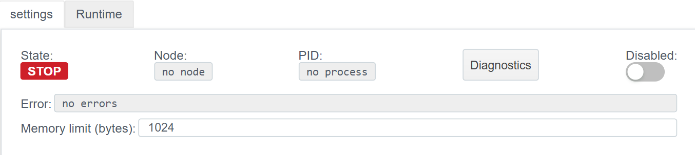
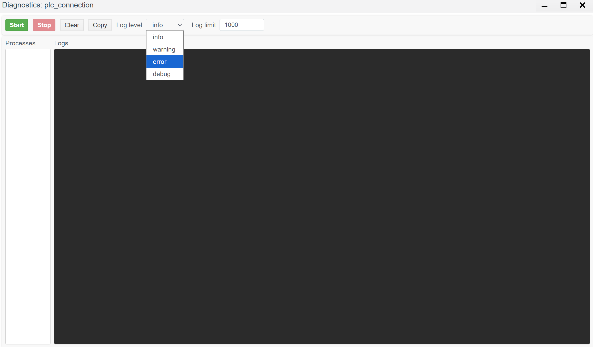

# Diagnostics

> See also: [PLC Connections overview](./general_en.md)

The diagnostics tool is used to troubleshoot connections, analyze errors, and view system messages in real time.

## Accessing diagnostics
After a connection is created and started (the driver status switches to **RUN**), the Diagnostics button becomes available in the control panel.

Clicking the button opens the **Diagnostics: plc_connection** window.

## Diagnostics window UI

The diagnostics window lets you monitor internal driver processes and filter the message stream.

### Controls

| Control | Description |
| --- | --- |
| **Start** | **Start monitoring.** Streams logs to the console in real time. |
| **Stop** | **Stop monitoring.** Pauses log updates so you can inspect messages. |
| **Clear** | Clears the console window. |
| **Copy** | Copies console contents to the clipboard (handy for bug reports). |
| **Log level** | **Log detail level.** Filters messages by severity (see below). |
| **Log limit** | Limits the number of lines kept in the buffer (default 1000). Older lines are dropped on overflow. |

### Display panes

1. **Processes (left):** A list of active Erlang processes serving this connection. Shows the internal driver process structure.
2. **Logs (right):** The main output pane for events (connect, packet exchange, timeouts, errors, and so on).

## Log levels

The selected level defines how much detail you see:

- **error:** Only critical errors that affect the connection (link down, port open failure, etc).
- **warning:** Warnings (non-critical failures, retries). Includes *error*.
- **info:** General operational messages (state changes, successful connect). Includes *warning* and *error*.
- **debug:** Maximum detail, including service info, raw bytes, and device replies. Use only during commissioning because it is verbose.
