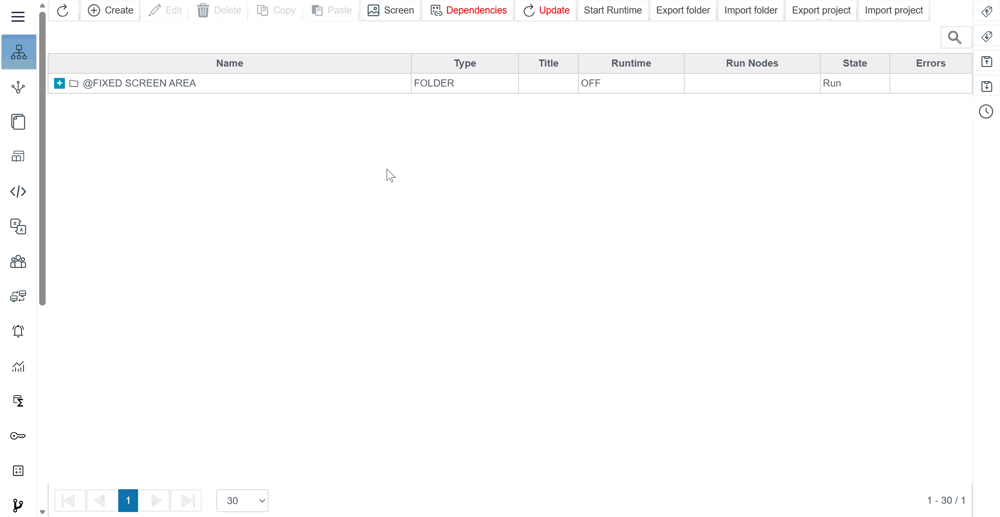

# PLC Connections

## Module purpose
The **PLC Connections** module is used to configure and manage connections between **Faceplate Runtime** and external automation devices/systems:

- **PLC/RTU/IED** (controllers, terminals, protection relays)
- **Meters and instruments** (power meters, heat meters, and so on)
- **OPC servers**
- Other industrial data sources via standard protocols

Through PLC connections the system can receive and/or send:

- **Tags/signals** (AI/DI/DO/AO)
- **Events and alarms**
- **Communication status**
- **Control commands** (if enabled by configuration)

PLC connections are used for:

1. **Telemetry acquisition** Reading sensor values, states, measurements.
2. **Command dispatch** Discrete control, setpoints, acknowledgements.
3. **Third-party integration** OPC DA/UA, gateways, SCADA systems, RTU concentrators.
4. **Availability monitoring** Link diagnostics, connection status, exchange statistics.

---

## Client and server connections

### Client connection

A **client connection** means **Faceplate initiates the connection** to a remote endpoint:

- Faceplate is the active side and opens the session
- the remote side accepts the connection and responds
- data exchange uses the selected protocol

**Examples:**
- IEC-104 Client -> connect to a protection relay/RTU server
- Modbus Client -> poll a device over TCP/RTU
- OPC UA Client -> read data from an OPC UA server

---

### Server connection

A **server connection** means **Faceplate listens for incoming connections**:

- an external device/system connects to Faceplate
- Faceplate serves incoming sessions and requests
- Faceplate publishes data or accepts commands

**Examples:**
- IEC-104 Server -> external information system connects to Faceplate
- OPC UA Server -> clients read values from Faceplate

---

## Supported PLC connection types

Below are the types available in the **/plc** folder.

### Client connections (supported)

- **plc_iec101_client_connection** -> [IEC-101 Client](./plc_iec101_client_connection_en.md)
- **plc_iec104_client_connection** -> [IEC-104 Client](./plc_iec104_client_connection_en.md)
- **plc_opcua_client_connection** -> [OPC UA Client](./plc_opcua_client_connection_en.md)

---

### Server connections (supported)

- **plc_iec101_server_connection** -> [IEC-101 Server](./plc_iec101_server_connection_en.md)
- **plc_iec104_server_connection** -> [IEC-104 Server](./plc_iec104_server_connection_en.md)
- **plc_opcua_server_connection** -> [OPC UA Server](./plc_opcua_server_connection_en.md)

---

### Other client connections

- **plc_ethernet_ip_connection** -> [EtherNet/IP](./plc_ethernet_ip_connection_en.md)
- **plc_mbus_connection** -> [M-Bus](./plc_mbus_connection_en.md)
- **plc_modbus_connection** -> [Modbus](./plc_modbus_connection_en.md)
- **plc_opcda_connection** -> [OPC DA](./plc_opcda_connection_en.md)
- **plc_s7_connection** -> [Siemens S7](./plc_s7_connection_en.md)
- **plc_snmp_connection** -> [SNMP](./plc_snmp_connection_en.md)

---

## Common connection settings

Common fields are identical for most connections. Some drivers may hide or ignore specific fields.

| Field | Purpose |
| :--- | :--- |
| **Name** | System connection name (unique identifier). |
| **Title** | Human-readable title. |
| **State** | Object state (**STOP** / **RUN**). |
| **Period (ms)** | Base processing/polling cycle. |
| **Shutdown timeout (ms)** | Time to wait for a clean shutdown. |
| **Disabled** | Enable/disable the connection without deleting it. |
| **Memory limit (bytes)** | Memory limit for the connection process. |
| **Actual connection** | Current active connection (used in redundancy). If no redundant connection is configured, points to itself. |
| **Master connection** | Reference to the primary channel in redundancy mode. |
| **Support for group requests** | Enables group requests (if supported by the protocol). |
| **Max. package length** | Packet size limit (if used by the driver). |
| **Line Delay Ratio** | Line delay ratio (if used by the driver). |

> **Note:** **Support for group requests**, **Max. package length**, and **Line Delay Ratio** are not used by some connection types. In such cases keep the defaults.

---

## Create a PLC connection

> The steps are identical for all PLC connections.

*Step 1.* In the project tree, select the directory where the PLC connection will be created.  
*Step 2.* Click **Create**.  
*Step 3.* In the object tree, open **plc**.  
*Step 4.* Make sure the list of available connection types is shown.  
  
*Step 5.* Select the required connection type.  
*Step 6.* Click **OK**.  
  
*Step 7.* The connection configuration window opens.  

> Connection-specific parameters depend on the protocol type:
- [IEC-101 Client](./plc_iec101_client_connection_en.md#1-connection-setup-connection)
- [IEC-104 Client](./plc_iec104_client_connection_en.md#1-connection-setup-connection)
- [IEC-101 Server](./plc_iec101_server_connection_en.md#1-connection-setup-connection)
- [IEC-104 Server](./plc_iec104_server_connection_en.md#1-connection-setup-connection)
- [OPC UA Client](./plc_opcua_client_connection_en.md#1-connection-setup-connection)
- [OPC UA Server](./plc_opcua_server_connection_en.md#1-connection-setup-connection)
- [Modbus](./plc_modbus_connection_en.md#1-connection-setup-connection)
- [EtherNet/IP](./plc_ethernet_ip_connection_en.md#1-connection-setup-connection)
- [M-Bus](./plc_mbus_connection_en.md#1-connection-setup-connection)
- [OPC DA](./plc_opcda_connection_en.md#1-connection-setup-connection)
- [Siemens S7](./plc_s7_connection_en.md#1-connection-setup-connection)
- [SNMP](./plc_snmp_connection_en.md#1-connection-setup-connection)

*Step 8.* After configuration, click **Save**.

---

## Common PLC binding fields

Common fields are identical for most bindings. The specific fields (address, data type, etc) depend on the protocol and are described in the relevant section.

| Field | Purpose |
| :--- | :--- |
| **Name** | Binding name in the project tree. |
| **Title** | Human-readable title. |
| **State** | Binding state (**STOP** / **RUN**). |
| **Off** | Enable/disable the binding without deleting it. |
| **Tag** | Link to a system tag (optional). If no tag is selected, the value stays in the binding `value` field. You can choose the target field next to the tag path. |
| **Transformation** | Value transformation before read/write. See [Transformation](./transformation_en.md). |
| **Access** | Access mode: **R** (read), **W** (write), **RW** (read/write). |

### Tag binding

Tag binding is **optional**. If no tag is selected, the value stays in the binding `value` field.

**Step 1:** Click the magnifier icon in **Tag**.  
> A project tree window opens. You can select an object manually or use search.

**Step 2:** Select the object to read from or write to.  
> Click the object, then click **OK** in the lower-right corner.

**Step 3:** After selecting the object, the field dropdown (right of the object path) becomes active.  
> Select the target field.

**Result:**  
The **Tag** field shows the full object path and the selected field.

### Binding errors

After you create bindings, each binding shows an **Errors** field in the project tree.

If there are no errors, the field is empty. Possible values:

| Error | Description |
| :--- | :--- |
| `unavailable address "<address>"` | The specified address is not available on the device. |
| `shutdown` | The connection has been stopped. |
| `no connection` | No connection to the device. |

---

## Create a PLC binding

> The steps are identical for all PLC connections.

*Step 1.* After a PLC connection is created, double-click it to open the connection settings window.  
*Step 2.* Click **Create**.  
  
*Step 3.* The PLC binding configuration window opens.  

> Binding-specific parameters depend on the connection type:
- [IEC-101 Client](./plc_iec101_client_connection_en.md#2-binding-setup-binding)
- [IEC-104 Client](./plc_iec104_client_connection_en.md#2-binding-setup-binding)
- [IEC-101 Server](./plc_iec101_server_connection_en.md#2-binding-setup-binding)
- [IEC-104 Server](./plc_iec104_server_connection_en.md#2-binding-setup-binding)
- [OPC UA Client](./plc_opcua_client_connection_en.md#2-binding-setup-binding)
- [OPC UA Server](./plc_opcua_server_connection_en.md#2-binding-setup-binding)
- [Modbus](./plc_modbus_connection_en.md#2-binding-setup-binding)
- [EtherNet/IP](./plc_ethernet_ip_connection_en.md#2-binding-setup-binding)
- [M-Bus](./plc_mbus_connection_en.md#2-binding-setup-binding)
- [OPC DA](./plc_opcda_connection_en.md#2-binding-setup-binding)
- [Siemens S7](./plc_s7_connection_en.md#2-binding-setup-binding)
- [SNMP](./plc_snmp_connection_en.md#2-binding-setup-binding)

*Step 4.* After configuration, click **Save**.

---

## Data transformation

Value conversion for PLC bindings uses the transformation engine. It lets you apply formulas, mapping, and other conversions during data exchange.

See [Transformation](./transformation_en.md) for details.

---

## Diagnostics

Each PLC connection provides a diagnostics tool for debug mode. It lets you analyze errors in real time, view logs, and monitor connection status.

See [PLC connection diagnostics](./diagnostics_en.md).