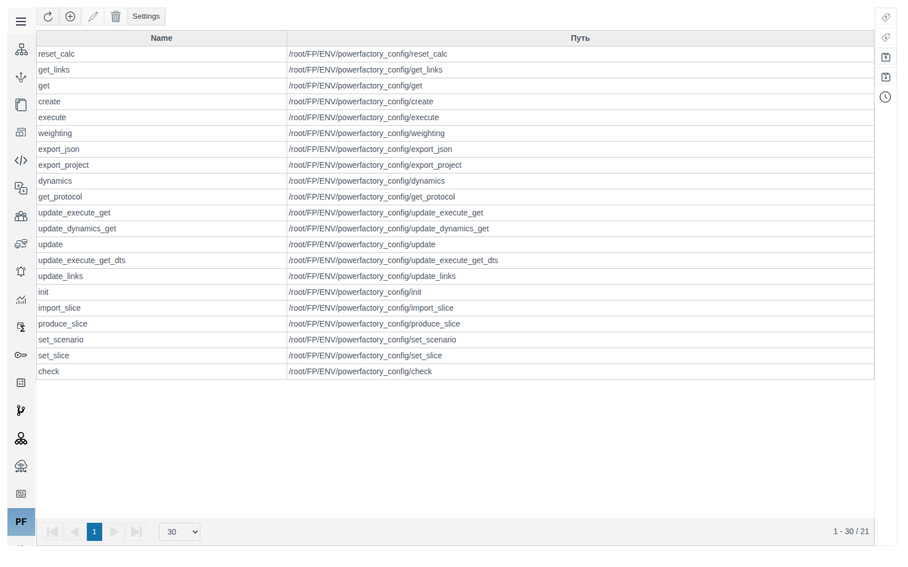
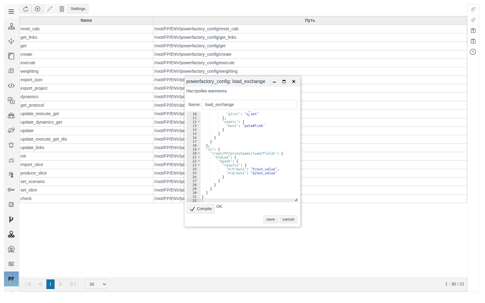
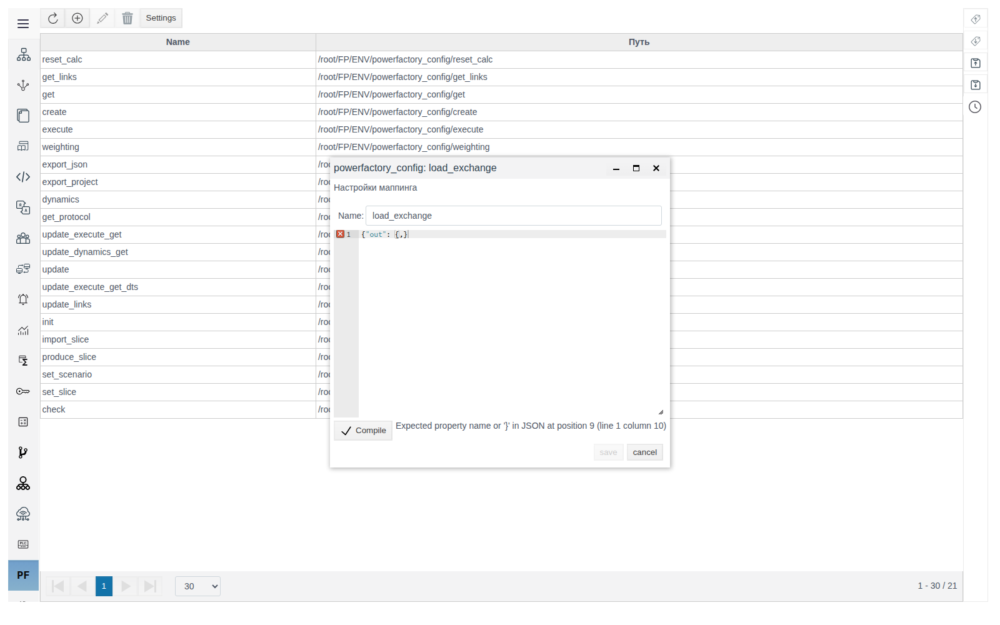
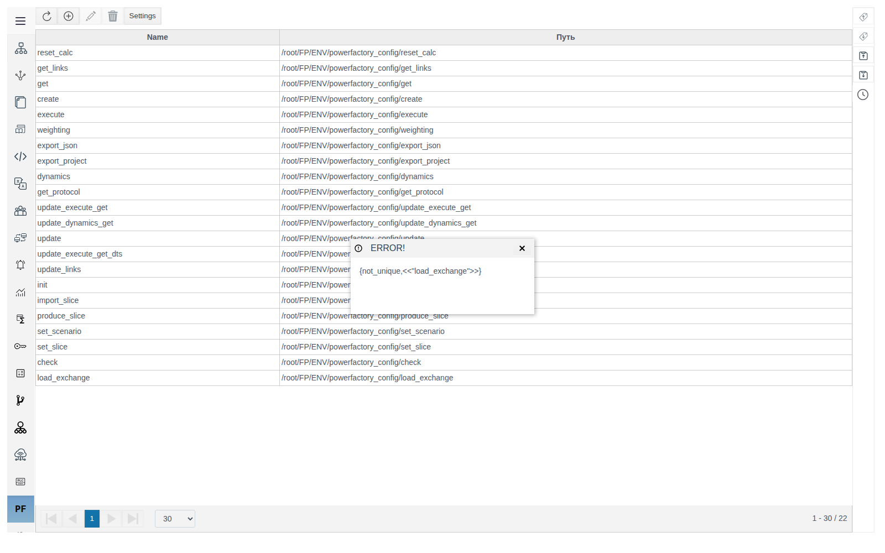
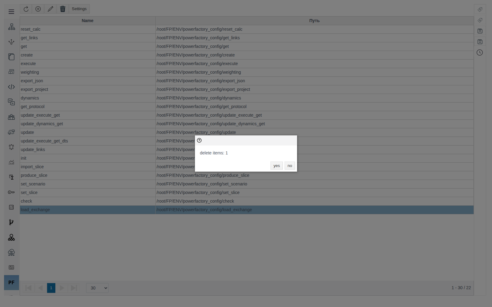

# Powerfactory Service

A document for integration engineers who set up data exchange between a Faceplate project and an external DIgSILENT PowerFactory calculation service. Checked on FACEPLATE Studio 4.0.7.

# Glossary

| Term | Meaning |
|---|---|
| Powerfactory Service | A Studio main menu section (**PF** icon): mappings and settings for the PowerFactory integration |
| Mapping | A named JSON that defines which fields of Faceplate objects are sent to PowerFactory and which fields receive the returned values |
| PowerFactory host | The address of the external PowerFactory service as `host[:port]`. Without a port, 80 is used |
| Modeling node | A Faceplate cluster node on which modeling sessions are allowed |
| Slice | A JSON snapshot of the network state. Slice files are stored in a folder on the Faceplate server |
| DTS | Dispatcher Training Simulator mode. Uses a separate PowerFactory host |
| Path conversion | Rules that turn a Faceplate object path into a PowerFactory object path and back |

# Introduction

Powerfactory Service links Faceplate project objects to the network model in PowerFactory. The section has two parts:

| Part | Where | What it defines |
|---|---|---|
| Mappings | The section table | Which fields of which objects take part in the exchange and which PowerFactory attributes they map to |
| Settings | The **Settings** button | Where to connect, where modeling is allowed, which mapping each operation uses, how paths are converted |

Running example: the `load_exchange` mapping for loads. A load in the project is an instance of the `load` [prototype](../prototypes/prototypes.md) with fields `p_set`, `q_set`, `pf_outserv`, a link `pole` to its node, and child objects `P` and `Q`. In PowerFactory it corresponds to the `ElmLod` class.

You need access to Studio (`http://<server>:9000/fp/studio`) with the right to change the project, and knowledge of the PowerFactory network model: element classes and their attribute names.

# Main part

## Mappings section

Open **Powerfactory Service** in the Studio main menu. The table shows each mapping's **Name** and its path in the project (the column header is **Путь** in 4.0.7).



Toolbar buttons from left to right: refresh, create, edit, delete, **Settings**. Edit and delete become available once a row is selected. Double-clicking a row also opens the mapping.

## Creating a mapping

1. Click the create button. A window titled **Настройки маппинга** (mapping settings) opens.
2. Enter `load_exchange` in the **Name** field. This is the name you refer to in **Settings**.
3. Write the mapping JSON in the editor (the format is described in [Mapping structure](#mapping-structure)).
4. Click **Compile**. `OK` appears next to it and the **save** button becomes available.
5. Save.



> **Important.** The editor accepts text only through the **Compile** button. For a new mapping, **save** stays unavailable until you click **Compile**. For an existing mapping, **save** is enabled by a change to **Name** alone; if the editor still holds uncompiled text, the previous JSON is saved without any warning. Always click **Compile** and wait for `OK` before saving.

### Errors

| What you see | Cause | What to do |
|---|---|---|
| A red cross on an editor line and an error message next to **Compile**, for example `Expected property name or '}' in JSON at position 9 (line 1 column 10)` | The text is not valid JSON | Fix the indicated line and click **Compile** again |
| An **ERROR!** window with `{not_unique,<<"name">>}` | A mapping with this name already exists | Choose a different **Name** |





## Editing and deleting

Open a mapping by double-clicking it, make your changes, click **Compile**, and save. Renaming is done in the same window, in the **Name** field. After renaming, replace the old name in **Settings** if it is used there.

To delete, select one or more rows and click the delete button. The confirmation window shows only the number of rows (`delete items: 1`), not their names. Confirm with **yes**.



## Mapping structure

The complete `load_exchange` mapping:

```json
{
  "links": [],
  "out": {
    "/root/FP/prototypes/load/fields": {
      "ElmLod": {
        "$path": {
          "params": {
            "outserv": "pf_outserv",
            "plini": "p_set",
            "qlini": "q_set"
          },
          "static": {
            "bus1": "pole#link"
          }
        }
      }
    }
  },
  "in": {
    "/root/FP/prototypes/load/fields": {
      "ElmLod": {
        "$path": {
          "results": {
            "m:P:bus1": "P/out_value",
            "m:Q:bus1": "Q/out_value"
          }
        }
      }
    }
  }
}
```

The load setpoints and its connection node are sent to PowerFactory. The calculated P and Q are written to `out_value` of the child objects `P` and `Q` of each load.

### Top-level sections

| Key | Purpose |
|---|---|
| `out` | What is sent to PowerFactory. A prototype rule applies only to instances whose `pf_active` field is `true` |
| `out_all` | Same as `out`, but for all instances of the prototype regardless of `pf_active`. If the prototype is also described in `out`, the `out_all` rule does not apply to it |
| `in` | Where values received from PowerFactory are written |
| `links` | Names of other mappings. Their rules are added to the current one, so shared parts are not duplicated |

All sections are optional: a mapping that only reads results can consist of `in` alone.

### Levels inside a section

| Level | In the example | Meaning |
|---|---|---|
| Key | `/root/FP/prototypes/load/fields` | Prototype fields: a rule for all its instances. A key starting with `/root/FP/PROJECT` or `/root/FP/catalogs/<catalog>/content/` defines a rule for one specific object |
| PowerFactory class | `ElmLod` | Element class in the PowerFactory model. Specify one class per key |
| `$path` | — | Replaced with the object's PowerFactory path using the path conversion rules from **Settings** |
| Group | `params`, `results`, `static` | Attribute group in the exchange with PowerFactory |
| Pair | `"plini": "p_set"` | PowerFactory attribute on the left, Faceplate field on the right |

### Faceplate field notation

Format of the right-hand side of a pair: `[link-field:][child object/]field[#type]`.

| Notation | Where the value is taken from or written to |
|---|---|
| `p_set` | Field `p_set` of the object itself |
| `P/out_value` | Field `out_value` of the child object `P` |
| `pole:P/out_value` | The object referenced by the `pole` field; its child `P`, field `out_value` |
| `pole#link` | Field `pole` of link type: the object's path is sent, converted to a PowerFactory path |

Types after `#`: `link`, `int`, `float`, `json`, `string`.

## Service settings

Click **Settings**. The window opens full screen.


### Connection and modeling

| Field | Default | Purpose |
|---|---|---|
| **pf_modeling_hosts** | empty | PowerFactory hosts for modeling sessions, `host[:port]`. Sessions are distributed across hosts |
| **pf_dts_host** | empty | PowerFactory host for DTS mode, `host[:port]` |
| **modeling_nodes** | empty | Modeling nodes as `node[:N]`, for example `fp@srv1:4`. `N` is the maximum number of concurrent sessions on the node; without `N` there is no limit. A modeling session will not open on a node that is not in the list |
| **modeling_project_params** | `{"Grid": "Grid"}` | PowerFactory project parameters sent in modeling session requests |

### Operation mappings

Each field takes the **Name** of a mapping from the section table. The service looks up the mapping by exact name match.

| Field | Default | When it is used |
|---|---|---|
| **modeling_init_mapping** | `init` | Starting a modeling session: which project data to load into the session |
| **modeling_apply_mapping** | `update_execute_get` | Calculation in a session: what to send to PowerFactory and where to write the result |
| **modeling_apply_mapping_dynamic** | `update_execute_get_dynamic` | Dynamic calculation |
| **current_slice_mapping** | `produce_slice` | Loading a slice from a file in **slices_folder** into project objects |
| **archive_slice_mapping** | `produce_slice_archive` | Not used by the server in 4.0.7 |

To make an operation use the example mapping, enter `load_exchange` in the corresponding field and save.

### Slices and paths

| Field | Default | Purpose |
|---|---|---|
| **slices_folder** | empty | Absolute path to the slice folder on the Faceplate server, for example `/opt/faceplate/slices`. Required |
| **fp2pf_path_mapping** | rules for `/root/FP/PROJECT` and equipment type catalogs | Converting Faceplate paths to PowerFactory paths |
| **pf2fp_path_mapping** | rules for `Grid` and `Equipment Type Library` | Reverse conversion |

### Working with the form

- In list fields (**modeling_nodes**, **pf_modeling_hosts**), an empty row for the next value appears after you enter one. The arrows change the order, the bin deletes a row.
- While **slices_folder** is empty, **save** stays unavailable regardless of other changes. Fill in the slice folder during the first setup.
- The JSON fields at the bottom of the form accept a change only through the **Compile** button under the field. Without **Compile**, the previous value of that field is saved.


### Path conversion

Each rule in **fp2pf_path_mapping** and **pf2fp_path_mapping** is a "regular expression — replacement" pair. Named groups `(?<NAME>…)` are substituted into the replacement as `<NAME>`. Rules are applied to a path one after another.

The rule:

```json
"^/root/FP/PROJECT/(?<COUNTRY>[\\w-_]*)/(?<REGION>[\\w-_]*)/@lines/": "Grid\\\\<COUNTRY>\\\\<REGION>\\\\@lines\\\\"
```

converts `/root/FP/PROJECT/KAZ/SEVER/@lines/L1` to `Grid\KAZ\SEVER\@lines\L1`.

The rules must reflect the project folder structure. If an object's converted path does not match its path in the PowerFactory model, its data does not take part in the exchange.

## Interface notes for 4.0.7

| On screen | Where |
|---|---|
| Untranslated buttons **save**, **cancel**, **Compile**, **yes**, **no** | Mapping, settings and confirmation windows |
| The caption `delete items: N` | Delete confirmation |
| Server errors shown as `{not_unique,<<"name">>}` | **ERROR!** window |
| Russian captions **Путь** (path), **Настройки маппинга** (mapping settings), **Настройки powerfactory_service** (service settings) in the English interface | Mappings table, mapping window, settings window |
| The long field name **modeling_apply_mapping_dynamic** is truncated | Settings window |
| The row counter below the table does not update right after a deletion | Mappings table |

# Conclusion

Integration setup order:

1. In **Settings**, specify **pf_modeling_hosts** and, if needed, **pf_dts_host**.
2. List in **modeling_nodes** the Faceplate nodes where modeling is allowed, with a session limit.
3. Fill in **slices_folder**: settings cannot be saved without it.
4. Describe in **fp2pf_path_mapping** and **pf2fp_path_mapping** how the project structure corresponds to the PowerFactory model.
5. Write the mappings: for each prototype, specify the PowerFactory class and the "attribute — field" pairs in `out` and `in`. Move shared parts into a separate mapping and include it through `links`.
6. Enter the mapping names in the operation fields.
7. Before every JSON save, click **Compile** and wait for `OK`.
