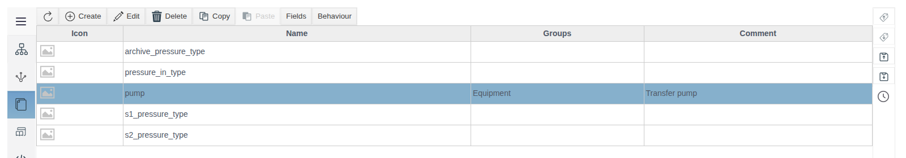
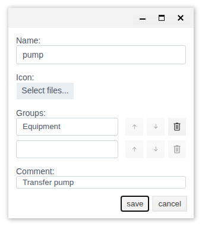
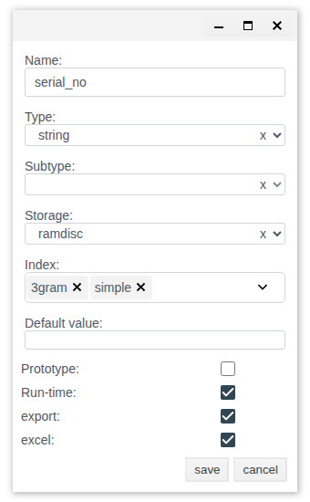
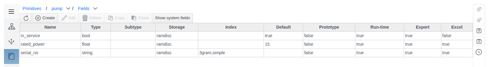
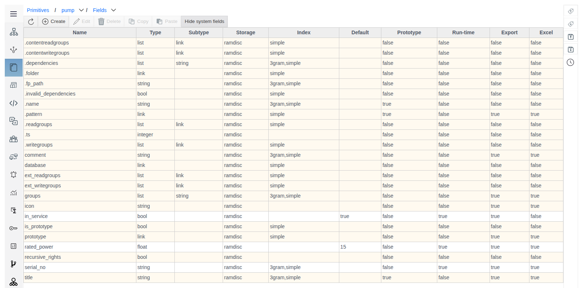
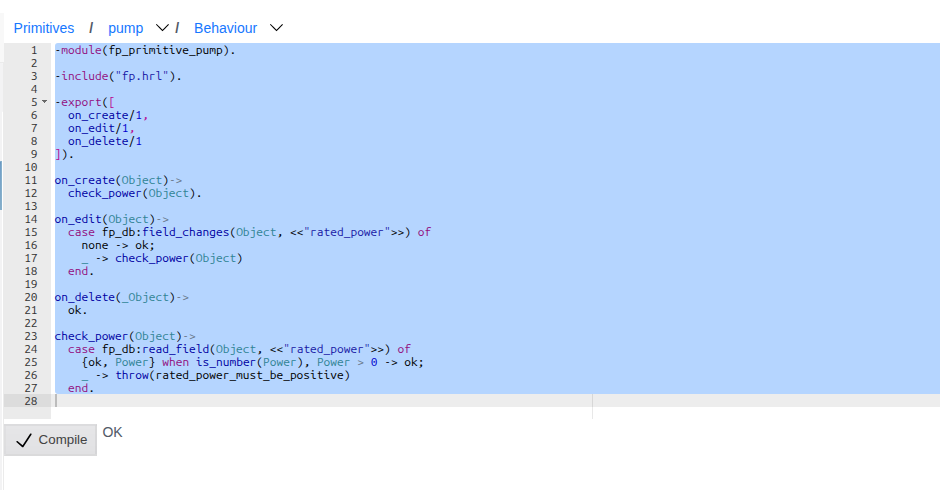
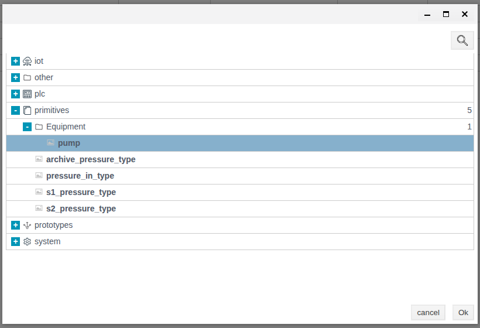
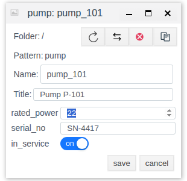
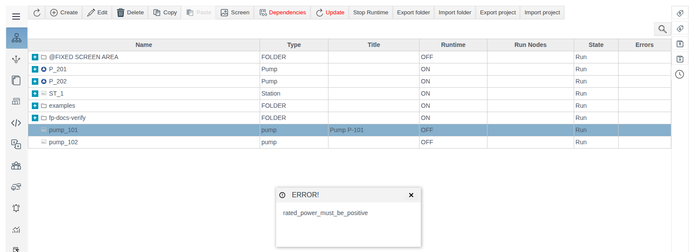

# Primitives

A document for integration engineers. Checked on FACEPLATE Studio 4.0.7.

# Glossary

| Term | Meaning |
|---|---|
| Primitive | A user-defined project object type: a set of fields plus behaviour. Created in the **Primitives** section. |
| Instance | An object in the General View created from a primitive. Its **Type** column shows the primitive name. |
| General View | The Studio section with the tree of project objects. |
| Field | An instance attribute: name, type, storage, indexes, default value. |
| System field | A field that every project object has. Shown with **Show system fields**; not editable. |
| Run-time field | A field with the **Run-time** flag. Shown in the instance form. |
| Group | The folder of a primitive in the type selection dialog (`primitives / <group>`). |
| Behaviour | An Erlang module with the functions `on_create/1`, `on_edit/1`, `on_delete/1`. The server calls them on instance operations. |
| Prototype | A template from the **Prototypes** section. The field's **Prototype** flag enables copying its value when a prototype is synchronized. |

# Introduction

A **primitive** is a user-defined project object type. The integrator gives it a set of fields and, if needed, server-side logic (behaviour) in Erlang. Once saved, the primitive appears in the type selection dialog when an object is created in the **General View**, and instances are created from it — for example, all pumps of a station with the same set of attributes and the same value check.

The section is in the Studio main menu: **Primitives** (below **Prototypes**). Each primitive has two tabs:

* **Fields** — the composition and settings of instance fields;
* **Behaviour** — code the server runs when an instance is created, edited, or deleted.

The example used throughout this document is the primitive `pump` with fields for rated power, serial number, and an "in service" flag, plus a check that the power is greater than zero.

You need access to Studio (`http://<server>:9000/fp/studio`) with an account that is allowed to modify the project.

# Main Part

## Primitive List



The table shows each primitive's **Icon**, **Name**, **Groups**, and **Comment**. Toolbar: **Create**, **Edit**, **Delete**, **Copy**, **Paste**, **Fields**, **Behaviour**. **Fields** and **Behaviour** are available when exactly one primitive is selected. Double-clicking a row opens the **Fields** tab.

Inside a primitive, the navigation bar at the top reads `Primitives / pump / Fields`. Its drop-down lists switch to another primitive or to the **Behaviour** tab without returning to the list.

## Creating a Primitive

Click **Create**, fill in the form, then click **save**.



| Field | Purpose |
|---|---|
| **Name** | Primitive name. It becomes the instance type (the **Type** column in the General View) and part of the behaviour module name. Required. |
| **Icon** | An `.svg`, `.png`, `.jpg`, or `.jpeg` image (**Select files...** button). Shown in the list and in the type selection dialog. Without an icon a placeholder is shown. |
| **Groups** | The folder the primitive is placed in within the type selection dialog (`primitives / <group>`). Filling a row adds a new empty row. The ↑ ↓ buttons change the order; the trash button removes a row. |
| **Comment** | Free text for the primitive list. |

Example: **Name** — `pump`, **Groups** — `Equipment`, **Comment** — `Transfer pump`.

## Fields

Select a primitive and click **Fields**. For a new primitive the list is empty: only own fields are shown, inherited ones are hidden.

### Creating a Field

Click **Create**, fill in the form, and click **save**. **save** becomes available once **Name** and **Type** are filled in.



| Setting | Values | Purpose and limits |
|---|---|---|
| **Name** | text | Field name. Must not start with a digit. |
| **Type** | `string`, `integer`, `float`, `bool`, `link`, `atom`, `term`, `list` | Value type. Required. |
| **Subtype** | `string`, `integer`, `float`, `bool`, `link`, `atom`, `term` | Element type of a list. Available and required only when **Type** = `list`. |
| **Storage** | `disc`, `ramdisc`, `ram` | Where the value is stored. Default: `ramdisc`. |
| **Index** | see below | Indexes for searching and filtering by the field. Several can be selected. |
| **Default value** | text | Pre-filled in the form of a new instance. |
| **Prototype** | check box | The field value is copied when a prototype is synchronized with its copies. Needed if the primitive instance is placed inside a prototype. |
| **Run-time** | check box | The field is shown in the instance create/edit form in the General View. Without the flag the field is not shown in the form. |
| **export** | check box | The field is included in folder or project export. |
| **excel** | check box | The field takes part in `.xlsx` export and import. |

Available indexes depend on the type:

| Type | Available indexes |
|---|---|
| `string`, `list` with subtype `string` | `simple`, `3gram` |
| `integer` | `simple`, `datetime` |
| `float` | none: **Index** is unavailable |
| others | `simple` |

Fields of the example:

| Name | Type | Index | Default | Run-time | export | excel |
|---|---|---|---|---|---|---|
| `rated_power` | `float` | — | `15` | ✓ | ✓ | ✓ |
| `serial_no` | `string` | `simple`, `3gram` | — | ✓ | ✓ | ✓ |
| `in_service` | `bool` | — | `true` | ✓ | ✓ | — |



The type changes as soon as the field is saved; no restart is needed.

### System Fields

**Show system fields** (clicking again shows **Hide system fields**) adds the fields every project object has: `.name`, `.folder`, `.pattern`, `title`, `comment`, `groups`, `icon`, `prototype`, and others. System field rows are highlighted. Their settings cannot be changed.



## Behaviour

Behaviour is an Erlang module the server calls on instance operations. The module runs inside a transaction:

| Function | Called when |
|---|---|
| `on_create/1` | an instance is created |
| `on_edit/1` | instance fields are edited |
| `on_delete/1` | an instance is deleted |

Each function receives the instance object and must return `ok` on success. If a function throws or crashes, the transaction is rolled back: the object is not created, changed, or deleted, and Studio shows an **ERROR!** window with the exception text.

### Writing and Saving

Select a primitive and click **Behaviour**. For a new primitive the editor contains a template: a module named `fp_primitive_<primitive name>` with three functions that return `ok`. Do not change the module name in the first line.

To save:

1. Write the code.
2. Click **Compile** and wait for `OK` to the right of the button.
3. Click **save**.

> **Important.** The form takes the editor text only when **Compile** is clicked. If you click **save** without **Compile**, the previous version of the code is saved.

After **save** the server immediately compiles and attaches the module. The new behaviour applies to subsequent instance operations.

Example for `pump`: check that the rated power is greater than zero. When an instance is edited, the check runs only if `rated_power` changed.

```erlang
-module(fp_primitive_pump).

-include("fp.hrl").

-export([
  on_create/1,
  on_edit/1,
  on_delete/1
]).

on_create(Object)->
  check_power(Object).

on_edit(Object)->
  case fp_db:field_changes(Object, <<"rated_power">>) of
    none -> ok;
    _ -> check_power(Object)
  end.

on_delete(_Object)->
  ok.

check_power(Object)->
  case fp_db:read_field(Object, <<"rated_power">>) of
    {ok, Power} when is_number(Power), Power > 0 -> ok;
    _ -> throw(rated_power_must_be_positive)
  end.
```



Functions used in the example:

| Call | Result |
|---|---|
| `fp_db:read_field(Object, <<"field">>)` | `{ok, Value}` |
| `fp_db:field_changes(Object, <<"field">>)` | `none` if the field did not change in this operation |
| `throw(Reason)` | rolls back the operation; `Reason` is shown in the **ERROR!** window |

For diagnostics without a rollback, use the macros `?LOGWARNING(Format, Args)` and `?LOGERROR(Format, Args)`: they write to the server log.

### Compilation Errors

If the code has an error, its description with the line number and position is shown to the right of **Compile**, for example `[{29,7},erl_parse,["syntax error before: ",[]]]`.


> **Warning.** After a compilation error **save** stays available. Save the code only after the `OK` response.

## Instances in the General View

Open the **General View**, go to the target folder, and click **Create**. In the type selection dialog expand **primitives** and the primitive's group, select the primitive, and click **Ok**.



The instance form contains **Name** and **Title**, followed by the primitive's fields with the **Run-time** flag, already filled with default values. The input control depends on the field type: a text box for `string`, a numeric box for `integer` and `float`, an **on/off** switch for `bool`, a list of rows for `list`, an object picker for `link`.



The instance appears in the current folder. The **Type** column shows the primitive name, the **Title** column shows the **Title**.

Checking the example behaviour:

| Action | Result |
|---|---|
| Create `pump_101` with `rated_power` = `22` | the instance is created |
| Create an instance with `rated_power` = `0` | an **ERROR!** window with `rated_power_must_be_positive`; the instance is not created |
| Change `rated_power` of `pump_101` to `-1` | an **ERROR!** window; the value is not saved |



## Editing and Deleting a Primitive

**Edit** opens the same form as **Create**. Fields and behaviour are changed on their tabs.

> **Warning.** **Delete** removes the primitive together with **all its instances** in the project. The confirmation (`delete items: N`, buttons **yes** / **no**) shows only the number of primitives being deleted, not instances. Before deleting, find the instances by the **Type** column in the General View.

# Conclusion

Working with a primitive:

1. **Primitives → Create**: name, group, icon.
2. **Fields**: add fields. Set **Run-time** for fields filled in the instance form, and **export** and **excel** for fields needed in export and `.xlsx`.
3. **Behaviour**, if logic is needed: write the code, click **Compile**, wait for `OK`, then click **save**.
4. **General View → Create → primitives**: create instances.

Deleting a primitive deletes all its instances.
