# JS Libraries

This document is for integration engineers who move shared JavaScript code into a separate project object and include it from user scripts.

# Contents

- [Glossary](#glossary)
- [Introduction](#introduction)
- [Main part](#main-part)
    - [Creating a library](#creating-a-library)
    - [Library code](#library-code)
    - [Compile and save](#compile-and-save)
    - [Including a library in a script](#including-a-library-in-a-script)
    - [A library that uses another library](#a-library-that-uses-another-library)
    - [Changing a library](#changing-a-library)
    - [Wrong path](#wrong-path)
- [Conclusion](#conclusion)

# Glossary

| Term | Meaning |
|---|---|
| JS library | A project object of type `js_library`. It holds JavaScript code whose result a script gets by calling `require` |
| `require` | A function available in JavaScript code. Given an object path, it returns the result of the JS library's code |

# Introduction

A JS library is shared JavaScript code for the whole project: functions, constants, lookup tables needed in more than one script. The code is written once in a `js_library` object, and scripts get it with `await require('/folder/name')`.

A library is an ordinary object in a project folder in **General View**. A library does not run on its own: a script runs its code when it calls `require`.

This document shows how to create a library and include it using one example throughout. In the example, several scripts need to convert temperature from Celsius to Fahrenheit, so the conversion function is moved into library `js_units`. Script `js_lib_demo` includes this library and writes the result to a tag. Then a second library, `js_limits`, is created on top of `js_units`. The end of the document shows how to change a library and what you see if the path to it is wrong.

All example objects are in folder `js_demo`:

| Object | Type | Purpose |
|---|---|---|
| `js_in`, `js_out` | primitive with a `float` field `value` | Example input and output. Created beforehand |
| `js_units` | `js_library` | Functions `c_to_f` (Celsius to Fahrenheit) and `clamp` (clamp to a range) |
| `js_lib_demo` | `user_script` | Reads `js_in`, writes the result of `c_to_f` to `js_out` |
| `js_limits` | `js_library` | Function `f_limited`, which uses `js_units` |

Creating a primitive is covered in [Primitives](../../project_objects/primitives/primitives.md), a user script in [User Scripts](../user_script/user_script.md).

You need access to Studio (`http://<server>:9000/fp/studio`) with an account allowed to modify the project.

# Main part

## Creating a library

The first library of the example is `js_units`.

1. Open **General View** in the Studio main menu.

   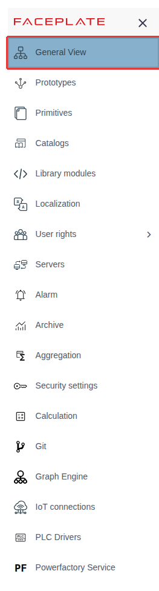

2. Enter folder `js_demo` with a double click and click **Create**.

   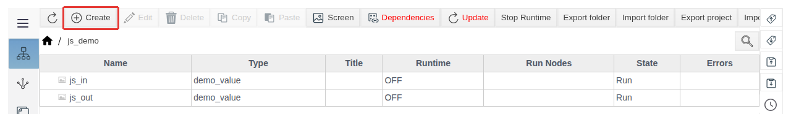

3. Expand **system**, select **js_library**, click **Ok**.

   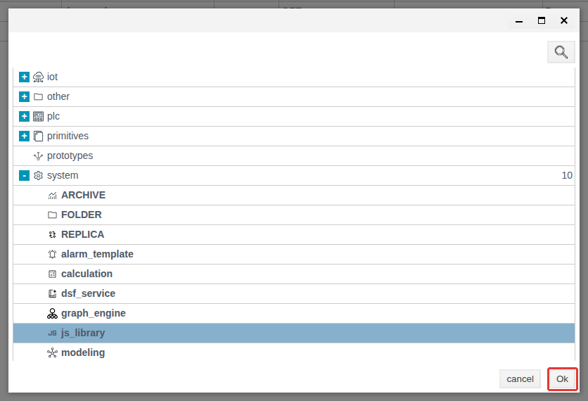

4. The new library form opens. In **Name** enter `js_units`.

   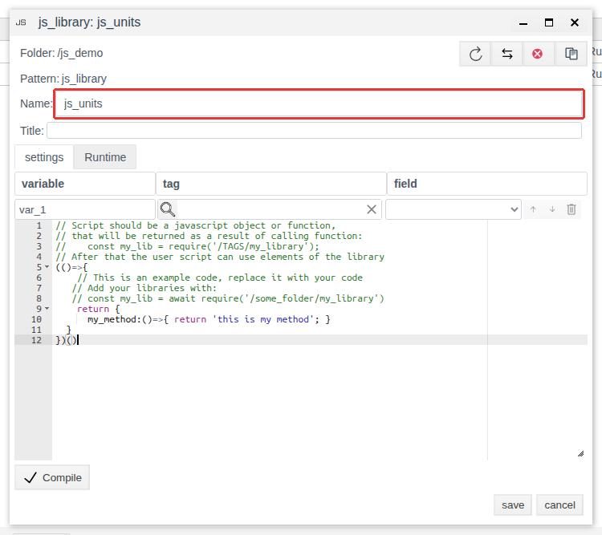

The form editor contains template code. Replace it with the library code.

## Library code

Library code is a single JavaScript expression. Its value is what `require` returns. The most convenient form, as in the template, is a function that is called immediately and returns an object with functions. Replace the template with the `js_units` code:

```javascript
(() => {
    const K = 9 / 5;
    return {
        c_to_f: (c) => { return c * K + 32; },
        clamp: (v, min, max) => { return Math.min(Math.max(v, min), max); }
    };
})()
```

The first `return` returns the library object, the `return` inside each function returns its result. Constant `K` is visible only inside the library; the script will get `c_to_f` and `clamp`.

The value of a library can also be an object itself, for example `({ k: 1.8 })`, or a function, for example `(x) => x * 2`. Then `require` returns that object or that function.

The **variable / tag / field** table above the editor is not used in a library: there is no `VARS` variable in library code. A library gets tag values from the script through the parameters of its functions, like `c` in `c_to_f`. The **Runtime** tab is empty.

## Compile and save

The code is in place; now check it. Click **Compile**: `OK` appears next to the button.

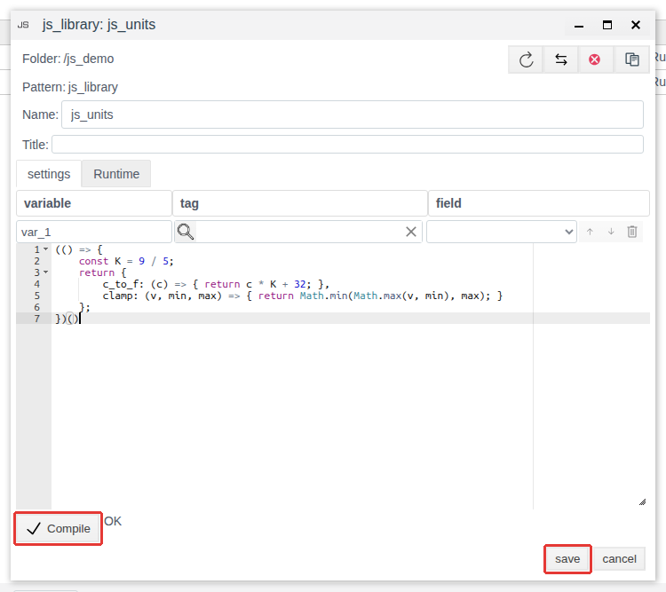

If the code has an error, its text appears instead of `OK`, for example `SyntaxError: Unexpected end of input` for an unclosed bracket. Fix the code and click **Compile** again.

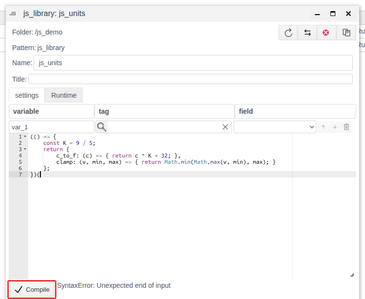

After `OK`, click **save**. The order is always the same: **Compile** → `OK` → **save**.

Library `js_units` is saved, but it does nothing on its own until a script includes it.

## Including a library in a script

Let us include `js_units` in script `js_lib_demo`. The script takes the temperature from `js_in`, converts it with `c_to_f` and writes it to `js_out`.

In folder `js_demo`, create user script `js_lib_demo`. On the **javascript** tab, set variable `t`: tag `/js_demo/js_in`, field `value`. Turn on **Execute on changing variables values** and enter the code:

```javascript
async function(VARS, State) {
    const units = await require('/js_demo/js_units');
    await fp.api.set_value('/root/FP/PROJECT/js_demo/js_out', 'value', units.c_to_f(VARS.t));
    return { state: State };
}
```

`await require('/js_demo/js_units')` returns the library object, and its functions are called as `units.c_to_f(...)`. The path in `require` starts at the project root, as in **General View**. `fp.api.set_value(path, field, value)` writes a value to an object field; the path here is the full one, with the `/root/FP/PROJECT` prefix.

Click **Compile**, wait for `OK` and save.

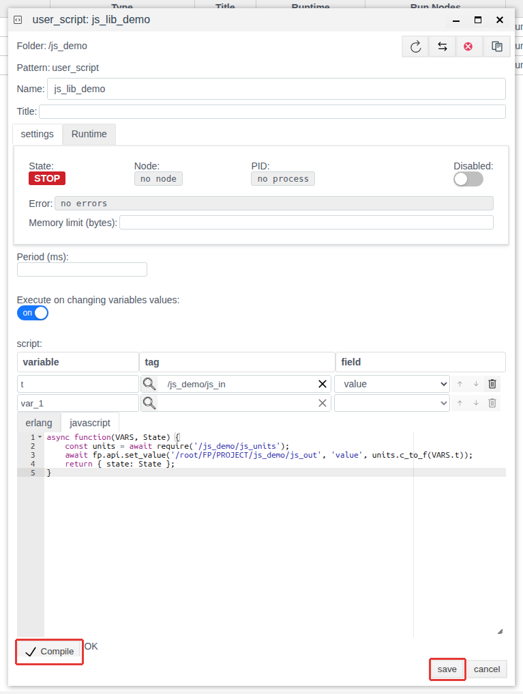

Now, with `js_in` = `25`, the script writes `77` to `js_out`.

## A library that uses another library

The functions of `js_units` can be included not only in scripts but also in other libraries. Let us add library `js_limits` to the example: it converts the temperature with `c_to_f` and clamps the result to the range from `-40` to `212` with `clamp`.

Create `js_limits` the same way as `js_units`, with the code:

```javascript
(async () => {
    const units = await require('/js_demo/js_units');
    return {
        f_limited: (c) => { return units.clamp(units.c_to_f(c), -40, 212); }
    };
})()
```

The function that calls `require` is declared `async`: inside a library `require` is called with `await`, just as in a script.

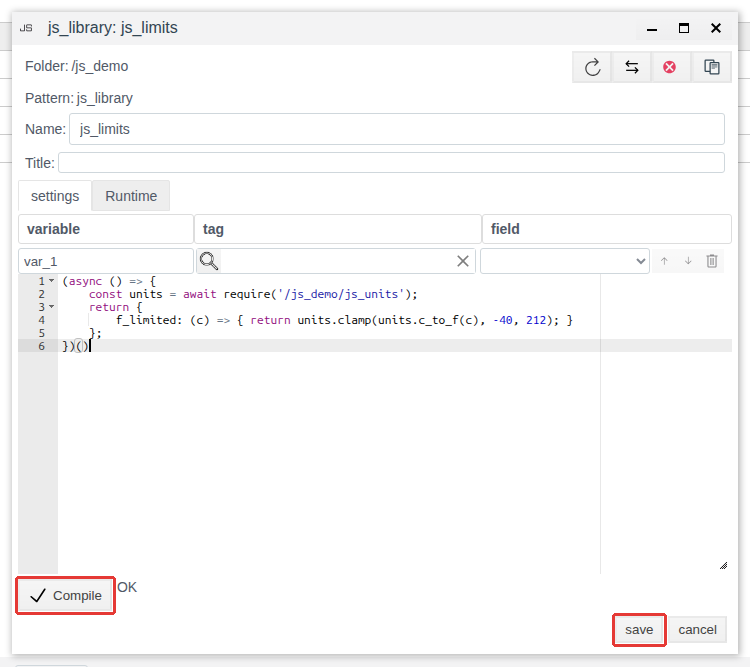

A script includes `js_limits` the same way as `js_units`: `const limits = await require('/js_demo/js_limits');`. With `js_in` = `150`, `limits.f_limited(VARS.t)` returns `212`, with `js_in` = `-100` it returns `-40`.

Now the example folder has two libraries. In **General View** they carry the **JS** icon, and their **Runtime** column shows `OFF`. In the screenshot the library rows are framed in red.

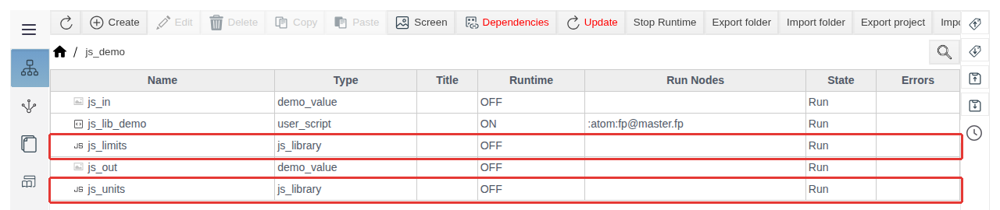

## Changing a library

A library can be changed while scripts use it. A running script loads the library on the first `require` call and keeps working with that version. A new version reaches the script after the script restarts. After changing a library, restart every script that uses it:

- turn **Disabled** on, save, turn **Disabled** off, save;
- or change the script code, click **Compile** and save.

Example: `+ 1000` is added to the result of `c_to_f` in `js_units`. Before `js_lib_demo` restarts, with `js_in` = `30` it writes `86`; after the restart, with `js_in` = `31`, it writes `1087.8`.

## Wrong path

The path in `require` must match the library path in **General View**. If there is no object at the `require` path, the script stops and writes no values. The screenshots show script `js_path_demo`: the same script as `js_lib_demo`, but `require` has path `/js_demo/no_such_lib` instead of `/js_demo/js_units`.

In **General View** the script row is highlighted in red, the **State** column shows `Stop`, and the **Errors** column shows `{badmatch,{error,{invalid_path,<<"/root/FP/PROJECT/js_demo/no_such_lib">>}}}`.

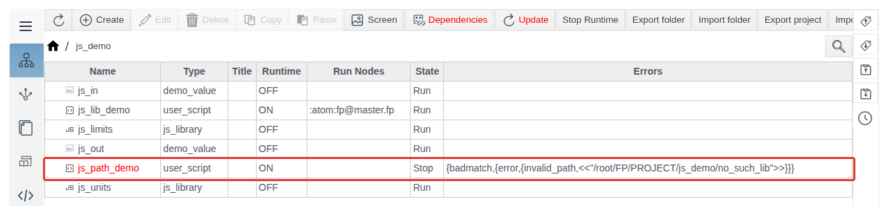

In the script form **State** is `STOP`, and **Error** shows the same text.

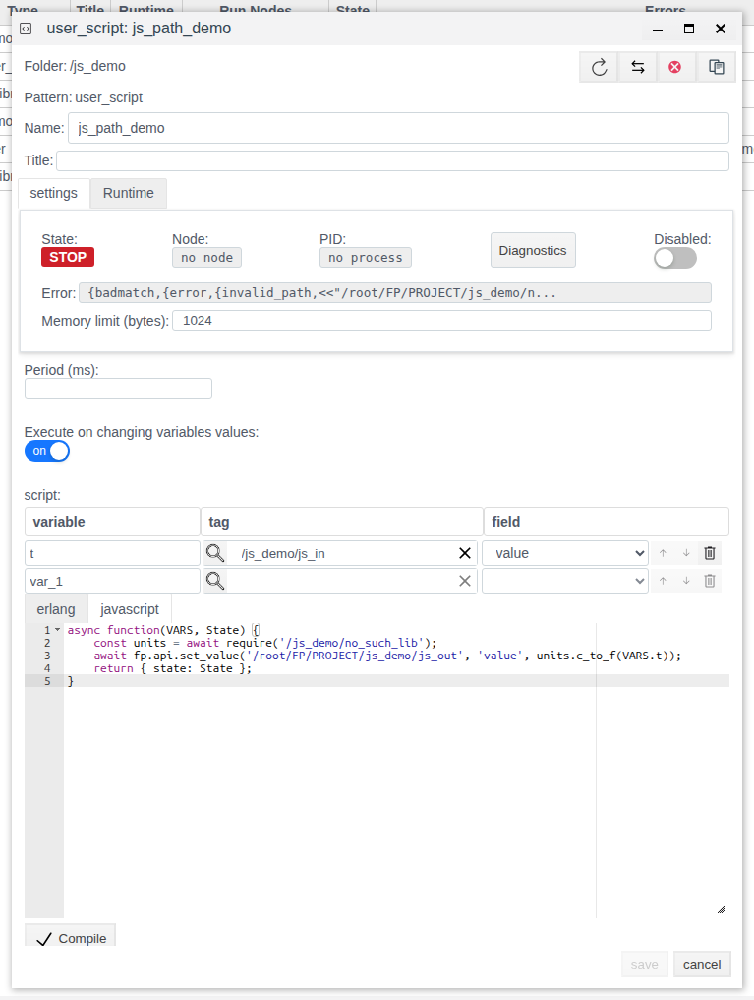

# Conclusion

Workflow:

1. In a project folder, create **system** → **js_library**.
2. Write an expression that returns an object with functions; if the library includes other libraries, make the function `async`.
3. **Compile** → `OK` → save.
4. In a script, include the library: `const lib = await require('/folder/name');`.
5. After changing a library, restart the scripts that use it.
