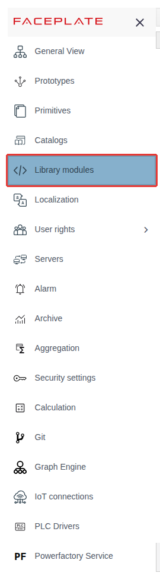
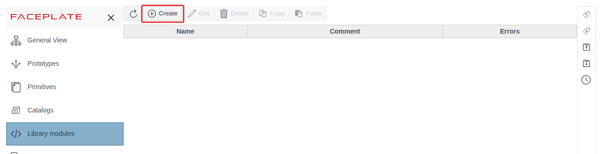
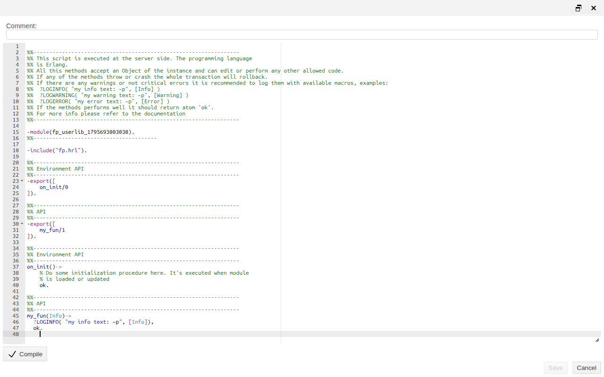
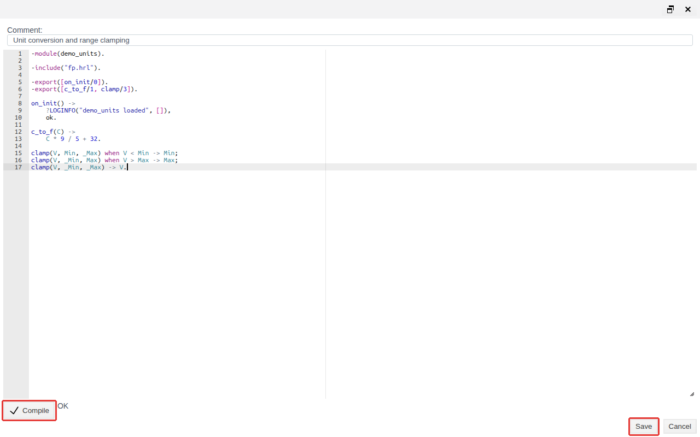
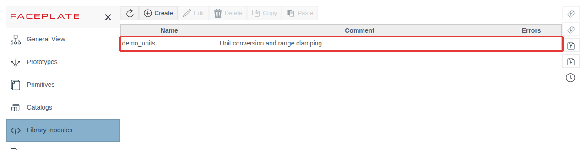
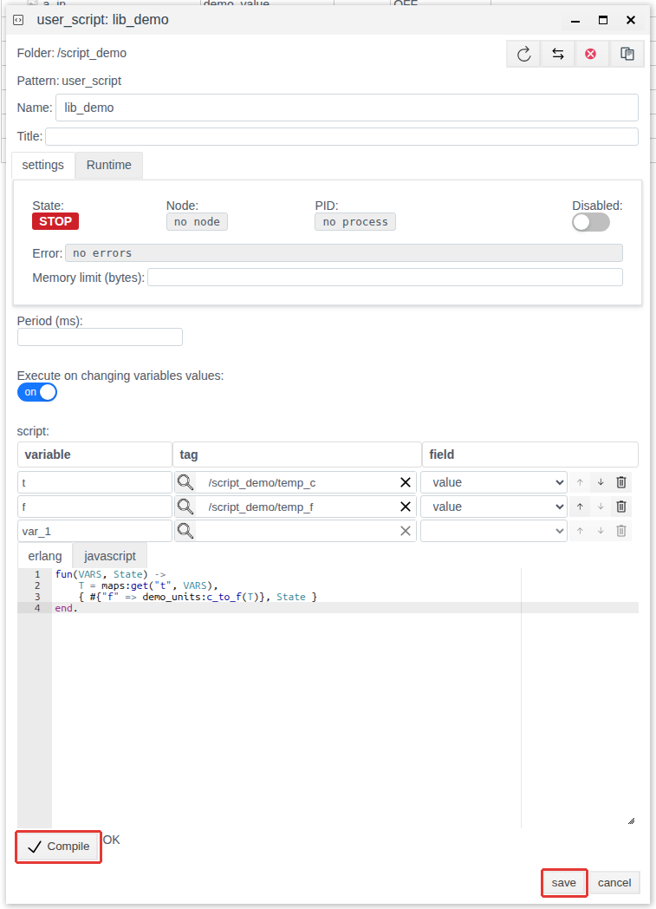
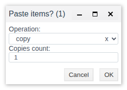
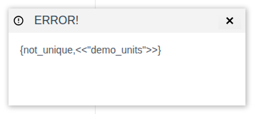

# Library Modules

This document is for integration engineers who move shared Erlang code into a separate module and call it from the project's user scripts.

# Contents

- [Glossary](#glossary)
- [Introduction](#introduction)
- [Main part](#main-part)
    - [The Library modules section](#the-library-modules-section)
    - [Creating a module](#creating-a-module)
    - [Compile and save](#compile-and-save)
    - [Calling from a user script](#calling-from-a-user-script)
    - [Changing a module](#changing-a-module)
    - [Copying](#copying)
    - [Deleting](#deleting)
- [Conclusion](#conclusion)

# Glossary

| Term | Meaning |
|---|---|
| Library module | An Erlang module stored in the project and loaded onto the FACEPLATE server. Its exported functions are available to project code as `module:function(...)` |
| **Library modules** section | A Studio main menu item: the list of the project's library modules and their editor |

# Introduction

A library module is shared Erlang code for the whole project: functions needed in several scripts. The code is written once, and user scripts call it by module name.

Modules are not stored in project folders but in a separate Studio section, **Library modules**. After saving, the server loads the module on its own, and its functions are immediately available to all scripts of the project.

The document shows how to create a module and call it from a script with one example that runs through the whole document. In the example, several scripts need to convert temperature from degrees Celsius to degrees Fahrenheit, so the conversion function is moved into the module `demo_units`. The script `lib_demo` calls the module function and writes the result to a tag. Then the module is changed and copied, and the copy is deleted.

| Object | Location | Purpose |
|---|---|---|
| `temp_c`, `temp_f` | folder `script_demo`, primitive with a `value` field of type `float` | Example input and output. Created in advance |
| `demo_units` | **Library modules** section | Functions `c_to_f/1` (degrees Celsius to degrees Fahrenheit) and `clamp/3` (limiting a value to a range) |
| `lib_demo` | folder `script_demo`, `user_script` | Reads `temp_c`, writes the result of `demo_units:c_to_f/1` to `temp_f` |

How to create a primitive is described in [Primitives](../../project_objects/primitives/primitives.md), a user script — in [User Scripts](../user_script/user_script.md).

You will need access to Studio (`http://<server>:9000/fp/studio`) with an account that has the right to change the project.

# Main part

## The Library modules section

1. Open **Library modules** in the Studio main menu.

   

2. The list of project modules opens. In the example it is still empty. Click **Create**.

   

The other buttons above the list — **Edit**, **Delete**, **Copy**, **Paste** — work with the selected row. A module can also be opened by double-clicking its row.

## Creating a module

After **Create**, the editor of a new module opens with a template: a name like `fp_userlib_<number>`, `fp.hrl` included, functions `on_init/0` and `my_fun/1`.



Replace the template with the `demo_units` code and fill in **Comment**, for example `Unit conversion and range clamping`:

```erlang
-module(demo_units).

-include("fp.hrl").

-export([on_init/0]).
-export([c_to_f/1, clamp/3]).

on_init() ->
    ?LOGINFO("demo_units loaded", []),
    ok.

c_to_f(C) ->
    C * 9 / 5 + 32.

clamp(V, Min, _Max) when V < Min -> Min;
clamp(V, _Min, Max) when V > Max -> Max;
clamp(V, _Min, _Max) -> V.
```

| Element | Rule |
|---|---|
| `-module(name).` | Required. Sets the module name in the list and the name used in calls. Lowercase Latin letters, digits and `_` are allowed |
| `-export([...])` | Only exported functions are available to scripts |
| `on_init/0` | The module initialization function: it performs the preparation the module needs to work. Called after the module is compiled and loaded: at server start and within a second after saving changed code. If the code did not change on saving, for example only **Comment** was edited, `on_init/0` is not called. In the example, `on_init/0` writes the line `demo_units loaded` to the server log. An error inside `on_init/0` is written to the server log and does not prevent the module from loading. |
| `-include("fp.hrl").` | The main FACEPLATE header file with the platform's common macros, including the log macros `?LOGINFO`, `?LOGWARNING`, `?LOGERROR`. Included in the new module template |

The module name is unique: two modules with the same name cannot be saved in a project. The name must not match the names of Erlang and FACEPLATE modules.

## Compile and save

The code is entered, now it needs to be checked. Click **Compile**: `OK` appears next to the button, and the **Save** button becomes available.



If the code has an error, the compiler error text is shown instead of `OK`, and **Save** stays unavailable. Look for a `{line,column}` pair and a description in the text. For example, if the period after `C * 9 / 5 + 32` is missing, the text contains `{15,1}` and `syntax error before: clamp` — the error is before line 15. Fix the code and click **Compile** again.

After `OK`, click **Save**. The order is always the same: **Compile** → `OK` → **Save**.

After saving, the form stays open, and **Save** is unavailable again until the next **Compile**. The module is already saved and appears in the list. Close the form with **Cancel** or the cross in its title bar: this does not undo the save.



| Column | Meaning |
|---|---|
| **Name** | Module name from the `-module(...)` line. Set on saving, not editable manually |
| **Comment** | Text from the **Comment** field |

The module `demo_units` is loaded on the server, but nothing calls its functions yet.

## Calling from a user script

Let's call `demo_units` from the script `lib_demo`. The script takes the temperature from `temp_c`, converts it with `c_to_f/1` and writes it to `temp_f`.

Create a user script `lib_demo` in the folder `script_demo`. On the **erlang** tab, set the variables `t` (tag `/script_demo/temp_c`, field `value`) and `f` (tag `/script_demo/temp_f`, field `value`). Turn on **Execute on changing variables values** and enter the code:

```erlang
fun(VARS, State) ->
    T = maps:get("t", VARS),
    { #{"f" => demo_units:c_to_f(T)}, State }
end.
```

A module function is called by its full name `module:function(arguments)`; the module does not need to be connected in the script.

Click **Compile**, wait for `OK` and save.



Now with `temp_c` = `25` the script writes `77` to `temp_f`.

## Changing a module

A module can be changed while scripts call it. Open the module, fix the code, click **Compile** and save. The server loads the new version within a few seconds, and the next calls from scripts go to it. Scripts do not need to be restarted.

Example: in `demo_units`, `+ 1000` is added to the result of `c_to_f`. The script `lib_demo` is not restarted, and with `temp_c` = `26` it immediately writes `1078.8` to `temp_f`.

If you change the name in the `-module(...)` line, the **Name** in the list changes after saving. Scripts call a module by its name, so the calls in them must be changed to the new name.

## Copying

A copy is a quick way to start a new module from existing code. Let's copy `demo_units`.

1. Select `demo_units`, click **Copy**, then **Paste**.
2. In the **Paste items?** window, keep **Operation** = `copy`, set **Copies count** and click **OK**.

   

The copy appears in the list as `demo_units_1`, but its code is the same, with the same `-module(demo_units)` line. Open the copy, replace the name in `-module(...)`, for example with `demo_units_copy`, click **Compile** and save. After saving, the **Name** in the list becomes `demo_units_copy`.

While the copy has the old name, it cannot be saved: an **ERROR!** window appears with the text `{not_unique,<<"demo_units">>}`.



## Deleting

The copy `demo_units_copy` is no longer needed. Select it, click **Delete** and confirm with **yes**. The confirmation window shows the number of modules to delete: `delete items: 1`.

To delete several modules at once, select them with Ctrl+click.

# Conclusion

Workflow:

1. In **Library modules**, click **Create**.
2. Set a unique name in `-module(...)` and export the functions you need.
3. **Compile** → `OK` → **Save**.
4. Call the functions from scripts as `module:function(...)`.
5. In a copy of a module, replace the name in `-module(...)`.
