# User scripts

A document for the integration engineer who writes server-side project logic in Erlang or JavaScript: computing values, counters, moving data between objects.

# Contents

- [Glossary](#glossary)
- [Introduction](#introduction)
- [Main part](#main-part)
    - [Creating a script](#creating-a-script)
    - [Variables](#variables)
    - [Run conditions](#run-conditions)
    - [Erlang code](#erlang-code)
    - [Compile and save](#compile-and-save)
    - [A running script](#a-running-script)
    - [Manual run](#manual-run)
    - [The Script section](#the-script-section)
    - [Runtime errors](#runtime-errors)
    - [JavaScript code](#javascript-code)
    - [Deleting a script](#deleting-a-script)
- [Conclusion](#conclusion)

# Glossary

| Term | Meaning |
|---|---|
| User script | A project object of type `user_script`. Holds an Erlang or JavaScript function and its run conditions. Runs on the server |
| Variable | The name under which the function sees a field of a project object. Defined by the triple "name — object (tag) — field" |
| `VARS` | First function argument: values of all variables at the moment of the run |
| `State` | Second function argument: the value the function returned last time. Reset when the script restarts |
| Auto-run | The **Execute on changing variables values** mode: the script runs whenever any of its variables changes |
| **Script** section | Studio main menu item: a summary table of all user scripts in the project |

# Introduction

A user script reads fields of project objects, computes new values and writes them to object fields. A script is a project object: it is created in the **General View**, in a folder next to the objects it works with, and runs on the server while it is enabled.

Simple formulas are easier to set up in [Calculation](../calculation/calculation.md): there you write only an expression, not a function. A script is needed when the computation requires more:

| Suits Calculation | Implement in User Script |
|---|---|
| Unit conversion, scaling | Computations over history and time windows, rate of change |
| Formulas over several inputs: sum, difference, ratio, percentage, power, efficiency | Accumulation and totalizers, state between runs |
| Threshold flags and statuses | Alarms, SQL, working with the interface |
| Simple conditions: range limiting, fallback value, division-by-zero protection | Complex logic and flow control |
| Extracting a bit from a word, mapping integer status codes | Protocol parsing, formula libraries |

How to write, run and check a script is shown in this document on one running example. In the example, the script `sum_script` in the `us_demo` folder adds the values of the objects `a_in` and `b_in`, writes the sum to `sum_out` and the number of its runs to `runs_out`. All four objects have a numeric field `value` of type `float`; how to create such objects is described in the [Primitives](../../project_objects/primitives/primitives.md) document.

First the script is written in Erlang: it is created, gets its variables and run conditions, passes the check and is saved. Then it is run manually, found in the **Script** section, and used to show what a runtime error looks like. At the end the same computation is written in JavaScript, and the extra script is deleted.

You need access to Studio (`http://<server>:9000/fp/studio`) with an account that may change the project.

# Main part

## Creating a script

1. In the **General View**, open the `us_demo` folder and click **Create**.

    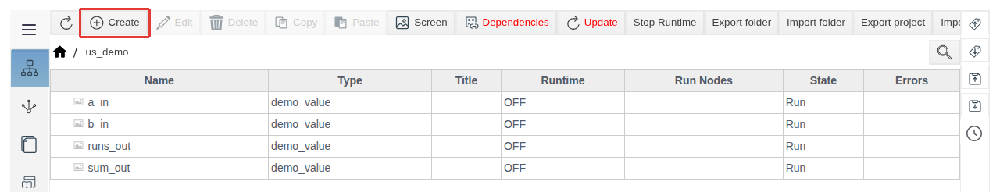

2. Expand the `system` group, select `user_script` and click **Ok**.

    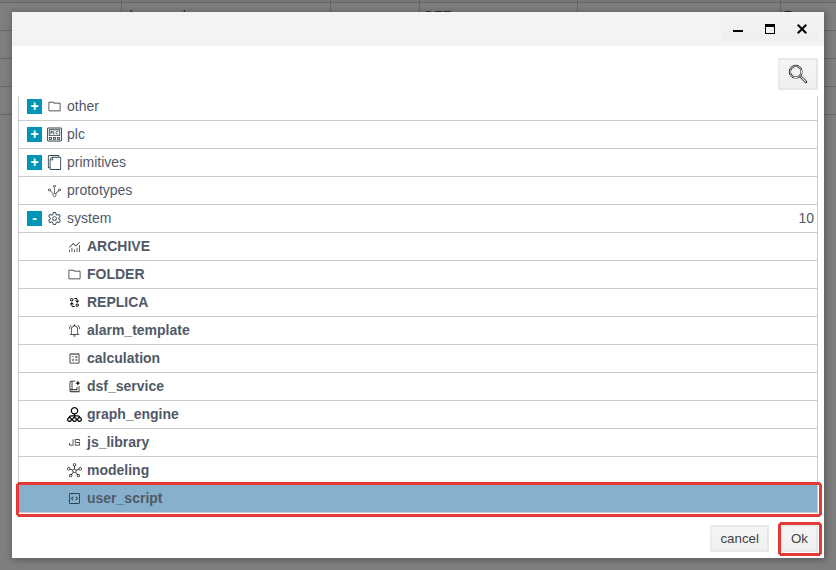

3. In the form that opens, enter **Name** `sum_script`.

The script form has three parts. At the top is the status panel: whether the script is running and where. Below it are the run conditions: **Period (ms)** and **Execute on changing variables values**. At the bottom are the **script** variable table and the code editor with the **erlang** and **javascript** tabs. A new script is not running yet: **State** is `STOP`, and the editor holds a template with a comment on how the function is built. Filling in starts with the variables.

## Variables

The script function does not access project objects directly: it receives and writes values through variables. A variable links a name in the code to an object field. The table under the **script** heading has the columns **variable** — the variable name in the code, **tag** — the project object, and **field** — its field.

The example script needs four variables: two inputs and two outputs.

1. Enter the name `a` in **variable**.
2. Click the magnifier in **tag**, open the `us_demo` folder, select `a_in` and click **OK**. Only an object from the project tree can be selected.

    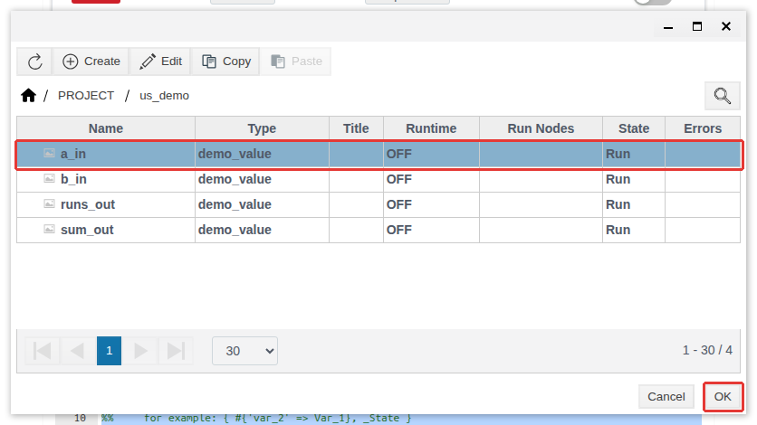

3. In **field**, select `value`. The list contains all fields of the object, including system ones.
4. Add the other rows the same way:

| variable | tag | field |
|---|---|---|
| `a` | `/us_demo/a_in` | `value` |
| `b` | `/us_demo/b_in` | `value` |
| `sum` | `/us_demo/sum_out` | `value` |
| `runs` | `/us_demo/runs_out` | `value` |

Once a row is filled in, an empty row `var_1` appears below it; an unfilled row does not prevent saving. The arrows on the right change the row order, the bin deletes a row.

The same variable serves both for reading and for writing: the script reads `a` and `b` and writes to `sum` and `runs`.

## Run conditions

The variables are set; now decide when the script will execute.

| Field | Behaviour |
|---|---|
| **Period (ms)** | The script executes right after it starts and then with this period. Empty — no timer |
| **Execute on changing variables values** | The script executes once after it starts and then every time the value of any of its variables changes |

The modes can be enabled together. If both are off, the script is running (**State** `RUN`) but does not execute until it is run manually (see [Manual run](#manual-run)).

Values the script writes to its own variables do not trigger it again: with auto-run the script does not loop.

The sum must be recomputed as soon as `a_in` or `b_in` changes, so in the example **Period (ms)** stays empty and **Execute on changing variables values** is switched on.

## Erlang code

What remains is the function that computes new values from the variable values. The **erlang** tab is open by default. Replace the template in the editor with the example code:

```erlang
fun(VARS, State) ->
    A = maps:get("a", VARS),
    B = maps:get("b", VARS),
    Runs = case State of
        N when is_integer(N) -> N + 1;
        _ -> 1
    end,
    { #{"sum" => A + B, "runs" => Runs}, Runs }
end.
```

The function takes two arguments — `VARS` and `State` — and returns the tuple `{ ValuesToWrite, NewState }`:

| Element | Rule |
|---|---|
| `VARS` | A map whose keys are variable names as strings: `"a"`, not `a` |
| Values to write | A map "variable name — value". Only a field declared as a variable can be written: keys not in the variable table are ignored. An empty map `#{}` writes nothing |
| `State` | The second element of the previous call's result. The example keeps the run count in it: an integer is increased by 1, any other value means the first run |
| Final dot | The code ends with `end.` |

The type of a value in `VARS` follows the field type: a `float` field gives a number, a `string` field gives a string. Adding string fields gives the `badarith` error.

## Compile and save

The code is entered. Before saving, it is checked by the **Compile** button under the editor: `OK` or the error text appears next to the button. For example, if the comma after the line `B = maps:get("b", VARS)` is missing, **Compile** reports:

`{invalid_expression,{4,erl_parse,["syntax error before: ","Runs"]}}`

The number in the text is the line where the error was found (here line 4, `Runs = case State of`), and the last word is what the error stands before.

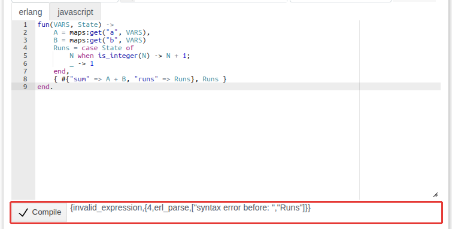

Fix the code and click **Compile** again. When `OK` appears next to the button, click **save**.

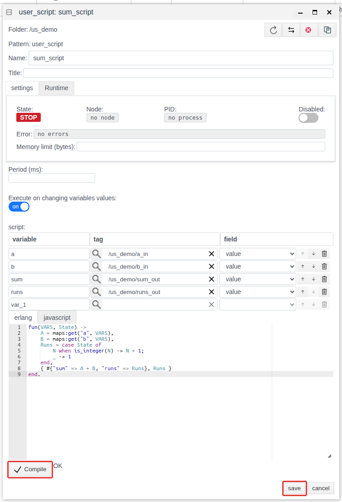

Save only after `OK`.

## A running script

A saved script starts right away. In the **General View**, `sum_script` has **Runtime** `ON`, and **Run Nodes** shows the node it runs on. A script with auto-run has executed once after starting: `sum_out` holds `5` (with `a_in` = 2 and `b_in` = 3), `runs_out` holds `1`.

Open `sum_script` again: the status panel is filled in.


| Field | Meaning |
|---|---|
| **State** | `RUN` — the script is running, `STOP` — not started |
| **Node**, **PID** | The cluster node and the process the script runs in |
| **Diagnostics** | The diagnostics window of the script process. The button exists only for a saved script |
| **Disabled** | Stops the script without deleting it. A disabled script has **State** `STOP`, and in the **General View** **Runtime** `OFF` and **State** `Stop` |
| **Error** | The text of the last runtime error. `no errors` — no errors |
| **Memory limit (bytes)** | Memory limit of the script process. `1024` is filled in on save |

Every save of the **Settings** tab — even if only **Title** was changed — restarts the script: the code is reloaded, `State` is reset, and the `runs_out` counter starts from `1` again. The script also restarts when **Disabled** is switched off.

## Manual run

The example script executes by itself when the inputs change. To execute it once more without changing the inputs, run it manually:

1. Open the **Runtime** tab in the script form.
2. Switch on **trigger_execute** and click **save**.

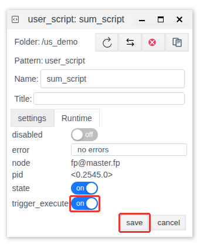

The script executes once, and the switch turns itself off. In the example `runs_out` becomes `2`. Saving on the **Runtime** tab does not restart the script: `State` is kept. The other rows of the tab repeat the status panel information.

A script with both run conditions off never runs on its own, not even when its inputs change. It is run only this way, manually.

## The Script section

In the **General View** a script is visible only in its own folder. All user scripts of the project are gathered in the **Script** section of the main menu.

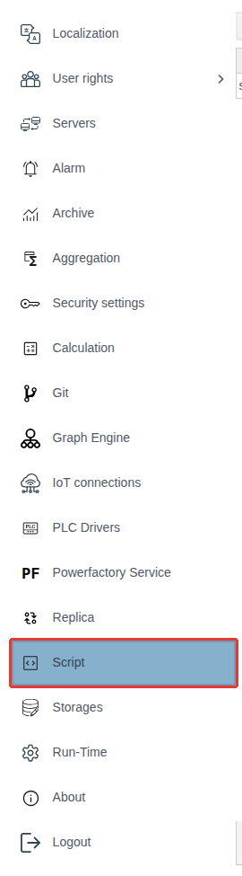

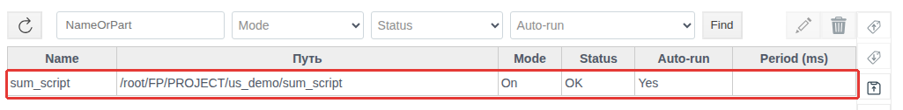

| Column | Meaning |
|---|---|
| **Name**, **Путь** | Name and full path of the script object |
| **Mode** | `On` or `Off` (the **Disabled** switch) |
| **Status** | `OK` or **ERROR** |
| **Auto-run** | `Yes` if **Execute on changing variables values** is on |
| **Period (ms)** | The period value or empty |

Above the table are the filters: part of the name, **Mode**, **Status** (`Error` / `OK`) and **Auto-run**. Choose the conditions and click **Find**; the cross to the right of **Find** clears the filters.

Scripts cannot be created in this section, only in the **General View**. Open a script by double-clicking its row or with the pencil button at the top right of the table; delete it with the bin button next to it. The buttons become available when a row is selected.

## Runtime errors

`sum_script` runs without errors: its **Status** is `OK`. Let us see what an error looks like when it occurs at execution, not at **Compile**. In the code, replace `maps:get("b", VARS)` with `maps:get("c", VARS)`: there is no variable `c` in the table. **Compile** returns `OK` — the syntax is correct — but the script fails as soon as it executes.

The error is shown in three places. In the script form, in the **Error** field:

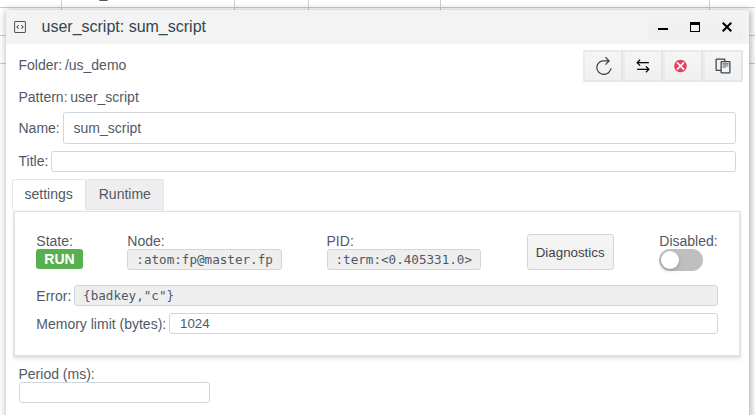

In the **General View**, in the **Errors** column of the script row. In the **Script** section, as a row with a red background and the status **ERROR**; the error text appears in a tooltip when you point at **ERROR**. To see only such scripts in a large project, choose `Error` in the **Status** filter and click **Find**:

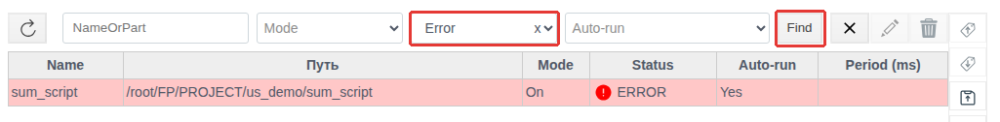

| Text | Cause |
|---|---|
| `badarith` | Arithmetic on a non-numeric value, for example on a string field |
| `{badkey,"c"}` | The code reads variable `c`, which is not in the variable table |
| `badarg` | For example, the path in `fp.api.set_value` (JavaScript) is given without the `/root/FP/PROJECT` prefix |

When the script executes with an error, variable values are not written: `sum_out` and `runs_out` keep their previous values. Put `maps:get("b", VARS)` back in the code, click **Compile** and **save**: after the first successful execution the error disappears from the form, the **General View** and the **Script** section.

## JavaScript code

The same computation can be written in JavaScript. To compare, create a second script `sum_js` in `us_demo` as in [Creating a script](#creating-a-script), open the **javascript** tab and paste the code:

```javascript
async function(VARS, State) {
    const runs = Number.isInteger(State) ? State + 1 : 1;
    await fp.api.set_value('/root/FP/PROJECT/us_demo/sum_out', 'value', VARS.a + VARS.b);
    await fp.api.set_value('/root/FP/PROJECT/us_demo/runs_out', 'value', runs);
    return { state: runs };
}
```

The script needs only the input variables `a` and `b`: it writes values not through variables but by calling `fp.api.set_value`. Switch on **Execute on changing variables values**, click **Compile**, and after `OK` click **save**.

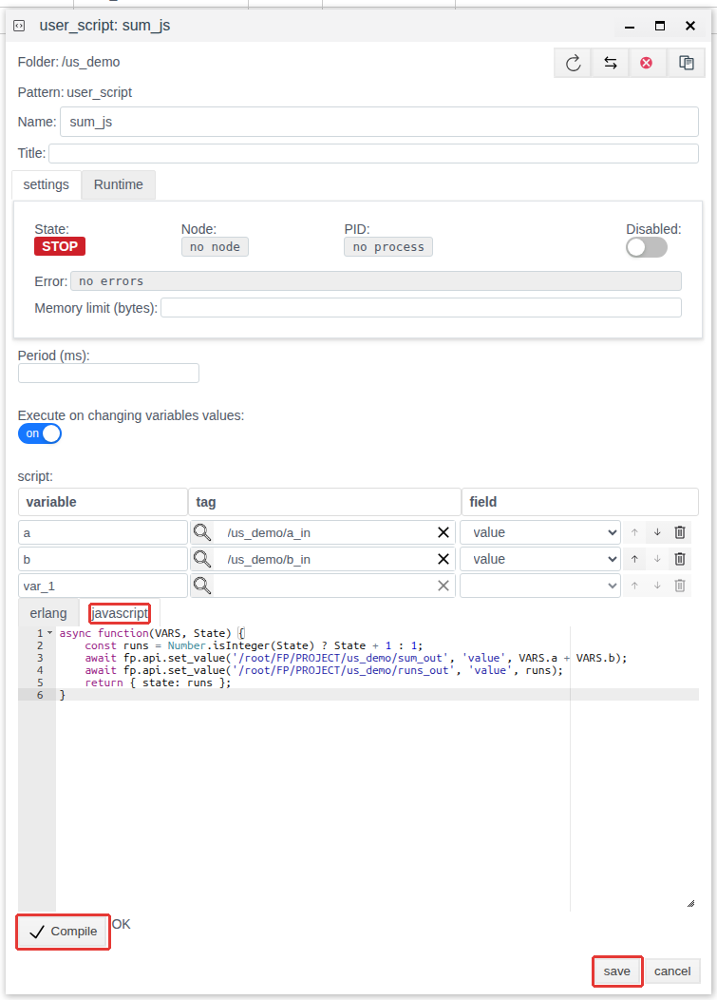

Differences from Erlang:

| | Erlang | JavaScript |
|---|---|---|
| Function | `fun(VARS, State) -> … end.` | `async function(VARS, State) { … }` |
| Reading a variable | `maps:get("a", VARS)` | `VARS.a` |
| Writing a value | A map in the function result; only to fields declared as variables | `await fp.api.set_value(path, field, value)`; to any field, the path is full — with the `/root/FP/PROJECT` prefix |
| New `State` | The second element of the tuple | `return { state: … }` |

The code is checked and executed in the language of the tab that is open at **Compile**: Erlang code on the **javascript** tab does not pass the check.

## Deleting a script

A script runs as long as it exists in the project. If its computation is no longer needed or has moved to another script, delete the old script; otherwise it keeps writing to the same fields. To stop a script for a while and keep its settings, do not delete it — switch on **Disabled** instead (see [A running script](#a-running-script)).

In the example, `sum_js` was written for comparison, and now two scripts write to `sum_out` and `runs_out` at once. Keep `sum_script` and delete `sum_js`: in the **Script** section select its row, click the bin button and confirm with **yes**.

The confirmation window shows the number of selected scripts, not their names. To delete several scripts at once, select them by clicking with Ctrl held down. A deleted script disappears from the **Script** section and from its folder in the **General View**.

# Conclusion

Workflow:

1. In the **General View**, create a `user_script` (`system` group).
2. Declare variables for the fields the script reads and writes.
3. Choose how it runs: **Period (ms)**, **Execute on changing variables values**, or both.
4. Write the function on the **erlang** or **javascript** tab.
5. Click **Compile**, wait for `OK`, save.
6. Check **Status** in the **Script** section; on **ERROR** read the text in the form's **Error** field.
