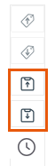
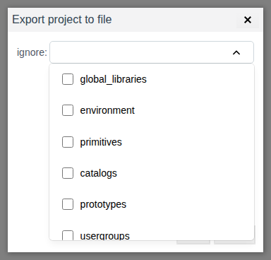
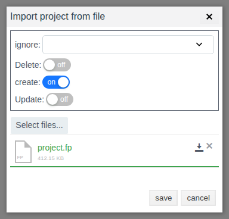
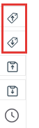
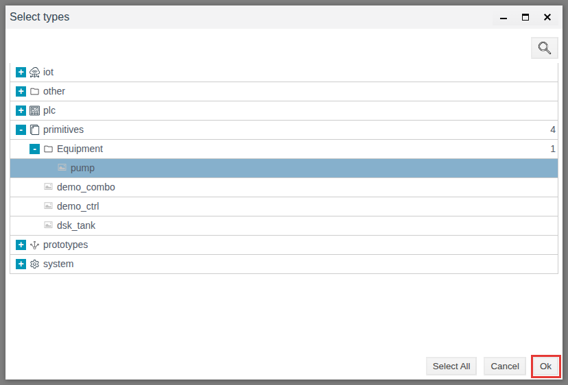
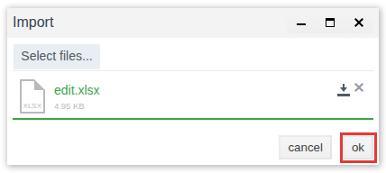
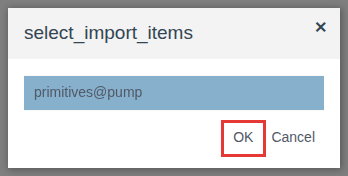
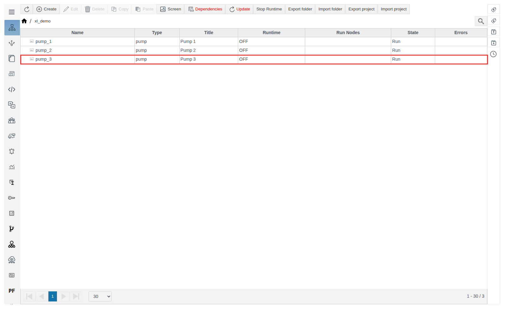
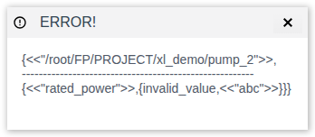

# Project import and export

For the integration engineer who moves a project between servers, keeps a backup of it or edits objects in bulk: how to save the project to a `project.fp` file and load this file into a project, how to export objects to an Excel table and load the table back.

# Contents

- [Glossary](#glossary)
- [Introduction](#introduction)
- [Main part](#main-part)
    - [Export](#export)
    - [What the file does not include](#what-the-file-does-not-include)
    - [Importing an export file](#importing-an-export-file)
    - [Excel exchange](#excel-exchange)
- [Conclusion](#conclusion)

# Glossary

| Term | Meaning |
|---|---|
| Export file | The `project.fp` file with project objects by sections |
| Section | A part of the project in the export file: the project tree, primitives, users and others. The list is in [«Export»](#export) |
| Object type | The built-in Studio type (folder, archive, connection and others), primitive or prototype the object is created from. Shown in the **Type** column of the General View |
| **export** flag | A property of a type field: the field value is written to the export file |
| **excel** flag | A property of a type field: the field is exported to an Excel table and loaded from it |
| Object path | The place of an object in the project tree from the `/PROJECT` root, for example `/PROJECT/<folder>/<object>` |

# Introduction

The `project.fp` export file holds the project objects. It is used to move the whole project or separate sections to another server and to keep a backup of the project before major changes. The file is also used in a FACEPLATE update, see [«FACEPLATE version and update»](../../administration/update/update.md).

An Excel table serves another task: filling in or correcting fields of many objects of one type and creating objects from a list. The table gets only fields with the **excel** flag, and loading the table does not delete objects.

You need access to Studio (`http://<server>:9000/fp/studio`) with an account that may change the project.

# Main part

## Export

The **Export project to file** and **Import project from file** buttons are the third and fourth icons from the top on the right vertical toolbar of Studio: the upper marked one is export, the lower one is import.

Click **Export project to file**. The project is written to the file by sections. In the **ignore** list, check the sections that do not need to be saved: the export skips the checked sections and saves all unchecked ones to the file. To save the whole project, leave the list empty. Click **save**. The browser saves `project.fp`.

Sections in the **ignore** list:

| Section | What it holds |
|---|---|
| `global_libraries` | [Library modules](../../project_logic/library_modules/library_modules.md) and [JS libraries](../../project_logic/js_library/js_library.md) |
| `environment` | [Image library](../../mnemo/images.md), [localization dictionary](../localization/localization.md) and project system settings: [alarms](../../alarms/alarm/alarm.md), authorization, [graphic editor](../../mnemo/editor.md) and others |
| `primitives` | [Primitives](../primitives/primitives.md) |
| `catalogs` | [Catalogs](../catalogs/catalogs.md) |
| `prototypes` | [Prototypes](../prototypes/prototypes.md) |
| `usergroups` | [Roles](../../access/roles.md) |
| `users` | [Users](../../access/users.md): accounts without passwords. After the import, passwords are set again, see [«Users», section «Password»](../../access/users.md#password) |
| `project` | The project tree: folders, objects, screens |
| `user_rights` | [Role rights on screens](../../access/roles.md#rights-on-screens): viewing and changing |

## What the file does not include

Accumulated archive values and event log records are kept in the node database and are not part of the file. After an import into an empty database, the project archives are empty and fill up anew.

The value of an own field of a primitive or prototype gets into the file only if the field has the **export** flag, see [«Primitives», section «Fields»](../primitives/primitives.md#fields) and [«Prototypes», section «Fields»](../prototypes/prototypes.md#fields). Values of fields without the flag are not written to the file, and after an import into another database they are set again. To move such values, set the **export** flag on the field before the export or move the values through Excel: for that the field must have the **excel** flag, see [«Excel exchange»](#excel-exchange). Built-in Studio types (folders, archives, alarms and others) have a predefined set of fields in the file.

## Importing an export file

1. Click **Import project from file** and pick `project.fp` with **Select files...**.
2. Turn on the **Delete**, **create** and **Update** switches in the combination you need, see the table of combinations below. In **ignore**, check the same sections as on export; for a file of the whole project, leave the list empty. Click **save**.

    

3. Wait for `The project was imported successfully` and reload the page. The project folders and objects appear in the tree.

The import window matches the objects of the file and of the project by path. The switches define what to do with the differences:

| Switch | What it does |
|---|---|
| **Delete** | Deletes the project objects that are not in the file |
| **create** | Creates the file objects that are not in the project. Does not change objects that already exist |
| **Update** | Writes the field values from the file into the objects that exist both in the file and in the project. It is turned on together with **create** |

Switch combinations:

| Turned on | Object only in the file | Object in the file and in the project | Object only in the project | When to use |
|---|---|---|---|---|
| **create** | Created | Not changed | Stays | Moving the project into an empty database; adding what is missing without overwriting changes made in the project |
| **create** and **Update** | Created | Gets the fields from the file | Stays | Bringing in changes from the file and keeping the objects created only in this project |
| **Delete** and **create** | Created | Not changed | Deleted | Removing extras and adding what is missing without overwriting changes in shared objects |
| **Delete**, **create** and **Update** | Created | Gets the fields from the file | Deleted | Making the project an exact copy of the file |
| **Delete** | Not created | Not changed | Deleted | Only removing from the project what is not in the file |

An import with **Delete** also deletes objects created in the project after the file was made. Before such an import, save an export file of the current project: what was deleted can be restored from it by an import with **create**.

The **ignore** list on import must match the list the file was exported with. Sections checked on export are absent from the file, and an import with **Delete** removes their contents from the project. For example, if `users` and `usergroups` were checked on export but not on import, the import deletes the users and roles of the project, including the built-in ones.

If it is unknown which sections were checked on export, an import without **Delete** does not harm the project: **create** and **Update** do not touch sections that are absent from the file. To turn **Delete** on, check in **ignore** the sections that must stay in the project as they are: the import neither changes nor deletes the checked sections.

## Excel exchange

An Excel table is used to fill in fields of many objects at once: enter serial numbers, correct setpoints, add objects from an equipment list. Unlike the export file, the table is opened and edited in Excel or another spreadsheet editor and then loaded back. The table also moves values of fields that have the **excel** flag but not the **export** flag: such values do not get into the export file.

| | Export file `project.fp` | Table `faceplate_project.xlsx` |
|---|---|---|
| What it holds | Whole project sections: objects with the fields that have the **export** flag, screens, users and more | Objects of the selected types from one folder, only fields with the **excel** flag |
| Where it is edited | Not edited, only loaded into Studio | In Excel or another spreadsheet editor |
| Object schemes (`screen`, `view1`–`view15`, `settings`) | Moved | Not moved; on a table load they stay as they were |
| Deletes objects on load | Yes, with the **Delete** switch | No |
| When to use | Moving a project, backup | Bulk editing of fields, creating objects from a list |

The **Export .xlsx** and **Import .xlsx** buttons are the first and second icons from the top on the right toolbar of Studio. They work in the **General View** and in the **Catalogs** and **Localization** sections; in other sections they are inactive. This section covers the General View. Exchanging catalog records is described in [«Catalogs», section «Excel exchange»](../catalogs/catalogs.md#excel-exchange), exchanging the dictionary in [«Localization», section «Exchange via Excel»](../localization/localization.md#exchange-via-excel).

### Export to Excel

1. In the **General View**, open the folder with the objects by double-clicking it. The table gets all objects inside the folder at any nesting depth; the folder itself is not included. To export the whole project, stay at the root.
2. Click **Export .xlsx**. The **Select types** window groups the types: `iot`, `other`, `plc`, `primitives`, `prototypes`, `system`. Select the types you need (several — with Ctrl) and click **Ok**. The **Select All** button exports objects of all types at once.

    

3. The browser saves the `faceplate_project.xlsx` file.

### The .xlsx table

Each type is a separate sheet. The sheet name and the header of the first column are the type:

| Type | Sheet |
|---|---|
| Built-in Studio type: folder, archive, script, IoT or PLC connection and others | The type name, for example `FOLDER` or `plc_modbus_connection` |
| Primitive | `primitives@<primitive>` |
| Prototype | `prototype@<prototype>` |

The first column is the object path, one row is one object. The other columns are fields with the **excel** flag in alphabetical order. Built-in types have a fixed set of fields (`title`, `disabled` and others). Primitives and prototypes add to the system fields their own fields that have the **excel** flag in the **Fields** section, Where the flag is set: [«Primitives», section «Fields»](../primitives/primitives.md#fields), [«Prototypes», section «Fields»](../prototypes/prototypes.md#fields). Catalog fields get the **excel** flag the same way, see [«Catalogs», section «Fields»](../catalogs/catalogs.md#fields).

In the example, the `xl_demo` folder with two instances of the `pump` primitive is exported. The `rated_power` and `serial_no` fields have the **excel** flag, `in_service` does not, so `in_service` is not in the table:

| primitives@pump | comment | icon | prototype | rated_power | serial_no | title |
|---|---|---|---|---|---|---|
| /PROJECT/xl_demo/pump_2 | :atom:null | :atom:null | :atom:null | 30 | SN-1002 | Pump 2 |
| /PROJECT/xl_demo/pump_1 | :atom:null | :atom:null | :atom:null | 22 | SN-1001 | Pump 1 |

How values are written:

| In the cell | Value |
|---|---|
| Number or text | The field value as is: `30`, `SN-1002` |
| `:atom:null` | The field is not set |
| `:atom:true`, `:atom:false` | Boolean value. On load, the Excel boolean values `TRUE` and `FALSE` are accepted as well |
| `fp://PROJECT/...` | A link to a project object, for example to the prototype in the `prototype` column of a prototype instance |
| Text in curly braces `{ ... }` | A compound value, for example an icon or object settings |
| Values with the `:string:` and `:term:` prefixes | Service notation. Leave it unchanged |

### Import from Excel

1. Make the changes in the table and save it. In the example, `rated_power` of `pump_2` is changed (30 → 37) and the row `pump_3` is added; the changes are in bold:

    | primitives@pump | comment | icon | prototype | rated_power | serial_no | title |
    |---|---|---|---|---|---|---|
    | /PROJECT/xl_demo/pump_2 | :atom:null | :atom:null | :atom:null | **37** | SN-1002 | Pump 2 |
    | /PROJECT/xl_demo/pump_1 | :atom:null | :atom:null | :atom:null | 22 | SN-1001 | Pump 1 |
    | **/PROJECT/xl_demo/pump_3** | **:atom:null** | **:atom:null** | **:atom:null** | **18.5** | **SN-1003** | **Pump 3** |

2. Click **Import .xlsx**. Objects are found by the paths in the table, so the open folder does not matter. Choose the file with **Select files...** and click **ok**.

    

3. The `select_import_items` window lists the sheets of the file. Select the ones you need (several — with Ctrl) and click **OK**.

    

4. Wait for the `Импорт выполнен успешно` (import completed successfully) message and close it. The object list is refreshed.

In the example, after the load `pump_2` has the new value and `pump_3` appears in the folder:

How the load handles rows and cells:

| In the table | Result |
|---|---|
| The path exists in the project | Fields from the sheet columns get the values from the table |
| The path does not exist in the project | An object of the sheet type is created, named after the last part of the path. Missing folders on the path are created |
| A new object with required fields not filled in | Not created; **ERROR!** names the empty field |
| No column for a field on the sheet | The field does not change. For an edit, the path column and the columns of the needed fields are enough |
| The cell is empty | The field is cleared |
| A column of a field without the **excel** flag | Not loaded |
| The object is in the project but not in the table | Does not change: loading from Excel does not delete objects |

If a value does not suit the field, for example text in a `float` field, the whole row is not loaded, while the other rows are. The **ERROR!** window lists the paths of the objects that were not loaded, the field names and the wrong values:

# Conclusion

The export file is saved with **Export project to file**: with an empty **ignore** list it holds the whole project, with checked sections it holds the project without them. It is imported with **Import project from file** and the same **ignore** list as on export. The **Delete**, **create** and **Update** switches are chosen by the table of combinations. Archive values and the event log are not part of the file.

Object fields are edited in bulk through Excel: **Export .xlsx** in a General View folder exports objects of the selected types, **Import .xlsx** loads the changed table. The load rewrites the fields from the sheet columns and creates objects at new paths, but deletes nothing.
