# Prototypes

A document for integration engineers who build projects in Studio.

# Contents

- [Glossary](#glossary)
- [Introduction](#introduction)
- [Main part](#main-part)
    - [Creating a prototype](#creating-a-prototype)
    - [Content](#content)
    - [Fields](#fields)
    - [Behaviour](#behaviour)
    - [Creating an instance](#creating-an-instance)
    - [Synchronizing a prototype with its instances](#synchronizing-a-prototype-with-its-instances)
    - [Nested prototypes](#nested-prototypes)
    - [Exporting and importing a prototype](#exporting-and-importing-a-prototype)
- [Conclusion](#conclusion)

# Glossary

| Term | Meaning |
|---|---|
| Prototype | A template from the **Prototypes** section: Content, Fields and Behaviour. Instances are created from it |
| Instance | A project object created from a prototype. It keeps a link to the prototype and a copy of its content. Its **Type** column shows the prototype name |
| Content | The object tree of a prototype that is copied into every instance |
| Prototype fields | The own fields of instances, defined on the **Fields** tab |
| Behaviour | An Erlang module with the functions `on_create/1`, `on_edit/1`, `on_delete/1`. The server calls them on instance operations |
| Synchronization (Sync) | Transfer of the current state of a prototype to its instances in the selected modes |
| Nested prototype | A prototype whose instance lies in the content of another prototype |
| Prototype group | The folder of a prototype in the type selection dialog (`prototypes / <group>`) |
| General View | The Studio section with the tree of project objects (see [Project structure](../Project_strucure/FACEPLATE-start.md)) |
| Run-time field | A field with the **Run-time** flag. Shown on the **Runtime** tab of the instance form |
| Storage `disc` / `ramdisc` / `ram` | Where the field value is stored: on disk; in memory with a copy on disk; in memory only |
| Index `simple` / `3gram` / `datetime` | A search index of the field: by exact value; by substring; by date and time |
| `.prt` file | A prototype export file |

# Introduction

A **prototype** is a template for any repeating part of a project: a piece of equipment, a plant section, a metering point, a set of connections or [calculations](../calculation/calculation.md) — anything that is built from project objects and occurs more than once. The structure is described once in the prototype, and any number of **instances** is then created from it. Each instance receives a copy of the structure. Changes to the prototype are transferred to all instances with the **Sync** command.

The section is in the Studio main menu: **Prototypes**. Every prototype has three parts, each opened with its own button:

| Part | Button | Contents |
|---|---|---|
| Content | **Content** | The object tree copied into every instance |
| Fields | **Fields** | The own fields of an instance: name, type, storage, default value |
| Behaviour | **Behaviour** | Erlang code the server runs when an instance is created, edited or deleted |

The example used throughout this document is a pump station:

| Object | Role |
|---|---|
| Prototype `Pump` (group "Pumps") | A pump: folder `motor` in the content, fields `rated_power`, `location`, `running` |
| Instance `P_201` | Pump P-201 in the project root |
| Prototype `Station` | A station whose content holds the pump instance `P1` |
| Instance `ST_1` | A station in the project root |

You need access to Studio (`http://<server>:9000/fp/studio`) with an account that is allowed to change the project.

# Main part

## Creating a prototype

Open **Prototypes** in the Studio main menu. The list shows the icon, name, groups and comment of each prototype.

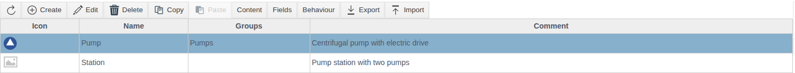

Click **Create** and fill in the form:

| Field | Purpose |
|---|---|
| **Name** | Prototype name, required. The prototype appears under this name in the type selection dialog |
| **Icon** | An `.svg`, `.png`, `.jpg` or `.jpeg` file. Instances inherit the icon |
| **Groups** | The folder of the prototype in the type selection dialog. Each next line adds a nested folder |
| **Comment** | Free text |

The **Sync** and **Show fields** buttons work only for a saved prototype; they are described in [Synchronizing a prototype with its instances](#synchronizing-a-prototype-with-its-instances) and [Fields](#fields).

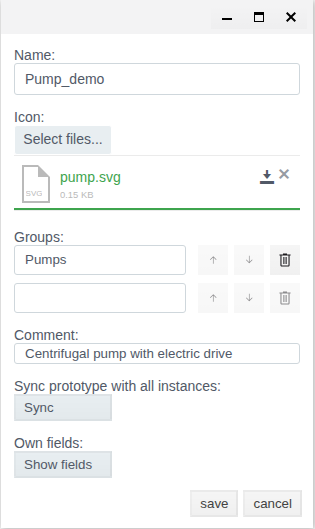

Save. Empty Content and Fields are created together with the prototype, and Behaviour receives a ready-made template.

Double-clicking a prototype opens its Content. The breadcrumbs above the table (**Prototypes / Pump / Content**) lead back to the list.

## Content

Select a prototype and click **Content**. This is the same object tree as in the General View, with the same buttons: **Create**, **Edit**, **Delete**, **Copy**, **Paste**, **Screen**, **Dependencies**.

Add the folder `motor` to the `Pump` content:

1. Click **Create**.
2. Expand the **system** group, select **FOLDER** and click **Ok**.

   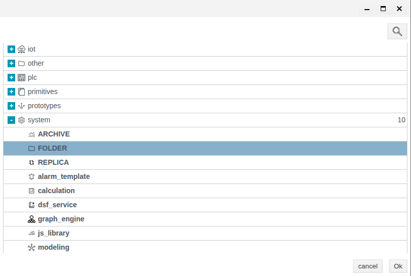

3. Enter **Name** `motor` and **Title** "Electric motor". Save.

   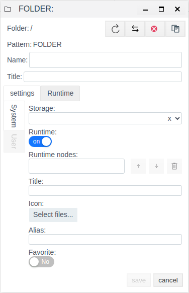

Objects of other types are added the same way, from their groups in the type selection dialog: `iot` ([IoT](../data_collection/IoT/IoT.md)), `plc` ([PLC connections](../data_collection/plc_connections/general_en.md)), `primitives` ([Primitives](../primitives/Primitives.md)), `prototypes`, `system` (for example, [calculations](../calculation/calculation.md) and [User Script](../user_script/user_script.md)).

The **Folder** line of the form shows the path from the content root: `/` is the root itself. In the instance `P_201`, the folder `/motor` ends up at `P_201/motor`.

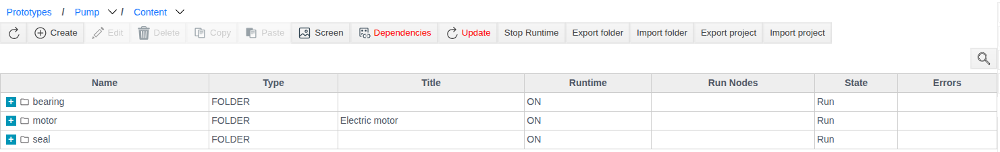

The **Screen** button at the content root opens the prototype screens: `screen`, `view1`–`view15` and `settings`. The screens are placed on project screens as the "Prototype" graphic element; `settings` is shown on the **User** tab of every instance form. See ["Screen editor"](../mnemo/editor.md), section "Prototype screens".

## Fields

Click **Fields**. The table lists the own fields of the prototype. **Show system fields** adds the inherited fields (`.name`, `.folder`, `.pattern` and others). The name of an inherited field cannot be changed.

Click **Create** and fill in the field form.

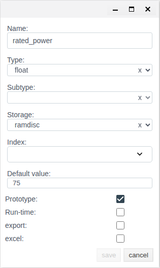

| Field | Values | Rules |
|---|---|---|
| **Name** | — | Required |
| **Type** | `string`, `integer`, `float`, `bool`, `link`, `atom`, `term`, `list` | Required |
| **Subtype** | The same types except `list` | Required only for the `list` type: the type of list elements |
| **Storage** | `disc`, `ramdisc`, `ram` | Required, `ramdisc` by default |
| **Index** | `simple`, `3gram`, `datetime` | Optional. `string` offers `simple` and `3gram`, `integer` offers `simple` and `datetime`, `float` offers none |
| **Default value** | — | The value the field has until it is set |
| **Prototype** | flag | The field value is transferred from the prototype to instances by synchronization in `update` mode. `update` does not change a field without the flag |
| **Run-time** | flag | The field is shown on the **Runtime** tab of the instance form and in the **Show fields** window |
| **export** | flag | The field is included in the project export |
| **excel** | flag | The field takes part in the Excel exchange |

In the example, `Pump` has three fields:

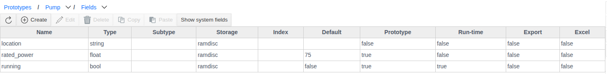

The **Runtime** tab of the instance form shows only the fields with the **Run-time** flag and the system field `disabled`. Fields without the flag (`rated_power`, `location`) are not shown in the instance form.

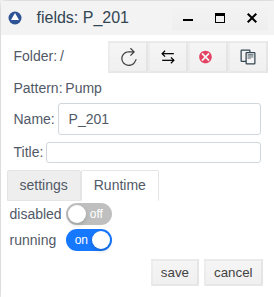

**Run-time field values of the prototype itself.** Open the prototype with **Edit** and click **Show fields**. The "Pump default field values" window lists the Run-time fields of the prototype. The window opens only for a saved prototype.

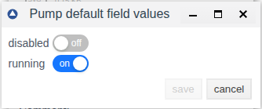

> [!NOTE]
> The values from this window are not copied into a new instance on creation. In the example, `running` is on in `Pump`, while it is off in the instance `P_202` created afterwards. Existing instances receive the value by synchronization in `update` mode if the field has the **Prototype** flag.

## Behaviour

Click **Behaviour**. An Erlang code editor opens with a template of three functions:

| Function | Called when |
|---|---|
| `on_create/1` | A new instance of the prototype is created |
| `on_edit/1` | The own fields of an instance are edited |
| `on_delete/1` | An instance is deleted |

Each function receives the instance object and must return `ok`. If a function throws, the whole transaction is rolled back. Log non-critical errors with the `?LOGWARNING` and `?LOGERROR` macros.

Check the code with **Compile** and save.

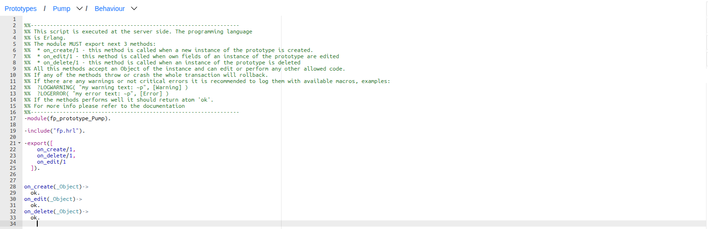

## Creating an instance

1. In the General View, open the folder for the instance and click **Create**.
2. Expand **prototypes**, then the prototype group ("Pumps"). Select `Pump` and click **Ok**.

   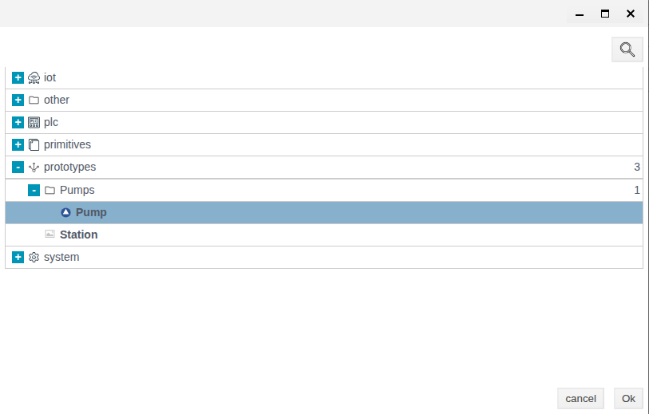

3. Enter **Name** `P_201` and **Title** "Pump P-201". Save.

   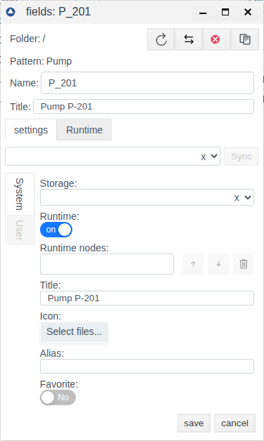

`P_201` appears in the tree with the prototype icon and `Pump` in the **Type** column. It contains a copy of the content.

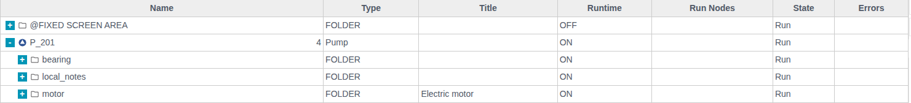

The instance form shows its prototype above the tabs: `Pump/content`.

## Synchronizing a prototype with its instances

Synchronization transfers the current state of a prototype to all its instances. Select the prototype, click **Edit**, then **Sync**. Check the modes and click **OK**.

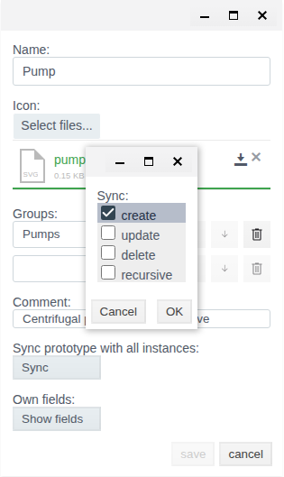

| Mode | What it does |
|---|---|
| `create` | Adds content objects that instances do not have yet. Existing objects are not changed |
| `update` | Overwrites the fields with the **Prototype** flag in instance objects with the prototype values, including the instance root |
| `delete` | Removes from instances the objects deleted from the prototype. Objects added to an instance manually stay |
| `recursive` | Extends synchronization to instances of outer prototypes whose content holds an instance of this prototype (see [Nested prototypes](#nested-prototypes)) |

Modes can be combined. For `update`, `delete` and `recursive` the system asks for confirmation; answer **yes**. If no mode is selected, the message "Options for sync are not selected" appears. After a successful synchronization the message is "Sync is finished".

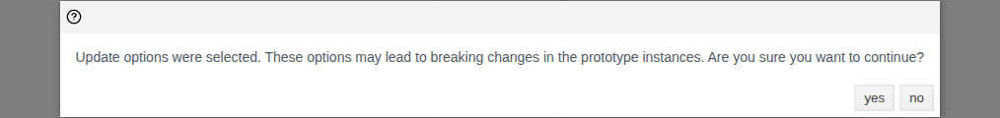

> [!WARNING]
> `update` also overwrites the fields of the instance root. In the example, after `update` the instance `P_201` lost its title "Pump P-201" because the title of the `Pump` content root is empty. After `update`, check the titles and own fields of the instances.

Example from the project:

| Change in the `Pump` prototype | Mode | Result in `P_201` |
|---|---|---|
| Folder `valve` added | `create` | `valve` appeared |
| Title of `motor` → "Electric motor" | `update` | Title of `motor` = "Electric motor", title of `P_201` cleared |
| Folder `valve` deleted | `delete` | `valve` removed, manually added `local_notes` stayed |
| `running` is on in the prototype, **Prototype** flag cleared | `update` | `running` unchanged |
| **Prototype** flag set on `running` | `update` | `running` is on |

## Nested prototypes

An instance of one prototype can be placed in the content of another. In the example, the instance `P1` of `Pump` is created in the `Station` content (**Content** → **Create** → **prototypes** → "Pumps" → `Pump`).

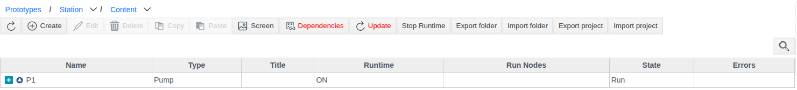

The station instance `ST_1` receives a copy of `P1`. The direct instances of `Pump` are `P_201` and `P1` in the `Station` content; any synchronization of `Pump` updates them. `ST_1/P1` is a second-level instance, and changes reach it in different ways:

| Synchronization | `P_201` | `ST_1/P1` |
|---|---|---|
| `Pump`: `create` + `recursive`, folder `seal` added | `seal` appeared | `seal` appeared |
| `Pump`: `create`, folder `bearing` added | `bearing` appeared | Unchanged |
| `Pump`: `update` + `recursive`, title of `motor` changed | Title updated | Unchanged |
| `Station`: `update` | — | Title of `motor` updated |

> [!NOTE]
> `recursive` transfers new objects (`create`) to the second level, but not field changes (`update`). To update fields in the instances of an outer prototype, run **Sync** with `update` on `Station` after synchronizing `Pump`.

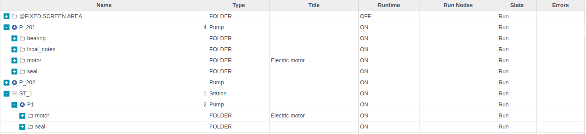

## Exporting and importing a prototype

**Export.** Select a prototype and click **Export**. The browser saves the file `prototype.prt`. The button is inactive while no prototype is selected.

**Import.** Click **Import**, switch on the required modes, select a `.prt` file and save. On success the message "The prototype was imported successfully" appears.

| Switch | What it does |
|---|---|
| **create** | Creates objects from the file that do not exist in the project |
| **Update** | Updates existing objects with the values from the file |
| **Delete** | Deletes prototype objects that are not in the file |

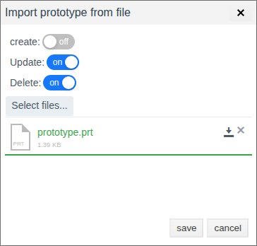

If the changes are needed in instances, run **Sync** after the import.

# Conclusion

The typical workflow with a prototype:

1. Create a prototype, set its icon and group.
2. Build the Content from project objects.
3. Describe the Fields. Set **Run-time** on fields that must be visible in the instance form and **Prototype** on fields that must be synchronized. Transfer Run-time field values to instances with `update`.
4. If needed, write the Behaviour and check it with **Compile**.
5. Create instances in the General View.
6. After changing the prototype, run **Sync**: `create` for new objects, `update` for changed fields, `delete` for deleted objects, `recursive` for nested prototypes. Update fields in nested instances by running `update` on the outer prototype. After `update`, check the fields of the instance roots.
7. To move a prototype between projects, use **Export** and **Import**.
