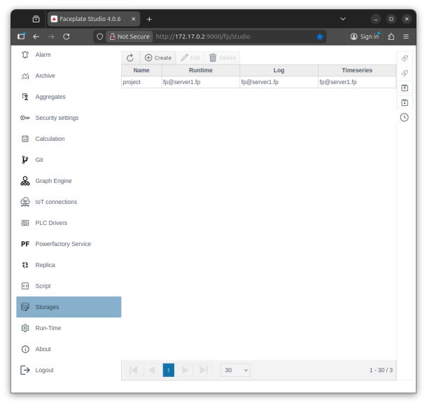
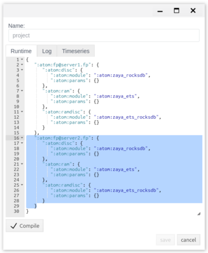
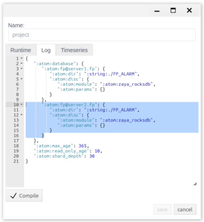
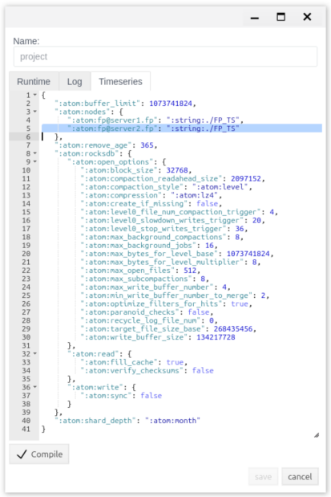
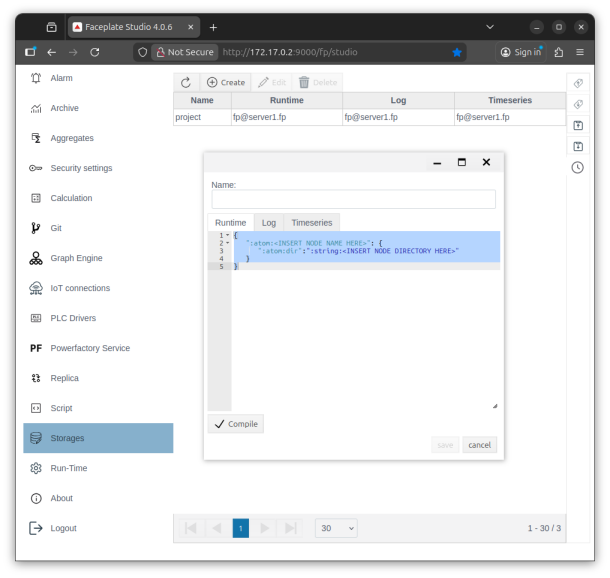
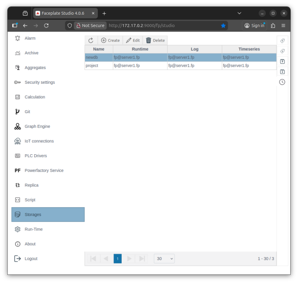
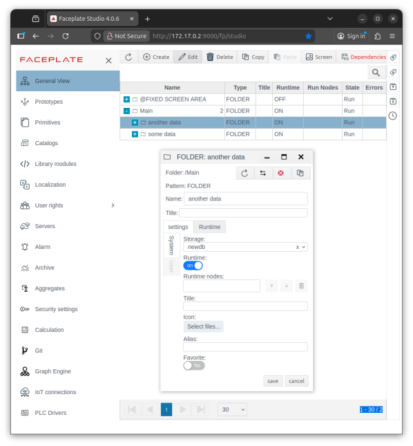
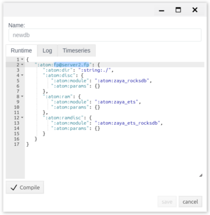
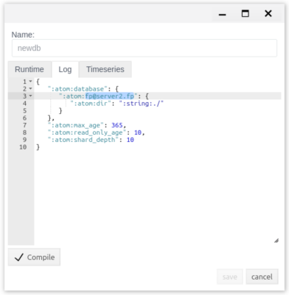
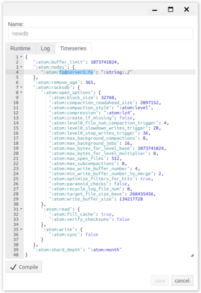

# Introduction

One of FACEPLATE's key features is its ability to quickly and flexibly configure distributed data storage. This allows for load balancing between storage servers and, if necessary, moving data to separate databases or nodes.  
Using the built-in storage editor module, you can perform the following operations:

* create new databases  
* change database storage directories  
* organize cluster data storage  
* migrate databases between cluster nodes

Within a single server, the data storage mechanism is implemented similarly to UNIX-like systems, where available disks are mounted into directories, and all data created within a directory is physically stored on the corresponding disk. In FACEPLATE, these "disks" are databases, which can be located on different physical media. Furthermore, FACEPLATE allows for distributed data storage. Individual databases can be migrated to different servers. It's important to note that more than one copy of each database can be configured, and these copies can be stored on different servers, thus providing hot backup.

# Possibilities

The ability to divide a logically unified database into several physically independent shards, and the ability to organize their distributed storage and backup provide FACEPLATE with the following advantages:

* Fault tolerance – FACEPLATE can survive the failure of individual storage devices or nodes without loss of functionality or data access. Depending on the storage architecture configuration, FACEPLATE allows the loss of more than half of the nodes without system failure.  
* Load balancing is the distribution of computing resources between servers to optimize performance and prevent overload.  
* Scalability \- the ability to easily add new nodes without stopping the system.

The FACEPLATE data storage architecture can be modified on the fly, without shutting down the system or individual nodes. For example, you can add new servers to an existing system, assign them functions, and add copies of your databases to them, or completely migrate some of your databases to them.  
Sharding enables horizontal scaling—data from a single logical database is divided into independent parts (shards), which can be hosted on either a single server or different servers in a cluster. This approach effectively addresses scaling challenges when vertical scaling is economically unfeasible or impossible. Each shard stores its own portion of the data and can be located on a separate physical disk or server, allowing for load balancing across available resources and efficient processing of large volumes of data. Benefits:

* Performance \- increased speed of query processing when working with large volumes of data;  
* Scalability \- increasing system resources as the project grows;  
* Management flexibility – manage your data storage architecture without having to shut down the system or any of its nodes.

# Description

The FACEPLATE Studio database is used to store project settings, real-time data continuously streaming into the system, generated messages, and archives. The Storage Editor is used to manage the data storage architecture.  
When you first launch FACEPLATE, a "*project*" database is created by default. The database configuration consists of three main sections: Runtime, Messages, and Archives.

***Runtime*** – This section is used to configure the storage of project configurations and real-time data. The configuration defines the storage types used on a specific FACEPLATE node and the driver modules that support them (for more details, see the [Database section](https://github.com/faceplate-docs/faceplate/blob/dev/docs/ru/README.md)).

***Log*** – This section is used to configure the storage parameters for system and application messages generated by the system (for more information on the message system, see [the Alarms section](https://github.com/faceplate-docs/faceplate/blob/dev/docs/ru/%D0%90%D1%80%D1%85%D0%B8%D0%B2%D1%8B%20%D0%B8%20%D0%A2%D1%80%D0%B5%D0%BD%D0%B4%D1%8B.md)). The configuration defines the storage, placement, and lifecycle parameters of messages (alarms, events, system messages) in the FACEPLATE system.

***Timeseries*** \- This section is used to configure the storage of archived (historical) data. This section defines the operating parameters of the archive storage. You can read more about the archiving system in [the Archives section](https://github.com/faceplate-docs/faceplate/blob/dev/docs/ru/%D0%90%D1%80%D1%85%D0%B8%D0%B2%D1%8B%20%D0%B8%20%D0%A2%D1%80%D0%B5%D0%BD%D0%B4%D1%8B.md). The configuration determines the storage, placement, and lifecycle of archives.  
You can read more about setting up storage parameters in the section "[Setting up storage parameters](https://github.com/faceplate-docs/faceplate/blob/dev/docs/ru/README.md)."

# Redundancy

To improve fault tolerance and system performance, FACEPLATE allows for easy hot backup of data. This is achieved by adding database copies to other available servers. If a database is configured with copies on two or more servers, FACEPLATE ensures their synchronization in real time. Requests to such a database are distributed among the servers that have a copy. Therefore, if a server fails, there is no failure; requests are simply transferred to the remaining available servers.

## Example

As an example, we'll demonstrate setting up a hot backup for a project database using two servers. The servers must be connected to each other via a network. The basic requirements and steps are outlined below:

* a stable communication channel between servers \- at least 100 Mbit/sec  
* Open access to ports 4369, 8000, 9000 \- more details [here](https://github.com/faceplate-docs/faceplate/blob/dev/docs/ru/README.md)  
* Prepare a directory with the FACEPLATE software on each server \- more details [here](https://github.com/faceplate-docs/faceplate/blob/dev/docs/ru/README.md)  
  * unzip the FACEPLATE software and open the directory  
  * Edit the FACEPLATE configuration file at faceplate/releases/4.0/vm.args \- more details [here](https://github.com/faceplate-docs/faceplate/blob/dev/docs/ru/README.md). For our example, we'll use the following names:  
    * first server: \-name fp@server1.fp  
    * second server: \-name fp@server2.fp  
* To enable the servers to find each other using their domain names (server1.fp, server2.fp), we'll add the appropriate entries to the /etc/hosts file (Linux) on both servers. IP addresses are provided for clarity; use actual addresses:  
  * 192.168.1.11 	server1.fp  
  * 192.168.1.22 	server2.fp  
* On the first server, go to the FACEPLATE folder, open a terminal, and run the following commands:  
  * ulimit \-n 200000  
  * ./faceplate/bin/faceplate console  
* Next, wait for the first server to start, as indicated by the following message in the console (---FACEPLATE STARTED---) and the web interface accessible at the following address (http://192.168.1.11:9000/fp/studio). When first launched, FACEPLATE creates the *project* database and the necessary environment.  
* After the first server is launched, we will launch the second one, but with the ATTACH command specified for the first server. To do this, go to the second server, open the terminal, go to the folder with FACEPLATE and execute the following commands:  
  * ulimit \-n 200000  
  * env ATTACH\_TO=fp@server1.fp ./faceplate/bin/faceplate console  
* Next, you should wait for FACEPLATE to launch on the 2nd server (similarly to the 1st server, we check the logs and the available web interface)

As a result, after completing the steps listed above, we have two servers combined into a cluster. When the first server started, the *project database was created on it* . The second server does not have a copy of the database, as it was joined to the first server and accessed the existing database. To add a copy of the database to it, the following settings must be configured.

### Setting up {#setting-up}

To add a database copy to a new server, simply add the connected instance to the appropriate section in the storage settings. In our example, we'll add a copy of the project database to server 2\.  
To do this, open the Studio interface on Server 1 or Server 2 (it doesn't matter), go to the "Storage" editor, and open the project database for editing. In the Runtime tab, copy the configuration for Server 1 and replace the name *fp@server1.fp* with *fp@server2.fp* :  

You need to compile and save the changes. Clicking "save" will begin copying the database to server 2\. The corresponding entries should appear in the log files. The logs will record the database copy process, which will look like this:

* server1  
  * zaya\_copy:copy\_request/1:219 copy: project to 'fp@server2.fp' (start copy process)  
  * zaya\_schema\_srv:handle\_call/3:229 project db opened at 'fp@server2.fp' (completing the copy process)  
* server2  
  * zaya\_copy:try\_copy/1:119 copy: project from 'fp@server1.fp' (start of copy process)  
  * zaya\_copy:wait\_ready/1:450 copy: project from 'fp@server1.fp' finish copy (completion of the copy process)

At this point, server 2 has a copy of the project runtime database. By default, the database is created at the relative path *faceplate/DB*. If you access server 2, the database files should be located at this path.

Next, let's add a copy of the project message database to server 2\. To do this, open the project database again for editing and go to the "Log" tab. Here, copy the configuration from server 1 and replace the name *fp@server1.fp* with *fp@server2.fp* :  

You need to compile and save the changes. After clicking "save," the message database will begin copying to server 2\. Depending on the number of messages accumulated in the system, this process may take some time. The message database is divided into segments (more details can be found in [the Alarms](https://github.com/faceplate-docs/faceplate/blob/dev/docs/ru/%D0%90%D1%80%D1%85%D0%B8%D0%B2%D1%8B%20%D0%B8%20%D0%A2%D1%80%D0%B5%D0%BD%D0%B4%D1%8B.md) and [Database sections](https://github.com/faceplate-docs/faceplate/blob/dev/docs/ru/README.md)). Each segment covers a specific time period, as indicated by its name. For example, the segment project\_\_\_2026\_01\_20\_\_2026\_02\_18 contains messages from 2026-01-20 to 2026-02-18. The following entries will be recorded in the logs for each existing segment:

* server1  
  * zaya\_copy:copy\_request/1:219 copy: project\_\_\_2026\_01\_20\_\_2026\_02\_18 to 'fp@server2.fp' (start copying process)  
  * zaya\_copy:copy\_request/1:252 copy: project\_\_\_2026\_01\_20\_\_2026\_02\_18 to 'fp@server2.fp' finished (completion of the copy process)  
* server2  
  * zaya\_copy:try\_copy/1:119 copy: project\_\_\_2026\_01\_20\_\_2026\_02\_18 from 'fp@server1.fp' (start of copy process)  
  * zaya\_copy:wait\_ready/1:450 copy: project\_\_\_2026\_01\_20\_\_2026\_02\_18 from 'fp@server1.fp' finish copy (completion of the copy process)

Next, let's add a copy of the project archive database to server 2\. To do this, open the project database again for editing and go to the "Timeseries" tab. Here, copy the configuration from server 1 and replace the name *fp@server1.fp* with *fp@server2.fp*:  

You need to compile and save the changes. After clicking "save," the process of copying the archive database to server 2 will begin. Depending on the number of archives accumulated in the system, the copying process may take some time. The archive database is divided into segments (more details can be found in [the Archives](https://github.com/faceplate-docs/faceplate/blob/dev/docs/ru/%D0%90%D1%80%D1%85%D0%B8%D0%B2%D1%8B%20%D0%B8%20%D0%A2%D1%80%D0%B5%D0%BD%D0%B4%D1%8B.md) and [Database sections](https://github.com/faceplate-docs/faceplate/blob/dev/docs/ru/README.md)). Each segment covers a specific time period, as indicated by its name. For example, the segment project\_ts\_database\_2026-01-18 contains archives starting from 2026-02-18. The segment depth is determined by the shard\_depth setting *(the default is month).* The following entries will be recorded in the logs for each existing segment:

* server1  
  * fp\_ts\_schema:add\_node/3:158 project\_ts\_database node 'fp@server2.fp' with path "./FP\_TS" added to schema (start copy process)  
  * zaya\_copy:copy\_request/1:252 copy: project\_ts\_database\_2026-01-18 to 'fp@server2.fp' finished (completion of the copy process)  
* server2  
  * zaya\_copy:try\_copy/1:119 copy: project\_ts\_database\_2026-01-18 from 'fp@server1.fp' (start of copy process)  
  * zaya\_copy:wait\_ready/1:450 copy: project\_ts\_database\_2026-01-18 from 'fp@server1.fp' finish copy (completion of the copy process)

Once these steps are successfully completed, a two-server cluster will be created, configured with hot standby for the project database (by default, this includes all project data). If necessary, you can add additional servers and redistribute database copies between them. For example, you can create a Historian Server that stores only archived data and transfer database copies with archives to it (for more details, see [Historian Server](https://github.com/faceplate-docs/faceplate/blob/dev/docs/ru/README.md)).

# Sharding

In projects with large data volumes (millions of objects) and high data flow rates, dividing the database into shards makes sense. This allows for load balancing across available storage subsystems and servers. To understand the principles of sharding, consider the analogy of disk mounting in UNIX-like systems. When a disk drive is mounted to a folder, everything stored within that folder is physically stored on the disk mounted to it. In the case of FACEPLATE, the database plays the role of the disk drive. By default, FACEPLATE creates a single project database and mounts it to the project's root folder. This means that by default, everything created in the project is stored in the project database. However, the user can create other databases and mount them to folders within the project, resulting in the project remaining logically a single entity but physically being divided into multiple databases (shards).

## Example

To create a new database shard, click the "Create" button in the storage editor.  

After this, a dialog box will open, you need to specify a unique name (Latin, without special characters) and in each section you need to specify:

* storage node, for example \- ":atom:fp@server1.fp"  
* path to the storage directory \- ":atom:dir":":string:./" (relative and absolute paths are allowed)  
* compile

After saving the settings, the database will be created and added to the system. The following entries will be recorded in the logs:

* ecomet\_db:on\_create/1:820 creating a new database newdb\_\_\_2026\_02\_02\_\_2026\_02\_11 (start of creation process)  
* fp\_ts\_db\_pool\_sup:init/1:36 DB pool Supervisor has been started newdb\_test\_ts\_database (completing the creation process)

If you access the server, directories and database files should be created at the specified path (faceplate/DB):

* newdb  
* newdb\_\_\_2026\_01\_20\_\_2026\_01\_29  
* newdb\_ts\_database

### Usage

At this point, the shard has been created but contains no useful data. If you create a new folder in Studio and specify in its settings that the shard we created is mounted to it, everything created in this folder will be physically stored in this shard. To do this, go to the General View in Studio, select a previously created folder, or create a new one (for more details, see [Creating Objects](https://github.com/faceplate-docs/faceplate/blob/dev/docs/ru/Project_strucure/FACEPLATE-start.md)). In the folder properties, there's a Storage setting; here, you can select the *newdb* shard for storing objects*.* Save the settings to confirm your changes.  

Thus, all objects created in the "some data" folder will be stored and processed in the "project" database shard by default. Similarly, for the "another data" folder, they will be stored and processed in the new "*newdb*" database shard.

### Transfer

To move a database shard to another server, simply add a copy of the shard to the other server, then delete the copy from the current one. The entire procedure is also performed in the storage settings.  
*newdb* database from server 1 to server 2\. The process for adding a copy is already described in the " [Setup](#setting-up)" section of this document. After we've added a copy of the *newdb database* to server 2, we'll delete the copy from server 1, leaving the only copy on server 2\. To do this, open the Studio interface on server 1 or 2 (it doesn't matter), go to the "Storage" editor, and open the *newdb database for editing* . In the Runtime tab, delete the configuration for server 1 and leave only server 2 in it \- *fp@server2.fp* :  

You need to compile and save the changes. Clicking "save" will begin the database shutdown on server 1\. The corresponding entries should appear in the log files. The logs will record the database migration process, which will look like this:

* server1  
  * zaya\_db\_srv:handle\_event/4:402 newdb database close (starting the closing process)  
  * zaya\_schema\_srv:handle\_call/3:288 newdb copy removed from 'fp@server1.fp' (completing shutdown process)  
* server2  
  * zaya\_schema\_srv:handle\_call/3:246 newdb db closed at 'fp@server1.fp' (starting the closing process)  
  * zaya\_schema\_srv:handle\_call/3:288 newdb copy removed from 'fp@server1.fp' (completing shutdown process)

*newdb* message database from server 1\. To do this, open the *newdb* database again for editing and go to the "Log" tab. Here, delete the server 1 configuration and leave only server 2 \- *fp@server2.fp \-* in it :  

You need to compile and save the changes. Clicking "save" will begin the database shutdown on server 1\. The corresponding entries should appear in the log files. The logs will record the database migration process, which will look like this:

* server1  
  * zaya\_db\_srv:handle\_event/4:402 newdb\_\_\_2026\_01\_20\_\_2026\_01\_29 database close (start of closing process)  
  * zaya\_schema\_srv:handle\_call/3:288 newdb\_\_\_2026\_01\_20\_\_2026\_01\_29 copy removed from 'fp@server1.fp' (completing the shutdown process)  
* server2  
  * zaya\_schema\_srv:handle\_call/3:246 newdb\_\_\_2026\_01\_20\_\_2026\_01\_29 db closed at 'fp@server1.fp' (start of migration process)  
  * zaya\_schema\_srv:handle\_call/3:288 newdb\_\_\_2026\_01\_20\_\_2026\_01\_29 copy removed from 'fp@server1.fp' (completing the shutdown process)

*newdb* database again for editing and go to the "Timeseries" tab. Here, delete the server 1 configuration and leave only server 2 \- *fp@server2.fp \-* in it :  

You need to compile and save the changes. Clicking "save" will begin the database shutdown on server 1\. The corresponding entries should appear in the log files. The logs will record the database migration process, which will look like this:

* server1  
  * fp\_ts\_schema:remove\_node/2:171 newdb\_ts\_database node 'fp@server1.fp' removed from schema (start of transfer process)  
  * zaya\_schema\_srv:handle\_call/3:288 newdb\_ts\_database\_buffer\_0 copy removed from 'fp@server1.fp' (completion of migration process)  
* server2  
  * zaya\_schema\_srv:handle\_call/3:246 newdb\_ts\_database\_buffer\_0 db closed at 'fp@server1.fp' (starting migration process)  
  * zaya\_schema\_srv:handle\_call/3:288 newdb\_ts\_database\_buffer\_0 copy removed from 'fp@server1.fp' (completion of migration process)

The *newdb* database shard will be migrated from one server to another, which will ultimately use the second server's resources to store information.  
This way, you can migrate the required database shards between servers in a cluster.