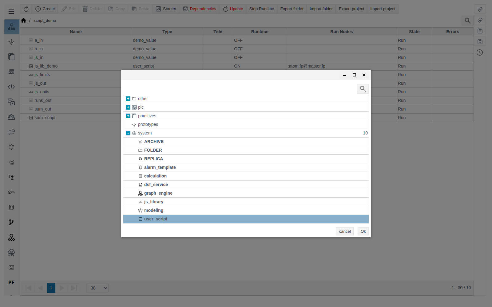
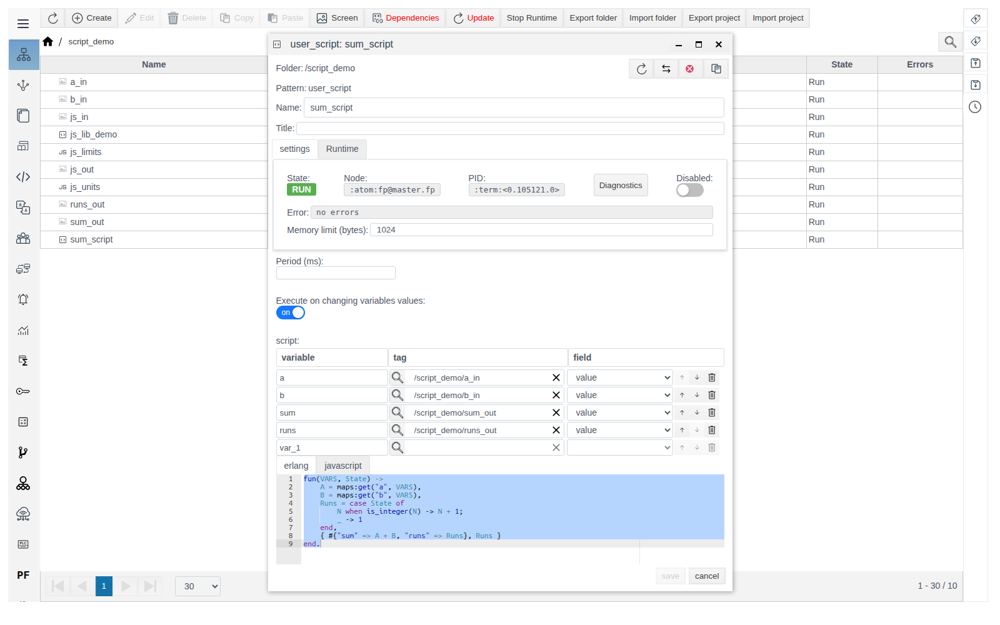
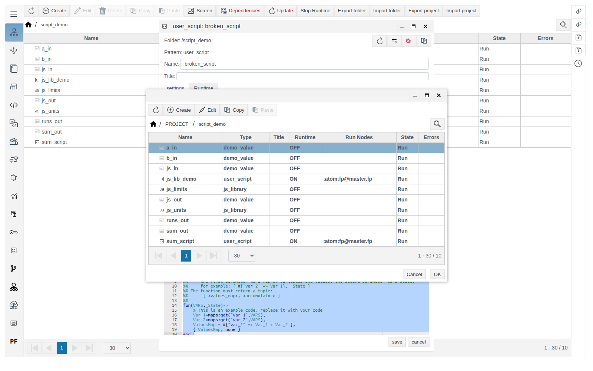
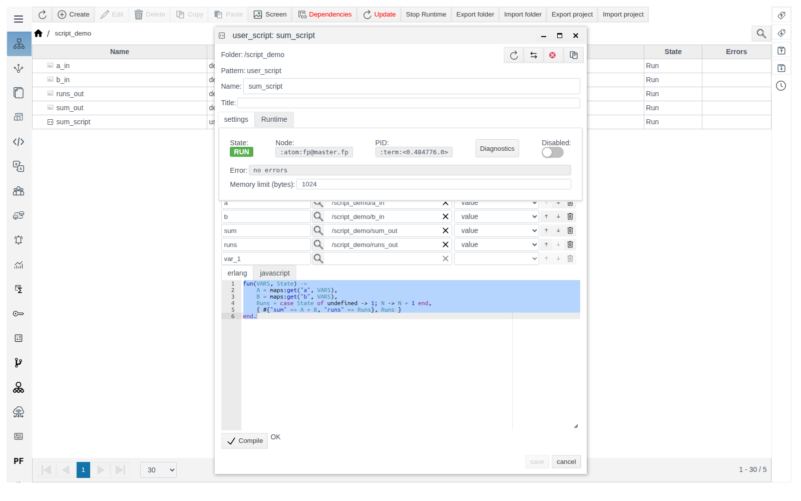
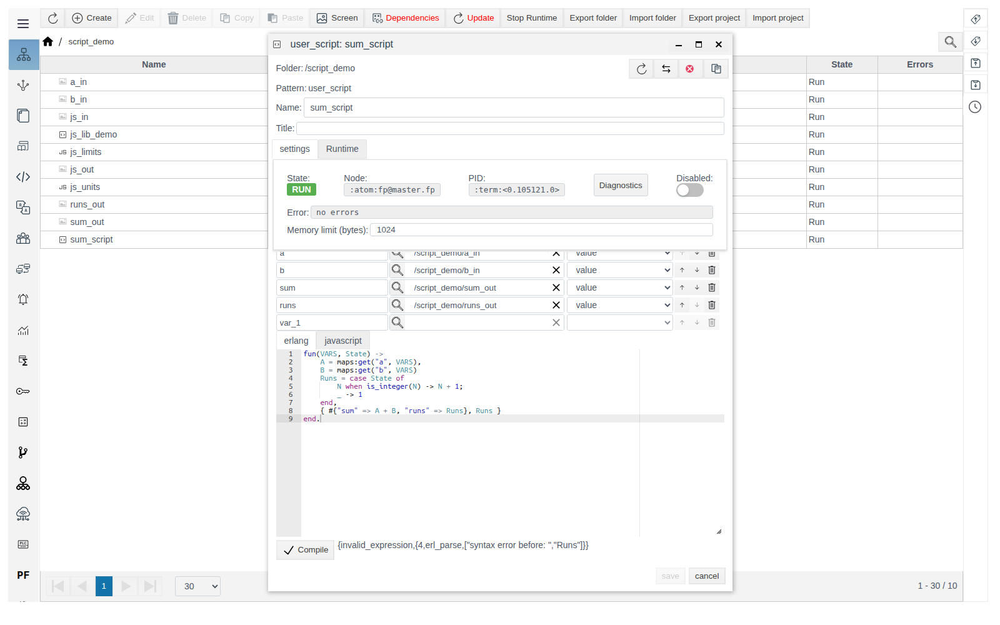
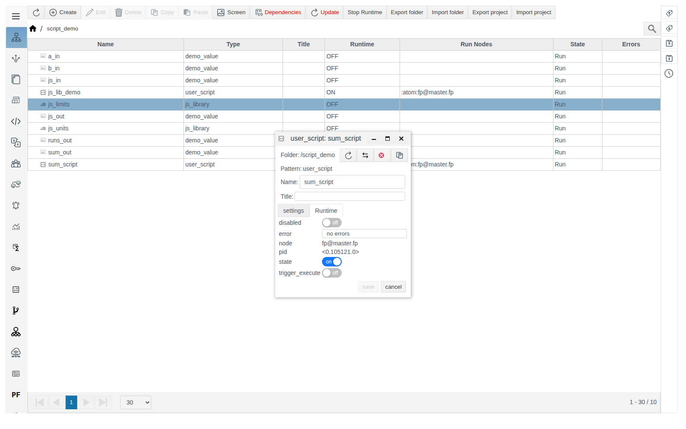
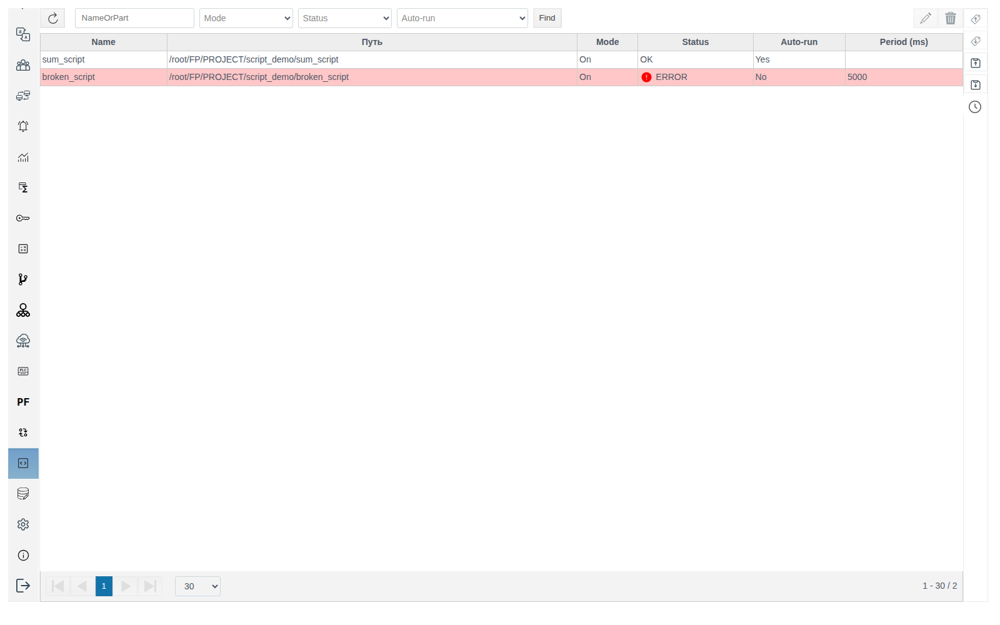
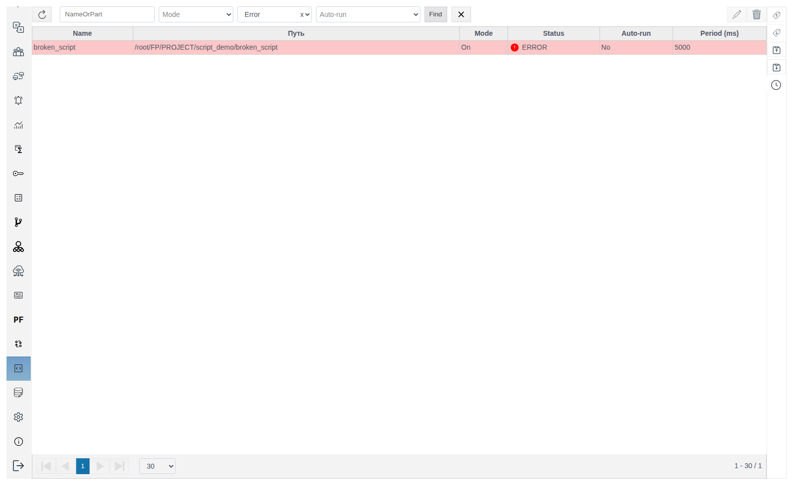
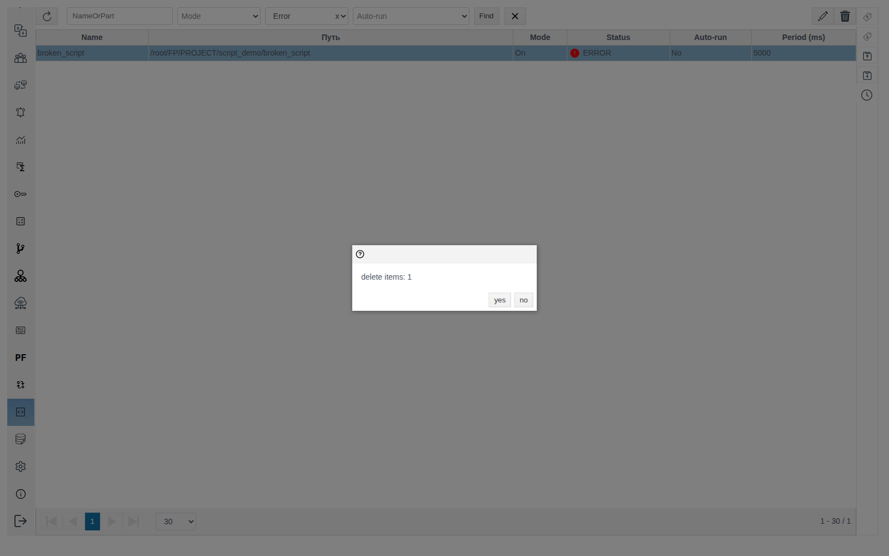

# User Scripts (User Script)

A guide for the integration engineer who writes server-side project logic in Erlang or JavaScript: computed values, counters, moving data between objects.

# Glossary

| Term | Meaning |
|---|---|
| User script | A project object of type `user_script`. Holds an Erlang or JavaScript function and its run conditions. Runs on the server |
| Variable | The name under which the function sees a field of a project object. Defined by the triple "name — object (tag) — field" |
| `VARS` | First function argument: values of all variables at the moment of the run |
| `State` | Second function argument: the value the function returned last time. Reset when the script restarts |
| Auto-run | The **Execute on changing variables values** mode: the script runs whenever any of its variables changes |
| **Script** section | Studio main menu item: a summary table of all user scripts in the project |

# Introduction

A user script reads fields of project objects, computes new values and writes them to object fields. The script is created as an object in the **General View** and runs:

| Condition | Where it is set |
|---|---|
| On a timer | **Period (ms)** |
| When any variable value changes | **Execute on changing variables values** |
| Manually, once | **Runtime** tab, **trigger_execute** switch |

When to use [Calculation](../calculation/calculation.md) and when to use User Script:

| Fits Calculation | Implement in User Script |
|---|---|
| Unit conversion, scaling | Calculations over history and time windows, rate of change |
| Formulas over several inputs: sum, difference, ratio, percentage, power, efficiency | Accumulation and totalizers, state between runs |
| Threshold flags and statuses | Alarms, SQL, user interface work |
| Simple conditions: range limiting, fallback value, division-by-zero guard | Complex logic and flow control |
| Extracting a bit from a word, mapping integer state codes | Protocol parsing, formula libraries |

Running example: the script `sum_script` in the folder `script_demo` adds the values of two objects `a_in` and `b_in`, writes the sum to `sum_out` and the number of runs to `runs_out`. All four objects have a numeric field `value` of type `float`. How to create such objects is covered in the [Primitives](../primitives/Primitives.md) guide.

You need access to Studio (`http://<server>:9000/fp/studio`) with an account allowed to modify the project.

# Main part

## Creating a script

1. In the **General View**, open the folder where the script will live.
2. Click **Create**, expand the `system` group, select `user_script` and click **Ok**.



3. Fill in **Name**, run conditions, variables and code (see the sections below).
4. Click **Compile**, wait for `OK`, save.

The script starts right after saving: in the **General View** its **Runtime** is `ON` and **Run Nodes** shows the node it runs on.



## Script form

### Status panel

| Field | Meaning |
|---|---|
| **State** | `RUN` — the script process is running, `STOP` — not started |
| **Node**, **PID** | Cluster node and process executing the script |
| **Diagnostics** | Process diagnostics window. Available for a saved script |
| **Disabled** | Stops the script without deleting it. In the **General View** a disabled script has **Runtime** `OFF` and **State** `Stop` |
| **Error** | Text of the last compile or runtime error. `no errors` — no errors |
| **Memory limit (bytes)** | Memory limit of the script process. `1024` is filled in after saving |

### Run conditions

| Field | Behaviour |
|---|---|
| **Period (ms)** | The script runs right after start and then with this period. Empty — no timer |
| **Execute on changing variables values** | The script runs once after start and then on every change of any variable value |

Both modes can be on at once. If both are off, the script stays in `RUN` but does not execute until it is started manually.

Writes the script makes to its own variables do not trigger it again: auto-run does not loop.

### Variables

The table under **script**: **variable** — the variable name in code, **tag** — a project object, **field** — its field.

1. Type the name in **variable**.
2. Click the magnifier in **tag**, open the object's folder, select the object, click **OK**. Only objects from the project tree can be selected.
3. Select the field in **field**. The list contains all object fields, system ones included.



Once a row is filled, an empty `var_1` row appears below it; an unfilled row can be left as is. Arrows change the order, the bin deletes a row.

For the example:

| variable | tag | field |
|---|---|---|
| `a` | `/script_demo/a_in` | `value` |
| `b` | `/script_demo/b_in` | `value` |
| `sum` | `/script_demo/sum_out` | `value` |
| `runs` | `/script_demo/runs_out` | `value` |

The same variable is used both for reading and writing. Only a field declared as a variable can be written.

## Erlang code

**erlang** tab. A function of arity 2: takes `VARS` and `State`, returns the tuple `{ ValuesToWrite, NewState }`.

```erlang
fun(VARS, State) ->
    A = maps:get("a", VARS),
    B = maps:get("b", VARS),
    Runs = case State of undefined -> 1; N -> N + 1 end,
    { #{"sum" => A + B, "runs" => Runs}, Runs }
end.
```

| Element | Rule |
|---|---|
| `VARS` | A map keyed by variable names as strings: `"a"`, not `a` |
| Values to write | A map "variable name — value". Keys missing from the variable table are ignored. An empty map `#{}` writes nothing |
| `State` | `undefined` on the first call after start. Afterwards — the second element of the previous result |
| Final dot | The code ends with `end.` |

> **Important.** The template of a new form returns `none` as the state, but the first call receives `undefined`, not `none`. Code like `case State of none -> …` fails on the first run: the example above with `none` instead of `undefined` gets `badarith`.

The value type follows the field type: a `float` field gives a number, a `string` field gives a string. Adding string fields gives `badarith`.



## JavaScript code

**javascript** tab. An async function with the same arguments returns the object `{ vars, state }`:

```javascript
async function(VARS, State) {
    const runs = (State ?? 0) + 1;
    return { vars: { sum: VARS.a + VARS.b, runs: runs }, state: runs };
}
```

- Variables are accessed by name: `VARS.a`.
- No `vars` in the result — nothing is written.
- `State` is not set on the first call, so the initial value is supplied with `??`.

Switching between the **erlang** and **javascript** tabs does not change the editor text. Replace the code entirely and click **Compile**.

The JavaScript editor may mark lines with a red cross even for valid code. Rely on the **Compile** result.

## Compile and saving

**Compile** checks the code and passes it to the form. Next to the button you see `OK` or the error text, for example:

`{invalid_expression,{4,erl_parse,["syntax error before: ",",\"Runs\""]}}`



> **Important.** Only code that passed **Compile** is saved. After a failed **Compile**, **save** stays disabled until a successful one. If you fix the code without **Compile** and change another field (for example **Period (ms)**), **save** becomes available, but the previous code is saved without warning. Always click **Compile** and wait for `OK` before saving.

Every save restarts the script: the code is reloaded and `State` is reset.

## Runtime errors

An error raised while the function runs is shown in three places:

- the **Error** field of the script form;
- the **Errors** column in the **General View**;
- a red row with status **ERROR** in the **Script** section. The error text is in the tooltip over **ERROR**.

| Text | Cause |
|---|---|
| `badarith` | Arithmetic on a non-numeric value: a string field or `State` = `undefined` |
| `{badkey,"c"}` | The code reads variable `c`, which is not in the variable table |
| `{badmatch,{error,{undefined_field,<<"out_value">>}}}` | The object has no field named in the variable |

The error is cleared after the first successful run. Variable values are not written when an error occurs.

## Manual run

Open the **Runtime** tab, turn on **trigger_execute**, save. The script runs once; the switch resets by itself.



## The "Script" section

The **Script** main menu item lists all user scripts of the project.



| Column | Meaning |
|---|---|
| **Name**, **Путь** (path) | Name and full path of the script object |
| **Mode** | `On` or `Off` (the **Disabled** switch) |
| **Status** | `OK` or **ERROR** |
| **Auto-run** | `Yes` if **Execute on changing variables values** is on |
| **Period (ms)** | The period value or empty |

Filters above the table: part of the name, **Mode**, **Status** (`Error` / `OK`), **Auto-run**. Choose conditions and click **Find**; the cross next to it resets the filters.



Scripts cannot be created in this section, only in the **General View**. Open a script by double-click or with the pencil button on the right; delete it with the bin button. The confirmation shows only the number of scripts (`delete items: 1`); confirm with **yes**.



## UI notes

| On screen | Where |
|---|---|
| Path column header stays Russian: **Путь** | **Script** section |
| **Runtime** tab shows fields by system names: **disabled**, **error**, **node**, **pid**, **state**, **trigger_execute** | Script form |
| First tab is labelled **settings** in lower case | Script form |
| Name filter placeholder `NameOrPart` | **Script** section |
| Caption `delete items: N` | Delete confirmation |

# Conclusion

Workflow:

1. Prepare objects with fields of suitable types: numbers in `integer` or `float` fields.
2. In the **General View**, create a `user_script` (group `system`).
3. Declare variables for every field the script reads or writes.
4. Choose how it runs: **Period (ms)**, **Execute on changing variables values**, or both.
5. Write the function. In Erlang, `VARS` keys are strings and the first `State` is `undefined`. In JavaScript, the result is `{ vars, state }`.
6. Click **Compile**, wait for `OK`, save.
7. Check **Status** in the **Script** section. On **ERROR**, read the text in the tooltip or in the form's **Error** field.
