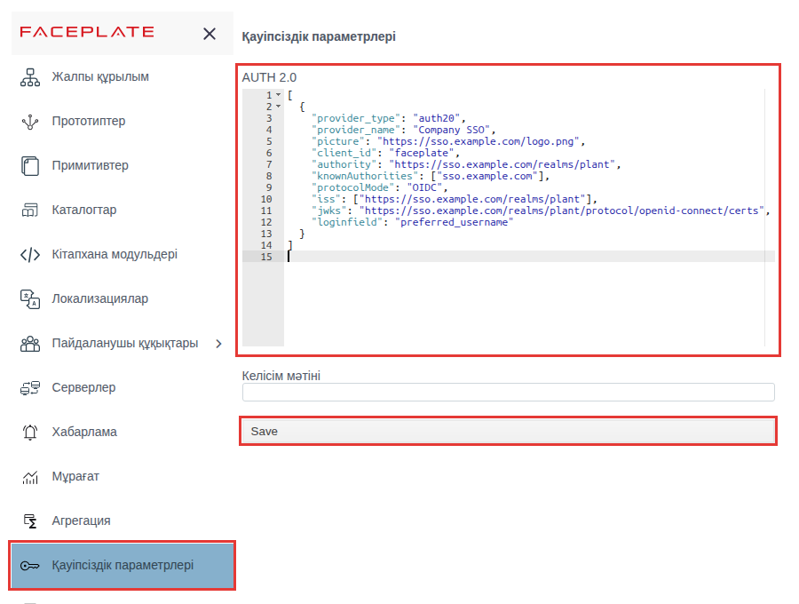
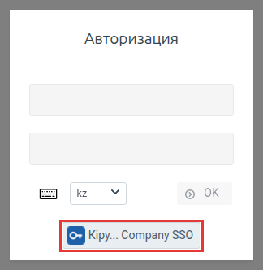

# Сыртқы авторизация

Бұл құжат Studio және Runtime ортасына корпоративтік тіркелгі провайдері (OpenID Connect, бірыңғай кіру) арқылы кіруді қосатын интегратор инженерге арналған.

# Мазмұны

- [Терминдер сөздігі](#терминдер-сөздігі)
- [Кіріспе](#кіріспе)
- [Негізгі бөлім](#негізгі-бөлім)
    - [Кіру қалай өтеді](#кіру-қалай-өтеді)
    - [Қолданбаны провайдерде тіркеу](#қолданбаны-провайдерде-тіркеу)
    - [AUTH 2.0 өрісі](#auth-20-өрісі)
    - [Тіркелгілер және құқықтар](#тіркелгілер-және-құқықтар)
    - [Қайта кіру және токеннің әрекет ету мерзімі](#қайта-кіру-және-токеннің-әрекет-ету-мерзімі)
    - [Шығу](#шығу)
    - [Баптауды тексеру](#баптауды-тексеру)
- [Қорытынды](#қорытынды)

# Терминдер сөздігі

| Термин | Мағынасы |
|---|---|
| AUTH 2.0 | **Қауіпсіздік параметрлері** бөліміндегі өріс. JSON форматындағы провайдерлер тізімі. Кіру формасы әр провайдер үшін жеке батырма көрсетеді |
| Провайдер сипаттамасы | **AUTH 2.0** тізіміндегі бір JSON объектісі: провайдер мекенжайы, қолданба идентификаторы, токенді тексеру ережелері |
| Провайдер батырмасы | Кіру формасындағы **OK** батырмасының астындағы «Кіру... <атауы>» батырмасы |

# Кіріспе

Сыртқы авторизация Studio және Runtime кіру формасына провайдер батырмасын қосады. Пайдаланушы провайдерде корпоративтік тіркелгімен кіреді, ал Faceplate алынған токеннен логинді анықтап, сол логині бар Faceplate пайдаланушысының сеансын ашады. Faceplate паролі қажет емес. Сол формада логин мен пароль арқылы кіру сақталады.

Провайдер тек тұлғаны растайды. Рөлдер мен құқықтар бұрынғыдай Faceplate ішінде беріледі, [Пайдаланушылар](users.md) және [Рөлдер және кіру құқықтары](roles.md) құжаттарын қараңыз. Кіру формасының өзі [Кіру және сеанстар](login.md) құжатында сипатталған.

Мысалда провайдер — `https://sso.example.com/realms/plant` OpenID Connect сервері, қолданба онда `faceplate` идентификаторымен тіркелген, батырма **Company SSO** деп аталады, ол арқылы `petrov` операторы кіреді.

Қажет:

- жобаны өзгерту құқығы бар тіркелгімен Studio ортасына (`http://<сервер>:9000/fp/studio`) кіру мүмкіндігі;
- қолданбаны тіркеу үшін провайдердегі әкімші құқықтары.

# Негізгі бөлім

## Кіру қалай өтеді

1. Пайдаланушы кіру формасында провайдер батырмасын басады.
2. Браузер провайдердің кіру бетіне өтеді. Егер пайдаланушының провайдерде сеансы ашық болса, бет көрсетілмейді.
3. Провайдер браузерді кіру басталған Faceplate мекенжайына қайтарып, токен береді.
4. Faceplate сервері токенді тексереді: шығарушыны (`iss`), провайдердің ашық кілттері бойынша қолтаңбаны, әрекет ету мерзімін. Логин токеннен алынады.
5. Осы логині бар Faceplate пайдаланушысының сеансы ашылады: кіру қай мекенжайдан басталғанына қарай Runtime немесе Studio.

## Қолданбаны провайдерде тіркеу

Faceplate қолданбасын провайдерде құпиясыз браузерлік қолданба ретінде тіркеңіз (жария клиент, PKCE бар Authorization Code ағыны).

| Провайдердегі параметр | Мәні |
|---|---|
| Қайтару мекенжайлары (Redirect URI) | `http://<сервер>:9000/fp/runtime` және `http://<сервер>:9000/fp/studio` — пайдаланушылар Runtime және Studio ашатын мекенжайлар |
| Сұрауларға рұқсат етілген көздер (CORS) | `http://<сервер>:9000` |
| Қол жеткізу аймақтары (scopes) | `openid`, `profile`, `User.Read`. Faceplate үшеуін де сұрайды, провайдер әрқайсысын қабылдауы керек |
| Токен қолтаңбасы | RSA: RS256, RS384 немесе RS512. Ашық кілттер — провайдердің JWKS мекенжайында |
| Логин өрісі | Мәні Faceplate ішіндегі пайдаланушы логинімен сәйкес келетін токен өрісі |

Егер провайдерде `User.Read` аймағы болмаса, оны жасап, қолданбаға рұқсат етіңіз: онсыз провайдер кіруден бас тартады.

Провайдер қолданба идентификаторын (client ID) береді — ол **AUTH 2.0** өрісінде қажет.

## AUTH 2.0 өрісі

Studio негізгі мәзірінде **Қауіпсіздік параметрлері** бөлімін ашып, **AUTH 2.0** өрісіне провайдерлер тізімін енгізіңіз де, **Save** батырмасын басыңыз. «Параметрлер сәтті сақталды» хабарламасы шығады. Батырма кіру формасы келесі ашылғанда пайда болады.



Бір провайдерге арналған мысал:

```json
[
  {
    "provider_type": "auth20",
    "provider_name": "Company SSO",
    "picture": "https://sso.example.com/logo.png",
    "client_id": "faceplate",
    "authority": "https://sso.example.com/realms/plant",
    "knownAuthorities": ["sso.example.com"],
    "protocolMode": "OIDC",
    "iss": ["https://sso.example.com/realms/plant"],
    "jwks": "https://sso.example.com/realms/plant/protocol/openid-connect/certs",
    "loginfield": "preferred_username"
  }
]
```

| Кілт | Мәні |
|---|---|
| `provider_type` | Әрқашан `auth20`. Басқа мәні бар сипаттама үшін батырма пайда болмайды |
| `provider_name` | Батырмадағы атау: «Кіру... <provider_name>» |
| `picture` | Міндетті емес. Батырмада атаудың сол жағында көрсетілетін сурет мекенжайы. Суретті пайдаланушының браузері жүктейді, сондықтан мекенжай оның компьютерінен ашылуы керек. Сурет биіктігі батырмаға сәйкестендіріледі, пропорциялары сақталады |
| `client_id` | Провайдердегі қолданба идентификаторы |
| `authority` | Браузер кіру үшін өтетін провайдер мекенжайы |
| `knownAuthorities` | Провайдер хостының аты бар тізім: `["<провайдер хосты>"]` |
| `protocolMode` | `"OIDC"` |
| `iss` | Токеннің рұқсат етілген шығарушыларының тізімі. Токендегі `iss` мәні солардың біреуімен таңбасына дейін сәйкес келуі керек |
| `jwks` | Провайдердің ашық кілттер жиынының (JWKS) мекенжайы. Оны Faceplate сервері ашады, сондықтан мекенжай тек браузерден емес, серверден де қолжетімді болуы керек |
| `loginfield` | Логин алынатын токен өрісі. Кілт көрсетілмесе, `nickname` өрісі қолданылады |

`knownAuthorities` және `protocolMode` болмаса, провайдер беті ашылмайды: батырманы басқаннан кейін кіру формасы қайта көрсетіледі.

Бірнеше провайдер үшін сипаттамаларды тізімде үтір арқылы жазыңыз — формада әрқайсысына тізім ретімен бір батырмадан шығады.



Батырмаларды алып тастау үшін **AUTH 2.0** өрісінде бос `[]` тізімін қалдырып, сақтаңыз. Өрістегі JSON қатемен жазылса, ол сақталады, бірақ формада батырмалар пайда болмайды; логин мен пароль арқылы кіру бұл кезде жұмыс істейді.

Сол терезедегі **Келісім мәтіні** өрісі [Кіру және сеанстар, «Келісім мәтіні» бөлімі](login.md#келісім-мәтіні) құжатында сипатталған.

## Тіркелгілер және құқықтар

Провайдер арқылы кіру логині токендегі `loginfield` өрісінің мәнімен сәйкес келетін Faceplate пайдаланушысының сеансын ашады. Мұндай пайдаланушыларды **Пайдаланушы құқықтары** → **Пайдаланушылар** бөлімінде жасап, оларға рөлдер беріңіз, [Пайдаланушылар](users.md) құжатын қараңыз. Провайдер арқылы кіргенде Faceplate паролі қолданылмайды.

Кіру ережелері пароль арқылы кірудегідей: Studio тек `.administrators` рөлі бар пайдаланушыларға ашылады.

Егер Faceplate ішінде мұндай логині бар пайдаланушы болмаса немесе оның Studio ортасына кіру құқығы болмаса, провайдерде кіргеннен кейін пайдаланушының бұл жүйеге кіру құқығы жоқ екені және басқа пайдаланушы ретінде кіре алатыны, бұл кезде басқа жүйелерден де шығатыны туралы сұрақ шығады.

| Жауап | Не болады |
|---|---|
| **yes** | Провайдерден шығу ([Шығу](#шығу) бөлімін қараңыз), содан кейін кіру формасы. Провайдер батырмасын келесі басқанда провайдер логин мен парольді қайта сұрайды — басқа тіркелгімен кіруге болады |
| **no** | Кіру формасы. Провайдердегі сеанс сақталады, сондықтан провайдер батырмасы сол тіркелгімен қайта кіреді және қайта бас тарту алады |

Мысалда провайдерде де, Faceplate ішінде де `operators` рөлі бар `petrov` пайдаланушысы бар: **Company SSO** батырмасы арқылы ол Runtime ортасына кіреді, ал Studio ортасына кіргенде **yes** және **no** батырмалары бар, бұл жүйеге кіру құқығы жоқ екені туралы сұрақты көреді, өйткені оның `.administrators` рөлі жоқ.

## Қайта кіру және токеннің әрекет ету мерзімі

Провайдер арқылы кіргеннен кейін браузер токенді оның әрекет ету мерзімі біткенше сақтайды; мерзімді провайдер белгілейді. Токен әрекет етіп тұрғанда Studio және Runtime жаңа қойындыда немесе бетті жаңартқаннан кейін формасыз өздігінен кіреді.

Мерзім біткенде ашық сеанстар жұмысын жалғастырады, ал бет келесі ашылғанда кіру формасы көрсетіледі. Егер провайдердегі сеанс әлі ашық болса, провайдер батырмасы парольсіз кіреді.

## Шығу

Провайдер арқылы кірген пайдаланушы Studio немесе Runtime ортасында **Шығу** → **yes** басқанда провайдердегі сеанс та аяқталады: провайдердің жеке шығу терезесі ашылады. Онда шыққаннан кейін терезе жабылады, Faceplate кіру формасын көрсетеді, ал провайдер батырмасын келесі басқанда провайдер логин мен парольді сұрайды.

Логин мен пароль арқылы кірген пайдаланушы үшін **Шығу** әдеттегідей жұмыс істейді, [Кіру және сеанстар, «Шығу және сеанстың аяқталуы» бөлімі](login.md#шығу-және-сеанстың-аяқталуы) құжатын қараңыз.

## Баптауды тексеру

Егер баптаудан кейін кіру формасында провайдер батырмасы болмаса немесе ол арқылы кіру өтпесе, кестеден экранда көрінетінін тауып, жанында көрсетілгенді тексеріңіз.

Браузердің жеке (инкогнито) терезесінде тексеріңіз: онда сақталған токен мен провайдердегі сеанс кедергі келтірмейді.

| Не көрінеді | Нені тексеру керек |
|---|---|
| Формада провайдер батырмасы жоқ | **AUTH 2.0** өрісіндегі JSON, `provider_type` мәні |
| Батырманы басқаннан кейін қайтадан кіру формасы | **AUTH 2.0** ішіндегі `authority`, `knownAuthorities`, `protocolMode`; провайдерде қолданбаға `User.Read` аймағы рұқсат етілген |
| Аутентификация қатесі туралы және басқа пайдаланушы ретінде кіруді ұсынатын сұрақ | `jwks` мекенжайы Faceplate серверінен қолжетімді; токендегі `iss` мәні `iss` тізімінде бар; токенде `loginfield` ішінде көрсетілген өріс бар |
| Пайдаланушының бұл жүйеге кіру құқығы жоқ екені туралы сұрақ | Токендегі логині бар пайдаланушы Faceplate ішінде бар және оның қажетті рөлі бар |

# Қорытынды

1. Faceplate қолданбасын провайдерде тіркеңіз: жария клиент, `/fp/runtime` және `/fp/studio` қайтару мекенжайлары, `openid`, `profile`, `User.Read` аймақтары.
2. **Қауіпсіздік параметрлері** → **AUTH 2.0** → **Save** толтырыңыз: `provider_type` `auth20`, `client_id`, `authority`, `knownAuthorities`, `protocolMode`, `iss`, `jwks`, `loginfield`.
3. Faceplate ішінде логиндері токендегідей пайдаланушыларды жасап, оларға рөлдер беріңіз. Studio — тек `.administrators` рөлімен.
4. Провайдер батырмасымен Runtime және Studio ортасына кіруді жеке терезеде тексеріңіз.
5. Провайдер пайдаланушысы үшін **Шығу** провайдердегі сеансты да аяқтайды.
