# Кіру және сеанстар

Бұл құжат операторлар мен жобаның басқа пайдаланушыларына Studio және Runtime ортасына кіруді дайындайтын интегратор инженерге арналған.

# Мазмұны

- [Терминдер сөздігі](#терминдер-сөздігі)
- [Кіріспе](#кіріспе)
- [Негізгі бөлім](#негізгі-бөлім)
    - [Кіру формасы](#кіру-формасы)
    - [Экрандық пернетақта](#экрандық-пернетақта)
    - [Интерфейс тілі](#интерфейс-тілі)
    - [Келісім мәтіні](#келісім-мәтіні)
    - [Кіру қателері](#кіру-қателері)
    - [Авторизация тарихы](#авторизация-тарихы)
    - [Шығу және сеанстың аяқталуы](#шығу-және-сеанстың-аяқталуы)
- [Қорытынды](#қорытынды)

# Терминдер сөздігі

| Термин | Мағынасы |
|---|---|
| Сеанс | Браузердің бір қойындысындағы кіруден шығуға, бетті жаңартуға немесе жабуға дейінгі жұмыс |
| Тіркелгі тілі | Пайдаланушыда сақталған интерфейс тілі. Кіру формасында таңдалған тіл онымен салыстырылады |
| Келісім мәтіні | **Қауіпсіздік параметрлері** бөліміндегі өріс. Ол толтырылса, кіру формасы бұл мәтінді **OK** батырмасының астында көрсетеді |
| Авторизация тарихы | Тіркелгімен соңғы сәтті және соңғы сәтсіз кірудің күні мен уақыты көрсетілетін терезе |

# Кіріспе

Studio және Runtime бір кіру формасымен ашылады. Онда интерфейс тілі таңдалады, ал пернетақтасы жоқ сенсорлық панельде логин мен пароль экрандық пернетақтада теріледі. Форма **OK** батырмасының астында келісім мәтінін көрсете алады.

Тіркелгілер, парольдер және рөлдер **Пайдаланушы құқықтары** → **Пайдаланушылар** бөлімінде жасалады, [Пайдаланушылар](users.md) құжатын қараңыз. Оператордың өз паролін өзгертуі және байланыс үзілгеннен кейін сеансты қалпына келтіру [Күй жолы және байланыс](../operator/status.md#тіркелгі-және-құпиясөзді-өзгерту) құжатында, Runtime ортасына кіргеннен кейін ашылатын экран — [Жұмыс үстелі және навигатор](../operator/desktop.md#кіргеннен-кейінгі-соңғы-экран) құжатында сипатталған.

Құжат бойындағы мысал — `operators` рөлі бар оператор `petrov`.

Жобаны өзгерту құқығы бар тіркелгімен Studio ортасына (`http://<сервер>:9000/fp/studio`) кіру мүмкіндігі қажет.

# Негізгі бөлім

## Кіру формасы

Форма Studio (`http://<сервер>:9000/fp/studio`) немесе Runtime (`http://<сервер>:9000/fp/runtime`) мекенжайы бойынша ашылады. Кіргеннен кейін сұралған орта ашылады.

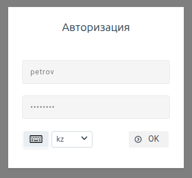

Жоғарғы өріс — логин, төменгісі — пароль; өрістердің жазуы жоқ. Өрістердің астында экрандық пернетақта батырмасы, тілдер тізімі және **OK** орналасқан. **OK** батырмасы екі өріс те толтырылғанда қолжетімді болады. Пароль өрісіндегі **Enter** **OK** сияқты жұмыс істейді.

## Экрандық пернетақта

Пернетақта суреті бар батырма курсор тұрған өріске экрандық пернетақтаны ашады. Ол физикалық пернетақтасы жоқ сенсорлық панельдерге арналған.

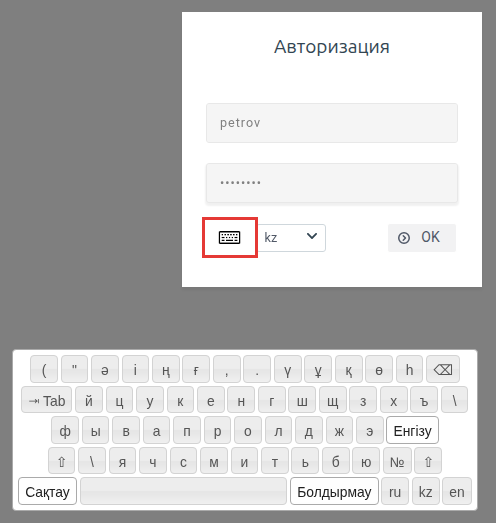

Пернетақта тілі форма тіліне сәйкес келеді, төменгі қатардағы **ru**, **kz**, **en** батырмалары оны ауыстырады.

## Интерфейс тілі

Өрістердің астындағы тізім (**ru**, **en**, **kz**) форманың және Studio мен Runtime интерфейсінің тілін ауыстырады. Браузер таңдауды есте сақтайды, форма келесі жолы сол тілде ашылады.

Әр тіркелгінің өз тілі бар. Алғашқы кіруде ол форма тілі болады. Келесі кіруде форма тілі тіркелгі тілінен өзгеше болса, кіргеннен кейін «Локализация параметрлерін сақтау?» сұрағы шығады.

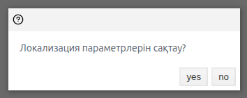

| Жауап | Ағымдағы сеанс | Осы браузерде форманың келесі ашылуы |
|---|---|---|
| **yes** | Таңдалған тілде | Таңдалған тілде. Ол тіркелгі тілі болады, сұрақ енді шықпайды |
| **no** | Таңдалған тілде | Тіркелгі тілінде |

Мысалда `petrov` тіркелгісінің тілі — ағылшын, ал формада **kz** таңдалған: Runtime қазақ тілінде ашылып, сұрақ қояды. **yes** басылса, `petrov` тілі қазақ тілі болады.

## Келісім мәтіні

Келісім мәтіні Studio және Runtime кіру формасында **OK** батырмасының астында көрсетіледі. Әдепкі бойынша өріс бос, **OK** астында ештеңе жоқ.

Studio негізгі мәзірінде **Қауіпсіздік параметрлері** бөлімін ашып, **Келісім мәтіні** өрісіне мәтінді енгізіңіз де, **Save** батырмасын басыңыз. «Параметрлер сәтті сақталды» хабарламасы шығады. Мәтін форма келесі ашылғанда көрінеді. Оны алып тастау үшін өрісті тазалап, сақтаңыз.

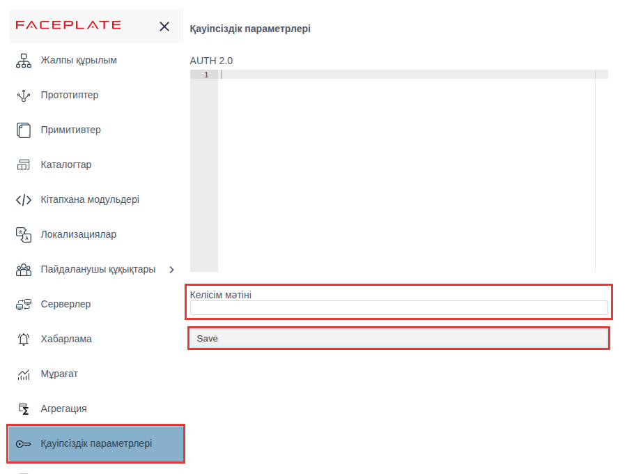

Сол терезедегі **AUTH 2.0** өрісі формаға корпоративтік тіркелгі провайдері арқылы кіруді қосады, [Сыртқы авторизация](external_auth.md) құжатын қараңыз.

## Кіру қателері

| Жағдай | Хабарлама |
|---|---|
| Runtime: логин немесе пароль қате | **ERROR!** «Пайдаланушы аты немесе құпия сөз дұрыс емес. Қайталап көріңіз» |
| Studio: `.administrators` рөлі бар пайдаланушының паролі қате | Сол хабарлама |
| Studio: `.administrators` рөлі жоқ пайдаланушы немесе жоқ логин | Жүйеге кіруге рұқсат жоқ екені және әкімшіге хабарласу керегі туралы **Қате** терезесі — кез келген парольде |

Хабарлама жабылғаннан кейін кіру формасы қайта ашылады.

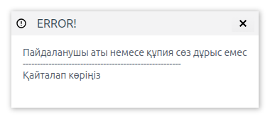

Мысалда `petrov` Runtime ортасына кіреді, ал Studio ортасында рұқсат жоқ туралы хабарлама алады. Пайдаланушыға Studio ашу үшін оған `.administrators` рөлін беріңіз, [Пайдаланушылар, «Пайдаланушы рөлдері» бөлімі](users.md#пайдаланушы-рөлдері) құжатын қараңыз.

## Авторизация тарихы

**Авторизация тарихы** терезесі ағымдағы сеанс ашылған тіркелгімен соңғы сәтті (**Сәтті кіру** жолы) және соңғы сәтсіз (**Сәтсіз кіру** жолы) кірудің күні мен уақытын көрсетеді. Мұндай кіру болмаса, жолда «Табылмады» жазылады. Сәтті кіру — әдетте ағымдағы сеансты бастаған кіру.

Studio ортасында терезені оң жақ панельдегі сағат белгішесі ашады.

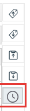

Runtime ортасында — мәзірдегі (☰) **Авторизация тарихы** тармағы.

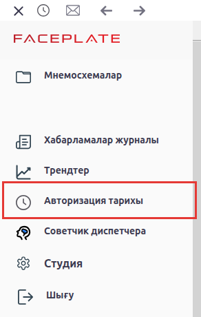

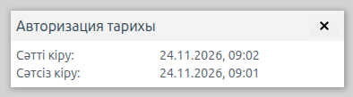

## Шығу және сеанстың аяқталуы

**Шығу** Studio негізгі мәзірінде (соңғы тармақ) және Runtime мәзірінде бар. «Шығуыңызға сенімдісізбе?» сұрағы → **yes** расталғаннан кейін кіру формасы ашылады.

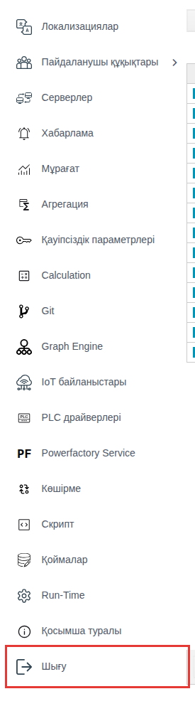

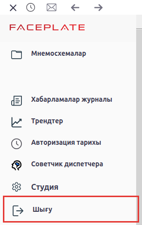

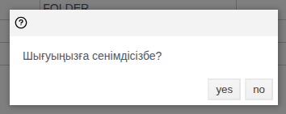

| Әрекет | Не болады |
|---|---|
| **Шығу** → **yes** | Сеанс аяқталады, кіру формасы ашылады |
| Бетті жаңарту (F5) | Браузер беттен кету керек пе деп сұрауы мүмкін. Жаңартудан кейін — кіру формасы |
| Қойындыны немесе браузерді жабу | Сеанс аяқталады. Келесі жолы — кіру формасы |
| Сервермен байланыстың үзілуі | Байланыс қалпына келгенде Runtime өзі қайта кіреді, Studio кіру формасын көрсетеді, [Күй жолы және байланыс, «Сервермен байланыстың үзілуі» бөлімі](../operator/status.md#сервермен-байланыстың-үзілуі) құжатын қараңыз |

Бір тіркелгімен бір мезгілде бірнеше қойындыда және браузерде жұмыс істеуге болады: сеанстар бірін-бірі жаппайды.

# Қорытынды

1. Пайдаланушылар мен рөлдерді **Пайдаланушы құқықтары** → **Пайдаланушылар** бөлімінде жасаңыз. Studio тек `.administrators` рөлі бар пайдаланушыларға ашылады.
2. Кіру формасындағы **OK** батырмасының астындағы мәтін **Қауіпсіздік параметрлері** → **Келісім мәтіні** → **Save** арқылы беріледі.
3. Сенсорлық панельдерде форманың экрандық пернетақтасын пайдаланыңыз.
4. Тіл формада таңдалады. «Локализация параметрлерін сақтау?» сұрағына **yes** жауабы оны тіркелгі тілі етеді.
5. Сеанс **Шығу**, бетті жаңарту немесе жабу арқылы аяқталады.
6. Соңғы сәтті және соңғы сәтсіз кіру **Авторизация тарихы** терезесінде көрінеді: Studio ортасында сағат белгішесі, Runtime ортасында мәзір тармағы.
