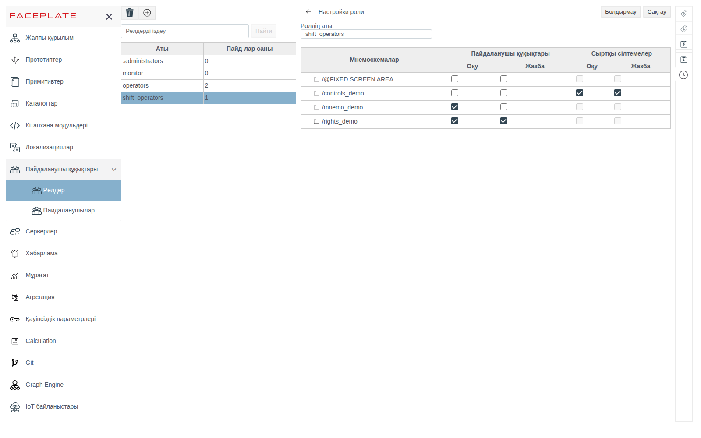
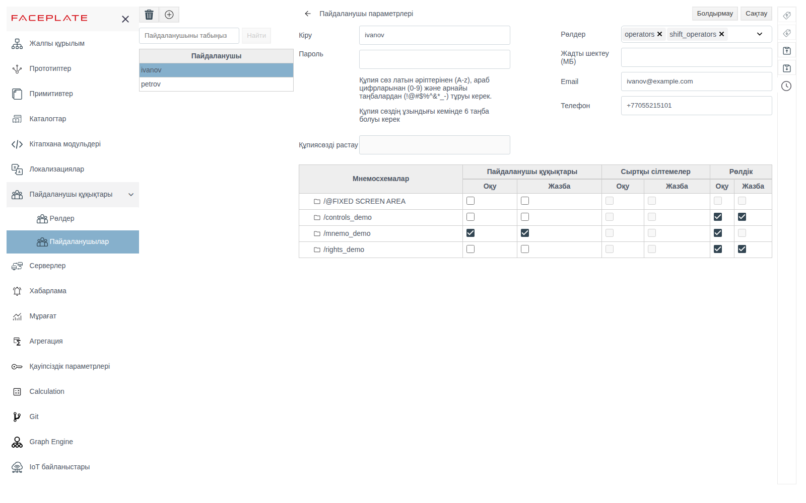
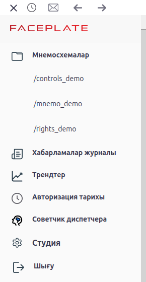
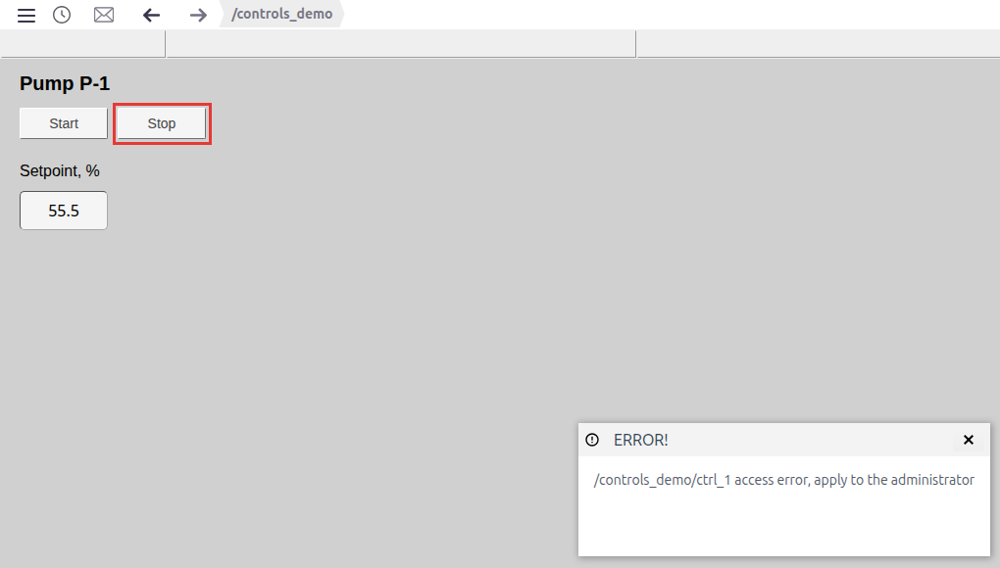

# Рөлдер және кіру құқықтары

Бұл құжат операторлардың жоба мнемосызбаларына кіру құқығын шектейтін интегратор инженерге арналған.

# Мазмұны

- [Терминдер сөздігі](#терминдер-сөздігі)
- [Кіріспе](#кіріспе)
- [Негізгі бөлім](#негізгі-бөлім)
    - [Кіріктірілген рөлдер](#кіріктірілген-рөлдер)
    - [Рөл жасау](#рөл-жасау)
    - [Мнемосызбаларға құқықтар](#мнемосызбаларға-құқықтар)
    - [Нысандарға құқықтар](#нысандарға-құқықтар)
    - [Пайдаланушы құқықтары](#пайдаланушы-құқықтары)
    - [Пайдаланушы Runtime ортасында не көреді](#пайдаланушы-runtime-ортасында-не-көреді)
    - [Рөлді жою](#рөлді-жою)
- [Қорытынды](#қорытынды)

# Терминдер сөздігі

| Термин | Мағынасы |
|---|---|
| Рөл | Мнемосызбаларға берілген құқықтардың атаулы жиыны. Рөлдер пайдаланушыларға олардың карточкасында тағайындалады |
| Бума мнемосызбасы | Жоба бумасының `screen` сызбасы. Құқықтар соған беріледі және буманың бүкіл мазмұнына әсер етеді |

# Кіріспе

FACEPLATE жүйесінде кіру құқығы мнемосызбалар бойынша шектеледі. Буманың әр мнемосызбасына **Оқу** және **Жазба** құқықтары беріледі — рөлдерге немесе жеке пайдаланушыға. Пайдаланушы өзінің барлық рөлдерінің құқықтарын және өзінің жеке құқықтарын алады.

Бөлім Studio негізгі мәзірінде орналасқан: **Пайдаланушы құқықтары** → **Рөлдер**. Пайдаланушының жеке құқықтары **Пайдаланушы құқықтары** → **Пайдаланушылар** бөлімінде беріледі, [Пайдаланушылар](users.md) құжатын қараңыз.

Құжат бойындағы мысал — `shift_operators` рөлі (ауысым операторлары) және осы рөлі бар `ivanov` пайдаланушысы. Мысал бумалары:

| Бума | Мнемосызбада не бар |
|---|---|
| `/mnemo_demo` | Шолу сызбасы |
| `/controls_demo` | `ctrl_1` сорғысын басқару: **Start**/**Stop** батырмалары, тағайындалған мән |
| `/rights_demo` | `ctrl_1` сорғысының тағайындалған мән өрісі және кірістірілген `/controls_demo` сызбасы (**Folder Screen** элементі) |

Жобаны өзгерту құқығы бар тіркелгімен Studio ортасына (`http://<сервер>:9000/fp/studio`) кіру мүмкіндігі қажет.

# Негізгі бөлім

## Кіріктірілген рөлдер

| Рөл | Мақсаты |
|---|---|
| `.administrators` | Studio ортасына кіру. Бұл рөлсіз Studio ашылмайды |
| `operators` | Әр пайдаланушыда бар, оны алып тастау мүмкін емес. Осы рөлге берілген мнемосызба құқықтарын барлық пайдаланушылар алады, сондықтан кіру құқығын шектеу үшін өз рөлдеріңізді жасаңыз |
| `monitor` | Жобаның барлық мнемосызбаларына, соның ішінде жаңаларына да **Оқу**: бума мнемосызбасы сақталған бойда құқық белгіленеді. Осы рөлі бар пайдаланушы Runtime ортасында барлық мнемосызбаларды көреді. Рөл **Жазба** құқығын бермейді |

Рөлдер тізіміндегі **Пайд-лар саны** бағаны **Пайдаланушылар** бөліміндегі қанша пайдаланушыда осы рөл бар екенін көрсетеді. Кіріктірілген тіркелгілер есепке алынбайды.

## Рөл жасау

**+** батырмасын басып, «Атын қойыңыз» терезесінде рөл атын енгізіп, **OK** басыңыз. Тізімдегі рөлді шерту оның баптауларын оң жақта ашады: **Рөлдің аты** және құқықтар кестесі. Құқықтарды белгілеп, **Сақтау** басыңыз.

Тізім үстіндегі іздеу аты енгізілген жолдан басталатын рөлдерді табады (үш таңбадан бастап).

## Мнемосызбаларға құқықтар

Кестеде `screen` мнемосызбасы сақталған жоба бумалары тізімделеді. Мнемосызбасы жоқ бума кестеде көрінбейді: алдымен оның сызбасын салып, сақтаңыз ([Мнемосызбалар редакторы](../mnemo/editor.md) құжатын қараңыз).

| Баған | Мағынасы |
|---|---|
| **Пайдаланушы құқықтары** → **Оқу** | Мнемосызба Runtime ортасында көрінеді, ондағы мәндер көрсетіледі |
| **Пайдаланушы құқықтары** → **Жазба** | Мнемосызбадан мәндерді өзгертуге болады. **Жазба** белгіленсе, сақтағаннан кейін **Оқу** да белгіленеді |
| **Сыртқы сілтемелер** → **Оқу**, **Жазба** | Басқа мнемосызба арқылы алынған құқықтар, төменде қараңыз. Жалаушалар тек күйді көрсетеді |

**Сыртқы сілтемелер.** Егер мнемосызба басқа буманың сызбасын көрсетсе (**Folder Screen** элементі, [Мнемосызбалар редакторы, «Сызба ішіндегі сызба: Folder Screen» бөлімі](../mnemo/editor.md#сызба-ішіндегі-сызба-folder-screen) құжатын қараңыз), бірінші сызбаға құқығы бар рөл екінші сызбаға да сондай құқықтар алады. Мысалда `shift_operators` рөлінде `/rights_demo` сызбасына **Оқу** және **Жазба** бар, ал `/rights_demo` сызбасы `/controls_demo` сызбасын көрсетеді, сондықтан `/controls_demo` жолында **Сыртқы сілтемелер** жалаушалары белгіленген.

## Нысандарға құқықтар

Мнемосызба құқықтары өз бумасының нысандарына әсер етеді: **Оқу** болса, оператор олардың мәндерін көреді, **Жазба** болса — өзгертеді.

Мнемосызба элементі байланыстырылған басқа буманың нысаны осы мнемосызбаның құқықтарын алады. Мысалда `/rights_demo` сызбасындағы тағайындалған мән өрісі `/controls_demo/ctrl_1` нысанына байланыстырылған: `/rights_demo` сызбасына **Оқу** болса, оператор тағайындалған мәнді көреді, **Жазба** болса — оны өзгертеді, тіпті `/controls_demo` сызбасына құқықтары болмаса да.

## Пайдаланушы құқықтары

Пайдаланушы карточкасында (**Пайдаланушы құқықтары** → **Пайдаланушылар**) дәл сондай құқықтар кестесі және қосымша **Рөлдік** → **Оқу**, **Жазба** бағандары бар. Олар құқықты пайдаланушының рөлдері берсе белгіленеді.

**Рөлдік** және **Сыртқы сілтемелер** әртүрлі сұрақтарға жауап береді. **Рөлдік** құқықтың пайдаланушының өзіне жеке берілмей, рөлден келгенін көрсетеді. **Сыртқы сілтемелер** мнемосызбаға құқықтың оны көрсететін басқа мнемосызба арқылы алынғанын көрсетеді ([Мнемосызбаларға құқықтар](#мнемосызбаларға-құқықтар) бөлімін қараңыз). Пайдаланушы карточкасында **Сыртқы сілтемелер** тек оның жеке құқықтары бойынша белгіленеді. Рөл сыртқы сілтеме арқылы алған құқық пайдаланушыда **Рөлдік** бағанында көрінеді. Мысалы, `shift_operators` рөлінде `/controls_demo` үшін **Сыртқы сілтемелер** белгіленген, ал `ivanov` пайдаланушысында сол құқық **Рөлдік** ретінде белгіленген.

Қорытынды құқықтар — жеке, рөлдік және сыртқы құқықтардың бірігуі.

`ivanov` пайдаланушысында `/mnemo_demo` сызбасына жеке **Оқу** және **Жазба** бар, қалғанын ол `shift_operators` рөлі арқылы алады.

Құқықтарды рөлдерге берген дұрыс, ал жеке құқықтарды ерекше жағдайларға қалдырыңыз: ауысым құрамы өзгергенде тек пайдаланушылардың рөлдері өзгереді.

## Пайдаланушы Runtime ортасында не көреді

**Мнемосхемалар** мәзірінде пайдаланушының **Оқу** құқығы бар мнемосызбалар ғана тізімделеді — жеке, рөлдік немесе сыртқы сілтемелер арқылы алынған. Құқықтар болмаса, тізім бос.

Егер пайдаланушыда тек **Оқу** болса, мнемосызбадағы мәндер көрсетіледі, ал оларды батырмамен немесе енгізу өрісімен өзгерту әрекеті нысан жолы көрсетілген кіру құқығы қатесі туралы хабармен аяқталады. Мән өзгермейді.

## Рөлді жою

Рөлді белгілеп, себетті басыңыз және **yes** арқылы растаңыз.

# Қорытынды

Кіру құқығын баптау реті:

1. Бумалардың мнемосызбаларын салып, сақтаңыз — құқықтар кестесіне тек солар түседі.
2. **Пайдаланушы құқықтары** → **Рөлдер** → **+** → рөл аты → **OK**. Мнемосызбалар бойынша **Оқу** және **Жазба** белгілеп, **Сақтау** басыңыз.
3. **Пайдаланушы құқықтары** → **Пайдаланушылар** бөлімінде пайдаланушыларға рөлдер тағайындаңыз. Жеке құқықтарды тек ерекше жағдайлар үшін беріңіз.
4. Сілтемелерді ескеріңіз: мнемосызба құқықтары ол көрсететін сызбаларға және оның элементтері байланыстырылған нысандарға таралады.
5. Нәтижені Runtime ортасына пайдаланушы ретінде кіріп тексеріңіз.
