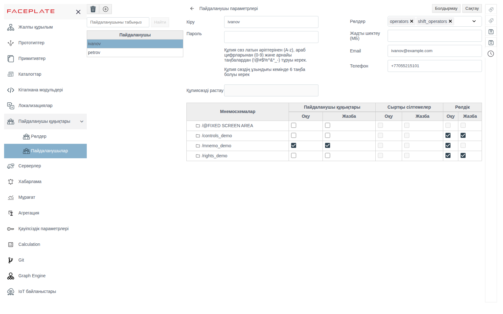

# Пайдаланушылар

Бұл құжат жобада операторлар мен басқа пайдаланушылардың тіркелгілерін жасайтын интегратор инженерге арналған.

# Мазмұны

- [Терминдер сөздігі](#терминдер-сөздігі)
- [Кіріспе](#кіріспе)
- [Негізгі бөлім](#негізгі-бөлім)
    - [Пайдаланушылар тізімі](#пайдаланушылар-тізімі)
    - [Пайдаланушы жасау](#пайдаланушы-жасау)
    - [Пайдаланушы карточкасы](#пайдаланушы-карточкасы)
    - [Пароль](#пароль)
    - [Пайдаланушы рөлдері](#пайдаланушы-рөлдері)
    - [Studio және Runtime ортасына кіру](#studio-және-runtime-ортасына-кіру)
    - [Пайдаланушыны жою](#пайдаланушыны-жою)
- [Қорытынды](#қорытынды)

# Терминдер сөздігі

| Термин | Мағынасы |
|---|---|
| Пайдаланушы | Studio және Runtime ортасына кіруге арналған тіркелгі: логин, пароль, рөлдер және мнемосызбаларға құқықтар |
| Рөл | Мнемосызбаларға берілген құқықтардың атаулы жиыны. Пайдаланушы өзінің барлық рөлдерінің құқықтарын алады. Толығырақ — [Рөлдер және кіру құқықтары](roles.md) құжатында |
| Жеке құқықтар | Рөл арқылы емес, пайдаланушының өзіне берілген мнемосызбаларға құқықтар |

# Кіріспе

FACEPLATE пайдаланушысы — адам Studio немесе Runtime ортасына кіретін тіркелгі. Онда логин мен пароль, байланыс деректері, рөлдер және мнемосызбаларға жеке құқықтар сақталады. Адамның Runtime ортасында қандай мнемосызбаларды көретіні және оларда мәндерді өзгерте алатыны рөлдер мен құқықтарға байланысты.

Бөлім Studio негізгі мәзірінде орналасқан: **Пайдаланушы құқықтары** → **Пайдаланушылар**.

Құжат бойындағы мысал — `shift_operators` рөлі бар ауысым операторы `ivanov`.

Жобаны өзгерту құқығы бар тіркелгімен Studio ортасына (`http://<сервер>:9000/fp/studio`) кіру мүмкіндігі қажет.

# Негізгі бөлім

## Пайдаланушылар тізімі

Сол жақта — жоба пайдаланушыларының тізімі, оның үстінде жою (себет) және жасау (**+**) батырмалары мен іздеу жолы. Іздеу логині енгізілген жолдан басталатын пайдаланушыларды табады. Үш таңбадан бастап жол ізделеді, қысқарағы бүкіл тізімді көрсетеді. Кіріктірілген тіркелгілер тізімде көрсетілмейді.

Пайдаланушыны шерту оның карточкасын оң жақта ашады.

## Пайдаланушы жасау

**+** батырмасын басып, «Атын қойыңыз» терезесінде логинді енгізіп, **OK** басыңыз.

Жаңа пайдаланушы бірден кіре алады: оның паролі логинімен бірдей, рөлі — `operators`, жеке құқықтары жоқ. Карточканы ашып, пароль, рөлдер мен құқықтарды беріп, сақтаңыз.

## Пайдаланушы карточкасы

| Өріс | Мақсаты |
|---|---|
| **Кіру** | Кіруге арналған ат |
| **Пароль**, **Құпиясөзді растау** | Жаңа пароль, [Пароль](#пароль) бөлімін қараңыз. Бос өрістер парольді бұрынғыдай қалдырады |
| **Рөлдер** | Пайдаланушы рөлдері, [Пайдаланушы рөлдері](#пайдаланушы-рөлдері) бөлімін қараңыз |
| **Жадты шектеу (МБ)** | Сервер пайдаланушы сеансына бөлетін жад шегі. Бос болса — сервердің әдепкі шегі |
| **Email** | `name@server.com` пішіміндегі мекенжай |
| **Телефон** | 11 цифр, басында `+` болуы мүмкін. Бірнеше нөмір үтір арқылы жазылады |

Өрістердің астындағы кесте — пайдаланушының мнемосызбаларға құқықтары: өзінің (**Пайдаланушы құқықтары**), сілтемелер арқылы (**Сыртқы сілтемелер**) және рөлдер арқылы (**Рөлдік**) алынған. Тек **Пайдаланушы құқықтары** бағанын өзгертуге болады, қалғандары нәтижені көрсетеді. Бағандардың мағынасы [Рөлдер және кіру құқықтары, «Мнемосызбаларға құқықтар» бөлімі](roles.md#мнемосызбаларға-құқықтар) құжатында берілген.

**Сақтау** өзгерістерді жазады, **Болдырмау** және тақырыптың сол жағындағы көрсеткі карточканы жазбай жабады.

## Пароль

Парольге қойылатын талаптар:

- кемінде 6 таңба;
- тек латын әріптері, цифрлар және `!@#$%^&*_-` таңбалары;
- кемінде бір кіші және бір бас әріп, цифр және жоғарыдағы тізімнен бір таңба болуы керек.

**Құпиясөзді растау** өрісі пароль талаптарға сай болғанда қолжетімді болады. Растау парольмен сәйкес келмесе, **Сақтау** басқанда парольдердің сәйкес келмейтіні туралы хабар шығады және пароль өзгермейді.

Мысал: `Demo_123`.

## Пайдаланушы рөлдері

**Рөлдер** тізімінде пайдаланушының рөлдерін белгілеңіз. Пайдаланушы белгіленген барлық рөлдердің құқықтарын өзінің жеке құқықтарымен бірге алады.

`operators` рөлі әр пайдаланушыда бар: оны алып тастасаңыз, сақтағаннан кейін ол қайта оралады. Сондықтан `operators` рөліне берілген құқықтарды барлық пайдаланушылар алады.

Пайдаланушы Studio ортасында жұмыс істей алуы үшін оған `.administrators` рөлін беріңіз. Қалған рөлдер **Пайдаланушы құқықтары** → **Рөлдер** бөлімінде жасалады, [Рөлдер және кіру құқықтары](roles.md) құжатын қараңыз.

Мысалда `ivanov` пайдаланушысының рөлдері — `operators` және `shift_operators`, ал жеке құқықтары — `/mnemo_demo` сызбасына оқу және жазу.

## Studio және Runtime ортасына кіру

Studio (`http://<сервер>:9000/fp/studio`) және Runtime (`http://<сервер>:9000/fp/runtime`) үшін кіру бірдей: карточкадағы логин мен пароль. Кіру формасы, тіл, қателер және шығу [Кіру және сеанстар](login.md) құжатында сипатталған.

Studio тек `.administrators` рөлі бар пайдаланушыларға ашылады. Қалғандарына кіргеннен кейін кіру құқығы жоқ екені туралы хабар көрсетіледі.

Runtime кез келген пайдаланушыға ашылады. **Мнемосхемалар** мәзірінде ол тек құқығы бар мнемосызбаларды көреді, [Рөлдер және кіру құқықтары, «Пайдаланушы Runtime ортасында не көреді» бөлімі](roles.md#пайдаланушы-runtime-ортасында-не-көреді) құжатын қараңыз.

## Пайдаланушыны жою

Пайдаланушыны белгілеп, себетті басыңыз және **yes** арқылы растаңыз.

# Қорытынды

Жұмыс реті:

1. **Пайдаланушы құқықтары** → **Пайдаланушылар** → **+** → логин → **OK**.
2. Карточкада талаптарға сай пароль, рөлдер және қажет болса мнемосызбаларға жеке құқықтар беріңіз. **Сақтау**.
3. Studio ортасында жұмыс істеу үшін `.administrators` рөлін қосыңыз.
4. Нәтижені тексеріңіз: Runtime ортасына пайдаланушы ретінде кіріп, **Мнемосхемалар** мәзірін ашыңыз.
