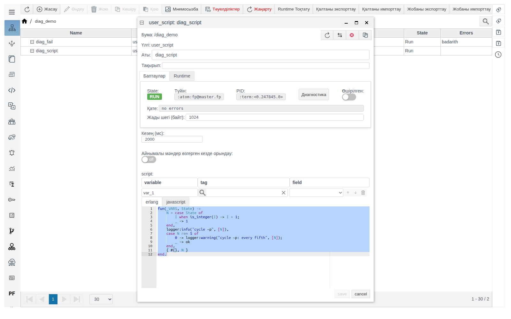
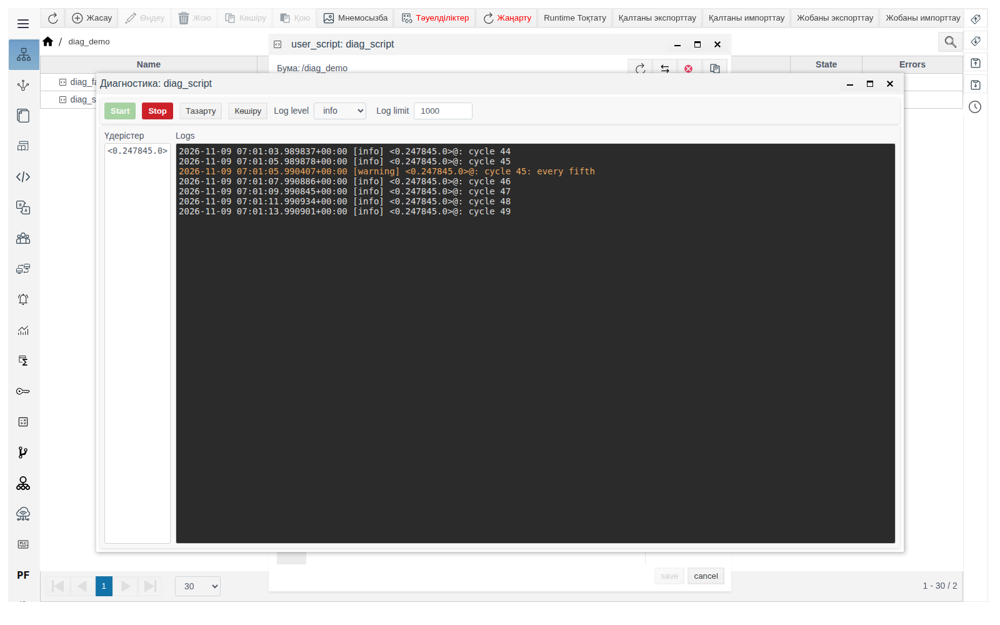
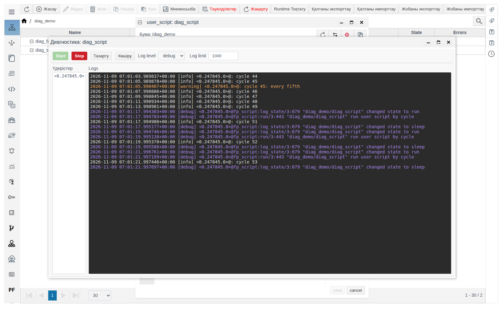
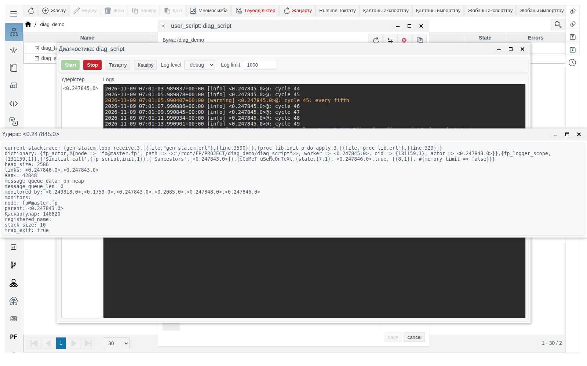
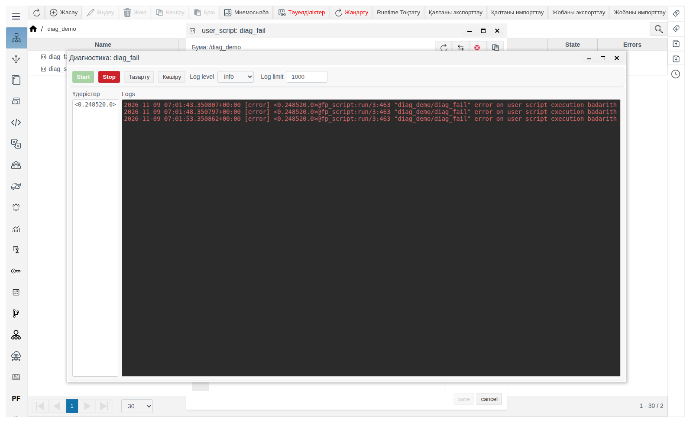

# Runtime нысандарының диагностикасы

Бұл құжат есеп, скрипт немесе қосылым неге күткендей жұмыс істемейтінін анықтайтын интегратор инженерге арналған.

# Мазмұны

- [Терминдер сөздігі](#терминдер-сөздігі)
- [Кіріспе](#кіріспе)
- [Негізгі бөлім](#негізгі-бөлім)
    - [Диагностиканы қайдан ашуға болады](#диагностиканы-қайдан-ашуға-болады)
    - [«Диагностика» терезесі](#диагностика-терезесі)
    - [Журнал деңгейі](#журнал-деңгейі)
    - [Журнал жолы](#журнал-жолы)
    - [Жолдар шегі](#жолдар-шегі)
    - [Нысан үдерістері](#нысан-үдерістері)
    - [Скрипттен өз хабарламаларыңыз](#скрипттен-өз-хабарламаларыңыз)
    - [Журналдан не іздеу керек](#журналдан-не-іздеу-керек)
- [Қорытынды](#қорытынды)

# Терминдер сөздігі

| Термин | Мағынасы |
|---|---|
| Runtime нысаны | Серверде орындалатын жоба нысаны: есеп, пайдаланушы скрипті, IoT немесе PLC қосылымы және басқалар. Оның пішінінің жоғарғы панелінде **State**, **Түйін**, **PID** және **Өшірілген** бар |
| Үдеріс | Нысан жұмысын серверде орындаушы. `<0.78331.0>` түріндегі идентификатормен белгіленеді; дәл сол идентификатор пішіннің **PID** өрісінде көрсетілген |
| Журнал | Нысан үдерістері жұмыс кезінде шығаратын хабарламалар ағыны: орындалу барысы, ескертулер, қателер |

# Кіріспе

Нысан пішініндегі **Қате** өрісі және **Жалпы құрылымдағы** **Errors** бағаны тек соңғы қатені көрсетеді. **Диагностика** терезесі нысан журналын нақты уақытта көрсетеді: әр хабарлама уақытымен, деңгейімен және үдерісімен. Ол арқылы қатенің қаншалықты жиі қайталанатыны, оның алдында не болғаны және нысанның қателер арасында не істейтіні көрінеді.

Терезе кез келген Runtime нысанының пішінінен ашылады және тек осы нысанның хабарламаларын көрсетеді.

Өтпелі мысал — Erlang тіліндегі екі пайдаланушы скрипті бар `diag_demo` бумасы:

| Нысан | Кезең (мс) | Не істейді |
|---|---|---|
| `diag_script` | 2000 | Циклдарды санайды, әр циклде журналға `cycle N` жазады, әр бесіншісінде — `cycle N: every fifth` ескертуін |
| `diag_fail` | 5000 | Әр іске қосылғанда нөлге бөледі және `badarith` қатесімен аяқталады |

Пайдаланушы скриптін қалай жасау керектігі [«Пайдаланушы скрипттері»](../../../en/user_script/user_script.md) құжатында сипатталған.

Жобаны өзгерту құқығы бар тіркелгімен Studio ортасына (`http://<сервер>:9000/fp/studio`) кіру мүмкіндігі қажет.

# Негізгі бөлім

## Диагностиканы қайдан ашуға болады

Нысан пішінін **Жалпы құрылымда** ашыңыз. **Диагностика** батырмасы жоғарғы панельде **PID** жанында орналасқан.



Батырма нысан алғаш сақталғаннан кейін пайда болады. Әлі сақталмаған жаңа нысанның пішінінде ол жоқ.

Батырма тек **State**, **Түйін**, **PID** панелі бар пішіндерде болады. **Жалпы құрылымның** **Жасау** терезесінде бұл түрлер:

| Топ | Түрлер |
|---|---|
| **system** | `calculation`, `user_script`, `ARCHIVE`, `REPLICA`, `alarm_template`, `graph_engine`, `modeling`, `dsf_service` |
| **iot** | `iot_http_client_connection`, `iot_http_server_connection`, `iot_mqtt_publisher`, `iot_mqtt_subscriber`, `iot_websocket_client_connection`, `iot_websocket_server_connection` |
| **plc** | Барлық `plc_…_connection` қосылымдары |

Панель мен батырма бумаларда (`FOLDER`), JS кітапханаларында (`js_library`), примитивтер мен прототиптердің даналарында, IoT қосылымының ішіндегі дереккөздер мен әрекеттерде (`iot_…_source`, `iot_…_action`) және PLC қосылымының ішіндегі байланыстыруларда (`plc_…_binding`) жоқ.

Терезе пішіннің үстінен **Диагностика: <нысан атауы>** тақырыбымен ашылады. Пішінді жаппауға болады: терезе мен пішін бір-біріне тәуелсіз жұмыс істейді.

## «Диагностика» терезесі



| Элемент | Мақсаты |
|---|---|
| **Start** | Журналды жазуды бастау. Терезе батырма басылғаннан кейін пайда болған хабарламаларды көрсетеді; ертеректегі хабарламалар терезеде жоқ |
| **Stop** | Жазуды тоқтату. Жолдар терезеде қалады. Тоқтап тұрған кезде шығарылған хабарламалар жиналмайды. Келесі **Start** жаңа жолдарды бар жолдарға қосып жазады |
| **Тазарту** | Жолдарды терезеден жою. Жазу жүріп жатса, жалғаса береді |
| **Көшіру** | Терезенің барлық жолдарын алмасу буферіне көшіру |
| **Log level** | Хабарламалардың маңыздылық шегі: `info` (әдепкі бойынша), `warning`, `error`, `debug`. [Журнал деңгейі](#журнал-деңгейі) бөлімін қараңыз |
| **Log limit** | Терезе соңғы қанша жолды ұстайды: 1-ден 100 000-ға дейін, әдепкі бойынша 1000. [Жолдар шегі](#жолдар-шегі) бөлімін қараңыз |
| **Үдерістер** | Хабарламалар келген нысан үдерістері. [Нысан үдерістері](#нысан-үдерістері) бөлімін қараңыз |
| **Logs** | Журнал жолдары. Жолды шерткенде ол алмасу буферіне көшіріледі |

Терезе секундына бір рет жаңарады. Пайдаланушы журналды жоғары айналдырмаса, терезе соңғы жолды көрінетін жерде ұстайды.

## Журнал деңгейі

**Log level** шек ретінде жұмыс істейді: терезе таңдалған деңгейдегі және одан маңыздырақ барлық деңгейдегі хабарламаларды көрсетеді.

| Log level | Терезеге не түседі | Жол түсі |
|---|---|---|
| `error` | Тек қателер | Қызыл |
| `warning` | Ескертулер мен қателер | Сарғылт |
| `info` | Ақпараттық хабарламалар, ескертулер мен қателер | Ашық сұр |
| `debug` | Барлық хабарламалар, нысан жұмысының егжей-тегжейлі барысын қоса | Күлгін |

Деңгей **Start** басылғанда қолданылады. Жазу кезінде деңгейді ауыстыру үшін **Stop** басып, деңгейді таңдаңыз да, қайтадан **Start** басыңыз.

`warning` деңгейінде `diag_script` үшін терезеге тек `cycle 5: every fifth`, `cycle 10: every fifth` т.с.с. жолдар түседі. `debug` деңгейінде олардың арасында скрипттің қызметтік хабарламалары көрінеді: күйдің өзгеруі (`changed state to run`, `changed state to sleep`) және іске қосылу себебі (`run user script by cycle`).



## Журнал жолы

```
2026-10-28 04:37:19.967153+00:00 [warning] <0.78331.0>@: cycle 20: every fifth
```

| Бөлігі | Мағынасы |
|---|---|
| `2026-10-28 04:37:19.967153+00:00` | Сервер сағаты бойынша микросекундқа дейінгі дәлдікпен хабарлама уақыты және UTC-тен ығысу |
| `[warning]` | Деңгей |
| `<0.78331.0>` | Хабарламаны шығарған үдеріс |
| `@` | Бөлгіш |
| `:` | Хабарламаны шығарған платформа кодындағы орын. Талдау кезінде оны өткізіп жіберуге болады. Пайдаланушы скриптінің хабарламаларында орын көрсетілмейді, жолда тек `:` қалады |
| `cycle 20: every fifth` | Хабарлама мәтіні |

## Жолдар шегі

**Log limit** терезені шектейді: толып кеткенде ескі жолдар жойылады, соңғылары қалады.

Нысан бір секундта **Log limit** өрісінде берілгеннен көп жол шығарса, жазу тоқтайды және `log_limit_exceeded` мәтінімен **ERROR!** хабарламасы шығады. **Log limit** мәнін арттырыңыз немесе егжей-тегжейі азырақ **Log level** таңдаңыз, содан кейін **Start** басыңыз.

## Нысан үдерістері

**Үдерістер** тізімі хабарламалар келген нысан үдерістерін көрсетеді. Идентификаторды шерткенде үдеріс туралы мәліметтері бар **Үдеріс: <идентификатор>** терезесі ашылады; терезе секундына бір рет жаңарады.



Ақауларды іздеуге пайдалы өрістер:

| Өріс | Не көрсетеді |
|---|---|
| **node** | Үдеріс орындалып жатқан кластер түйіні |
| **Жады** | Үдеріс жадысы, байт |
| **message_queue_len** | Өңдеуді күтіп тұрған хабарламалар саны. Тұрақты өсу — үдеріс кіріс деректерін өңдеуге үлгермейді |
| **Қысқартулар** | Орындалған жұмыстың есептегіші. Үдеріс жұмыс істеп тұрғанда өседі |
| **current_stacktrace** | Жаңарту сәтінде үдеріс қай жерде тұр. Мән өзгермесе, ал **message_queue_len** өссе — үдеріс қатып қалған |

Терезенің қалған өрістері — FACEPLATE әзірлеушілеріне арналған қызметтік мәліметтер; оларды қолдау қызметіне өтінішке қоса беріңіз.

## Скрипттен өз хабарламаларыңыз

Erlang тіліндегі пайдаланушы скрипті өз нысанының журналына `logger:info/2`, `logger:warning/2`, `logger:error/2`, `logger:debug/2` функцияларымен жазады. Бірінші аргумент — мәтін үлгісі, екіншісі — мәндер тізімі. Хабарламалар осы скрипттің **Диагностика** терезесінде тиісті деңгейде көрінеді.

`diag_script` коды:

```erlang
fun(_VARS, State) ->
    N = case State of
        I when is_integer(I) -> I + 1;
        _ -> 1
    end,
    logger:info("cycle ~p", [N]),
    case N rem 5 of
        0 -> logger:warning("cycle ~p: every fifth", [N]);
        _ -> ok
    end,
    { #{}, N }
end.
```

Мұндай хабарламалар іске қосу-баптау кезінде айнымалылардың мәндерін және код тармақтарын тексеруге көмектеседі. Уақытша жөндеу хабарламаларын `debug` деңгейінде жазыңыз: **Log level** `info` болғанда, қалыпты жұмыс кезінде олар кедергі келтірмейді.

## Журналдан не іздеу керек

`diag_fail` скрипті пішінде `badarith` **Қате** көрсетеді. Журнал жағдайды нақтылайды: қате әр іске қосылғанда, 5 секунд сайын қайталанады, үдеріс сол біреу — скрипт қайта іске қосылмайды, әр циклде құлайды.



| Не көрінеді | Бұл нені білдіреді | Не істеу керек |
|---|---|---|
| Бірдей аралықпен бірдей мәтінді қызыл `[error]` жолдары | Әр іске қосылғандағы қате | Кодты немесе ол құлайтын деректерді түзетіңіз |
| Қате бір рет пайда болды, одан әрі қалыпты жолдар | Бір реттік ақау, нысан жұмысын жалғастырады | Қате уақытын нысандағы оқиғалармен салыстырыңыз |
| `info` деңгейінде **Start** басылғаннан кейін журнал бос | Нысан осы деңгейдегі хабарламаларды шығармайды | `debug` таңдап, қайтадан **Start** басыңыз |
| `State` `RUN`, **Қате** `no errors`, бірақ нысан жұмыс істемейді | Себеп тек журналда көрінеді: мысалы, қосылым серверге қосыла алмайды | **Диагностиканы** `debug` деңгейінде ашыңыз |
| Үдеріс терезесіндегі **message_queue_len** өсіп жатыр | Нысан деректерді өңдеуге үлгермейді | Кезеңді арттырыңыз, деректер көлемін азайтыңыз |

Нақты модульдердің хабарламалары және олардың мағынасы модульдердің құжаттарында сипатталған:

- IoT қосылымдары — [«IoT қосылымдары», «Диагностика» бөлімі](../../../en/data_collection/IoT/IoT.md#diagnostics);
- PLC қосылымдары — [«Faceplate-тегі PLC қосылымдары», «Диагностика» бөлімі](../../../en/data_collection/plc_connections/general_en.md#troubleshooting);
- репликация — [«Faceplate-тегі репликация», «Диагностика» бөлімі](../../../en/administration/replica/replica_en.md#troubleshooting);
- мұрағаттар — [«Мұрағаттар», «Диагностика және жазу ерекшеліктері» бөлімі](../../../en/data_storage/archives/archives_en.md#diagnostics-and-recording-behavior);
- диспетчер кеңесшісі (DSF) — [«Диспетчер кеңесшісі», «Ұсыныс пайда болмаса» бөлімі](../../../en/dsf/dsf_en.md#if-no-recommendation-appears).

# Қорытынды

Жұмыс реті:

1. Нысан пішінін ашыңыз → **Диагностика**.
2. **Log level** таңдаңыз (бастау үшін `info`, егжей-тегжей үшін `debug`) → **Start**.
3. Мәселені қайталап, `[error]` және `[warning]` жолдарын табыңыз.
4. Қатып қалуға күдік болса, **Үдерістер** тізіміндегі үдерісті шертіп, **message_queue_len** және **current_stacktrace** өрістерін тексеріңіз.
5. **Көшіру** — есеп немесе қолдау қызметіне өтініш үшін. Жазу енді қажет болмаса — **Stop**.
