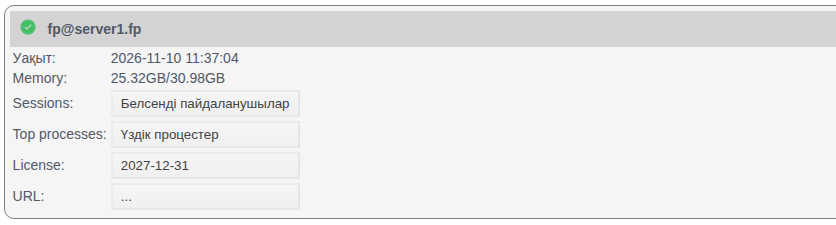
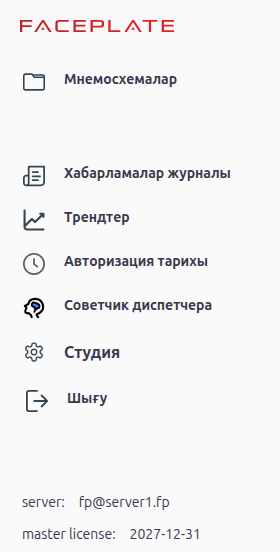
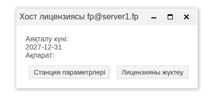
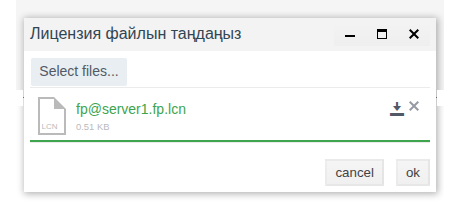
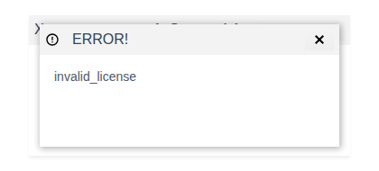
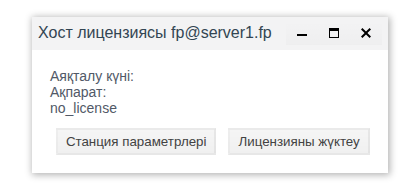
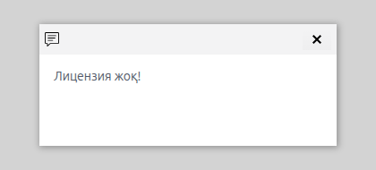

# Лицензиялау

Бұл құжат FACEPLATE түйіндерін пайдалануға енгізетін интегратор инженерге арналған: түйін лицензиясын қай жерден тексеруге болады, оны қалай алуға және жүктеуге болады, лицензия болмаса немесе мерзімі жақында аяқталса, оператор не көреді.

# Мазмұны

- [Терминдер сөздігі](#терминдер-сөздігі)
- [Кіріспе](#кіріспе)
- [Негізгі бөлім](#негізгі-бөлім)
    - [Лицензия қай жерде көрінеді](#лицензия-қай-жерде-көрінеді)
    - [«Хост лицензиясы» терезесі](#хост-лицензиясы-терезесі)
    - [Лицензияны алу және жүктеу](#лицензияны-алу-және-жүктеу)
    - [Лицензиясыз түйін](#лицензиясыз-түйін)
    - [Лицензия мерзімінің аяқталуы](#лицензия-мерзімінің-аяқталуы)
- [Қорытынды](#қорытынды)

# Терминдер сөздігі

| Термин | Мағынасы |
|---|---|
| Түйін | `fp@<хост>` түріндегі атауы бар FACEPLATE-тің бір сервері. Кластер түйіндері **Серверлер** панелінде тізімделген, [«Кластер түйіндері»](../nodes/nodes.md) құжатын қараңыз |
| Түйін лицензиясы | Нақты түйіннің жұмыс істеуіне рұқсат. Әр түйінге бөлек жүктеледі |
| Станция параметрлерінің файлы | Studio түйін үшін сақтайтын `<түйін атауы>.stn` файлы. Жеткізуші лицензияны осы файл бойынша береді |
| Лицензия файлы | Жеткізушіден алынған `.lcn` файлы. Ол берілген түйінге жүктеледі |
| Аяқталу күні | Лицензия әрекет ететін соңғы күн, `ЖЖЖЖ-АА-КК` түрінде |

# Кіріспе

Лицензия жобаға емес, түйінге беріледі: үш серверден тұратын кластерге үш лицензия қажет, әрқайсысы өз түйінінің параметрлері бойынша беріледі. Сондықтан лицензияны әр жаңа серверді пайдалануға енгізгенде және түйінді басқа жабдыққа көшіргенде тексереді.

Құжат үш сұраққа жауап береді:

- түйінде лицензия бар ма және ол қай күнге дейін әрекет етеді, оны қай жерден көруге болады — Studio ортасында барлық түйіндер үшін бірден, Runtime ортасында оператор қосылған түйін үшін;
- лицензияны қалай алуға және жүктеуге болады;
- лицензия болмаса немесе мерзімі аяқталып келе жатса, оператордың жұмыс орнында не болады.

Жобаны өзгерту құқығы бар тіркелгімен Studio ортасына (`http://<сервер>:9000/fp/studio`) кіру мүмкіндігі қажет.

# Негізгі бөлім

## Лицензия қай жерде көрінеді

**Studio.** Сол жақ мәзірде **Серверлер** тармағын таңдаңыз. Әр түйін карточкасында **License** жолы лицензияның аяқталу күнін немесе лицензия болмаса, `...` көрсетеді. Кластердің барлық түйіндерінің лицензиялары бірден көрінетін жалғыз орын — осы.

**Runtime.** Жоғарғы сол жақ бұрыштағы ☰ батырмасымен мәзірді ашыңыз. Мәзірдің төменгі жағында:

- `server` — Runtime қосылған түйін;
- `master license` — осы түйіннің лицензиясы: аяқталу күні немесе «жоқ».

| | Studio, **Серверлер** панелі | Runtime, мәзір |
|---|---|---|
| Қандай түйіндер | Кластердің барлық түйіндері | Тек Runtime қосылған түйін |
| Не істеуге болады | Қарау, станция параметрлерінің файлын сақтау, лицензияны жүктеу | Тек қарау |
| Ескертулер | Жоқ | Лицензия болмаса немесе аяқталуына 5 күннен аз қалса, әр 10 минут сайын хабарлама |

## «Хост лицензиясы» терезесі

Түйін карточкасындағы **License** мәнін шертіңіз. **Хост лицензиясы <түйін атауы>** терезесі ашылады.

| Элемент | Мақсаты |
|---|---|
| **Аяқталу күні** | Лицензия әрекет ететін соңғы күн. Лицензия болмаса, бос |
| **Ақпарат** | Лицензия туралы мәліметтер. Лицензия болмаса, мұнда себебі көрсетіледі, мысалы `no_license` |
| **Станция параметрлері** | `<түйін атауы>.stn` станция параметрлерінің файлын браузердің жүктеулер бумасына сақтайды |
| **Лицензияны жүктеу** | `.lcn` файлын жүктеу үшін **Лицензия файлын таңдаңыз** терезесін ашады |

## Лицензияны алу және жүктеу

1. **Серверлер** панелінде қажетті түйіннің **License** мәнін ашып, **Станция параметрлері** батырмасын басыңыз. Браузер файлды сақтайды, мысалы `fp@server1.fp.stn`.
2. Файлды FACEPLATE жеткізушісіне беріңіз. Жауап ретінде осы түйінге арналған `.lcn` лицензия файлы келеді.
3. Сол терезеде **Лицензияны жүктеу** → **Select files...** → `.lcn` файлын таңдаңыз → **ok**.

Жүктегеннен кейін сәтті жүктелгені туралы хабарлама шығады, терезеде **Аяқталу күні** мен **Ақпарат**, түйін карточкасында **License** толтырылады. Runtime жаңа лицензияны мәзірде қайта іске қоспай көрсетеді.

Кластерде қадамдарды әр түйін үшін қайталаңыз: станция параметрлерінің файлы бір түйінді және ол жұмыс істейтін серверді сипаттайды. Түйінге басқа түйін үшін берілген файлды жүктесеңіз, `invalid_license` мәтіні бар **ERROR!** терезесі шығады, ал түйін лицензиясы өзгермейді.

Сол себепті түйінді басқа серверге көшірсе немесе оның `vm.args` файлындағы атауын өзгертсе, жаңа лицензия қажет: станция параметрлерінің файлын жаңа орында қайта сақтаңыз.

## Лицензиясыз түйін

Лицензиясыз түйін әдеттегідей жұмыс істейді: жоба тоқтамайды, Studio мен Runtime ештеңені шектемейді. Studio лицензияның жоқтығы туралы өзі ескертпейді: ол **Серверлер** панелінде және Runtime ортасында көрінеді:

- Studio ортасында түйін карточкасындағы **License** `...` көрсетеді, **Хост лицензиясы** терезесінде **Аяқталу күні** өрісі бос, ал **Ақпарат** — `no_license`;
- Runtime ортасында мәзірдегі `master license` жолы «жоқ» деп көрсетеді және қалың қаріппен ерекшеленеді;
- Runtime ортасында кіргеннен кейін 10 минуттан соң және одан кейін әр 10 минут сайын «Лицензия жоқ!» мәтіні бар терезе шығады. Терезе крестикпен жабылғанша экранда қалады.

Хабарламаны осы түйіндегі Runtime ортасында жұмыс істейтін әркім, соның ішінде оператор да көреді. Ол жұмыс орындарында шықпауы үшін лицензияны жүйені тапсырғанға дейін жүктеңіз.

## Лицензия мерзімінің аяқталуы

Аяқталу күніне дейін 5 күннен аз қалса, Runtime `master license` жолын қалың қаріппен ерекшелейді және әр 10 минут сайын «Лицензия мерзімі аяқталады <күн>! Лицензияны ұзартыңыз» хабарламасын көрсетеді. Аяқталу күнінен кейін түйін [лицензиясыз түйінмен](#лицензиясыз-түйін) бірдей көрсетіледі: Studio ортасында **License** `...`, Runtime ортасында «жоқ» және «Лицензия жоқ!» хабарламасы; жоба жұмысын жалғастырады. Лицензияны ұзарту үшін [Лицензияны алу және жүктеу](#лицензияны-алу-және-жүктеу) бөліміндегідей жаңа `.lcn` файлын алып, оны ескісінің үстінен жүктеңіз.

# Қорытынды

Лицензия нақты түйінге оның станция параметрлерінің файлы бойынша беріледі және **Серверлер** панеліндегі **Хост лицензиясы** терезесінде жүктеледі. Кластерде әр түйіннің өз лицензиясы бар; сол **Серверлер** панелінде қай түйіндерде лицензия бар екені және ол қай күнге дейін әрекет ететіні көрінеді. Оператор өз түйінінің лицензиясын Runtime мәзірінде көреді және лицензия болмаса немесе аяқталуына 5 күннен аз қалса, әр 10 минут сайын хабарлама алады. Лицензияны әр жаңа түйінге жүйені тапсырғанға дейін жүктеңіз және түйінді басқа серверге көшіргенде жаңасын сұратыңыз.
