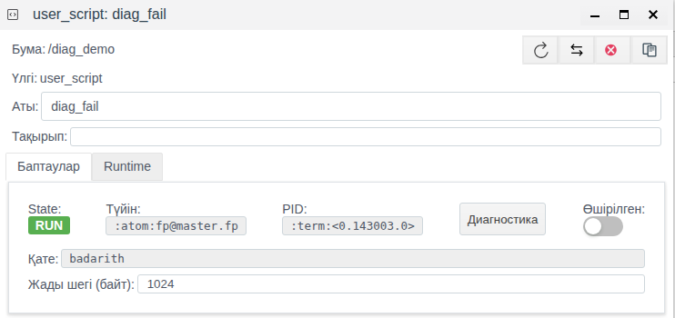

# Сервер журналдары

Бұл құжат FACEPLATE серверіндегі журнал файлдары бойынша ақаудың себебін іздейтін немесе жобаны кім және қашан өзгерткенін анықтайтын интегратор инженерге арналған.

# Мазмұны

- [Терминдер сөздігі](#терминдер-сөздігі)
- [Кіріспе](#кіріспе)
- [Негізгі бөлім](#негізгі-бөлім)
    - [Журналдар қайда орналасқан](#журналдар-қайда-орналасқан)
    - [Көлемі және ротация](#көлемі-және-ротация)
    - [Журнал жолы](#журнал-жолы)
    - [Іздеуді неден бастау керек](#іздеуді-неден-бастау-керек)
    - [Нысан жолдарын қалай табуға болады](#нысан-жолдарын-қалай-табуға-болады)
    - [Нысанды кім өзгертті](#нысанды-кім-өзгертті)
    - [Журналдар, Диагностика және «Қате» өрісі](#журналдар-диагностика-және-қате-өрісі)
- [Қорытынды](#қорытынды)

# Терминдер сөздігі

| Термин | Мағынасы |
|---|---|
| Орнату каталогы | Серверде FACEPLATE орнатылған бума. Онда `bin`, `releases`, `logs` бумалары бар; `./faceplate console` командасы осы буманың `bin` ішінен іске қосылады |
| Түйін | FACEPLATE-тің іске қосылған бір сервері. Түйін атауы `fp@<сервер атауы>` түрінде болады, мысалы `fp@master.fp`; дәл сол атау Runtime нысаны пішінінің **Түйін** өрісінде және **Серверлер** панелінде көрсетіледі |
| Сервер журналы | Түйін өз жұмысы және жоба нысандарының жұмысы туралы хабарламаларды жазатын `console.log` және `error.log` мәтіндік файлдары |
| Ротация | Толған журнал файлын мұрағаттық файлға (`console.log.0`, `console.log.1`, …) қайта атау және жаңа файлды бастау |
| Үдеріс | Нысан жұмысын серверде орындаушы. `<0.518463.0>` түріндегі идентификатормен белгіленеді; дәл сол идентификатор нысан пішінінің **PID** өрісінде көрсетіледі |

# Кіріспе

Studio нысанның қазіргі күйін көрсетеді: **Қате** өрісі — соңғы қатені, **Диагностика** терезесі — **Start** басылған сәттен бастап бір нысанның хабарламаларын. Сервер журналдары түйін іске қосылғаннан бастап үздіксіз, барлық нысандар бойынша бірден және жүйенің өзі бойынша жазылады. Олар арқылы Studio енді көрсетпейтін нәрсе қалпына келтіріледі:

- нысан қашан қате бере бастады және түнде ол қаншалықты жиі қайталанды;
- қосылым немесе скрипт тоқтар алдында не болды;
- нысанды кім және қай мекенжайдан жасады, өзгертті немесе жойды және нақты не өзгертті;
- пайдаланушылар қашан кірді және шықты;
- түйін FACEPLATE-тің қай нұсқасын іске қосты.

Өтпелі мысал — [«Runtime нысандарының диагностикасы»](../diagnostics/diagnostics.md) құжатындағы `diag_demo` бумасы: `diag_fail` пайдаланушы скрипті әр іске қосылғанда, 5 секунд сайын, `badarith` қатесімен аяқталады, `diag_script` скрипті әр 2 секунд сайын журналға `cycle N` жазады.

FACEPLATE серверінің файлдық жүйесіне кіру мүмкіндігі (мысалы, SSH арқылы) және жобаны өзгерту құқығы бар тіркелгімен Studio ортасына (`http://<сервер>:9000/fp/studio`) кіру мүмкіндігі қажет.

# Негізгі бөлім

## Журналдар қайда орналасқан

Әдепкі бойынша түйін орнату каталогының `logs` бумасына екі файл жазады:

| Файл | Не жазылады | Не үшін |
|---|---|---|
| `<орнату каталогы>/logs/console.log` | `info`, `notice`, `warning`, `error` және одан жоғары деңгейдегі хабарламалар | Түйін жұмысының толық тарихы: іске қосылу, пайдаланушылардың кіруі, жобаның өзгерістері, нысандардың жұмысы мен қателері |
| `<орнату каталогы>/logs/error.log` | Тек `error` және одан жоғары деңгейдегі хабарламалар | Жұмыс хабарламаларының ағынынсыз қателерді жылдам қарау. Дәл сол жолдар `console.log` ішінде де бар |

`debug` деңгейіндегі хабарламалар файлдарға жазылмайды. Олар тек **Диагностика** терезесінде `debug` деңгейінде көрінеді, [«Runtime нысандарының диагностикасы», «Журнал деңгейі» бөлімін](../diagnostics/diagnostics.md#журнал-деңгейі) қараңыз.

`./faceplate console` іске қосылған консоль терезесі журналды қайталамайды: файлдарды оқыңыз.

Кластерде әр түйін өз файлдарын өз серверінде жазады. Нысан хабарламаларын ол орындалып жатқан түйіннен іздеңіз — бұл нысан пішініндегі **Түйін** өрісінің мәні ([Нысан жолдарын қалай табуға болады](#нысан-жолдарын-қалай-табуға-болады) бөлімін қараңыз). Түйіндер тізімі **Серверлер** панелінде, [«Кластер түйіндері»](../nodes/nodes.md) құжатын қараңыз.

Docker контейнеріне орнатқанда `logs` бумасы әдетте сервердегі бумаға қосылады, [«Docker контейнеріне орнату»](../../../en/general/docker/deploy%20as%20docker.md) құжатын қараңыз.

Журналдарды басқа бумаға, мысалы бөлек дискіге, көшіруге болады, [«Ресурстарды резервтеу», «Журналдау конфигурациясы (fp.logger.config)» бөлімін](../redundancy/redundancy.md#журналдау-конфигурациясы-fploggerconfig) қараңыз. Жаңа бума түйін қайта іске қосылғаннан кейін қолданылады.

## Көлемі және ротация

Файл 1 ГБ-қа жеткенде түйін оны `.0` нөмірлі мұрағаттық файлға қайта атайды, бұрынғы мұрағаттарды бір нөмірге жылжытады (`.0` → `.1` т.с.с.) және жаңа файлды бастайды. Шектен асқан ең үлкен нөмірлі мұрағат жойылады.

| Файл | Файл өлшемі | Мұрағаттар | Дискідегі ең үлкен көлем |
|---|---|---|---|
| `console.log` | 1 ГБ | 10 (`console.log.0` … `console.log.9`) | шамамен 11 ГБ |
| `error.log` | 1 ГБ | 3 (`error.log.0` … `error.log.2`) | шамамен 4 ГБ |

Мұрағат нөмірі неғұрлым кіші болса, соғұрлым ол жаңа. Сақталған бүкіл тарих бойынша іздеу үшін командаға барлық файлдарды бірден беріңіз: `grep '<мәтін>' logs/console.log*`.

Жүктемесі жоғары жүйеде `console.log` файлының 11 ГБ көлемі небәрі бірнеше күнді сыйғызуы мүмкін. Тарих ұзағырақ керек болса, мұрағаттарды жойылғанға дейін басқа жерге көшіріңіз.

## Журнал жолы

Әр хабарлама — бір жол:

```
2026-11-09 12:13:22.704800+00:00 [error] <0.518463.0>@fp_script:run/3:463 "diag_demo/diag_fail" error on user script execution badarith
```

| Бөлігі | Мағынасы |
|---|---|
| `2026-11-09 12:13:22.704800+00:00` | Сервер сағаты бойынша микросекундқа дейінгі дәлдікпен уақыт және UTC-тен ығысу. Уақыт белдеуі UTC+5 серверде жол `+05:00` болып аяқталады |
| `[error]` | Деңгей: `info`, `notice`, `warning`, `error` және одан жоғары |
| `<0.518463.0>` | Хабарламаны шығарған үдеріс. Нысан қайта іске қосылмайынша, нысан пішініндегі **PID** мәнімен сәйкес келеді |
| `@` | Бөлгіш |
| `fp_script:run/3:463` | Хабарламаны шығарған платформа кодындағы орын. Талдау кезінде оны өткізіп жіберуге болады. Пайдаланушы скриптінің хабарламаларында орын көрсетілмейді, жолда тек `:` қалады |
| `"diag_demo/diag_fail" error on …` | Мәтін. Жоба нысандарының хабарламаларында нысан жолы болады |

Нысан жолы әртүрлі жазылады: скрипттерде — жоба бумасынан (`"diag_demo/diag_fail"`), қосылымдарда — толық (`/root/FP/PROJECT/plat_bugs/bt_master`), өзгерістер жолдарында — жоба түбірінен (`<<"/diag_demo/diag_fail">>`). Барлық түрінде «бума/нысан» жолы бар, сондықтан сол бойынша іздеңіз: `diag_demo/diag_fail` кез келген түрдегі жолдарды табады.

**Диагностика** терезесіндегі жол пішімі де дәл осындай, сондықтан терезедегі жолды файлдан табуға болады және керісінше.

## Іздеуді неден бастау керек

Журналдарға платформа және жобаның барлық нысандары жазады. Кез келген жол бірдей құрылған ([Журнал жолы](#журнал-жолы) бөлімін қараңыз), сондықтан талдауды ақау туралы белгілі нәрседен бастайды:

- **нысанды білесіз** — `бума/нысан` жолы бойынша іздеңіз, [Нысан жолдарын қалай табуға болады](#нысан-жолдарын-қалай-табуға-болады) бөлімін қараңыз;
- **нысан өзгерген, бірақ оны кім өзгерткені белгісіз** — `USER ACTION` іздеңіз, [Нысанды кім өзгертті](#нысанды-кім-өзгертті) бөлімін қараңыз;
- **нысан пішінінде қате бар** — оның мәтінін **Қате** өрісінен алып, `error.log` ішінен іздеңіз, онда уақыты мен түйіні болады;
- **өз скриптіңіздің хабарламалары керек** — скрипт `logger` функциясына беретін мәтінді іздеңіз, [«Runtime нысандарының диагностикасы», «Скрипттен өз хабарламаларыңыз» бөлімін](../diagnostics/diagnostics.md#скрипттен-өз-хабарламаларыңыз) қараңыз;
- **базалардың көшірілуін немесе жабылуын тексеріп жатырсыз** — [«Қоймалар», «Журнал бойынша тексеру» бөлімін](../../data_storage/storage/storage.md#журнал-бойынша-тексеру) қараңыз;
- **журналда `crasher:` бар** — бұл үдерістің апаттық аяқталуы туралы есеп. Оны алдындағы және кейінгі бірнеше жолмен бірге қолдау қызметіне өтінішке қоса беріңіз.

## Нысан жолдарын қалай табуға болады

Studio-дағы нысан пішінінен бастаңыз: ол нені және қайдан іздеу керектігін көрсетеді.



| Пішін өрісі | Іздеуге не береді |
|---|---|
| **Түйін** | Журналдарды қай серверде ашу керек: `fp@master.fp` |
| **PID** | Нысан үдерісі: `<0.518463.0>`. Іздеуді нысанның ағымдағы іске қосылуымен шектейді |
| **Қате** | Соңғы қатенің мәтіні: `badarith` |

Нысан жолы буманың тақырыбында және **Аты** өрісінде көрінеді: `diag_demo/diag_fail`.

Нысанның барлық қателері, соңғы жолдар:

```bash
grep 'diag_demo/diag_fail' logs/error.log | tail -n 3
```

```
2026-11-09 12:13:17.704793+00:00 [error] <0.518463.0>@fp_script:run/3:463 "diag_demo/diag_fail" error on user script execution badarith
2026-11-09 12:13:22.704800+00:00 [error] <0.518463.0>@fp_script:run/3:463 "diag_demo/diag_fail" error on user script execution badarith
2026-11-09 12:13:27.704813+00:00 [error] <0.518463.0>@fp_script:run/3:463 "diag_demo/diag_fail" error on user script execution badarith
```

Қате дәл 5 секунд сайын — скрипт кезеңімен қайталанады: скрипт қайта іске қосылмайды, әр іске қосылғанда құлайды.

Нысанның іске қосылулары, тоқтаулары және өзгерістері бар толық тарихы `console.log` ішінде:

```bash
grep 'diag_demo/diag_fail' logs/console.log
```

Журналды нақты уақытта тек нысан жолдарын көрсетіп бақылау:

```bash
tail -f logs/console.log | grep --line-buffered 'diag_demo/diag_fail'
```

**Диагностика** терезесінен айырмашылығы, бұлай нысанның өз жолдары да, ол туралы жүйелік жолдар да көрінеді, мысалы басқа пайдаланушының өзгерісі туралы жазба.

## Нысанды кім өзгертті

Нысанды Studio арқылы әр жасау, өзгерту және жою `console.log` ішіне `info` деңгейіндегі `USER ACTION` жолымен жазылады:

| Әрекет | Жолда не бар |
|---|---|
| `create object` | Жол, пайдаланушы, IP мекенжайы, жаңа нысан өрістерінің мәндері (`fields: …`) |
| `edit object` | Жол, пайдаланушы, IP мекенжайы, өзгертілген өрістер: әрқайсысы үшін жаңа мән `value` және бұрынғы мән `previous_value` (`changes: …`) |
| `delete object` | Жол, пайдаланушы, IP мекенжайы |

Мысалда `diag_fail` скриптін **Өшірілген** ауыстырғышымен өшіріп, бір минуттан кейін қайта қосты. Журналда:

```bash
grep 'diag_demo/diag_fail' logs/console.log | grep -v 'error on user script'
```

```
2026-11-09 12:11:21.456723+00:00 [info] <0.517054.0>@fp_item:log_user_action/1:1240 USER ACTION: edit object <<"/diag_demo/diag_fail">>, user <<"system">>, ip: {172,17,0,1}, changes: #{<<"disabled">> => #{value => true,previous_value => false}}
2026-11-09 12:11:21.457658+00:00 [info] <0.499862.0>@fp_script:terminate/3:530 "diag_demo/diag_fail" stop script, reason shutdown
2026-11-09 12:11:21.458121+00:00 [info] <0.499862.0>@fp_script:log_state/3:676 "diag_demo/diag_fail" changed state to stop
2026-11-09 12:12:22.675101+00:00 [info] <0.518133.0>@fp_item:log_user_action/1:1240 USER ACTION: edit object <<"/diag_demo/diag_fail">>, user <<"system">>, ip: {172,17,0,1}, changes: #{<<"disabled">> => #{value => false,previous_value => true}}
```

Жолдардан көрінеді:

- 12:11:21-де `172.17.0.1` мекенжайынан `system` пайдаланушысы **Өшірілген** ауыстырғышын қосты (`disabled`: `false` → `true`);
- сол миллисекундта `<0.499862.0>` үдерісі тоқтады;
- 12:12:22-де сол пайдаланушы **Өшірілген** ауыстырғышын ажыратты.

12:11:21 мен 12:12:22 аралығында `error.log` ішінде `badarith` қатесі жоқ, келесісі — 12:12:22-де жаңа `<0.518463.0>` үдерісінен. Сондықтан қосқаннан кейінгі пішіндегі **PID** өшірер алдындағыдан басқа.

Бір пайдаланушының жобадағы барлық өзгерістері:

```bash
grep 'USER ACTION' logs/console.log* | grep 'user <<"admin">>'
```

## Журналдар, Диагностика және «Қате» өрісі

| | **Қате** өрісі, **Errors** бағаны | **Диагностика** терезесі | Сервер журналдары |
|---|---|---|---|
| Қайда | Нысан пішіні, **Жалпы құрылым** | Runtime нысаны пішінінен ашылатын терезе | Сервердегі файлдар |
| Не көрсетеді | Нысанның соңғы қатесі | Бір нысанның хабарламалары | Барлық нысандар мен жүйенің хабарламалары |
| Қай уақыт аралығы | Тек қазір | **Start** басылғаннан терезе жабылғанға дейін | Түйін іске қосылғаннан файл ротациямен жойылғанға дейін |
| Деңгейлер | — | `debug`, `info`, `warning`, `error` | `info` және одан жоғары (`console.log`), `error` және одан жоғары (`error.log`) |
| Жобаның өзгерістері, пайдаланушылардың кіруі | Жоқ | Жоқ | Бар |
| Қажетті қолжетімділік | Studio | Studio | Сервердің файлдық жүйесі |

Талдау реті: **Қате** өрісі нысанның қатеде екенін айтады; **Диагностика** терезесі нысанның қазір не істеп жатқанын, соның ішінде `debug` деңгейінде көрсетеді; сервер журналдары бұрын не болғанына, қай түйінде болғанына және нысанды кім өзгерткеніне жауап береді.

Оператор көретін дабыл хабарламалары — сервер файлдары емес, жобаның жеке хабарламалар журналы, [«Экрандағы дабылдар мен трендтер»](../../mnemo/alarms_trends.md) құжатын қараңыз.

# Қорытынды

FACEPLATE-тің әр түйіні `<орнату каталогы>/logs` ішіне екі файл жазады: `info` және одан жоғары хабарламалары бар `console.log` және тек қателері бар `error.log`. Файлдар 1 ГБ-қа дейін өседі және ротацияланады: `console.log` 10 мұрағат, `error.log` — 3 мұрағат сақтайды. Журналдарды басқа бумаға көшіруге болады; жаңа бума түйін қайта іске қосылғаннан кейін қолданылады. Нысан жолын **Түйін** өрісіндегі түйінде «бума/нысан» жолы бойынша табады; пішіндегі **PID** нысан қайта іске қосылғанға дейін жолдағы үдеріспен сәйкес келеді. `USER ACTION` жолдары нысанды кім, қашан және қай мекенжайдан жасағанын, өзгерткенін немесе жойғанын және қандай өрістерді ауыстырғанын көрсетеді.
