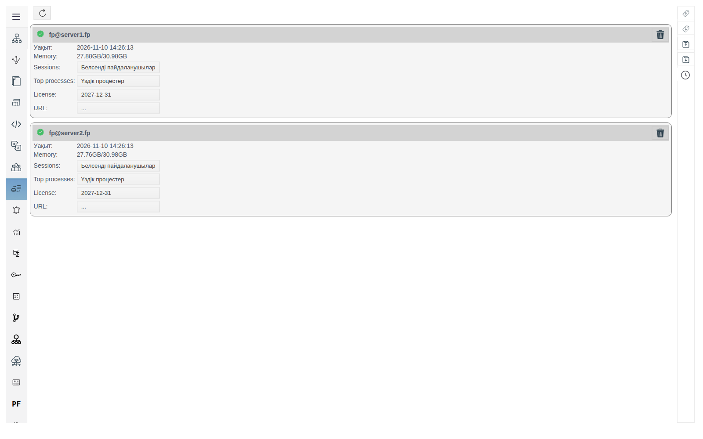
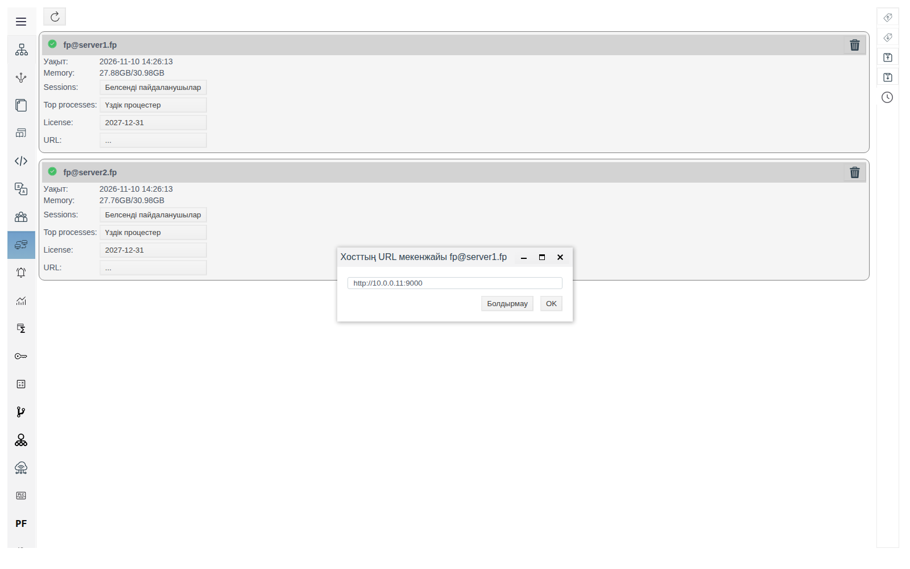
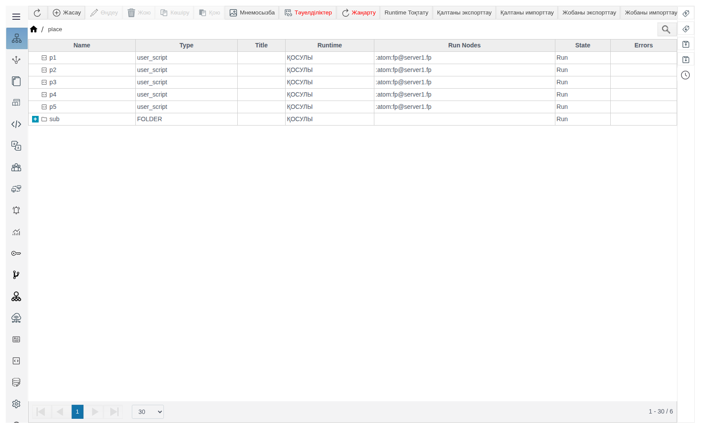
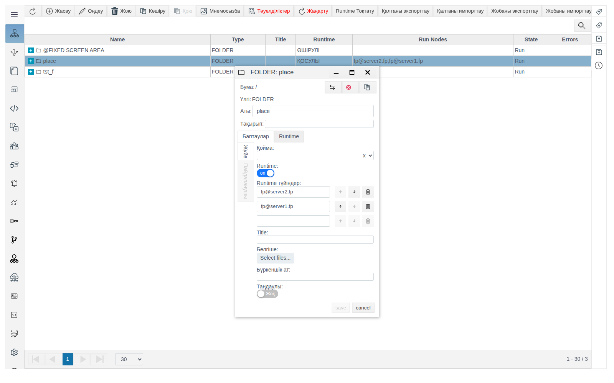
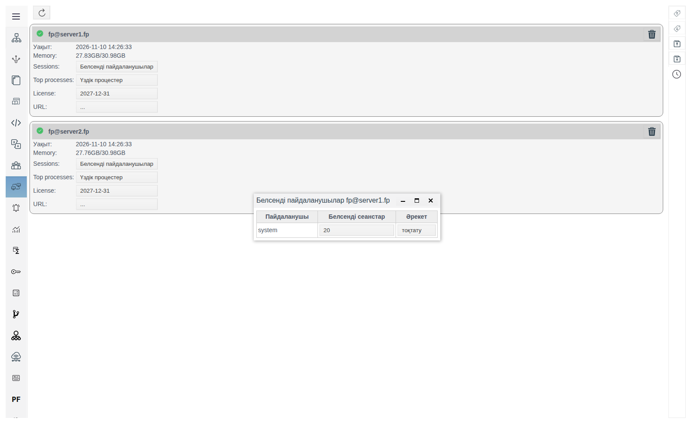
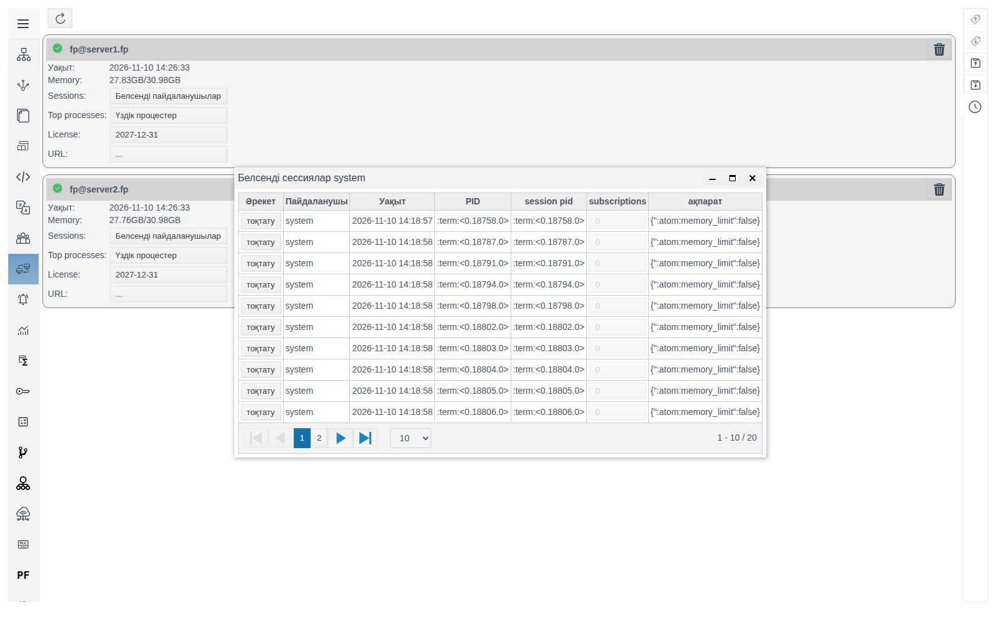
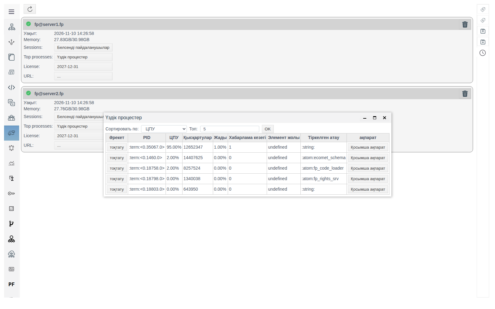
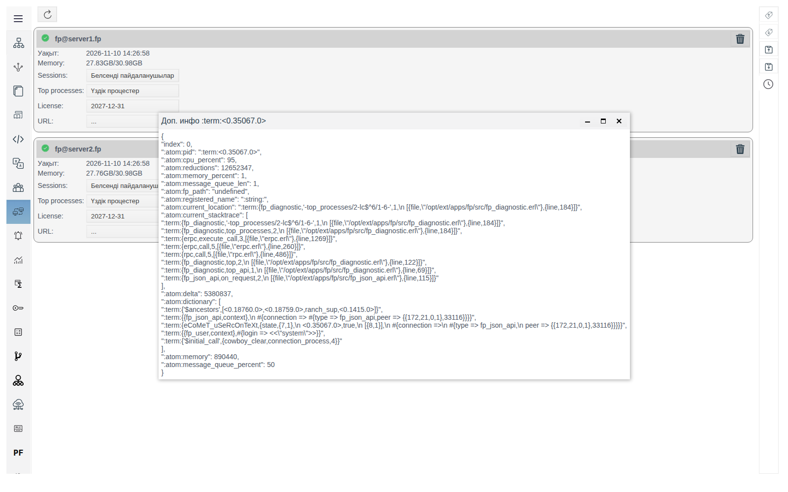
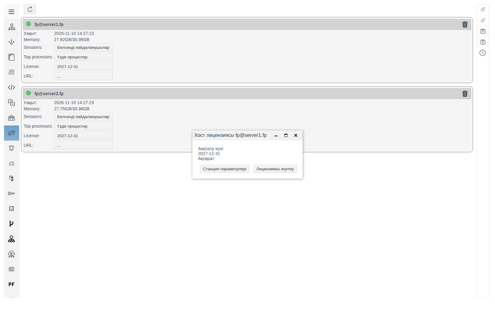

# Кластер түйіндері

Бұл құжат FACEPLATE серверлерін бақылайтын интегратор инженерге арналған: қандай түйіндер жұмыс істеп тұр, оларға кім қосылған, оларды не жүктейді және сервер қолжетімсіз болса, оператордың Runtime ортасы қайда ауысады.

# Мазмұны

- [Терминдер сөздігі](#терминдер-сөздігі)
- [Кіріспе](#кіріспе)
- [Негізгі бөлім](#негізгі-бөлім)
    - [Панельді қайдан ашуға болады](#панельді-қайдан-ашуға-болады)
    - [Түйін карточкасы](#түйін-карточкасы)
    - [Runtime үшін түйін мекенжайы](#runtime-үшін-түйін-мекенжайы)
    - [Нысандар қай жерде орындалады](#нысандар-қай-жерде-орындалады)
    - [Белсенді пайдаланушылар мен сеанстар](#белсенді-пайдаланушылар-мен-сеанстар)
    - [Үздік процестер](#үздік-процестер)
    - [Түйін лицензиясы](#түйін-лицензиясы)
- [Қорытынды](#қорытынды)

# Терминдер сөздігі

| Термин | Мағынасы |
|---|---|
| Түйін | FACEPLATE-тің бір сервері. `fp@<хост>` түріндегі атау `vm.args` файлындағы `-name` параметрімен беріледі, [«Ресурстарды резервтеу»](../redundancy/redundancy.md#виртуалды-машинаны-баптау-vmargs) құжатын қараңыз |
| Кластер | Бір жүйеге біріктірілген бірнеше түйін. Құрастыру реті — [«Ресурстарды резервтеу»](../redundancy/redundancy.md#кластерді-іске-қосу-және-құрастыру) құжатында |
| Сеанс | Пайдаланушы тіркелгісімен түйінге қосылу. Studio мен Runtime-тің әр терезесі өз сеанстарын ашады; олардан басқа түйін іске қосылған кезде құрылған қызметтік сеанстарды да ұстайды |
| Үдеріс | Түйіндегі жұмысты орындаушы. `<0.1353.0>` түріндегі идентификатормен белгіленеді |

# Кіріспе

**Серверлер** панелі — Studio ортасындағы кластер түйіндерінің тізімі, әр түйінге бір карточка. Ол түйінге тұтас қатысты сұрақтарға жауап береді: ол жұмыс істеп тұр ма, серверде қанша жады бос емес, кім қосылған, түйінді қай үдерістер ең көп жүктейді, оның лицензиясы қандай.

**Диагностика** терезесі ([«Runtime нысандарының диагностикасы»](../diagnostics/diagnostics.md)) бір нысан деңгейінде жұмыс істейді: нақты есептің, скрипттің немесе қосылымның журналы. **Серверлер** панелі одан ертерек, қай нысан кінәлі екені әлі белгісіз кезде қажет: түйін шамадан тыс жүктелсе, **Үздік процестер** ең ауыр үдерістерді және олардың әрқайсысы тиесілі жоба нысанының жолын көрсетеді. Себепті одан әрі осы нысанның **Диагностикасынан** іздейді.

Панельдің екінші мақсаты — Runtime ортасын резервтеу. Түйін карточкасында оператордың Runtime ортасы өз серверімен байланысын жоғалтқанда осы түйінге қосылатын мекенжай беріледі. Үшіншісі — нысандарды орналастыру: әр скрипт, есеп немесе қосылым қай түйінде жұмыс істейді және түйін істен шыққанда қайда ауысады.

Бір түйіннен тұратын кластерде панель бір карточканы көрсетеді.

Жобаны өзгерту құқығы бар тіркелгімен Studio ортасына (`http://<сервер>:9000/fp/studio`) кіру мүмкіндігі қажет.

# Негізгі бөлім

## Панельді қайдан ашуға болады

Studio сол жақ мәзірінде **Серверлер** тармағын таңдаңыз. Карточкалардың үстіндегі жаңарту батырмасы түйіндер тізімін және карточкалардағы мәндерді қайта оқиды.

## Түйін карточкасы

| Элемент | Мақсаты |
|---|---|
| Түйін атауы | `fp@<хост>` |
| **Уақыт** | Түйін өз деректерін соңғы рет жаңартқан уақыт. Жұмыс істеп тұрған түйінде бірнеше секунд дәлдікпен ағымдағы уақытпен сәйкес келеді. Түйін тоқтатылса, мән өзгеруін тоқтатады |
| **Memory** | Сервердің бос емес және жалпы жадысы, мысалы `22.13GB/30.98GB` |
| **Sessions** | **Белсенді пайдаланушылар** батырмасы, [Белсенді пайдаланушылар мен сеанстар](#белсенді-пайдаланушылар-мен-сеанстар) бөлімін қараңыз |
| **Top processes** | **Үздік процестер** батырмасы, [Үздік процестер](#үздік-процестер) бөлімін қараңыз |
| **License** | Түйін лицензиясының аяқталу күні; лицензия жүктелмесе — `...`. [Түйін лицензиясы](#түйін-лицензиясы) бөлімін қараңыз |
| **URL** | Runtime үшін түйін мекенжайы; мекенжай берілмесе — `...`. [Runtime үшін түйін мекенжайы](#runtime-үшін-түйін-мекенжайы) бөлімін қараңыз |

## Runtime үшін түйін мекенжайы

Оператордың Runtime ортасы бір түйіннен ашылған және онымен байланысты ұстап тұрады. Қосылған кезде Runtime серверден кластердің жұмыс істеп тұрған түйіндерінің тізімін және олардың мекенжайларын алады. Байланыс үзілсе, Runtime тізімдегі мекенжайларды кезекпен тексереді, бірінші қолжетімді түйінге қосылады, Runtime бетін оның мекенжайынан жүктейді және сол тіркелгімен жұмысын жалғастырады: операторға құпиясөзді қайта енгізудің қажеті жоқ.

Тізімдегі түйін мекенжайы:

| **URL** өрісі | Runtime қай мекенжайды тексереді |
|---|---|
| Толтырылған | **URL** мәні |
| Бос | Түйін атауынан алынған мекенжай: `@` белгісінен кейінгі хост түйіннің HTTP және HTTPS порттарымен, мысалы `http://<хост>:9000` |

Түйін хостының атауы оператордың жұмыс орнынан ашылмаса, **URL** өрісін толтырыңыз: мысалы, ол тек серверлер желісінің ішінде белгілі немесе операторлар IP мекенжайы арқылы қосылады. Мекенжай оператордың жұмыс орнынан ашылатын түрде көрсетіледі: хаттама, хост немесе IP мекенжайы және порт, жолсыз, мысалы `http://10.0.0.11:9000`.

Түйін операторды қабылдай алады, тек онда жоба дерекқорының көшірмесі болса. Көшірмені басқа түйінге қалай қосу керектігі [«Қоймалар»](../../data_storage/storage/storage.md#резервтеу-екінші-сервердегі-база-көшірмесі) құжатында сипатталған. Көшірмесі жоқ түйінде бірінші түйін істен шыққаннан кейін Runtime жүктелмейді.

Мекенжайды беру үшін:

1. Түйін карточкасындағы **URL** мәнін шертіңіз. **Хосттың URL мекенжайы <түйін атауы>** терезесі ашылады.
2. Мекенжайды енгізіп, **OK** батырмасын басыңыз.

Мекенжай карточкада пайда болады; оның оң жағында өрісті тазартатын айқыш бар. Мән түйін қайта іске қосылғанда сақталады.

Ауысуды серверді тоқтатпай-ақ тексеруге болады: Runtime ортасын ашыңыз, содан кейін Studio ортасында осы Runtime сеансын тоқтатыңыз ([Белсенді пайдаланушылар мен сеанстар](#белсенді-пайдаланушылар-мен-сеанстар) бөлімін қараңыз). Runtime байланысты жоғалтып, тізімдегі түйінге қосылады. Түйінде FACEPLATE тоқтатылғанда Runtime бірнеше секунд ішінде басқа түйінге ауысады.

## Нысандар қай жерде орындалады

Runtime нысандары — пайдаланушы скрипттері, есептер, қосылымдар, мұрағаттар — кластер түйіндерінде жұмыс істейді. Нысан қазір жұмыс істеп тұрған түйін екі жерде көрінеді:

* **Жалпы құрылымдағы** **Run Nodes** бағаны, мысалы `:atom:fp@server1.fp`. Тоқтатылған нысанда түйін болмайды;
* нысан пішінінің жоғарғы панеліндегі **PID** жанындағы **Түйін** өрісі.

Нысандарға қай түйіндерде жұмыс істеуге рұқсат етілетіні нысанның өзінде емес, бумада беріледі. Бұл нысан белгілі бір серверге байланған кезде қажет: ПЛК қосылымына контроллерге дейін желісі бар сервер керек, ауыр есептерге — қалғандарын жүктемеу үшін бөлек сервер. Бума пішініндегі өрістер, **Баптаулар** қойындысы:

| Өріс | Мақсаты |
|---|---|
| **Runtime** | Өшірулі — бума мен ішкі бумалардың нысандары тоқтатылған (**State** `Stop`, түйінсіз), буманың **Runtime** бағанында `ӨШІРУЛІ`. Қосулы — нысандар жұмыс істейді |
| **Runtime түйіндер** | Бума нысандары жұмыс істей алатын түйіндер. Түйін атауы толық енгізіледі, мысалы `fp@server2.fp`; енгізгеннен кейін келесі түйінге арналған бос жол пайда болады. Себет жолды жояды |

| Бумадағы **Runtime түйіндер** | Нысандар қайда жұмыс істейді |
|---|---|
| Бос | Ата-аналық бумадағыдай. Тізім жоғарыдағы бірде-бір бумада берілмесе — кластердің кез келген түйінінде: FACEPLATE нысандарды түйіндер арасында өзі бөледі |
| Берілген | Тек тізімдегі түйіндерде. Нысандар олардың арасында бөлінеді |

Бумада **Run Nodes** бағаны оның **Runtime түйіндер** тізімін көрсетеді.

Тізімнің өзгерісі бума сақталғанда қолданылады: нысандар бірнеше секунд ішінде сәйкес түйіндерде қайта іске қосылады.

Түйін тоқтаса, онда жұмыс істеген нысандар бірнеше секунд ішінде тізімдегі басқа түйінде қайта іске қосылады. Бума нысандары сервердің істен шығуына төтеп беруі үшін тізімде кемінде екі түйін көрсетіңіз, және осы түйіндердің әрқайсысында жоба дерекқорының көшірмесі болуы керек, [«Қоймалар»](../../data_storage/storage/storage.md#резервтеу-екінші-сервердегі-база-көшірмесі) құжатын қараңыз.

**Жалпы құрылым** панеліндегі **Runtime Тоқтату** және **Runtime Іске Қосу** батырмалары растаудан кейін жобаның барлық нысандарын бірден тоқтатады және іске қосады.

Мысалда `place` бумасының тізімінде `fp@server2.fp` және `fp@server1.fp` бар: буманың бес скрипті екі түйінде де жұмыс істеді. `fp@server2.fp` түйінінде FACEPLATE тоқтатылғаннан кейін оның скрипті бірнеше секундтан соң `fp@server1.fp` түйінінде жұмыс істеді.

## Белсенді пайдаланушылар мен сеанстар

**Белсенді пайдаланушылар** батырмасы **Белсенді пайдаланушылар <түйін атауы>** терезесін ашады: түйінге қосылған тіркелгілер және **Белсенді сеанстар** бағанындағы олардың сеанстар саны.

Сеанстар санын шерткенде **Белсенді сессиялар <пайдаланушы>** терезесі ашылады.

| Баған | Мағынасы |
|---|---|
| **Әрекет** | **тоқтату** батырмасы — сеансты жабу |
| **Пайдаланушы** | Тіркелгі |
| **Уақыт** | Сеанстың ашылған уақыты |
| **PID**, **session pid** | Сеанс үдерісі |
| **subscriptions** | Сеанстың деректерге жазылымдар саны |
| **ақпарат** | Studio мен Runtime терезелері үшін — клиент мекенжайы (`peer`): терезе ашылған IP мекенжайы мен порт |

Терезе бір бетте 10 сеанстан көрсетеді; жолдар саны кестенің астындағы тізіммен өзгертіледі.

**тоқтату** «Вы уверены что хотите прервать сессию пользователя <пайдаланушы>, id: <PID>» растауын сұрайды және **yes** басылғаннан кейін сеансты жабады. Сеанс тиесілі болған Studio немесе Runtime терезесі сервермен байланысын жоғалтады: Runtime [Runtime үшін түйін мекенжайы](#runtime-үшін-түйін-мекенжайы) бөліміндегі ережелер бойынша ауысады.

Қажетті терезенің сеансын **Уақыт** (кіру уақыты) және **ақпарат** (жұмыс орнының мекенжайы) бағандары бойынша табады.

## Үздік процестер

**Үздік процестер** батырмасы бірнеше секунд ішінде түйін үдерістерінің статистикасын жинайды және **Үздік процестер** терезесін ашады.

| Элемент | Мақсаты |
|---|---|
| **Сортировать по** | Үдерістерді қай көрсеткіш бойынша іріктеу: **ЦПУ**, **Қысқартулар**, **Жады**, **Хабарлама кезегі** |
| **Топ** | Қанша үдерісті көрсету, әдепкі бойынша 5 |
| **OK** | Таңдалған параметрлермен тізімді қайта жинау |

| Баған | Мағынасы |
|---|---|
| **Әрекет** | **тоқтату** батырмасы — үдерісті тоқтату |
| **PID** | Үдеріс идентификаторы |
| **ЦПУ** | Жинау уақытындағы түйін процессор уақытының үлесі |
| **Қысқартулар** | Үдеріс орындаған жұмыстың есептегіші. Неғұрлым көп болса, үдеріс соғұрлым көп есептеген |
| **Жады** | Үдеріс алып тұрған түйін жадысының үлесі |
| **Хабарлама кезегі** | Өңдеуді күтіп тұрған хабарламалар саны. Өсіп келе жатқан кезек үдерістің кіріс деректеріне үлгермейтінін білдіреді |
| **Элемент жолы** | Үдеріс тиесілі жоба нысанының жолы, мысалы `"<бума>/<нысан>"`. `undefined` — жоба нысанының емес, платформаның өз үдерісі |
| **Тіркелген атау** | Платформаның қызметтік үдерісінің атауы, егер ол бар болса |
| **ақпарат** | **Қосымша ақпарат** батырмасы |

Қай сұрыптауды таңдау керек:

| Түйіндегі белгі | Сұрыптау |
|---|---|
| Процессор жүктелген, интерфейс баяу жауап береді | **ЦПУ** |
| Карточканың **Memory** өрісіндегі бос емес жады өсіп жатыр | **Жады** |
| Деректер кешігіп келеді | **Хабарлама кезегі** |

**ЦПУ** бойынша сұрыптағанда бірінші жолда әдетте осы тізімді ағымдағы пайдаланушы үшін жинайтын үдерістің өзі тұрады.

**Элемент жолы** бағанында жоба нысаны көрсетілсе, оның пішінін **Жалпы құрылымда** ашып, **Диагностиканы** іске қосыңыз, [«Runtime нысандарының диагностикасы»](../diagnostics/diagnostics.md#диагностиканы-қайдан-ашуға-болады) құжатын қараңыз.

**Қосымша ақпарат** үдеріс туралы барлық мәліметтермен **Доп. инфо <PID>** терезесін ашады: ағымдағы орындалу орны (`current_location`) және шақырулар стегі (`current_stacktrace`), байттағы жады көлемі (`memory`), хабарламалар кезегінің ұзындығы (`message_queue_len`), үдерістің қызметтік деректері (`dictionary`). Сеанс үдерісінің `dictionary` ішінде тіркелгі (`login`) және клиент мекенжайы (`peer`) көрсетілген.

**тоқтату** «Вы уверены что хотите прервать процесс <PID>» растауын сұрайды және **yes** басылғаннан кейін үдерісті тоқтатады.

## Түйін лицензиясы

**License** мәнін шерткенде **Хост лицензиясы <түйін атауы>** терезесі ашылады: лицензияның аяқталу күні, станция параметрлерінің файлын сақтау және лицензия файлын жүктеу. Лицензия әр түйінге бөлек жүктеледі. Лицензияны қалай алуға және жүктеуге болатыны және онсыз оператор не көретіні [«Лицензиялау»](../license/license.md) құжатында сипатталған.

# Қорытынды

**Серверлер** панелі кластердің әр түйінін бөлек карточкамен көрсетеді. Түйіннің **URL** өрісі байланыс жоғалғанда оператордың Runtime ортасы осы түйінге ауысатын мекенжайды анықтайды: түйін хостының атауы операторлардың жұмыс орындарынан ашылмаса, оны толтырыңыз. Түйін операторларды тек онда жоба дерекқорының көшірмесі болса ғана қабылдайды. Ауысуды Runtime сеансын тоқтату арқылы серверді тоқтатпай тексеруге болады. Нысандардың қай түйіндерде жұмыс істейтінін буманың **Runtime түйіндер** өрісі анықтайды; түйін істен шыққанда нысандар тізімдегі басқа түйінге ауысады. **Белсенді пайдаланушылар** кімнің және қайдан қосылғанын көрсетеді. **Үздік процестер** түйінді жүктейтін үдерісті және ол тиесілі жоба нысанын табады. Себебін осы нысанның **Диагностикасынан** іздеңіз. Лицензия әр түйінге **Хост лицензиясы** терезесінен жүктеледі.
