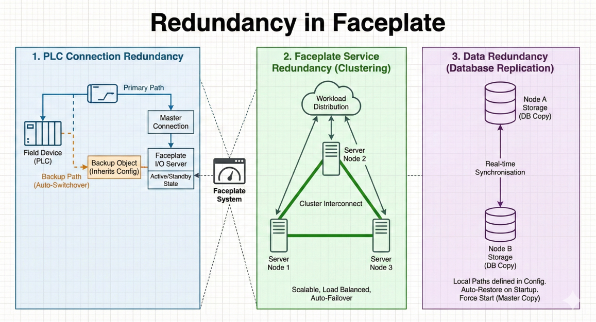
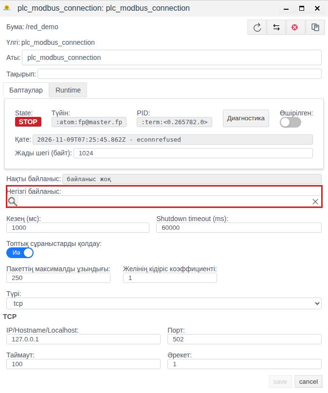
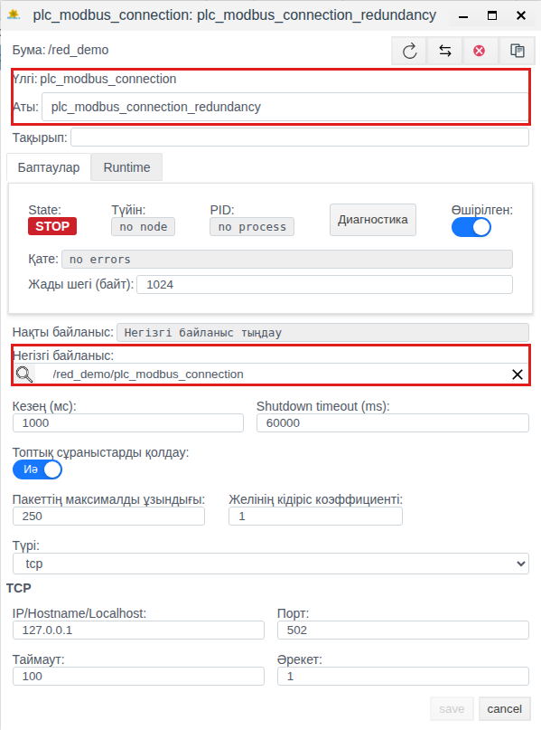
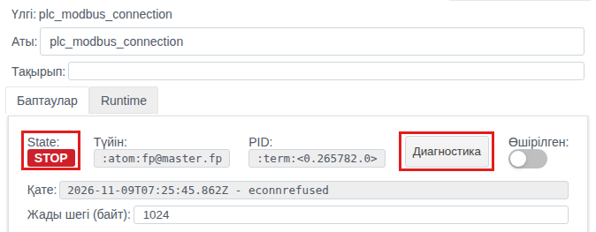
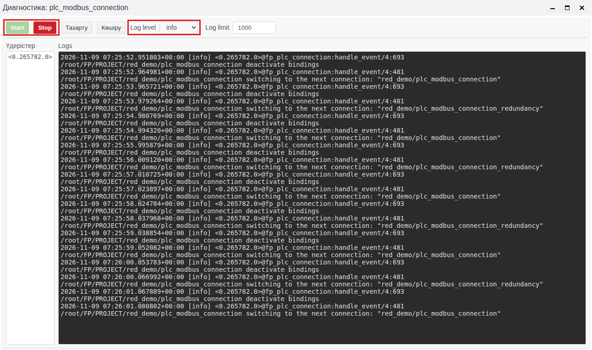

# Faceplate-тегі ресурстарды резервтеу

Технологиялық процестердің үздіксіздігін және жоғары қолжетімділікті қамтамасыз ету үшін Faceplate-те көпдеңгейлі резервтеу жүйесі іске асырылған. Өнім архитектурасы жүйенің негізгі құрамдас бөліктерін қайталау арқылы «бірыңғай істен шығу нүктесінің» пайда болу қаупін барынша азайтады.

## 1. Жабдықпен қосылымдарды резервтеу

Faceplate өріс құрылғыларымен (ПЛК, датчиктер, RTU) байланыс үшін [әртүрлі хаттамаларды](../../../en/data_collection/plc_connections/index.md#choose-a-connection) қолдайды. Резервтік арнаны баптау мысалы — [5-бөлімде](#5-plc-қосылымдарын-резервтеу).

- **Механизм:** Жүйе бір логикалық түйін үшін деректер алмасудың бірнеше жолын баптауға мүмкіндік береді.

- **Нәтиже:** Негізгі байланыс желісі үзілгенде немесе желілік интерфейсте ақау болғанда Faceplate автоматты түрде резервтік арнаға ауысып, телеметрияны үздіксіз жинауды және басқару командаларын беруді қамтамасыз етеді.

## 2. Faceplate қызметтерін резервтеу

Қызметтерді резервтеу **кластерлеу** арқылы қол жеткізіледі. Бірнеше сервер (Runtime) бір Erlang кластеріне біріктіріледі. Кластерді құрастыру реті — [4-бөлімде](#4-кластерді-іске-қосу-және-құрастыру).

- **Масштабтау:** Үдерістер түйіндер арасында бөлінеді. Бір түйін (сервер) құласа, қалғандары жұмысын жалғастырып, жүйенің қолжетімділігін қамтамасыз етеді. Ол үшін қалған түйіндерде жоба дерекқорларының көшірмелері болуы керек, [«Қоймалар»](../../data_storage/storage/storage.md#резервтеу-екінші-сервердегі-база-көшірмесі) құжатын қараңыз.

- **Сәйкестендіру:** Түйіндер бірыңғай «Cookie» (құпия кілт) және DNS/Hosts баптаулары арқылы бір-бірін «көреді».

## 3. Негізгі конфигурация (Tuning)

Параметрлерді нақты баптау релиз каталогында орналасқан конфигурациялық файлдарда жасалады (мысалы, `/DATASET/project/scada/faceplate/releases/4.0.6/`).

### 3.1. Виртуалды машинаны баптау (vm.args)

`vm.args` файлында әр түйін үшін Erlang ортасының бірегей параметрлері беріледі:

- **-name:** Түйіннің бірегей атауы (мысалы, `fp@rt-server1.fp`).

- **-setcookie:** Кластердің барлық серверлеріне ортақ, түйіндер өзара әрекеттескенде авторизацияны қамтамасыз ететін бірыңғай идентификатор (cookie).

- **+MIscs:** Ресурстарды тұтынуды оңтайландыруға арналған литерал жадысының шегі (мегабайтпен беріледі).

### 3.2. Журналдауды баптау (fp.logger.config)

`console_handler` және `error_handler` бөлімдерінде журналдарды шығару жолдарын баптаңыз, мысалы:

- **Консоль жолы:** `/DATASET/project/scada/local/logs/console.log`

- **Қателер жолы:** `/DATASET/project/scada/local/logs/error.log`

## 4. Кластерді іске қосу және құрастыру

Үдерістің үздіксіздігін қамтамасыз ету үшін алғашқы іске қосуды `scada` атты tmux сеансында орындау ұсынылады.

### 4.1. Жетекші түйінді іске қосу

Кластердің бірінші серверінде консоль режимінде іске қосыңыз:

```bash
./faceplate console
```

### 4.2. Қосымша түйіндерді қосу

Келесі серверлерді (Runtime 2, Runtime 3 немесе Historian) қосу үшін бұрыннан белсенді түйіннің мекенжайын көрсететін `ATTACH_TO` орта айнымалысы қолданылады.

**Алғашқы қосылуға арналған команда:**

```bash
env ATTACH_TO=fp@rt-server1.fp ./faceplate console
```

*(мұндағы `fp@rt-server1.fp` — жетекші түйіннің атауы).*

**Ескертпе:** Түйін кластерге сәтті қосылғаннан кейін барлық келесі қайта іске қосулар әдеттегі `./faceplate console` командасымен орындалады. Қосылған түйіндер Studio ортасында **Серверлер** панелінде көрінеді, [«Кластер түйіндері»](../nodes/nodes.md) құжатын қараңыз; оператордың Runtime ортасы ауысатын түйін мекенжайы да сонда беріледі.



*1-сурет. Түйіндердің кластерлік конфигурациясы*

## 5. PLC қосылымдарын резервтеу

Faceplate байланыс модулі деректер алмасудың артық физикалық және логикалық арналарын қолдау арқылы телеметриялық ақпарат пен басқару командаларының кепілді жеткізілуін қамтамасыз етеді. Қосылымдарды резервтеу механизмі хаттама драйверлері деңгейінде жұмыс істейді (OPC UA, Modbus TCP, IEC 60870-5-104 және т.б.) және мынадай мүмкіндіктерді қамтиды:


*2-сурет. Резервтік байланыс арналарының сызбасы*

**Нәтиже:** Бұл механизмдерді пайдалану деректердегі «олқылықтардың» пайда болу ықтималдығын барынша азайтады және апаттық жағдайларда басқару жүйесінің лезде әрекет етуін қамтамасыз етеді.

### 5.1. Толық мысал және баптау

#### Faceplate Studio ортасында баптау (Негізгі байланыс)

**1. Басты қосылымды құру:**

[Стандартты қосылым](../../../en/data_collection/plc_connections/general_en.md#create-the-connection-object-and-configure-the-channel) құрыңыз (мысалы, `plc_modbus_connection`). Негізгі байланыс өрісін бос қалдырыңыз. Бұл қосылым негізгі болады.



*3-сурет. Басты қосылымды құру*

**2. Резервтік нысанды құру:**

Екінші қосылымды құрыңыз (мысалы, `plc_modbus_connection_redundancy`). Негізгі байланыс өрісінде Басты қосылымға сілтемені көрсетіңіз (оны тізімнен таңдаңыз).



*4-сурет. Резервтік қосылымды құру*

#### Журналдар және мониторинг

Қосылым күйі драйверлер редакторындағы State (RUN/STOP) және Status (OK/ERROR) өрістерінде көрсетіледі. Күйлердің мәндері [PLC қосылымдарының анықтамалығында](../../../en/data_collection/plc_connections/general_en.md#states-and-diagnostic-controls) сипатталған.



*5-сурет. Редактордағы қосылым күйі*

[Диагностика терезесі](../diagnostics/diagnostics.md#диагностика-терезесі) ағымдағы қосылым бойынша журналдарды қарауға мүмкіндік береді. Start және Stop батырмалары журналдау үдерісін іске қосуға және тоқтатуға мүмкіндік береді. [Log level](../diagnostics/diagnostics.md#журнал-деңгейі) хабарламаларды маңыздылық және егжей-тегжей дәрежесі бойынша деңгейлерге бөледі. Нақты деңгейді таңдау әдетте «шек сүзгісі» ретінде жұмыс істейді: консольде таңдалған деңгейдегі хабарламалар және одан жоғары маңыздылықтағы барлық хабарламалар көрсетіледі.




*6-сурет. Қосылым диагностикасының терезесі*
