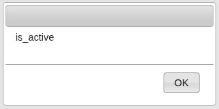
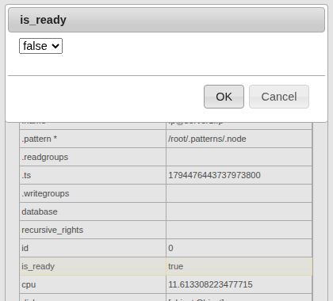
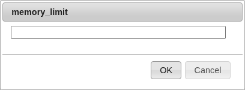

# Мажорлық жаңарту

Құжат интегратор инженерге арналған. Жаңарту түрлері [«FACEPLATE нұсқасы және жаңарту»](update.md) құжатында сипатталған.

# Мазмұны

- [Терминдер сөздігі](#терминдер-сөздігі)
- [Кіріспе](#кіріспе)
- [Негізгі бөлім](#негізгі-бөлім)
    - [Жаңарту қалай жүреді](#жаңарту-қалай-жүреді)
    - [Не көшіріледі](#не-көшіріледі)
    - [Түйін консолі](#түйін-консолі)
    - [ECOMET басқару беті](#ecomet-басқару-беті)
    - [Жаңарту реті](#жаңарту-реті)
    - [Кластерді тоқтатып жаңарту](#кластерді-тоқтатып-жаңарту)
- [Қорытынды](#қорытынды)

# Терминдер сөздігі

| Термин | Мағынасы |
|---|---|
| Түйін | FACEPLATE-тің іске қосылған бір сервері. Түйін атауы `fp@<сервер>` түрінде болады, [«Кластер түйіндері»](../nodes/nodes.md) қараңыз |
| Кластер | Бір жобамен және бір базамен бірге жұмыс істейтін түйіндер |
| Орнату каталогы | Серверде FACEPLATE орнатылған бума. Онда `bin`, `erts-<нұсқа>`, `etc`, `lib` және `releases` бумалары жатады. Бірінші іске қосудан кейін онда `logs` бумасы мен `DB` базасы, фонда іске қосқаннан кейін `log` бумасы, ал Git модулі репозиторийге қосылғаннан кейін `cvs` бумасы пайда болады |
| Cookie | `vm.args` файлындағы кластер паролі. Түйіндер cookie бірдей болғанда ғана байланысады |
| `ATTACH_TO` | Түйінді іске қосқандағы айнымалы: түйін қосылатын кластердің түйін атауы |
| Түйін консолі | Жұмыс істеп тұрған түйіннің командалар орындалатын командалық жолы |

# Кіріспе

Мажорлық жаңартуда нұсқа нөмірінің бірінші саны өзгереді. Алдыңғы мажорлық нұсқаның базасы жаңасына сәйкес келмейді. Сондықтан жаңа нұсқа бос базамен іске қосылады, ал жоба оған көшіріледі: түйін консоліндегі командалармен немесе Git-тен.

Негізгі рет кластерді тоқтатпайды: түйіндер жаңа нұсқаға бір-бірден көшіріледі. Алғашқы түйіндер көшіріліп жатқанда ескі нұсқаның қалған түйіндері жұмысын жалғастырады, және Runtime жаңа кластерге ауысқанға дейін үзілмейді. Жаңарту кезінде Runtime-ды тоқтатуға болса, барлық түйін бірден тоқтатылады, [«Кластерді тоқтатып жаңарту»](#кластерді-тоқтатып-жаңарту) бөлімін қараңыз.

Жоба көшіріледі — Studio-да құрылғанның бәрі. Мұрағаттар тарихы мен оқиғалар журналы түйін базасында сақталады және көшірілмейді, [«Не көшіріледі»](#не-көшіріледі) бөлімін қараңыз.

Серверлердің файлдары мен консоліне қолжетімділік (мысалы, SSH арқылы), Studio және [ECOMET басқару беті](#ecomet-басқару-беті) қажет.

# Негізгі бөлім

## Жаңарту қалай жүреді

1. Бірінші түйін ескі кластерден шығарылып, жаңа нұсқада бос базамен және жаңа cookie-мен іске қосылады. Жаңа cookie әр нұсқадағы түйіндердің байланысуына жол бермейді.
2. Бұл түйінге жоба көшіріледі.
3. Қалған түйіндер жаңа нұсқаға бір-бірден көшіріліп, біріншісіне `ATTACH_TO` арқылы қосылады. Түйін базаны бірінші түйіннен алады.
4. Ескі нұсқаның соңғы түйіні тоқтатылғанда жаңа кластерде Runtime іске қосылады.

Түйіндер көшіріліп жатқанда Runtime ескі кластердің қалған түйіндерінде жұмыс істейді. Жаңа кластердің Runtime-ын ертерек іске қосса, әрқайсысы өз базасымен екі Runtime жұмыс істейді.

Экспорттан кейін (қадам [3](#3-экспорттау)) ескі кластер жазған деректер жаңа кластерге түспейді.

Мысалда кластер `fp@server1.fp` және `fp@server2.fp` түйіндерінен тұрады, бірінші болып `fp@server1.fp` жаңартылады. Командалар `faceplate` орнату каталогы жатқан бумадан орындалады.

## Не көшіріледі

| Көшіріледі | Көшірілмейді |
|---|---|
| Жоба нысандары: бумалар, тегтер, мұрағаттар, мнемосхемалар, скрипттер, прототиптер, анықтамалықтар, пайдаланушылар, рөлдер және басқалар | Мұрағаттардың жинақталған мәндері, демек трендтер тарихы да |
| Жобаның жүйелік баптаулары | Оқиғалар журналының жазбалары |
| **export** құсбелгісі қойылған өрістердің мәндері, [«Прототиптер»](../../project_objects/prototypes/prototypes.md) қараңыз | **export** құсбелгісі жоқ өрістердің мәндері |
| | Пайдаланушылардың парольдері: көшіргеннен кейін қайта беріледі |

Жаңартудан кейін тарих алдыңғы нұсқаның базасында қалады: оны сақтық көшірмеде іске қосылған алдыңғы нұсқада қарайды немесе алдын ала файлдарға түсіреді — [трендтер](../../../en/data_storage/archives/trends.md#exporting-the-selected-period) және [дабылдар мұрағаты](../../../en/alarms/alarm/alarm.md#5-archive-and-export).

## Түйін консолі

3, 6, 12 және 15-қадамдардың командалары түйін консолінде орындалады. Оны қалай ашу және түйінді тоқтатпай қалай шығу керектігін [«Түйінді іске қосу және тоқтату», «Түйін консолі» бөлімінен](../start_stop/start_stop.md#түйін-консолі) қараңыз.

## ECOMET басқару беті

6, 12 және 13-қадамдарда базаны басқару беті қажет: `http://<сервер>:8000/static/admin.html`, кіріктірілген есептік жазбамен кіру. Мекенжайлар — [«General information», «ECOMET» бөлімінде](../../../en/general/project_structure/FACEPLATE-start.md#ecomet).

Бетте `/root`-тан басталатын база бумалары:

- бума екі рет шерту арқылы ашылады;
- нысан сол жақтағы жалаушамен белгіленеді, содан кейін төмендегі батырма басылады: **edit** — қасиеттер, **delete** — жою;
- қасиеттерде мән екі рет шерту арқылы өзгертіледі, терезеде жаңасы беріліп, **OK**, содан кейін **Save** басылады.

## Жаңарту реті

Жоба екі жолдың бірімен көшіріледі: файлмен немесе Git-тен. 3, 8, 12 және 13-қадамдар жолдарда әртүрлі, қалғандары ортақ:

| Қадам | Файлмен | Git-тен |
|---|---|---|
| [3. Экспорттау](#3-экспорттау) | Жобаны файлға сақтаңыз | Жобаның соңғы өзгерістерін репозиторийге жіберіңіз |
| [8. Көшіру](#8-көшіру) | Жаңартудан кейін де Git-пен жұмыс істесе, `cvs` бумасын ауыстырыңыз | `cvs` бумасын ауыстырмаңыз |
| [12. Импорттау](#12-импорттау) | Орындаңыз | Өткізіп жіберіңіз |
| [13. Клондау](#13-клондау) | Өткізіп жіберіңіз | Орындаңыз |

### 1. Танысу

Жаңа нұсқа шығарылымының сипаттамасын оқыңыз. Жаңартудан кейін мұрағаттар тарихы немесе оқиғалар журналы қажет болса, оларды файлдарға түсіріңіз, [«Не көшіріледі»](#не-көшіріледі) бөлімін қараңыз.

### 2. Қосылу

Барлық түйін жұмыс істеп тұрғанын тексеріңіз: Studio, **Серверлер** панелі, [«Кластер түйіндері»](../nodes/nodes.md) қараңыз.

Бірінші жаңартылатын түйінді таңдаңыз — жұмыс істеп тұрғандардың кез келгені. Ол тоқтап тұрғанда оның нысандары қалған түйіндерде жұмыс істейді. Егер буманың **Runtime түйіндер** өрісінде тек осы түйін көрсетілсе, бума нысандары жаңарту кезінде тоқтайды, [«Кластер түйіндері», «Нысандар қай жерде орындалады» бөлімі](../nodes/nodes.md#нысандар-қай-жерде-орындалады) қараңыз. Мысалда бірінші болып `fp@server1.fp` жаңартылады.

Осы түйіннің серверіне қосылыңыз.

### 3. Экспорттау

Жоба Git-тен көшірілсе, файл қажет емес: жобаның соңғы өзгерістерін Git модулімен репозиторийге жіберіңіз, [«Git in Faceplate», «Push the commit» бөлімін](../../../en/administration/git/git.md#push-the-commit) қараңыз, және [4](#4-тоқтату)-қадамға өтіңіз.

Жобаны файлға сақтаңыз. [Түйін консолінде](#түйін-консолі) орындаңыз:

```erlang
ecomet:login(<<"<пайдаланушы>">>, <<"<пароль>">>).
fp_export:project_to_file("<бума>/prj_old.zip", #{}).
```

Бірінші команда — кіру. `<пайдаланушы>` және `<пароль>` — `.administrators` рөлі бар есептік жазба ([«Рөлдер және кіру құқықтары», «Кіріктірілген рөлдер» бөлімін](../../access/roles.md#кіріктірілген-рөлдер) қараңыз). Кіру `ok` деп, қате парольде `error` деп жауап береді. Бұл рөлсіз пайдаланушымен экспорт жобаның бір бөлігін ғана сақтайды, ал импорт `access_denied` қателерімен аяқталады.

`<бума>` — орнату каталогынан тыс бума, мысалы үй бумасы: 8-қадамда орнату каталогы ауыстырылады. Экспорт командасы `ok` деп жауап береді, бумада `prj_old.zip` файлы пайда болады.

### 4. Тоқтату

Түйінді тоқтатыңыз, [«Түйінді іске қосу және тоқтату», «Тоқтату» бөлімін](../start_stop/start_stop.md#тоқтату) қараңыз.

### 5. Сақтау

Орнату каталогының `DB` базасымен және `logs` журналдарымен бірге сақтық көшірмесін жасаңыз, мысалы `faceplate_backup` бумасына. Жоба нысандарын экспорт файлына да сақтауға болады, [«Жобаны импорттау және экспорттау», «Экспорт» бөлімін](../../project_objects/import_export/import_export.md#экспорт) қараңыз.

### 6. Оқшаулау

Түйінді кластерден шығарыңыз. Жұмыс істеп тұрған басқа түйіннің [ECOMET басқару бетін](#ecomet-басқару-беті) ашыңыз, мысалда `fp@server2.fp`:

1. `.nodes` бумасын ашып, `fp@server1.fp` белгілеңіз және **delete** басыңыз.
2. `is_active` терезесі шықса, **OK** басыңыз:

    

    Түйінді белгілеп, **edit** басыңыз, `is_ready` мәнін екі рет шертіп, `false` таңдаңыз, **OK** және **Save** басыңыз. Түйінді қайта жойыңыз.

    

3. Жұмыс істеп тұрған түйіннің [консолінде](#түйін-консолі) орындаңыз:

    ```erlang
    zaya:all_nodes().
    ```

    Тізімде `fp@server1.fp` болмауы керек.

### 7. Тексеру

Сервердің `/etc/hosts` файлында кластердің барлық түйіні бар екенін тексеріңіз, [«Қоймалар», «Серверлерді дайындау» бөлімін](../../data_storage/storage/storage.md#серверлерді-дайындау) қараңыз.

### 8. Көшіру

1. Жаңа нұсқаның дистрибутивін орнату каталогының орнына ашыңыз.
2. Жоба файлмен көшірілсе ([12](#12-импорттау)-қадам), ал жаңартудан кейін де Git-пен жұмыс істесе, `cvs` бумасын `faceplate_backup` ішінен жаңа орнату каталогына ауыстырыңыз. Онда Git модулінің репозиторийге қосылым баптаулары бар; онсыз қосылым қайта бапталады.

    Жоба Git-тен көшірілсе ([13](#13-клондау)-қадам), `cvs` бумасын ауыстырмаңыз: ол тұрғанда Git модулінде **Клондау** батырмасы жоқ.

### 9. Өзгерту

Ашу `faceplate/releases/<нұсқа>/vm.args` файлын әдепкі файлмен ауыстырады. Онда беріңіз:

| Параметр | Мәні |
|---|---|
| `-name` | Түйіннің бұрынғы атауы, мысалы `fp@server1.fp` |
| `-setcookie` | Жаңа кластердің барлық түйінінде бірдей жаңа cookie |
| `+MIscs` | Бұрынғы мән |

Параметрлердің сипаттамасы — [«Ресурстарды резервтеу», «Виртуалды машинаны баптау (vm.args)» бөлімінде](../redundancy/redundancy.md#виртуалды-машинаны-баптау-vmargs).

### 10. Іске қосу

Орнату каталогындағы `DB` бумасын жойыңыз (көшірмесі `faceplate_backup` ішінде бар).

Ашық файлдар шегін беріп, түйінді іске қосыңыз, [«Түйінді іске қосу және тоқтату»](../start_stop/start_stop.md#ашық-файлдар-шегі) қараңыз. Іске қосу қателерін сервер журналдарынан қараңыз, [«Сервер журналдары»](../logs/logs.md) және [11](#11-бақылау)-қадамды қараңыз.

Түйін бос жоба құрады: сервер журналында `init faceplate environment` жолы, Studio ағашында тек `@FIXED SCREEN AREA` бумасы.

### 11. Бақылау

Тексеріңіз:

- [сервер журналында](../logs/logs.md) Runtime іске қосылғанға дейін `error` және `crash` жолдары жоқ. Тек мыналарға рұқсат етіледі:
    - бос базада бірінші іске қосылғанда `FP_TS_SCHEMA` туралы екі `error` жолы: мұрағаттар базасы әлі құрылмаған;
    - `the attempt to obtain license failed` жолдары: түйінде лицензия жоқ, [«Лицензиялау», «Лицензиясыз түйін» бөлімін](../license/license.md#лицензиясыз-түйін) қараңыз;
- Studio және Runtime ашылады.

Тексеру өтпесе, жаңартуды жалғастырмаңыз: түйінді тоқтатып, [5](#5-сақтау)-қадамдағы сақтық көшірмеге қайтыңыз. Іске қосу сәтіндегі журналдар мен базаның мұрағатын жасап, оны қолдау қызметіне беріңіз.

Қанша уақыт бақылау керектігі жобаның көлеміне байланысты.

### 12. Импорттау

Жоба Git-тен көшірілсе, [13](#13-клондау)-қадамға өтіңіз.

1. Импорттайтын кіріктірілген есептік жазбаға жад шегін беріңіз: [ECOMET басқару бетінде](#ecomet-басқару-беті) `.users` бумасы → пайдаланушы → **edit** → `memory_limit` → мегабайт саны, мысалы `2048` → **OK** → **Save**. Шек консольдегі командаларға да әсер етеді. Өріс бос болса, сеансқа 100 МБ бөлінеді де, үлкен жобаның импорты үзіледі: команда `killed` деп жауап береді, сервер журналында `maximum heap size reached` жолы шығады. Шек кіру кезінде қолданылады, сондықтан оны төмендегі командалардан бұрын беріңіз.
2. [Түйін консолінде](#түйін-консолі) [3](#3-экспорттау)-қадамдағы файлды жаңа нұсқа форматына аударып, импорттаңыз:

    ```erlang
    ecomet:login(<<"<пайдаланушы>">>, <<"<пароль>">>).
    fp_export:upgrade("<бума>/prj_old.zip", "<бума>/prj_new.zip").
    fp_export:project_from_file("<бума>/prj_new.zip", #{create => true, update => true, delete => false}).
    ```

    Бірінші команда — [3](#3-экспорттау)-қадамдағыдай кіру. Екіншісі `ok` деп жауап береді. Үшіншісі импорт қателерінің тізімін шығарады: `[]` — қате жоқ. Үлкен жобаны импорттау бірнеше минутқа созылады.

3. Пайдаланушыларға пароль беріңіз, [«Пайдаланушылар», «Пароль» бөлімін](../../access/users.md#пароль) қараңыз.
4. [11](#11-бақылау)-қадамды орындаңыз.

### 13. Клондау

Жоба файлмен көшірілсе ([12](#12-импорттау)-қадам), [14](#14-өшіру)-қадамға өтіңіз.

Жоба оны ескі кластердің Git модулі жіберген репозиторийден клондалады.

1. Клондайтын пайдаланушыға жад шегін беріңіз:
    - кіріктірілген тіркелгілерге — [ECOMET басқару бетінде](#ecomet-басқару-беті): `.users` бумасы → пайдаланушы → **edit** → `memory_limit` → мегабайт саны, мысалы `2048` → **OK** → **Save**;

        

    - қалғандарына — Studio-да, **Жадты шектеу (МБ)** өрісі, [«Пайдаланушылар», «Пайдаланушы карточкасы» бөлімін](../../access/users.md#пайдаланушы-карточкасы) қараңыз.
2. Жобаны клондаңыз, [«Git in Faceplate», «Clone the branch» бөлімін](../../../en/administration/git/git.md#clone-the-branch) қараңыз. Жобаны файлға сақтау туралы сұраққа **no** деп жауап беріңіз.
3. `repository cloned successfully` хабарламасын күтіңіз.
4. Пайдаланушыларға пароль беріңіз, [«Пайдаланушылар», «Пароль» бөлімін](../../access/users.md#пароль) қараңыз.
5. [11](#11-бақылау)-қадамды орындаңыз.

### 14. Өшіру

Studio-да **Жалпы құрылым** ашыңыз. Панельде **Runtime Тоқтату** батырмасы болса, оны басыңыз.

Ескі кластердің кем дегенде бір түйіні жұмыс істеп тұрғанда жаңасының Runtime-ын іске қоспаңыз.

### 15. Қосу

Келесі түйінді көшіріңіз, мысалда `fp@server2.fp`:

1. Түйінді тоқтатып ([4](#4-тоқтату)-қадам), сақтық көшірме жасаңыз ([5](#5-сақтау)-қадам).
2. Ескі кластерде әлі жұмыс істеп тұрған түйін болса, бұл түйінді кластерден шығарыңыз ([6](#6-оқшаулау)-қадам).
3. [7](#7-тексеру)–[9](#9-өзгерту)-қадамдарды орындаңыз. Cookie — бірінші жаңартылған түйіндегідей.
4. `DB` бумасын жойып, түйінді `ATTACH_TO` — жаңартылған түйін атауымен іске қосыңыз, мысалда `fp@server1.fp`, [«Түйінді іске қосу және тоқтату», «Түйінді кластерге қосу» бөлімін](../start_stop/start_stop.md#түйінді-кластерге-қосу) қараңыз.

    Ескі базамен түйін жаңа кластерге қосылмайды.

5. Studio-да **Қоймалар** ішінде түйінге **Runtime**, **Хабарламалар** және **Мұрағаттар** қойындыларында база көшірмелерін қосыңыз, [«Қоймалар», «Резервтеу: екінші сервердегі база көшірмесі» бөлімін](../../data_storage/storage/storage.md#резервтеу-екінші-сервердегі-база-көшірмесі) қараңыз.
6. Көшірудің аяқталуын күтіңіз. [Түйін консолінде](#түйін-консолі) орындаңыз:

    ```erlang
    zaya:all_dbs_available_copies().
    ```

    Түйін `ECOMET_SCHEMA`, `FP_TS_SCHEMA`, `project`, `project___<күндер>`, `project_ts_database_buffer_<нөмір>` және `root` базаларының тізімінде болуы керек. Көшіру фонда жүреді, [«Қоймалар», «Журнал бойынша тексеру» бөлімін](../../data_storage/storage/storage.md#журнал-бойынша-тексеру) қараңыз.

7. [11](#11-бақылау)-қадамды орындаңыз.

Қалған түйіндер де осылай көшіріледі.

### 16. Іске қосу

Ескі кластердің соңғы түйіні тоқтатылғанда жаңа кластердің Studio-сында **Жалпы құрылым** ашып, **Runtime Іске Қосу** басыңыз.

Қалған түйіндердің қосылуын күтпеңіз: 15-қадамды Runtime жұмыс істеп тұрғанда орындауға болады.

## Кластерді тоқтатып жаңарту

Жаңарту кезінде Runtime-ды тоқтатуға болса, кластердің барлық түйіні бірден тоқтатылады. Онда ескі және жаңа кластер бір уақытта жұмыс істемейді: түйіндер кластерден шығарылмайды, ал жаңа кластердің Runtime-ын тоқтатулы ұстаудың қажеті жоқ. Түйіндер тоқтатылғаннан бастап жоба көшірілгенше Runtime жұмыс істемейді.

[Жаңарту ретін](#жаңарту-реті) мына айырмашылықтармен орындаңыз:

| Қадам | Айырмашылық |
|---|---|
| [3. Экспорттау](#3-экспорттау) | Экспорт тоқтатуға дейін, жұмыс істеп тұрған кластерде жасалады |
| [4. Тоқтату](#4-тоқтату) | Кластердің барлық түйінін тоқтатыңыз |
| [5. Сақтау](#5-сақтау) | Сақтық көшірме әр түйінде жасалады |
| [6. Оқшаулау](#6-оқшаулау) | Өткізіп жіберіңіз: ескі кластердің жұмыс істеп тұрған түйіні жоқ |
| [14. Өшіру](#14-өшіру) | Өткізіп жіберіңіз |
| [15. Қосу](#15-қосу) | Түйін тоқтатылған және сақталған: 3-тармақтан бастаңыз |
| [16. Іске қосу](#16-іске-қосу) | Жоба көшірілген соң, қалған түйіндерді күтпей орындаңыз. Экспорт кезінде Runtime жұмыс істесе, көшіруден кейін ол іске қосулы тұрады: **Жалпы құрылымда** **Runtime Тоқтату** батырмасы |

[9](#9-өзгерту)-қадамдағы cookie негізгі реттегідей жаңа болады.

# Қорытынды

Түйіндер ескі кластерден бір-бірден шығарылып, жаңа нұсқаға ауыстырылады; кез келген түйіннен бастауға болады. Түйін тоқтатылады, оның орнату каталогы базасымен және журналдарымен бірге сақталады, жаңа нұсқа орнатылып, бос базамен және жаңа cookie-мен іске қосылады. Содан кейін сервер журналы, Studio және Runtime тексеріледі; қателер болса, түйінге сақталған каталог қайтарылады. Жоба бірінші жаңартылған түйінге көшіріледі: консоль командаларымен жаңа нұсқа форматына аударылатын файлмен немесе Git-тен; көшірер алдында есептік жазбаға жад шегі, кейін пайдаланушыларға парольдер беріледі. Қалған түйіндер `ATTACH_TO` арқылы қосылады. Жаңа кластердің Runtime-ы ескісінің соңғы түйіні тоқтатылғанда іске қосылады. Runtime-ды тоқтатуға болса, барлық түйін бірден тоқтатылады және кластерден бір-бірден шығарылмайды. Мұрағаттар тарихы мен оқиғалар журналы көшірілмейді: оларды алдыңғы нұсқада сақталған каталогта қарайды немесе алдын ала файлдарға түсіреді.
