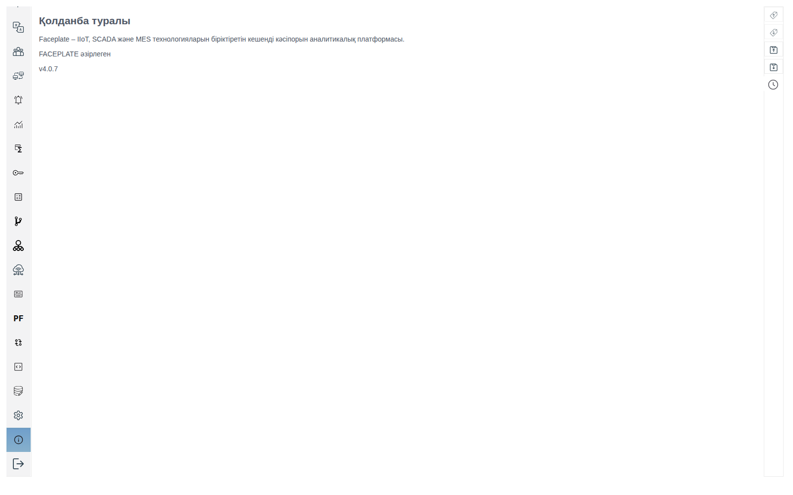
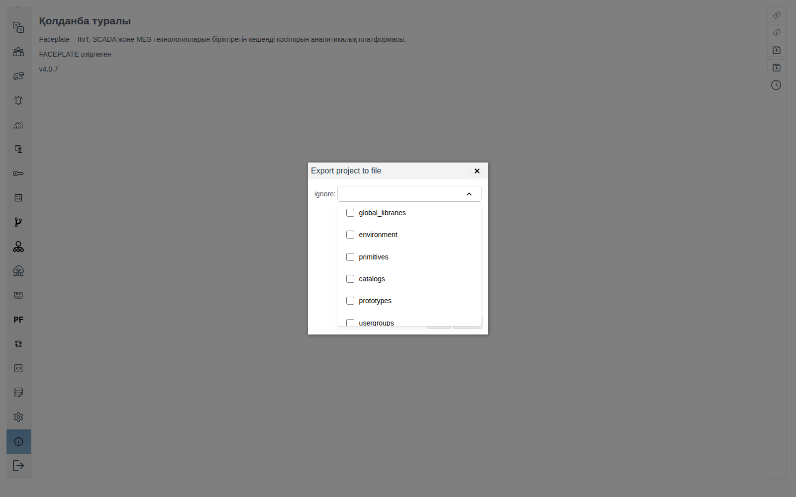
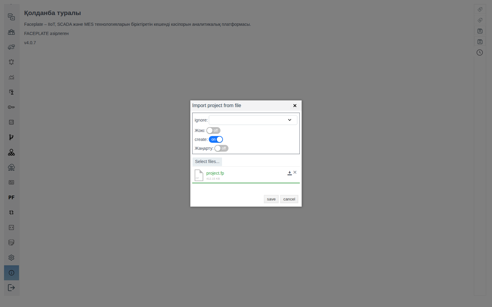

# FACEPLATE нұсқасы және жаңарту

Құжат интегратор инженерге арналған: FACEPLATE-тің қай нұсқасы іске қосылғанын қалай білуге болады және жобаны жаңа нұсқаға қалай көшіруге болады.

# Мазмұны

- [Терминдер сөздігі](#терминдер-сөздігі)
- [Кіріспе](#кіріспе)
- [Негізгі бөлім](#негізгі-бөлім)
    - [Нұсқа қайда көрінеді](#нұсқа-қайда-көрінеді)
    - [Іске қосу кезінде түйін базамен не істейді](#іске-қосу-кезінде-түйін-базамен-не-істейді)
    - [Қай жолды таңдау керек](#қай-жолды-таңдау-керек)
    - [Жаңа нұсқаны ескі базада іске қосу](#жаңа-нұсқаны-ескі-базада-іске-қосу)
    - [Кластерді жаңарту](#кластерді-жаңарту)
    - [Жобаны экспорт файлы арқылы көшіру](#жобаны-экспорт-файлы-арқылы-көшіру)
- [Қорытынды](#қорытынды)

# Терминдер сөздігі

| Термин | Мағынасы |
|---|---|
| Түйін | FACEPLATE-тің іске қосылған бір сервері. Түйін атауы `fp@<сервер атауы>` түрінде болады. [«Кластер түйіндері»](../nodes/nodes.md) құжатын қараңыз |
| Орнату каталогы | Серверде FACEPLATE орнатылған бума. Онда `bin`, `releases`, `logs` бумалары жатады |
| Түйін базасы | Түйін жобаны, мұрағат мәндерін және оқиғалар журналын сақтайтын бума. Әдепкі бойынша бұл орнату каталогындағы `DB`. Docker-ге орнатқанда оған сервердегі бума қосылады, [«Deploying in a Docker container»](../../../en/quick_start/deploy%20as%20docker.md) құжатын қараңыз |
| Жобаның экспорт файлы | Studio **Жобаны файлға экспорттау** батырмасымен сақтайтын `project.fp` файлы. Онда жинақталған деректерсіз жоба нысандары бар |

# Кіріспе

Нұсқа нөмірі қолдау қызметіне өтініш жасау, жаңартудан кейін тексеру және кластер түйіндерін салыстыру үшін қажет. Studio браузер қосылған түйіннің нұсқасын көрсетеді.

Жоба жаңа нұсқаға екі тәсілдің бірімен көшіріледі:

- [жаңа нұсқаны ескі базада іске қосу](#жаңа-нұсқаны-ескі-базада-іске-қосу) — түйін іске қосылғанда базаны өз нұсқасына өзі көшіреді;
- [экспорт файлы арқылы көшіру](#жобаны-экспорт-файлы-арқылы-көшіру) — ескі нұсқада экспорттау, жаңасында импорттау.

Бірінші тәсіл мұрағаттар мен оқиғалар журналының тарихын сақтайды, бірақ түйін база пішімін танығанда ғана жұмыс істейді. Мұны нұсқа нөмірі бойынша анықтау мүмкін емес: пішін бір нұсқаның әртүрлі жинақтарында да ерекшеленуі мүмкін. Сондықтан жаңа нұсқа базаның көшірмесінде іске қосылады, ал түйін оны танымаса, жоба экспорт файлы арқылы көшіріледі.

Сервердің файлдық жүйесіне қолжетімділік (мысалы, SSH арқылы) және жобаны өзгертуге құқығы бар есептік жазбамен Studio-ға (`http://<сервер>:9000/fp/studio`) қолжетімділік қажет.

# Негізгі бөлім

## Нұсқа қайда көрінеді



| Қайда | Не көрсетіледі | Қашан ыңғайлы |
|---|---|---|
| Studio, **Қосымша туралы** тармағы — сол жақ панельдің төменгі жағындағы «i» белгішесі, **Шығу** үстінде | Платформа атауы, әзірлеуші және нұсқа нөмірі, мысалы `v4.0.7` | Қолдау қызметіне өтініш үшін нөмірді көшіру |
| Браузер қойындысының тақырыбы | Studio-да `Faceplate Studio 4.0.7`, Runtime-да `Faceplate RUN-TIME 4.0.7` | Ештеңе ашпай нұсқаны білу. Runtime-да **Қосымша туралы** тармағы жоқ, сондықтан онда нұсқа тек тақырыпта көрінеді |
| `console.log` сервер журналы | Түйін іске қосылғанда жазатын үш жолдың бірі: нұсқа, жаңа нұсқаға көшу немесе бос жоба құру. Әрқайсысының мағынасы — [«Іске қосу кезінде түйін базамен не істейді»](#іске-қосу-кезінде-түйін-базамен-не-істейді) бөлімінде | Studio ашылмаса да, түйін қай нұсқаны іске қосқанын және базамен не істегенін білу. Журнал қайда жатқаны — [«Сервер журналдары», «Журналдар қайда орналасқан» бөлімінде](../logs/logs.md#журналдар-қайда-орналасқан) |

Кластерде әр түйін өз нұсқасын көрсетеді. Түйіндерді салыстыру үшін Studio-ны әр түйіннің мекенжайы бойынша ашыңыз.

## Іске қосу кезінде түйін базамен не істейді

Іске қосылғанда түйін базадан жобаны іздейді және онда жазылған нұсқаны өзінікімен салыстырады. Не істегені `console.log` ішіндегі үш жолдың бірінен көрінеді:

| Журналдағы жол | Не болды | Studio-да не көрінеді |
|---|---|---|
| `faceplate version 4.0.7` | Нұсқалар сәйкес келді, түйін жобамен бұрынғыдай жұмыс істейді | Жоба орнында, **Қосымша туралы** сол нұсқаны көрсетеді |
| `upgrade faceplate version from <ескі> to <жаңа>` | Түйін алдыңғы нұсқаның жобасын тапты, базаны өз нұсқасына көшірді және жобаға жаңа нөмірді жазды | Жоба орнында, **Қосымша туралы** жаңа нұсқаны көрсетеді |
| `init faceplate environment` | Түйін базадан жобаны таппады және жаңа бос жоба құрды | Ағашта тек `@FIXED SCREEN AREA` жүйелік бумасы бар, жобаның бірде-бір нысаны жоқ |

Базаның бос бумасында алғаш іске қосқанда `init faceplate environment` жолы — қалыпты жағдай. Жаңа нұсқаны жұмыс базасында іске қосқанда ол түйіннің база пішімін танымағанын білдіреді.

## Қай жолды таңдау керек

| | Жаңа нұсқаны ескі базада іске қосу | Экспорт файлы арқылы көшіру |
|---|---|---|
| Қашан жұмыс істейді | Жаңа нұсқа база пішімін таныса: журналда `upgrade faceplate version from … to …` жолы | Ескі нұсқа экспорттай алатын кезде әрқашан |
| Мұрағаттар және оқиғалар журналы | Жаңа нұсқаға өтеді | Ескі базада қалады, жаңа нұсқада нөлден басталады |
| Ескі база | Өзгермейді: жаңа нұсқа көшірмеде жұмыс істейді | Өзгермейді |

Мұрағаттар тарихы қажет болса, базаның көшірмесінде іске қосудан бастаңыз. Қажет болмаса, екі жол да тең.

## Жаңа нұсқаны ескі базада іске қосу

Негізгі жол: жоба, мұрағаттар және оқиғалар журналы базамен бірге жаңа нұсқаға өтеді. Ескі база қозғалмай қалады, жаңа нұсқа оның көшірмесінде іске қосылады.

1. Жобаның экспорт файлын [«Жобаны экспорт файлы арқылы көшіру»](#жобаны-экспорт-файлы-арқылы-көшіру) бөлімінің 1-қадамындағыдай сақтаңыз. Ол жаңа нұсқа базаны танымаса қажет болады.
2. Ескі түйінді тоқтатыңыз (орнату каталогының `bin` ішінен `./faceplate stop`) және оның база бумасын көшіріңіз.
3. Жаңа нұсқаны жаңа орнату каталогына орнатыңыз және базаның көшірмесін оның `DB` бумасына салыңыз. Жаңа каталогтың `releases/<нұсқа>/vm.args` файлында ескі түйіндікімен бірдей түйін атауын (`-name`) беріңіз, [«Ресурстарды резервтеу», «Виртуалды машинаны баптау (vm.args)» бөлімін](../redundancy/redundancy.md#виртуалды-машинаны-баптау-vmargs) қараңыз. Docker-де базаның көшірмесін жаңа контейнердің `/opt/faceplate/DB` бумасына қосыңыз.
4. Жаңа түйінді іске қосыңыз және `console.log` ішінен нұсқа туралы жолды табыңыз ([«Іске қосу кезінде түйін базамен не істейді»](#іске-қосу-кезінде-түйін-базамен-не-істейді) бөлімін қараңыз):
    - `upgrade faceplate version from <ескі> to <жаңа>` — база көшірілді. Studio-дағы жоба ағашы орнында, **Қосымша туралы** жаңа нұсқаны көрсетеді. Келесі іске қосуларда журналда `faceplate version <жаңа>` жолы болады.
    - `init faceplate environment` — түйін базаны танымады және көшірмеге жаңа бос жоба жазды. Түйінді тоқтатыңыз, көшірмені жойыңыз және жобаны [экспорт файлы арқылы](#жобаны-экспорт-файлы-арқылы-көшіру) көшіріңіз.

База қай түйінде жұмыс істегенін есте сақтайды. `vm.args` ішіндегі түйін атауы бұрынғыдан өзгеше болса, жаңа түйін нұсқа туралы жолға жетпейді: ол бұрынғы түйінді күтеді. `console.log` ішінде `trying to connect to 'fp@<бұрынғы атау>' node` және `'fp@<бұрынғы атау>' node is not available` жолдары қайталанады, ал Studio ашылмайды. Түйінді тоқтатыңыз, `-name` мәнін түзетіңіз және оны қайта іске қосыңыз.

## Кластерді жаңарту

Әртүрлі нұсқадағы түйіндер бір кластерде бірге жұмыс істемейді. Жаңа нұсқаның түйіні ескі нұсқаның түйіндеріне қосылмайды: оның `console.log` ішінде `database register lock error … retry` жолы қайталанады, онда Studio ашылмайды. Сондықтан кластер толығымен жаңартылады: барлық түйіндер тоқтатылады және жаңа нұсқада іске қосылады.

Толық тоқтағаннан кейін түйіндер іске қосылғанда бір-бірін күтеді: олардың кез келгенінде басқаларында жоқ деректер болуы мүмкін. Бұл кезде `console.log` ішінде `trying to connect to 'fp@<түйін>' node` және `There were active nodes ['fp@<түйін>'], when the node went down` жолдары қайталанады. Кластер іске қосылуы үшін алдымен соңғы тоқтатылған түйін `FORCE_START` айнымалысымен іске қосылады: ол түйінге басқаларын күтпей базаны ашуға рұқсат береді. Кластер кез келген толық тоқтағаннан кейін де, тек жаңарту кезінде ғана емес, осылай іске қосылады.

1. Жобаның экспорт файлын [«Жобаны экспорт файлы арқылы көшіру»](#жобаны-экспорт-файлы-арқылы-көшіру) бөлімінің 1-қадамындағыдай сақтаңыз.
2. Түйіндерді бір-бірден тоқтатыңыз (`./faceplate stop`) және қайсысы соңғы тоқтатылғанын есте сақтаңыз. Әр түйіннің база бумасын көшіріңіз.
3. Әр серверге жаңа нұсқаны [«Жаңа нұсқаны ескі базада іске қосу»](#жаңа-нұсқаны-ескі-базада-іске-қосу) бөлімінің 3-қадамындағыдай орнатыңыз: осы түйін базасының көшірмесі `DB` бумасында, бұрынғы түйін атауы `vm.args` ішінде.
4. Соңғы тоқтатылған түйінді іске қосыңыз:

    ```bash
    env FORCE_START=true ./faceplate console
    ```

    Оның `console.log` ішінде `upgrade faceplate version from <ескі> to <жаңа>` жолы пайда болуы керек.

5. Қалған түйіндерді әдеттегі `./faceplate console` командасымен іске қосыңыз. Олар көшірілген базаны алады, олардың `console.log` ішінде `faceplate version <жаңа>` жолы болады.
6. Studio-ны әр түйіннің мекенжайы бойынша ашыңыз: жоба ағашы орнында, **Қосымша туралы** жаңа нұсқаны көрсетеді.

`FORCE_START` бір түйінге және тек осы іске қосуға беріледі. Осы айнымалысы бар түйін өз деректерін ең жаңа деп санайды, ал тек басқа түйіндерге түскен өзгерістер жоғалады. Ең жаңа деректер соңғы тоқтатылған түйінде болады, сондықтан айнымалыны сол алады.

Жаңа нұсқаның түйіні ескі нұсқаның жұмыс істеп тұрған түйіндерінің қасында іске қосылып, күтіп тұрса, барлық түйіндерді, оны қоса, тоқтатыңыз және 4–6 қадамдарды орындаңыз.

## Жобаны экспорт файлы арқылы көшіру

Жаңа нұсқа базаны танымаған немесе мұрағаттар тарихы жаңа нұсқада қажет болмаған кезде қолайлы. Жоба ескі нұсқада файлға экспортталады және бос базамен орнатылған жаңа нұсқаға импортталады. Тек жоба нысандары көшіріледі.

### Жобаның экспорт файлы

**Жобаны файлға экспорттау** және **Жобаны файлдан импорттау** батырмалары — Studio-ның оң жақ тік панеліндегі жоғарыдан үшінші және төртінші белгішелер.



Жоба файлға бөлімдер бойынша жазылады. Экспорт терезесіндегі **ignore** тізімі сол бөлімдерді атайды: белгіленгендері файлға түспейді. Жаңа нұсқаға көшіру үшін тізімді бос қалдырыңыз.

| Бөлім | Ішінде не бар |
|---|---|
| `global_libraries` | Кітапхана модульдері және JS кітапханалары |
| `environment` | Жобаның жүйелік баптаулары |
| `primitives` | Примитивтер |
| `catalogs` | Каталогтар |
| `prototypes` | Прототиптер |
| `usergroups` | Пайдаланушылар топтары |
| `users` | Пайдаланушылар |
| `project` | Жоба ағашы: бумалар, нысандар, сызбалар |
| `user_rights` | Пайдаланушылар мен топтардың құқықтары |

Мұрағаттардың жинақталған мәндері және оқиғалар журналының жазбалары түйін базасында сақталады және файлға кірмейді. Олар жаңа нұсқаға тек [ескі базада іске қосқанда](#жаңа-нұсқаны-ескі-базада-іске-қосу) өтеді. Файл арқылы көшіргенде тарих ескі базада қалады: оны осы базада іске қосылған ескі нұсқада қарайды немесе файлдарға түсіреді — [трендтер](../../../en/data_storage/archives/trends_en.md#exporting-the-selected-period) және [дабылдар мұрағаты](../../../en/alarms/alarm/alarm_en.md#5-archive-and-export).

### Импорт ауыстырғыштары

**Жобаны файлдан импорттау** терезесі файл мен жоба нысандарын жол бойынша салыстырады. Ауыстырғыштар айырмашылықтармен не істеу керегін анықтайды:

| Ауыстырғыш | Не істейді |
|---|---|
| **Delete** | Файлда жоқ нысандарды жобадан жояды |
| **Create** | Жобада жоқ нысандарды файлдан құрады. Бар нысандарды өзгертпейді |
| **Update** | Файлда да, жобада да бар нысандарға файлдағы өріс мәндерін жазады. **Create**-пен бірге қосылады |

Ауыстырғыштардың тіркесімдері:

| Қосулы | Нысан тек файлда | Нысан файлда да, жобада да | Нысан тек жобада | Қашан қолдану керек |
|---|---|---|---|---|
| **Create** | Құрылады | Өзгермейді | Қалады | Жаңа нұсқаға бос базаға көшіру; жобадағы түзетулерді өшірмей жетіспейтінін қосу |
| **Create** және **Update** | Құрылады | Файлдан өрістерді алады | Қалады | Файлдан өзгерістерді әкелу және тек осы жобада құрылған нысандарды сақтау |
| **Delete** және **Create** | Құрылады | Өзгермейді | Жойылады | Ортақ нысандардағы түзетулерді өшірмей артығын алып тастау және жетіспейтінін қосу |
| **Delete**, **Create** және **Update** | Құрылады | Файлдан өрістерді алады | Жойылады | Жобаны файлдың дәл көшірмесі ету |
| **Delete** | Құрылмайды | Өзгермейді | Жойылады | Жобадан тек файлда жоқты алып тастау |

**Delete** қосулы импорт файл жасалғаннан кейін жобада құрылған нысандарды да жояды. Мұндай импорт алдында ағымдағы жобаның экспорт файлын сақтаңыз: жойылғанды одан **Create** қосулы импортпен қайтаруға болады.

### Көшіру қадамдары

1. Ескі нұсқаның Studio-сында **Жобаны файлға экспорттау** батырмасын басыңыз, **ignore** тізімін бос қалдырып, **save** басыңыз. Браузер `project.fp` файлын сақтайды.
2. Ескі түйінді тоқтатыңыз (орнату каталогының `bin` ішінен `./faceplate stop`) және оның база бумасын бөлек орынға көшіріңіз. Көшірме ескі нұсқаға қайту керек болса қажет.
3. Жаңа нұсқаны базаның бос бумасымен орнатыңыз: жаңа орнату каталогына немесе Docker-де `/opt/faceplate/DB` бумасына жаңа бос бума қосылған жаңа контейнерге.
4. Жаңа түйінді іске қосыңыз. `console.log` ішінде `init faceplate environment` жолы пайда болуы, ал **Қосымша туралы** жаңа нұсқаны көрсетуі керек.
5. **Жобаны файлдан импорттау** батырмасын басып, **Select files...** батырмасымен `project.fp` таңдаңыз. **Create** қосыңыз, **Delete** және **Update** ауыстырғыштарын өшірулі, **ignore** тізімін бос қалдырыңыз. **save** басыңыз.

   

6. `The project was imported successfully` хабарламасын күтіп, бетті жаңартыңыз. Ескі жобаның бумалары мен нысандары ағашта пайда болады.

# Қорытынды

Түйін нұсқасын Studio-дағы **Қосымша туралы** тармағы, браузер қойындысының тақырыбы және түйін іске қосылғандағы `console.log` жолы көрсетеді.

Жаңарту экспорт файлынан және базаның көшірмесінен басталады. Бұрынғы түйін атауы бар жаңа нұсқа көшірмеде іске қосылады. `upgrade faceplate version from … to …` жолы жоба, мұрағаттар және оқиғалар журналы жаңа нұсқаға өткенін білдіреді. `init faceplate environment` жолы жобаны **Create** қосулы экспорт файлы арқылы көшіру керектігін, ал тарих ескі базада қалатынын білдіреді.

Кластер толығымен жаңартылады. Алдымен соңғы тоқтатылған түйін `FORCE_START=true` айнымалысымен іске қосылады, содан кейін қалғандары.
