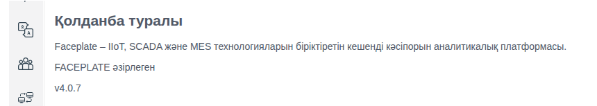

# FACEPLATE нұсқасы және жаңарту

Құжат интегратор инженерге арналған: FACEPLATE-тің қай нұсқасы іске қосылғанын қалай білуге болады және жаңартудың қай тәсілін таңдау керек. Тәсілдердің өзі бөлімнің жеке құжаттарында сипатталған.

# Мазмұны

- [Терминдер сөздігі](#терминдер-сөздігі)
- [Кіріспе](#кіріспе)
- [Негізгі бөлім](#негізгі-бөлім)
    - [Нұсқа қайда көрінеді](#нұсқа-қайда-көрінеді)
    - [Нұсқа нөмірі және жаңарту түрі](#нұсқа-нөмірі-және-жаңарту-түрі)
    - [Іске қосу кезінде түйін базамен не істейді](#іске-қосу-кезінде-түйін-базамен-не-істейді)
- [Қорытынды](#қорытынды)

# Терминдер сөздігі

| Термин | Мағынасы |
|---|---|
| Түйін | FACEPLATE-тің іске қосылған бір сервері. Түйін атауы `fp@<сервер атауы>` түрінде болады. [«Кластер түйіндері»](../nodes/nodes.md) құжатын қараңыз |
| Орнату каталогы | Серверде FACEPLATE орнатылған бума. Онда `bin`, `erts-<нұсқа>`, `etc`, `lib` және `releases` бумалары жатады. Бірінші іске қосудан кейін онда `logs` бумасы мен `DB` базасы, фонда іске қосқаннан кейін `log` бумасы, ал Git модулі репозиторийге қосылғаннан кейін `cvs` бумасы пайда болады |
| Түйін базасы | Түйін жобаны, мұрағат мәндерін және оқиғалар журналын сақтайтын бума. Әдепкі бойынша бұл орнату каталогындағы `DB`. |
| Жобаның экспорт файлы | Studio **Жобаны файлға экспорттау** батырмасымен сақтайтын `project.fp` файлы. Онда жинақталған деректерсіз жоба нысандары бар. [«Жобаны импорттау және экспорттау»](../../project_objects/import_export/import_export.md) қараңыз |
| Хотфикс | Нұсқа нөмірін өзгертпейтін шұғыл қате түзету: орнату каталогындағы файлдарды ауыстыру немесе Studio не Runtime ортасында қолданбалы жобаны түзету. [«Хотфикс»](hotfix.md) қараңыз |

# Кіріспе

Нұсқа нөмірі қолдау қызметіне өтініш жасау, жаңартудан кейін тексеру және кластер түйіндерін салыстыру үшін қажет. Studio браузер қосылған түйіннің нұсқасын көрсетеді.

Жобаны жаңа нұсқаға қалай көшіру [жаңарту түріне](#нұсқа-нөмірі-және-жаңарту-түрі) байланысты:

| Құжат | Онда не бар |
|---|---|
| [Мажорлық жаңарту](major.md) | Жаңа нұсқа бос базамен іске қосылады, жоба экспорт файлынан немесе Git репозиторийінен көшіріледі. Түйіндер бір-бірден көшіріледі, ескі кластер соңғы түйіні көшірілгенше жұмыс істейді. Runtime-ды тоқтатуға болса, барлық түйін бірден тоқтатылады |
| [Минорлық жаңарту және патч](minor.md) | Жаңа нұсқа алдыңғы нұсқаның базасында іске қосылады және оны өз пішіміне өзі көшіреді. Жоба, мұрағаттар және оқиғалар журналы базамен бірге өтеді. Түйіндер бір-бірден жаңартылады, Runtime қалған түйіндерде жұмыс істейді |
| [Хотфикс](hotfix.md) | Нұсқаны өзгертпей және жобаны көшірмей шұғыл түзету: орнату каталогындағы файлдарды ауыстыру немесе Studio не Runtime ортасында қолданбалы жобаны түзету |
| [Жобаны импорттау және экспорттау](../../project_objects/import_export/import_export.md) | Жобаны файлға сақтау және файлды импорттау: мажорлық жаңартуда жобаны көшіру, минорлық жаңартуда және патчта сақтық көшірме |

Сервердің файлдық жүйесіне қолжетімділік (мысалы, SSH арқылы) және жобаны өзгертуге құқығы бар есептік жазбамен Studio-ға (`http://<сервер>:9000/fp/studio`) қолжетімділік қажет.

# Негізгі бөлім

## Нұсқа қайда көрінеді

Нұсқаны **Қосымша туралы** беті көрсетеді. Ол Studio сол жақ панелінің төменгі жағындағы, **Шығу** батырмасының үстіндегі «i» белгішесімен ашылады:

| Қайда | Не көрсетіледі | Қашан ыңғайлы |
|---|---|---|
| Studio, **Қосымша туралы** тармағы — сол жақ панельдің төменгі жағындағы «i» белгішесі, **Шығу** үстінде | Платформа атауы, әзірлеуші және `v<нұсқа>` түріндегі нұсқа нөмірі | Қолдау қызметіне өтініш үшін нөмірді көшіру |
| Браузер қойындысының тақырыбы | Studio-да `Faceplate Studio <нұсқа>`, Runtime-да `Faceplate RUN-TIME <нұсқа>` | Ештеңе ашпай нұсқаны білу. Runtime-да **Қосымша туралы** тармағы жоқ, сондықтан онда нұсқа тек тақырыпта көрінеді |
| `console.log` сервер журналы | Түйін іске қосылғанда жазатын үш жолдың бірі: нұсқа, жаңа нұсқаға көшу немесе бос жоба құру. Әрқайсысының мағынасы — [«Іске қосу кезінде түйін базамен не істейді»](#іске-қосу-кезінде-түйін-базамен-не-істейді) бөлімінде | Studio ашылмаса да, түйін қай нұсқаны іске қосқанын және базамен не істегенін білу. Журнал қайда жатқаны — [«Сервер журналдары», «Журналдар қайда орналасқан» бөлімінде](../logs/logs.md#журналдар-қайда-орналасқан) |

Кластердің барлық түйіндері бір нұсқада жұмыс істеуі тиіс. Studio тек браузер қосылған түйіннің нұсқасын көрсетеді. Жаңартудан кейін жаңа нұсқа барлық түйінде іске қосылғанына көз жеткізу үшін әр түйіннің мекенжайы бойынша Studio-да **Қосымша туралы** бетін ашыңыз.

## Нұсқа нөмірі және жаңарту түрі

FACEPLATE нұсқасының нөмірі [семантикалық нұсқалау (SemVer)](https://semver.org/) ережелері бойынша `X.Y.Z` түрінде жазылады. Нөмірдің қай бөлігі өзгеретініне қарай жаңарту мажорлық, минорлық немесе патч болады.

| Нөмір бөлігі | Жаңарту түрі | Жаңа нұсқада не өзгереді | Қалай жаңарту керек |
|---|---|---|---|
| `X` — мажорлық | Мажорлық | Үйлесімсіз өзгерістер: алдыңғы нұсқаның базасы жаңасына сәйкес келмейді | [Мажорлық жаңарту](major.md): бос база, жобаны көшіру, түйіндер бір-бірден |
| `Y` — минорлық | Минорлық | Үйлесімділікті сақтайтын жаңа мүмкіндіктер | [Минорлық жаңарту және патч](minor.md): бұрынғы базада іске қосу |
| `Z` — патч | Патч | Қателерді түзету | [Минорлық жаңарту және патч](minor.md): бұрынғы базада іске қосу |

Нақты нұсқалар арасындағы өтуге қандай жаңарту реті сәйкес келетіні шығарылымда не өзгергеніне байланысты.

Нұсқа нөмірін өзгертпейтін шұғыл түзету — хотфикс — басқаша орнатылады: жобаны көшірмей, орнату каталогындағы файлдарды ауыстыру немесе Studio не Runtime ортасында қолданбалы жобаны түзету арқылы. [«Хотфикс»](hotfix.md) қараңыз.

## Іске қосу кезінде түйін базамен не істейді

Іске қосылғанда түйін базадан жобаны іздейді және онда жазылған нұсқаны өзінікімен салыстырады. Не істегені `console.log` ішіндегі жолдан көрінеді:

| Журналдағы жол | Қашан пайда болады | Түйін не істеді |
|---|---|---|
| `faceplate version <нұсқа>` | Түйінді өз базасында әдеттегідей қайта іске қосу | Жобамен бұрынғыдай жұмыс істейді. **Қосымша туралы** сол нұсқаны көрсетеді |
| `upgrade faceplate version from <ескі> to <жаңа>` | Минорлық жаңарту немесе патч: жаңа нұсқа алдыңғы нұсқаның базасында іске қосылды | Базаны өз нұсқасына көшірді. Жоба орнында, **Қосымша туралы** жаңа нұсқаны көрсетеді |
| `init faceplate environment` | Жаңа орнату немесе мажорлық жаңарту: түйін базаның бос бумасымен іске қосылды | Бос жоба құрды: ағашта тек `@FIXED SCREEN AREA` жүйелік бумасы бар. Жоба қайта құрылады немесе экспорт файлынан не Git-тен көшіріледі |

Түйін процесіне жеткілікті файл ашуға рұқсат етілген жағдайда ғана іске қосылады. Сондықтан іске қосар алдында ашық файлдар шегі кемінде 200 000 етіп беріледі, [«Түйінді іске қосу және тоқтату», «Ашық файлдар шегі» бөлімін](../start_stop/start_stop.md#ашық-файлдар-шегі) қараңыз.

# Қорытынды

Түйін нұсқасын Studio-дағы **Қосымша туралы** тармағы, браузер қойындысының тақырыбы және түйін іске қосылғандағы `console.log` жолы көрсетеді.

Нұсқа нөмірі SemVer бойынша жазылады: `X` — мажорлық бөлік, `Y` — минорлық, `Z` — патч. Минорлық жаңарту мен патчтың реті [«Минорлық жаңарту және патч»](minor.md) құжатында, мажорлық жаңартудың реті [«Мажорлық жаңарту»](major.md) құжатында сипатталған; олардың қайсысы сәйкес келетіні шығарылымда не өзгергеніне байланысты. Хотфикс нұсқа нөмірін өзгертпейді ([«Хотфикс»](hotfix.md)).
