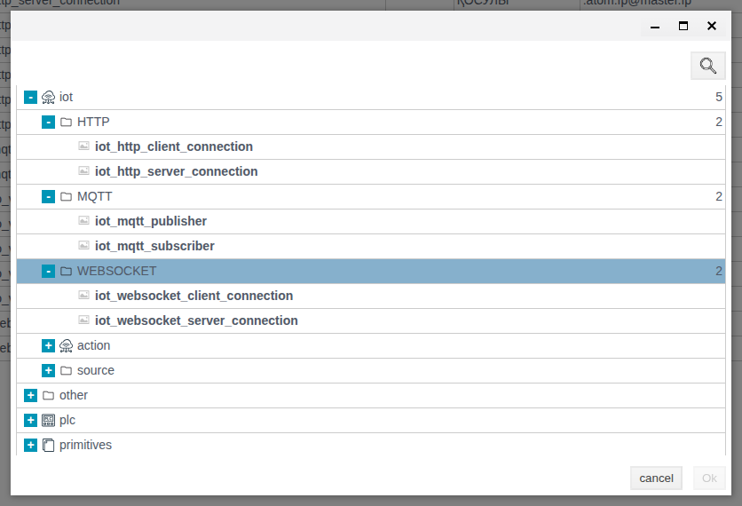
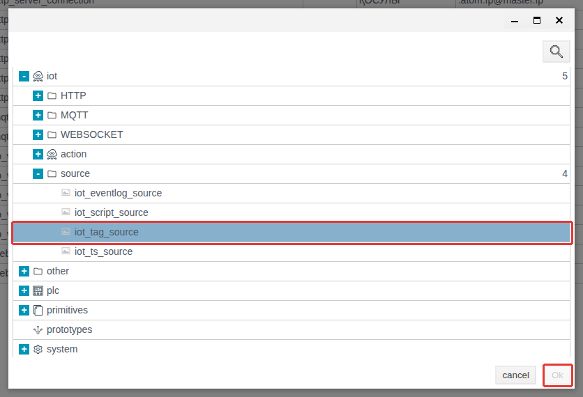
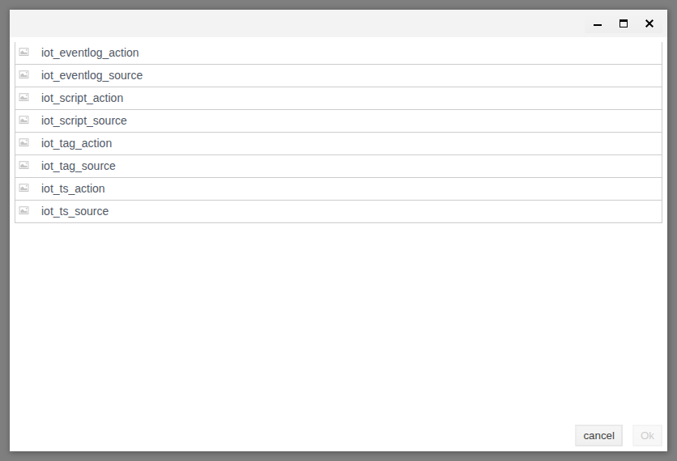
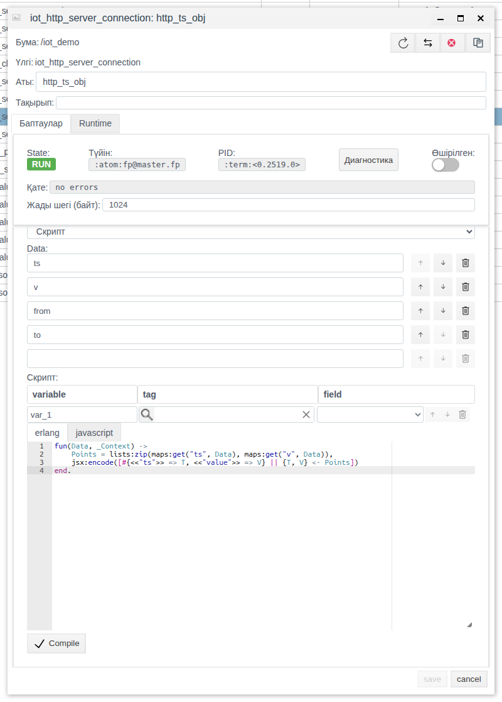
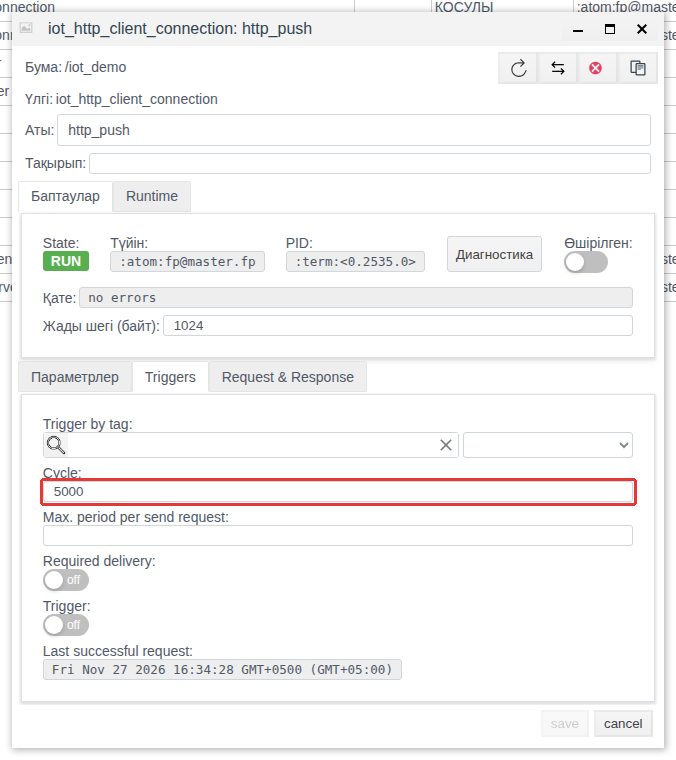
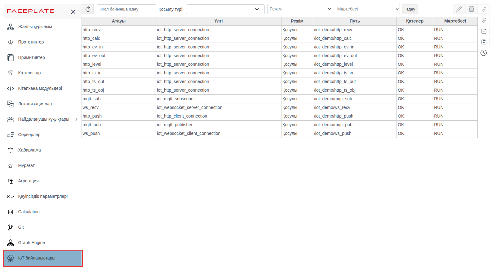
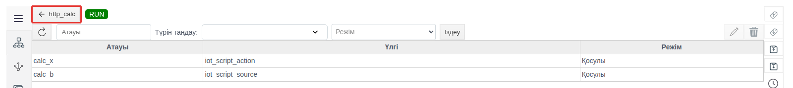
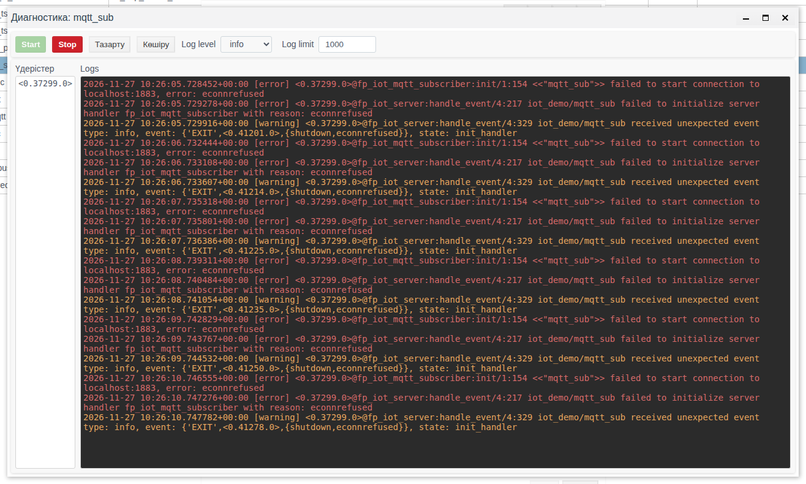

# IoT-қосылымдар

Бұл құжат FACEPLATE жүйесінің сыртқы жүйелермен HTTP, MQTT және WebSocket арқылы дерек алмасуын баптайтын интегратор инженерге арналған.

# Мазмұны

- [Терминдер сөздігі](#терминдер-сөздігі)
- [Кіріспе](#кіріспе)
- [Негізгі бөлім](#негізгі-бөлім)
    - [Модуль құрамы](#модуль-құрамы)
    - [Рөлдер және айнымалылар](#рөлдер-және-айнымалылар)
    - [Дереккөз бен әрекет қосылыммен қалай байланысады](#дереккөз-бен-әрекет-қосылыммен-қалай-байланысады)
    - [Қосылым жасау](#қосылым-жасау)
    - [Хабарлама пішімі](#хабарлама-пішімі)
    - [Triggers](#triggers)
    - [«IoT байланыстары» бөлімі](#iot-байланыстары-бөлімі)
    - [Диагностика](#диагностика)
- [Қорытынды](#қорытынды)

# Терминдер сөздігі

| Термин | Мағынасы |
|---|---|
| IoT-қосылым | **HTTP**, **MQTT**, **WEBSOCKET** топтарындағы алты түрдің бірінің жоба нысаны. Runtime ортасында жеке процесс болып жұмыс істейді және бума болып табылады: ішінде оның дереккөздері мен әрекеттері орналасады |
| Клиент рөлі | Қосылым алмасуды өзі бастайды: таймер бойынша, тег өзгергенде немесе қолмен |
| Сервер рөлі | Қосылым кіріс хабарламаны күтіп, оны өңдейді |
| Қосылым айнымалысы | **Request & Response** қойындысындағы **Data** тізімінің атауы. Айнымалылар арқылы хабарлама үлгісі дереккөздермен және әрекеттермен байланысады |
| Дереккөз | Қосылым ішіндегі **source** тобының нысаны. Шығыс хабарламаның айнымалыларын толтырады |
| Әрекет | Қосылым ішіндегі **action** тобының нысаны. Кіріс хабарламаның айнымалыларын алып, оларды тегтерге немесе мұрағатқа жазады |
| JSON-үлгі | Мәндердің орнында `$атау` айнымалылары тұратын JSON мәтіні |

# Кіріспе

IoT-қосылымдар сыртқы жүйелермен — мысалы, бұлттық платформамен, веб-сервиспен, шлюзбен немесе басқа қосымшамен — HTTP, MQTT немесе WebSocket арқылы дерек алмасу үшін қажет. MQTT үшін сыртқы жүйе — брокер: FACEPLATE оған хабарламалар жариялайды немесе оның топиктеріне жазылады. Өнеркәсіптік ПЛК протоколдары бар жабдық IoT-қосылымдар арқылы қосылмайды. FACEPLATE клиент (деректерді өзі жібереді немесе сервисті сұрайды) және сервер (сыртқы жүйе жіберген деректерді қабылдайды) бола алады.

Кез келген қосылым бірдей құрылған:

1. **Request & Response** қойындысында хабарлама пішімі және **Data** айнымалыларының тізімі беріледі.
2. Қосылым ішіндегі дереккөздер шығыс хабарламаның айнымалыларына мән береді.
3. Қосылым ішіндегі әрекеттер кіріс хабарламаның айнымалыларын тегтерге немесе мұрағатқа жазады.

Барлық мысал `iot_demo` бумасында жиналған. Онда `value` сандық өрісі бар `demo_value` түріндегі тегтер бар: `t_src` (мәні `21.5`), `t_dst`, `t_mqtt`, `t_ws`, `t_calc`. HTTP және WebSocket мысалдары сыртқы жүйелерсіз бір FACEPLATE ішінде жұмыс істейді, MQTT мысалына брокер қажет.

Түрлер бөлімнің жеке құжаттарында сипатталған:

- [HTTP-қосылымдар](http.md)
- [MQTT-қосылымдар](mqtt.md)
- [WebSocket-қосылымдар](websocket.md)
- [Дереккөздер](sources.md)
- [Әрекеттер](actions.md)

Жобаны өзгерту құқығы бар тіркелгімен Studio ортасына (`http://<сервер>:9000/fp/studio`) кіру мүмкіндігі қажет.

# Негізгі бөлім

## Модуль құрамы

**Жалпы құрылым** бөлімінде нысан жасағанда түрді таңдау терезесінің **iot** тобында мыналар бар:

| Топ | Түрі | Рөлі | Мақсаты |
|---|---|---|---|
| **HTTP** | [`iot_http_client_connection`](http.md#iot_http_client_connection) | Клиент | HTTP-сұрау жіберіп, жауапты талдайды |
| | [`iot_http_server_connection`](http.md#iot_http_server_connection) | Сервер | Берілген жолға HTTP-сұрауларды қабылдап, жауап береді |
| **MQTT** | [`iot_mqtt_publisher`](mqtt.md#iot_mqtt_publisher) | Клиент | Хабарламаларды брокер топигіне жариялайды |
| | [`iot_mqtt_subscriber`](mqtt.md#iot_mqtt_subscriber) | Сервер | Брокер топигінен хабарламалар алады |
| **WEBSOCKET** | [`iot_websocket_client_connection`](websocket.md#iot_websocket_client_connection) | Клиент | WebSocket-серверге қосылып, хабарламалармен алмасады |
| | [`iot_websocket_server_connection`](websocket.md#iot_websocket_server_connection) | Сервер | WebSocket-қосылымдарды қабылдайды |
| **source** | [`iot_tag_source`](sources.md#iot_tag_source) | Дереккөз | Тег өрістерінің мәндері |
| | [`iot_script_source`](sources.md#iot_script_source) | Дереккөз | Скрипт нәтижесі |
| | [`iot_ts_source`](sources.md#iot_ts_source) | Дереккөз | Мұрағат мәндері |
| | [`iot_eventlog_source`](sources.md#iot_eventlog_source) | Дереккөз | Оқиғалар журналының жазбалары |
| **action** | [`iot_tag_action`](actions.md#iot_tag_action) | Әрекет | Тег өрістеріне жазу |
| | [`iot_script_action`](actions.md#iot_script_action) | Әрекет | Скриптпен өңдеу және тегтерге жазу |
| | [`iot_ts_action`](actions.md#iot_ts_action) | Әрекет | Серияны мұрағатқа жазу |
| | [`iot_eventlog_action`](actions.md#iot_eventlog_action) | Әрекет | Оқиғалар журналында жазбалар жасау |



Қосылымдар кез келген бумада жасалады. Дереккөздер мен әрекеттер тек қосылым ішінде жасалады: кәдімгі бумада **source** және **action** топтары көрінеді, бірақ олардың түрлері үшін **Ok** батырмасы қолжетімсіз.



Қосылым ішінде түрді таңдау терезесі дереккөздер мен әрекеттердің тек сегіз түрін көрсетеді.



## Рөлдер және айнымалылар

**Request** және **Response** нені білдіретіні қосылымның рөліне байланысты:

| | Клиент рөлі | Сервер рөлі |
|---|---|---|
| **Request** | FACEPLATE жіберетін хабарлама. **Data** айнымалыларын дереккөздер толтырады | FACEPLATE жүйесіне келетін хабарлама. **Data** айнымалыларын әрекеттер алады |
| **Response** | Сыртқы жүйенің жауабы. **Data** айнымалыларын әрекеттер алады | FACEPLATE жүйесінің кіріс хабарламаға жауабы. **Data** айнымалыларын дереккөздер толтырады |

- Дереккөздің немесе әрекеттің **variable** ашылмалы тізімінде тек тиісті **Data** тізімінің айнымалылары қолжетімді.
- **Data** тізімі бос болса, осы жақтың дереккөздері немесе әрекеттері орындалмайды.
- MQTT-де жауап жоқ: **Request & Response** қойындысында тек **Request** бар.

## Дереккөз бен әрекет қосылыммен қалай байланысады

Тек **Аты** берілген дереккөз немесе әрекет ештеңе істемейді. Онда қосылым айнымалысы таңдалып, оның мәнін қайдан алу немесе қайда жазу керегі көрсетілгенде ғана жұмыс істей бастайды. Реті:

1. Қосылымның **Request & Response** қойындысында **Type** беріп, **Data** ішінде айнымалыларды тізіңіз. **JSON** үшін сол айнымалыларды үлгіге `$` арқылы қойыңыз. Қосылымды сақтаңыз.
2. Қосылымға екі рет шерту арқылы кіріңіз: кестенің үстіндегі жол қосылым атауымен аяқталуы керек. Дереккөз немесе әрекет жасаңыз.
3. Байланыстыру жолында **variable** таңдаңыз — тізімде 1-қадамдағы **Data** айнымалылары болады. Содан кейін үлкейткіш әйнек батырмасымен **тег** және **field** таңдаңыз.
4. Сақтап, алмасуды тексеріңіз.

Мысал — `http_recv` сервері сұраудағы температураны `t_dst` тегіне жазады:

| Қайда | Не беру керек |
|---|---|
| `http_recv`, **Request** | **Type** `JSON`, **Data** `t`, үлгі `{"temperature": $t}` |
| `http_recv` → `to_t_dst` (`iot_tag_action`) | `t` — `/iot_demo/t_dst` — `value` |

`{"temperature": 23.4}` сұрауы → `t` айнымалысы = `23.4` → `to_t_dst` әрекеті `t_dst.value` өрісіне `23.4` жазады. Толық баптау — [`iot_http_server_connection`](http.md#iot_http_server_connection) бөлімінде.

**variable** тізімі бос болса, қажетті жақтың **Data** тізімінде айнымалылар жоқ немесе қосылым сақталмаған (жоғарыдағы кестені қараңыз: серверде әрекеттер айнымалыларды **Request** ішінен, дереккөздер **Response** ішінен алады; клиентте — керісінше).

## Қосылым жасау

1. **Жалпы құрылым** бөлімін ашып, қосылым болатын бумаға екі рет шерту арқылы кіріңіз.
2. **Жасау** батырмасын басып, **iot**, содан кейін **HTTP**, **MQTT** немесе **WEBSOCKET** тобын ашыңыз, түрді таңдап, **Ok** батырмасын басыңыз.
3. **Аты** өрісін, қойындылардағы параметрлерді толтырып, сақтаңыз.
4. Қосылымға екі рет шерту арқылы кіріп, онда дереккөздер мен әрекеттер жасаңыз.

Қосылым сақталғаннан кейін бірден іске қосылады. Баптауларды жоймай алмасуды тоқтату үшін **Өшірілген** ауыстырғышын қосыңыз. Дереккөз немесе әрекет **Өшіру** белгісімен өшіріледі.

Дереккөзді немесе әрекетті жұмысқа дайындау мүмкін болмаса (мысалы, байланыстыру жоқ нысанға сілтейді), бүкіл қосылым тоқтайды: **State** `STOP`, қате мәтіні **Қате** өрісінде және **Жалпы құрылым** бөлімінің **Errors** бағанында.

Пішіннің жоғарғы панелі барлық қосылымда бірдей:

| Өріс | Мағынасы |
|---|---|
| **State** | `RUN` — қосылым процесі іске қосылған, `STOP` — іске қосылмаған |
| **Түйін**, **PID** | FACEPLATE түйіні және процесс идентификаторы |
| **Өшірілген** | Баптауларды сақтап, қосылымды тоқтату |
| **Қате** | Соңғы алмасу қатесінің мәтіні; қате болмаса, `no errors` |
| **Жады шегі (байт)** | Қосылым процесінің жады шегі |
| **Диагностика** | Қосылым процесінің журналы (төмендегі [«Диагностика»](#диагностика) бөлімін қараңыз) |

## Хабарлама пішімі

**Request & Response** қойындысында әр хабарлама үшін **Type** таңдалады:

| Type | Шығыс хабарлама | Кіріс хабарлама |
|---|---|---|
| **Const** | **Мәтін** өрісіндегі тұрақты мәтін | Мазмұны талданбайды, айнымалылар жоқ |
| **JSON** | Үлгі бойынша JSON, айнымалылар мәндермен ауыстырылады | JSON үлгі бойынша талданады, мәндер айнымалыларға түседі |
| **Скрипт** | Erlang немесе JavaScript функциясы хабарлама мәтінін қайтарады | Функция хабарламаны талдап, айнымалылар картасын қайтарады |

### JSON-үлгі

```json
{
  "temperature": $t,
  "pressure": $p
}
```

- Үлгінің әр айнымалысын **Data** тізіміне қосыңыз.
- Редактор `$t` айнымалысын JSON қатесі ретінде белгілейді. Бұл сақтауға және жұмысқа әсер етпейді.
- Кіріс JSON ішінде үлгінің барлық кілті болуы керек, артық кілттер еленбейді. Кілт болмаса, хабарлама `{invalid_parse_request_result,false}` қатесімен қабылданбайды.
- Кіріс JSON ішіндегі массив `$$` құрылымымен талданады: `{"items": [{"v": 1}, {"v": 2.5}]}` хабарламасы үшін `{"items": [$$ {"v": $v}]}` үлгісі `v` = `[1, 2.5]` береді.
- Шығыс үлгідегі мәндер тізімі бар айнымалы (`{"got": $v}`) JSON-массивке айналады (`{"got": [1, 2.5]}`).

### Хабарлама скрипті

Скрипт **erlang** немесе **javascript** қойындысында жазылады, редактор функция үлгісімен ашылады. Түзеткеннен кейін **Compile** батырмасын басып, сәтті компиляцияны күтіңіз де, сақтаңыз.

| Рөл және хабарлама | Бірінші аргумент | Қайтарады |
|---|---|---|
| Клиент, **Request** | `Data` — дереккөздерден алынған айнымалылар | Сұрау мәтіні |
| Клиент, **Response** | `Response` — жауап мәтіні | Әрекеттерге арналған айнымалылар картасы |
| Сервер, **Request** | `Request` — кіріс хабарлама мәтіні | Әрекеттерге арналған айнымалылар картасы |
| Сервер, **Response** | `Data` — дереккөздерден алынған айнымалылар | Жауап мәтіні |

Мысал — `http_ts_obj` серверінің нысандар массиві түріндегі жауабы. **Response**: **Type** `Скрипт`, **Data** `ts`, `v`, `from`, `to` (`ts` және `v` айнымалыларын [iot_ts_source](sources.md#iot_ts_source) бөліміндегі `ts_read` сияқты `iot_ts_source` дереккөзі толтырады), скрипт:

```erlang
fun(Data, _Context) ->
    Points = lists:zip(maps:get("ts", Data), maps:get("v", Data)),
    jsx:encode([#{<<"ts">> => T, <<"value">> => V} || {T, V} <- Points])
end.
```

`{"from": 1792387500000, "to": 1792387550000}` сұрауына жауап: `[{"ts":1792387500000,"value":"undefined"},{"ts":1792387513000,"value":10.5},{"ts":1792387543000,"value":11.25}]`. `jsx:encode/1` Erlang карталары мен тізімдерін JSON пішіміне түрлендіреді.



## Triggers

Қойынды клиент рөліндегі қосылымдарда бар: `iot_http_client_connection`, `iot_mqtt_publisher`, `iot_websocket_client_connection`.

| Өріс | Мағынасы |
|---|---|
| **Trigger by tag** | Сұрау тегтің таңдалған өрісі өзгерген сайын жіберіледі |
| **Cycle** | Жіберу кезеңі, мс. Бос болса — мерзімді жіберу жоқ |
| **Max. period per send request** | Бір сұраудың `from`–`to` аралығының ең үлкен ұзындығы, мс. Бос болса — аралық шектелмеген |
| **Required delivery** | Соңғы сәтті сұраудан бері **Max. period per send request** мәнінен көп уақыт өтсе, не істеу керек. Қосулы — деректер ағымдағы сәтке жеткенше ең үлкен ұзындықтан аспайтын бөліктермен ретімен жіберіледі. Өшірулі — тек соңғы аралық жіберіледі |
| **Trigger** | Бір сұрауды бірден жіберу үшін қосып, сақтаңыз. Жіберілгеннен кейін белгі тасталады |
| **Last successful request** | Соңғы сәтті сұраудың уақыты |

`from`–`to` аралығы соңғы сәтті сұраудан басталып, ағымдағы сәтпен аяқталады. Оны скрипттік дереккөздің `Context` аргументі алады. Сұрау қатемен аяқталса (мәтіні **Қате** өрісінде шығады), **Last successful request** бұрынғы мәнін сақтайды. Келесі сұрау сол сәттен басталады, сондықтан сәтсіз сұраудың деректері қайта жіберіледі және жоғалмайды.




## «IoT байланыстары» бөлімі

Studio негізгі мәзірінің **IoT байланыстары** тармағы жобаның барлық қосылымын көрсетеді: **Атауы**, **Үлгі** (түрі), **Режім** (`Қосулы` / `Ажыратылған`), **Путь**, **Қателер**, **Мәртебесі** (`RUN` / `STOP`).



- Кестенің үстіндегі сүзгілер: **Жол бойынша іздеу**, **Қосылу түрі** (бірнешеуін таңдауға болады), **Режім**, **Мәртебесі**, содан кейін **Іздеу**.
- Қарындаш батырмасы таңдалған қосылымның пішінін ашады, себет батырмасы таңдалған қосылымдарды жояды (**yes** растауы). Бірнеше жол Ctrl+шерту арқылы таңдалады.
- Қосылымды екі рет шерту оның дереккөздері мен әрекеттерінің тізімін дәл осындай батырмалармен ашады. Қосылым атауы бар батырма жалпы тізімге қайтарады.



Бұл бөлімде нысан жасауға болмайды — тек **Жалпы құрылым** бөлімінде жасалады.

## Диагностика

**Қате** өрісі алмасу қателерін көрсетеді. Қосылым пішінін ашып, **Диагностика**, содан кейін **Start** батырмасын басыңыз: терезеде қосылым процесінің журналы пайда болады. **Log level** толықтығын береді, **Stop** шығаруды тоқтатады. Терезе [«Runtime нысандарының диагностикасы»](../../administration/diagnostics/diagnostics.md) құжатында толық сипатталған.



| Белгісі | Себебі | Не істеу керек |
|---|---|---|
| `STOP`, қате **Қате** өрісінде | Дереккөзді немесе әрекетті дайындау мүмкін болмады | Қосылым ішіндегі байланыстырулар мен скрипттерді түзетіңіз |
| HTTP-сервер `405` жауабын береді | **Method** бас әріппен жазылмаған немесе сұрау әдісіне сәйкес келмейді | Әдісті бас әріппен көрсетіңіз |
| `{invalid_parse_request_result,false}` | Кіріс JSON үлгіге сәйкес келмеді | Үлгіні нақты хабарламамен салыстырыңыз |
| Әрекет мәндерді жазбайды | Кіріс жақтың **Data** тізімі бос, байланыстыруда айнымалы таңдалмаған немесе әрекет өшірулі | Айнымалыны **Data** тізіміне және байланыстыруға қосыңыз |
| **Last successful request** жаңармайды | **Triggers** қойындысында шарт берілмеген немесе сұраулар қатемен аяқталады | **Cycle** немесе **Trigger by tag** беріп, **Қате** өрісін тексеріңіз |

# Қорытынды

Баптау реті:

1. FACEPLATE рөлін (клиент немесе сервер) және протоколды анықтап, қосылым түрін таңдаңыз.
2. **Жалпы құрылым** бөлімінде қосылым жасап, көлік параметрлерін толтырыңыз. HTTP-серверде **Method** бас әріппен жазылады, WebSocket-клиентте танысу өрістерін тексеріңіз.
3. **Request & Response** қойындысында хабарлама пішімін таңдап, **Data** ішінде айнымалыларды тізіңіз.
4. Қосылым ішінде шығыс айнымалылар үшін дереккөздер, кіріс айнымалылар үшін әрекеттер жасаңыз.
5. Клиент рөлі үшін **Triggers** қойындысында жіберу шартын беріңіз.
6. **State**, **Қате** және **Last successful request** мәндерін тексеріңіз. Алмасу болмай, қателер көрінбесе, **Диагностика** терезесін ашыңыз.
