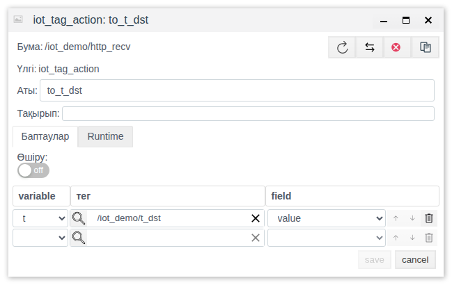
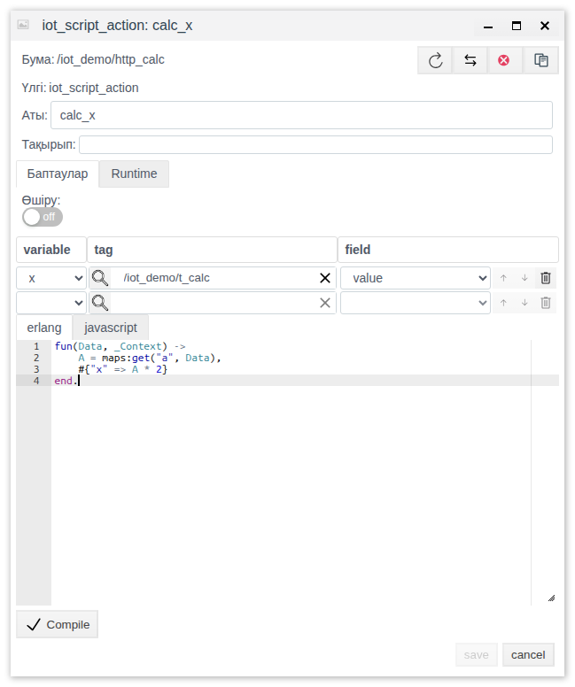

# IoT әрекеттері

Бұл құжат интегратор инженерге арналған. Жалпы ұғымдар (рөлдер, **Data** айнымалылары, хабарлама пішімі, **Triggers** қойындысы, диагностика) [«IoT-қосылымдар»](IoT.md) құжатында сипатталған.

# Мазмұны

- [Кіріспе](#кіріспе)
- [Негізгі бөлім](#негізгі-бөлім)
    - [iot_tag_action](#iot_tag_action)
    - [iot_script_action](#iot_script_action)
    - [iot_ts_action](#iot_ts_action)
    - [iot_eventlog_action](#iot_eventlog_action)
- [Қорытынды](#қорытынды)

# Кіріспе

Әрекет қосылымның кіріс хабарламасының айнымалыларын (серверде — сұраудың, клиентте — жауаптың) алып, оларды тегтерге немесе мұрағатқа жазады. Әрекеттер тек қосылым ішінде жасалады және дереккөздерден бұрын орындалады. Баптау реті мен мысал — [«IoT-қосылымдар»](IoT.md) құжатының [«Дереккөз бен әрекет қосылыммен қалай байланысады»](IoT.md#дереккөз-бен-әрекет-қосылыммен-қалай-байланысады) бөлімінде.

Жобаны өзгерту құқығы бар тіркелгімен Studio ортасына (`http://<сервер>:9000/fp/studio`) кіру мүмкіндігі қажет.

# Негізгі бөлім

## iot_tag_action

Кіріс хабарламаның айнымалыларын тег өрістеріне жазады. Байланыстыру жолдары [iot_tag_source](sources.md#iot_tag_source) жолдарымен бірдей. Мән өрістің түріне келтіріледі.



Мысалдар: [`http_recv`](http.md#iot_http_server_connection) ішіндегі `to_t_dst`, [`mqtt_sub`](mqtt.md#iot_mqtt_subscriber) ішіндегі `to_t_mqtt`, [`ws_recv`](websocket.md#iot_websocket_server_connection) ішіндегі `to_t_ws`.

## iot_script_action

Кіріс хабарламаны скриптпен өңдеп, нәтижені тегтерге жазады. Редактордың үстіндегі байланыстыру жолдарында скрипт айнымалылары беріледі: **Data** тізіміндегі атаулар, мәндер жазылатын тегтер. `fun(Data, Context)` функциясы `Data` ішінде кіріс хабарламаның барлық айнымалыларын, `Context` ішінде скрипт айнымалыларының ағымдағы мәндерін алады да, `атау => мән` картасын қайтарады. Әр мән осы атауға байланыстырылған тегке жазылады. **Compile** батырмасын басып, содан кейін сақтаңыз.

Мысал — `http_calc` сервері `a` санын қабылдап, `t_calc` тегіне `a * 2` жазады және осы мәнге 1 қосып жауап береді:

1. `iot_demo` бумасында `iot_http_server_connection` түріндегі `http_calc` жасаңыз: **Шығу тегі** `/calc`, **Method** `POST`.
2. **Request**: **Type** `JSON`, **Data** `a`, `x`, үлгі `{"a": $a}`. **Response**: **Type** `JSON`, **Data** `b`, `x`, үлгі `{"b": $b}`. `x` айнымалысы екі тізімде де қажет, өйткені оны әрекет пен дереккөз скрипттері пайдаланады. Сақтаңыз.
3. `http_calc` ішінде `iot_script_action` түріндегі `calc_x` жасаңыз: байланыстыру `x` — `/iot_demo/t_calc` — `value`, скрипт:

   ```erlang
   fun(Data, _Context) ->
       A = maps:get("a", Data),
       #{"x" => A * 2}
   end.
   ```

   

4. `http_calc` ішінде `iot_script_source` түріндегі `calc_b` жасаңыз: байланыстыру `x` — `/iot_demo/t_calc` — `value`, скрипт:

   ```erlang
   fun(Data, _Context) ->
       X = maps:get("x", Data),
       #{"b" => X + 1}
   end.
   ```

`curl -X POST -d '{"a": 5}' http://<сервер>:7080/calc` сұрауы `{"b":11}` қайтарады, `t_calc` тегіне `10` жазылады. Әрекеттер дереккөздерден бұрын орындалады, сондықтан дереккөз жаңартылған тегті оқиды.

## iot_ts_action

Мәндер сериясын мұрағатқа жазады. Әрекеттің өзі мұрағат болып табылады: **Кезең (мс)** және **Минималды қадам** — оның мұрағат баптаулары. **Көзі** тобындағы **Карта привязок** уақыт белгілері (`ts`) мен мәндер (`value`) массивтері бар айнымалыларды көрсетеді. Уақыт белгілері — Unix миллисекундтары немесе күн жолы, массивтердің ұзындығы бірдей болуы керек, сан емес мәндер бос болып жазылады.

Мысал — `http_ts_in` сервері нүктелер топтамасын қабылдап, оны `ts_store` мұрағатына жазады:

1. `iot_demo` бумасында `iot_http_server_connection` түріндегі `http_ts_in` жасаңыз: **Шығу тегі** `/ts_in`, **Method** `POST`.
2. **Request**: **Type** `JSON`, **Data** `ts`, `v`, үлгі `{"points": [$$ {"ts": $ts, "value": $v}]}`. **Response**: **Type** `Const`, **Мәтін** `OK`. Сақтаңыз.
3. `http_ts_in` ішінде `iot_ts_action` түріндегі `ts_store` жасаңыз. **Карта привязок** ішінде `ts` автоматты түрде қойылады, `value` үшін `v` таңдаңыз. Сақтаңыз.

```
curl -X POST -d '{"points": [{"ts": 1792387513000, "value": 10.5}, {"ts": 1792387543000, "value": 11.25}]}' http://<сервер>:7080/ts_in
```

Жауап — `OK`, `ts_store` мұрағатында көрсетілген уақыт белгілері бар `10.5` және `11.25` нүктелері пайда болады.

## iot_eventlog_action

Оқиғалар журналында жазбалар жасайды. Әрекеттің өзі оқиға үлгісі болып табылады: онда кәдімгі оқиға үлгісіндегідей **Баптаулар**, **Хабарлама** (түрі, дыбысы, **Мәтін**) және **Қосымша баптаулар** топтары бар. **Көзі** тобындағы **Карта привязок** оқиға өрістерін кіріс хабарламаның айнымалыларымен байланыстырады. **Салыстыру** өрістері бұл әрекетке әсер етпейді: оларда берілген шарт төмендегі режимдердің ешқайсысында тексерілмейді.

Жұмыс режимі байланыстыруларға қарай анықталады:

| Байланыстырулар | Не болады |
|---|---|
| `@value` жоқ (мысалы, тек `text`) | Әр кіріс хабарлама жаңа жазба жасайды. Байланыстырылған өрістер айнымалылардан, қалғандары әрекет баптауларынан алынады |
| `@value` және `@ts` | Күйі бар оқиға. `@value` = `true` оқиғаны `@ts` уақытымен ашады, `false` оны жабады (жабылу уақыты — `@ts`). Оқиға ашық тұрғанда қайталанған `true` жаңа жазба жасамайды |

`@value` мәнін `true`/`false` (немесе `"true"`/`"false"` жолдары) түрінде беріңіз. Хабарламадағы айнымалы массив болса, әр элементке бір жазбадан жасалады.

1-мысал — `http_ev_in` сервері сұраудағы мәтінді журналға жазады:

1. `iot_demo` бумасында `iot_http_server_connection` түріндегі `http_ev_in` жасаңыз: **Шығу тегі** `/ev_in`, **Method** `POST`. **Request**: **Type** `JSON`, **Data** `text`, үлгі `{"text": $text}`. **Response**: **Type** `Const`, **Мәтін** `OK`. Сақтаңыз.
2. `http_ev_in` ішінде `iot_eventlog_action` түріндегі `ev_store` жасаңыз: **Карта привязок** `text` = `text`. Хабарлама түрі мен дыбысын кәдімгі оқиға үлгісіндегідей беріңіз. Сақтаңыз.

```
curl -X POST -d '{"text": "Door open"}' http://<сервер>:7080/ev_in
```

Жауап — `OK`, оқиғалар журналында `Door open` жазбасы пайда болады. Мұндай жазбаларды шығару — [iot_eventlog_source](sources.md#iot_eventlog_source) бөліміндегі `ev_read` дереккөзі.

2-мысал — `http_level` сервері сұраудағы белгі бойынша «High level» оқиғасын ашады және жабады:

1. `iot_demo` бумасында `iot_http_server_connection` түріндегі `http_level` жасаңыз: **Шығу тегі** `/level`, **Method** `POST`. **Request**: **Type** `JSON`, **Data** `v`, `ts`, үлгі `{"alarm": $v, "ts": $ts}`. **Response**: **Type** `Const`, **Мәтін** `OK`. Сақтаңыз.
2. `http_level` ішінде `iot_eventlog_action` түріндегі `level_alarm` жасаңыз: **Карта привязок** `@value` = `v`, `@ts` = `ts`; **Мәтін** `High level`. Сақтаңыз.

```
curl -X POST -d '{"alarm": true, "ts": 1792406684878}' http://<сервер>:7080/level
curl -X POST -d '{"alarm": false, "ts": 1792406686025}' http://<сервер>:7080/level
```

Бірінші сұраудан кейін журналда `High level` оқиғасы ашылады (`dt_on` = 1792406684878), екіншісінен кейін ол жабылады (`dt_off` = 1792406686025).

# Қорытынды

- Тегтерге жазу үшін `iot_tag_action`, өңдеу үшін `iot_script_action`, мұрағат деректерінің топтамалары үшін `iot_ts_action` пайдаланыңыз.
- Оқиғаларды `iot_eventlog_action` арқылы жасаңыз: әр хабарлама бойынша — оқиға өрістерін байланыстырып, ашып-жабу арқылы — `@value` және `@ts` байланыстырып.
