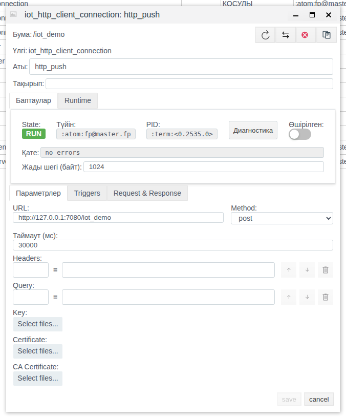
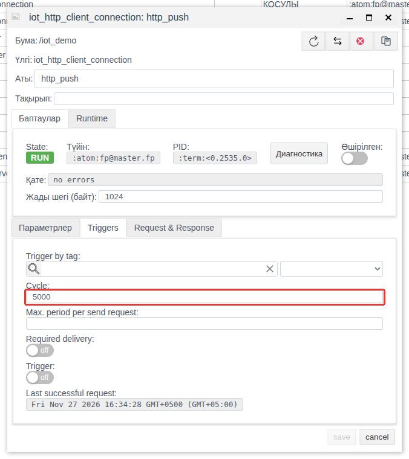
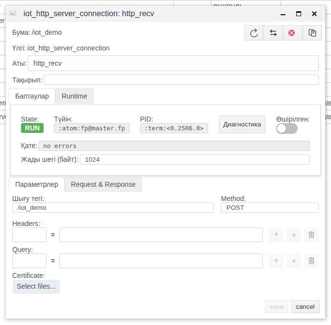
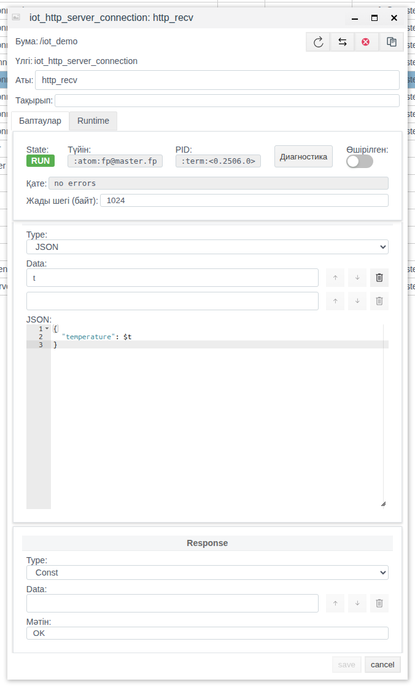

# HTTP-қосылымдар

Бұл құжат интегратор инженерге арналған. Жалпы ұғымдар (рөлдер, **Data** айнымалылары, хабарлама пішімі, **Triggers** қойындысы, диагностика) [«IoT-қосылымдар»](IoT.md) құжатында сипатталған.

# Мазмұны

- [Кіріспе](#кіріспе)
- [Негізгі бөлім](#негізгі-бөлім)
    - [iot_http_client_connection](#iot_http_client_connection)
    - [iot_http_server_connection](#iot_http_server_connection)
- [Қорытынды](#қорытынды)

# Кіріспе

HTTP-қосылымдар FACEPLATE жүйесін веб-сервистермен байланыстырады: `iot_http_client_connection` сұрауларды өзі жібереді, `iot_http_server_connection` сыртқы жүйелердің сұрауларын қабылдайды. Құжаттағы мысал — бір FACEPLATE ішіндегі клиент → сервер жұбы: `t_src` тегінің мәні `t_dst` тегіне түседі.

Жобаны өзгерту құқығы бар тіркелгімен Studio ортасына (`http://<сервер>:9000/fp/studio`) кіру мүмкіндігі қажет.

# Негізгі бөлім

## iot_http_client_connection

HTTP-клиент: **Triggers** қойындысындағы шарт бойынша **URL** мекенжайына сұрау жіберіп, жауапты талдайды.

| Өріс (**Параметрлер** қойындысы) | Мақсаты | Әдепкі мәні |
|---|---|---|
| **URL** | Сервистің толық мекенжайы: `http://...` немесе `https://...` | `http://127.0.0.1:7080/myserver` |
| **Method** | Сұраудың HTTP-әдісі | `get` |
| **Таймаут (мс)** | Жауапты күту уақыты | `30000` |
| **Headers**, **Query** | Сұрау жолының тақырыптары мен параметрлері: атау = мән. Мәнге сұрау айнымалысын қоюға болады: `${атау}` | бос |
| **Key**, **Certificate**, **CA Certificate** | HTTPS үшін клиенттің кілті мен сертификаттары | жүктелмеген |

- Сұраудың **Type** мәні `Content-Type` тақырыбын береді: **Const** үшін `text/plain`, **JSON** үшін `application/json`, **Скрипт** үшін `application/octet-stream`.
- 4xx немесе 5xx кодты жауап қате болып саналады және **Қате** өрісіне шығарылады.

Мысал — `t_src` мәнін келесі бөлімдегі `http_recv` серверіне әр 5 секунд сайын жіберетін `http_push` клиенті:

1. `iot_demo` бумасында `iot_http_client_connection` түріндегі `http_push` жасаңыз. **Параметрлер**: **URL** `http://127.0.0.1:7080/iot_demo`, **Method** `post`. **Таймаут (мс)** әдепкі күйінде қалсын.

   

2. **Triggers** қойындысы: **Cycle** `5000` — жіберу кезеңі, мс. Бұл **Параметрлер** қойындысындағы **Таймаут (мс)** емес: таймаут әр сұрауға жауап күтуді шектейді.

   

3. **Request & Response**, **Request**: **Type** `JSON`, **Data** `t`, үлгі `{"temperature": $t}`. **Response**: **Type** `Const`. Сақтаңыз.
4. `http_push` ішінде `iot_tag_source` түріндегі `from_t_src` жасаңыз: `t` — `/iot_demo/t_src` — `value`.

Бірнеше секундтан кейін `t_dst` тегінде `21.5`, ал **Last successful request** өрісінде сұрау уақыты пайда болады.

## iot_http_server_connection

HTTP-сервер: **Шығу тегі** жолына келген сұрауларды қабылдайды, деректерді әрекеттерге береді және **Response** хабарламасымен жауап береді. FACEPLATE серверлері 7080 (HTTP) және 7443 (HTTPS) порттарын тыңдайды.

| Өріс (**Параметрлер** қойындысы) | Мақсаты | Әдепкі мәні |
|---|---|---|
| **Шығу тегі** | Сұраулар қабылданатын жол. Толық мекенжай: `http://<сервер>:7080<Шығу тегі>`. Жол жобаның HTTP-серверлері арасында бірегей | бос (`/myserver` кеңесі) |
| **Method** | Қабылданатын әдіс. Өріс міндетті, мән регистрді ескеріп салыстырылады: бас әріппен жазыңыз (`POST`, `GET`, `PUT`) | бос (`post` кеңесі) |
| **Headers**, **Query** | Сервер сұраудан алатын тақырыптар мен сұрау жолының параметрлері: атау = сұрауда болмаған жағдайдағы мән | бос |
| **Certificate** | Кіруге рұқсат етілген клиенттердің сертификаттары. Файл жүктелсе, жарамды клиент сертификаты жоқ сұраулар `401 Access denied` алады | жүктелмеген |

| Сервердің жауабы | Қашан |
|---|---|
| `200` және **Response** мәтіні | Сұрау өңделді |
| `404` | Жол бірде-бір қосулы сервердің **Шығу тегі** мәніне сәйкес келмейді |
| `405 Method not allowed` | Әдіс **Method** мәніне, соның ішінде регистрі бойынша, сәйкес келмейді |
| `500 Internal error` | Өңдеу қатесі: кіріс JSON үлгіге сәйкес келмеді, дереккөз немесе скрипт қатесі |

Мысал — алынған температураны `t_dst` тегіне жазатын `http_recv` сервері:

1. `iot_demo` бумасында `iot_http_server_connection` түріндегі `http_recv` жасаңыз. **Параметрлер**: **Шығу тегі** `/iot_demo`, **Method** `POST`.

   

2. **Request & Response**, **Request**: **Type** `JSON`, **Data** `t`, үлгі `{"temperature": $t}`. **Response**: **Type** `Const`, **Мәтін** `OK`. Сақтаңыз.

   

3. `http_recv` ішінде `iot_tag_action` түріндегі `to_t_dst` жасаңыз: `t` — `/iot_demo/t_dst` — `value`.

Кез келген HTTP-клиентпен тексеру:

```
curl -X POST -d '{"temperature": 23.4}' http://<сервер>:7080/iot_demo
```

Жауап — `OK`, `t_dst` тегіне `23.4` жазылды.

# Қорытынды

- HTTP-серверде **Method** бас әріппен жазылады, **Шығу тегі** жобада бірегей болады.
- HTTP-клиентке **Triggers** қойындысында жіберу шартын беріңіз.
- Серверді `curl` сұрауымен тексеріп, клиенттегі **Қате** өрісін қараңыз.
